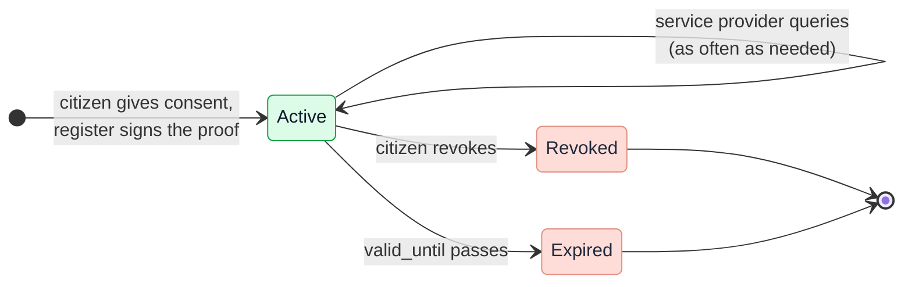

# Consent facility

The consent facility (toestemmingsvoorziening) is where the citizen gives, views and revokes
consent. It also tells every source, at every request, whether a consent
still holds. It has three components: the consent portal (toestemmingsportaal) frontend
and backend (PSA capability
[S02](https://ictu.github.io/GBO-PSA/main/capabilities/#s02-toestemmingsportaal))
and the consent register (toestemmingsregister)
([S01](https://ictu.github.io/GBO-PSA/main/capabilities/#s01-toestemmingsregistratie)).
The [Consent](../../concepts/consent.md) concept page has the detail and
the links to the code.

[Overview](../index.md) › [DvTP channel](index.md) › Consent facility

## Components and interfaces

```mermaid
flowchart LR
  burger(["Citizen<br/>browser"])
  dv["Service provider"]
  subgraph tv["Consent facility"]
    direction TB
    pf("Portal frontend<br/>request, login, choice,<br/>overview, revoke")
    pb("Portal backend<br/>keeps the BSN away<br/>from the register")
    subgraph tr["Consent register"]
      direction TB
      api("Portal API<br/>create, list, revoke")
      st("Status listener<br/>status only")
      jw("JWKS<br/>public keys")
      db[("Consents,<br/>PI + PP per citizen")]
    end
  end
  digid["DigiD<br/><i>mock</i>"]
  bsnk["BSNk PP<br/><i>mock</i>"]
  inw("Register Inway<br/>FSC service consent-status")
  pdp("PDP of a source")
  log[("LDV logbook<br/>consent facility")]

  dv -- "redirect: consumer, service,<br/>data sets, return address" --> pf
  burger --> pf
  pf -- "login" --> digid
  pf --> pb
  pb -- "activate once,<br/>transform per consent" --> bsnk
  pb -- "only the backend" --> api
  api --- db
  st --- db
  pf -- "proof in the URL fragment" --> dv
  pdp -- "over FSC" --> inw --> st
  pdp -. "keys, cached 5 min" .-> jw
  api -.-> log
  st -.-> log
--8<-- "mermaid/classes.mmd"
  class burger source
  class dv,digid,bsnk ext
  class pf,pb,api,st,jw dvtp
  class db,log store
  class inw,pdp basis
  class pdp,bsnk zoom
  style tv fill:#F4F5F7,stroke:#E28F80
  style tr fill:#FFFFFF,stroke:#E28F80
  click pdp "../../gbo-basis/authorization/" "Authorization"
  click bsnk "../../../concepts/pseudonymization/" "Pseudonymization"
```

*Figure 1: The components of the consent facility and their
interfaces.*
{: .caption }

Each component has one job:

| Component | Job | Never does |
|---|---|---|
| Portal frontend | Shows the request in plain language, one choice per data set. Shows the consents of the citizen and lets the citizen revoke one. | Picks fields inside a data set ([REQ-10](../../requirements/consent.md#req-10)) |
| Portal backend | Recognizes the citizen with a keyed hash of the BSN. Asks BSNk for the values per source. Talks to the register. | Sends a BSN to the register ([REQ-23](../../requirements/consent.md#req-23)) |
| Register: portal API | Creates, lists and revokes consents. Signs the consent proof. Only the portal backend can call it. | Serves the status to a source |
| Register: status listener | Answers one question per request: is this consent active? It is reachable only over FSC. | Serves anything else |
| Register: JWKS | Publishes the public keys that the PDP uses to check a proof. | — |

## The consent proof

The register signs a consent proof when the citizen gives consent. The
service provider (dienstverlener) keeps it and sends it unchanged with every query:

```mermaid
flowchart LR
  subgraph jwt["Consent proof: ES256 JWT, type gbo-consent+jwt"]
    direction TB
    h["Header<br/>algorithm, type, key ID"]
    subgraph claims["Claims"]
      direction TB
      id["consent_id · jti"]
      sc["scopes · scope_entries<br/>data sets per source"]
      who["dienstverlener_oin<br/>the party it is for"]
      t["valid_until = exp<br/>iss · aud · iat · nbf"]
      subgraph es["encrypted_subject: one entry per source OIN"]
        direction LR
        vp["pseudonym (VP)<br/>for every source"]
        vi["identity (VI)<br/>only for a source that<br/>may process the BSN"]
      end
    end
  end
  sig["Signature of<br/>the register"]
  jwt --- sig
--8<-- "mermaid/classes.mmd"
  class h,id,sc,who,t dvtp
  class vp,vi store
  class sig ext
  style jwt fill:#FFFFFF,stroke:#E28F80
  style claims fill:#F4F5F7,stroke:#D1D5DB
  style es fill:#F5F3FF,stroke:#7C3AED
```

*Figure 2: The parts of the consent proof.*
{: .caption }

The proof holds no BSN. The service provider can read which data sets it
can ask for. It cannot read who the citizen is: each value in
`encrypted_subject` can be decrypted only by the source it was made for
([REQ-80](../../requirements/pseudonymization.md#req-80)). The
decision for this form is
[ADR-0032](../../decisions/0032-consent-proof.md).

The proof works as a bearer token. The binding to the service provider stops
use by another party, but not replay by the same party within the
validity ([R4](../../risks.md#r4)).

## Life of a consent



*Figure 3: The states of a consent.*
{: .caption }

The register stores `ACTIVE` or `REVOKED`. Expired follows from the
date in the proof. A consent can be used again within its validity: the
design does not require single use
([Q-04](../../traceability/answered-questions.md#q-04)). A revocation
takes effect on the next request, because the PDP asks the status every
time ([REQ-14](../../requirements/consent.md#req-14)).

## Why the status stays online

The proof carries the content of the consent, and the register keeps the
status. Each part has its own freshness:

| What | How fresh | Why |
|---|---|---|
| Content: data sets, party, validity | Fixed at consent, checked locally | The register signed it. The PDP needs no call for it. |
| Public keys | At most five minutes old | Keys change rarely. An unknown key ID triggers a fetch at once. |
| Status | Live at every request | A revocation must stop the next request. |

The price is a hard dependency: if the register does not answer, the PDP
denies every DvTP request ([REQ-75](../../requirements/consent.md#req-75)).
The target values for availability and delay are open
([Q-47](../../traceability/open-questions.md#q-47)).

## Open points

The main open points in the consent facility are these:

- Whether the register and the portal backend are one system, and which
  one is the BSNk participant
  ([Q-49](../../traceability/open-questions.md#q-49)).
- Who sets the validity period, and whether the citizen can change it
  ([Q-13](../../traceability/open-questions.md#q-13)).
- When a consent counts as "retrieved", and how the register learns that
  ([Q-42](../../traceability/open-questions.md#q-42)).
- Where the signing key lives and how it rotates
  ([Q-55](../../traceability/open-questions.md#q-55)).
- Whether the register must authenticate the portal backend, or whether
  network isolation is enough
  ([Q-58](../../traceability/open-questions.md#q-58)).

## Traceability

- Requirements: [REQ-10](../../requirements/consent.md#req-10),
  [REQ-14](../../requirements/consent.md#req-14),
  [REQ-23](../../requirements/consent.md#req-23),
  [REQ-68](../../requirements/consent.md#req-68),
  [REQ-75](../../requirements/consent.md#req-75),
  [REQ-76](../../requirements/consent.md#req-76),
  [REQ-80](../../requirements/pseudonymization.md#req-80)
- Findings: [F-61](../../traceability/findings-closed.md#f-61) (closed),
  [F-78](../../traceability/findings.md#f-78) (open)
- Open questions: [Q-04](../../traceability/answered-questions.md#q-04) (answered),
  [Q-13](../../traceability/open-questions.md#q-13) (open),
  [Q-42](../../traceability/open-questions.md#q-42) (open),
  [Q-47](../../traceability/open-questions.md#q-47) (open),
  [Q-49](../../traceability/open-questions.md#q-49) (open),
  [Q-55](../../traceability/open-questions.md#q-55) (open),
  [Q-58](../../traceability/open-questions.md#q-58) (open)
- Demo increments: [SL-11](../../traceability/increments.md#sl-11) (done),
  [SL-47](../../traceability/increments.md#sl-47) (done),
  [SL-51](../../traceability/increments.md#sl-51) (done)
