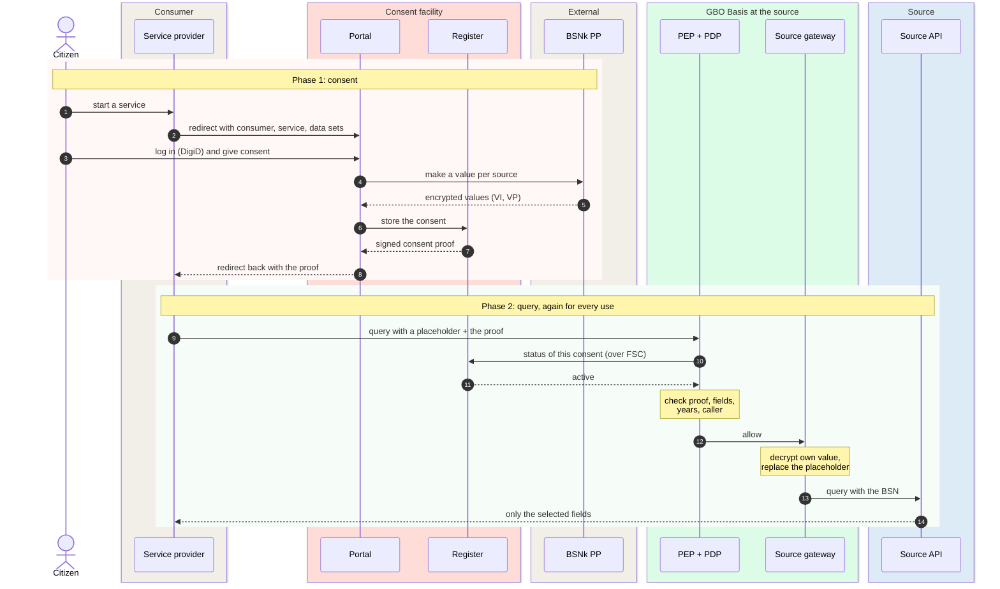

# DvTP channel

In the DvTP channel, a private service provider (dienstverlener) gets source data about a
citizen, with the consent of that citizen. The channel adds two things to
GBO Basis. In the consent facility (toestemmingsvoorziening), the citizen gives and revokes
consent. The pseudonymization facility (pseudonimiseervoorziening) of BSNk makes sure that the
service provider never gets a BSN. This is interaction pattern C of the
[Globaal Ontwerp](https://ictu.github.io/GBO-GO/main/#patroon-c-gegevensverzoek-van-private-dienstverlener-dvtp).

[Overview](../index.md) › DvTP channel

## Inside the channel

```mermaid
flowchart LR
  burger(["Citizen"])
  subgraph cons["Consumer side"]
    direction TB
    dv["Service provider"]
    int["Integrator<br/><i>optional</i>"]
  end
  subgraph tv["Consent facility"]
    direction LR
    pf("Portal<br/>frontend") --> pb("Portal<br/>backend") --> tr[("Toestemmings-<br/>register")]
  end
  subgraph ext["External services"]
    direction LR
    digid["DigiD<br/><i>mock</i>"]
    bsnk["BSNk PP<br/><i>mock</i>"]
  end
  subgraph basis["GBO Basis, at each source"]
    direction LR
    pdp("PEP + PDP") --> gw("Source<br/>gateway") --> api[("Source<br/>BD · LVG")]
  end

  burger -- "uses a service" --> dv
  dv -- "① redirect" --> pf
  pf -. "login" .-> digid
  pb -. "at consent only" .-> bsnk
  dv <-- "② consent proof" --- tr
  dv -- "③ query + proof<br/>over FSC" --> pdp
  int -. "on behalf of" .-> pdp
  pdp -- "④ status<br/>over FSC" --> tr

--8<-- "mermaid/classes.mmd"
  class burger,api source
  class dv,int,digid,bsnk ext
  class pf,pb,tr dvtp
  class pdp,gw basis
  class pf,pb,tr,pdp,bsnk,int zoom
  style tv fill:#F4F5F7,stroke:#E28F80
  style basis fill:#F4F5F7,stroke:#16A34A
  style cons fill:#F4F5F7,stroke:#D1D5DB
  style ext fill:#F4F5F7,stroke:#D1D5DB

  click pf "consent-service/" "Toestemmingsvoorziening"
  click pb "consent-service/" "Toestemmingsvoorziening"
  click tr "consent-service/" "Toestemmingsvoorziening"
  click pdp "../gbo-basis/authorization/" "Authorization"
  click bsnk "../../concepts/pseudonymization/" "Pseudonymization"
  click int "../../runtime/dvtp-query/#variant-an-integrator-calls-for-the-consumer" "Integrator variant"
```

*Figure 1: The DvTP channel. Pink: GBO components of the channel. Green:
GBO Basis at the source.*
{: .caption }

The channel has these parts:

| Part | Role | Zoom in |
|---|---|---|
| Consent facility | The citizen sees the request, logs in, and gives or refuses consent. Later the citizen views and revokes consents. The register signs a consent proof and answers the status of a consent. | [consent facility](consent-service.md) |
| Pseudonymization facility | BSNk PP turns the BSN into values that only one party can read. The channel calls it only when a citizen gives consent. | [Pseudonymization](../../concepts/pseudonymization.md) |
| Service provider | Starts the request, keeps the proof, and sends it with every query. It never gets a BSN or another number for the citizen. | [DvTP query](../../runtime/dvtp-query.md) |
| Integrator | A software party that calls the source for a service provider, under an FSC delegation and a registered mandate. | [ADR-0034](../../decisions/0034-integrator-delegation.md) |
| GBO Basis | Checks the proof and the consent status for every request, and fills in the citizen only after an allow. | [GBO Basis](../gbo-basis/index.md) |

## Two phases

The channel works in two phases, as in the Globaal Ontwerp. In phase 1,
the citizen gives consent. In phase 2, the service provider queries a source
under that consent, as often as the consent allows:



*Figure 2: The two phases of DvTP. Every step names the essence only.
The runtime pages have every hop.*
{: .caption }

For every hop, with the data and the error paths, see
[DvTP consent](../../runtime/dvtp-consent.md) and
[DvTP query](../../runtime/dvtp-query.md). Viewing and revoking a consent
is a third flow: [DvTP citizen access](../../runtime/dvtp-citizen-access.md).

## Who sees which identifier

The channel is built so that the BSN appears in as few places as
possible. The service provider holds no identifier for the citizen at all:

```mermaid
flowchart LR
  subgraph bsn["Sees the BSN"]
    direction TB
    pb("Portal backend<br/>at login and consent")
    bk["BSNk PP"]
    gw("Source gateway<br/>after the allow")
    api[("Source API")]
  end
  subgraph pseudo["Sees only pseudonymous values"]
    direction TB
    tr[("Register<br/>PI, PP under its<br/>own reference")]
    pdp("PDP<br/>checks the proof,<br/>not the person")
  end
  subgraph none["Sees no identifier"]
    direction TB
    dv["Service provider<br/>proof + placeholder"]
    int["Integrator"]
  end
--8<-- "mermaid/classes.mmd"
  class pb,tr dvtp
  class bk,dv,int ext
  class gw,pdp basis
  class api source
  style bsn fill:#FFF1F0,stroke:#E28F80
  style pseudo fill:#FFF7ED,stroke:#EA580C
  style none fill:#F0FDF4,stroke:#16A34A
```

*Figure 3: Where the BSN can appear in the DvTP channel.*
{: .caption }

The consent proof carries one encrypted value per source. Only that source
can decrypt its value. The value becomes the own pseudonym of the source,
or the BSN if the source has the right to process the BSN
([ADR-0032](../../decisions/0032-consent-proof.md),
[ADR-0033](../../decisions/0033-gateway-decrypts-after-allow.md)). In its
query, the service provider names the citizen with a fixed placeholder.

This has a cost. The service provider cannot recognize the same citizen
across two consents, and it logs under the consent, not under the person
([F-76](../../traceability/findings.md#f-76)).

## Compared with the Globaal Ontwerp

The demo follows pattern C of the Globaal Ontwerp. It differs in the form
of three steps:

| Step | Globaal Ontwerp | Demo v0.9.0 |
|---|---|---|
| What the service provider gets | A consent ID and an encrypted identity | A signed consent proof that holds the consent ID and an encrypted value per source |
| What the register stores | The encrypted identity, scope, purpose, validity | The consent, plus the polymorphic values of the citizen under its own reference. No encrypted values per source |
| Who checks the consent | The source holder (bronhouder) asks the register | The PDP of the source checks the proof itself, then asks the register for the status over FSC |

The design choice behind these differences is in
[ADR-0032](../../decisions/0032-consent-proof.md). Whether the register and
the portal backend are one system, and which of them talks to BSNk, is
open ([Q-49](../../traceability/open-questions.md#q-49),
[ADR-0040](../../decisions/0040-route-d-citizen-recognition.md)).

## Open points

The main open points in the DvTP channel are these:

- Whether a private service provider without a public task can connect to
  BSNk PP at all ([Q-01](../../traceability/open-questions.md#q-01)).
- Who sets the validity period of a consent
  ([Q-13](../../traceability/open-questions.md#q-13)).
- Whether the proof must also name the integrator
  ([Q-46](../../traceability/open-questions.md#q-46)).
- The values in the proof are fixed at consent: a source that joins later
  needs a new consent ([F-78](../../traceability/findings.md#f-78)).

## Traceability

- Requirements: [REQ-12](../../requirements/consent.md#req-12),
  [REQ-20](../../requirements/pseudonymization.md#req-20),
  [REQ-21](../../requirements/pseudonymization.md#req-21),
  [REQ-37](../../requirements/consent.md#req-37),
  [REQ-68](../../requirements/consent.md#req-68),
  [REQ-79](../../requirements/pseudonymization.md#req-79),
  [REQ-106](../../requirements/consent.md#req-106)
- Findings: [F-76](../../traceability/findings.md#f-76) (open),
  [F-78](../../traceability/findings.md#f-78) (open)
- Open questions: [Q-01](../../traceability/open-questions.md#q-01) (partly answered),
  [Q-13](../../traceability/open-questions.md#q-13) (open),
  [Q-46](../../traceability/open-questions.md#q-46) (open),
  [Q-49](../../traceability/open-questions.md#q-49) (open)
- Demo increments: [SL-06a](../../traceability/increments.md#sl-06a) (done),
  [SL-47](../../traceability/increments.md#sl-47) (done),
  [SL-51](../../traceability/increments.md#sl-51) (done)
