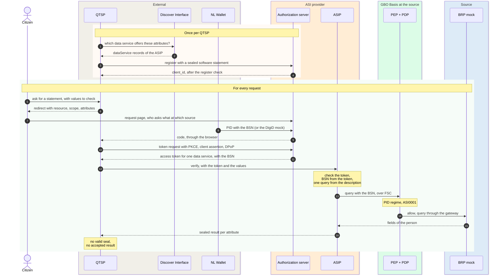

# ASI provider

The ASI provider lets a qualified trust service provider (QTSP) verify or
retrieve attributes of a citizen at the authentic source. The exchange
follows eIDAS article 45e and ETSI TS 119 478, clause 6.1. It is flow B of
interaction pattern A in the
[Globaal Ontwerp](https://ictu.github.io/GBO-GO/main/#verificatie-en-retrievedienst-voor-qtsps-asi-provider).
GBO offers it as an OAuth front door with two services: the Authentic
Source Interface Provider (ASIP) and its own authorization server
([ADR-0037](../../decisions/0037-asi-oauth-front-door.md)). The
[ASI verification](../../runtime/asi-verification.md) runtime page has
every hop and the links to the code.

[Overview](../index.md) › [EUDI wallet channel](index.md) › ASI provider

## Components and interfaces

```mermaid
flowchart LR
  burger(["Citizen"])
  subgraph outer["External roles"]
    direction TB
    qtsp["QTSP<br/><i>reference QTSP</i>"]
    dip["Discover Interface<br/><i>stub</i>"]
    reg[("Register of<br/>relying parties<br/><i>stub</i>")]
    wallet["NL Wallet"]
  end
  subgraph asi["ASI provider"]
    direction TB
    as("Authorization server<br/>registration, login, tokens")
    wv("Wallet verifier<br/>nl-wallet")
    dg["DigiD mock"]
    asip("ASIP<br/>data service brp")
  end
  rel[("Source registry<br/>asi description")]
  subgraph basis["GBO Basis at the source"]
    direction TB
    pdp("PEP + PDP<br/>rule ASI0001")
    src[("BRP mock")]
  end

  qtsp -- "① find the data service" --> dip
  dip -. "records" .-> asip
  qtsp -- "② register, get a token" --> as
  as -. "entitlement" .-> reg
  burger -- "③ log in" --> as
  wallet -- "PID" --> wv
  as --- wv
  as --- dg
  qtsp -- "④ verify, retrieve" --> asip
  asip -. "token keys" .-> as
  rel -. "every 5 s" .-> asip
  asip -- "query + BSN<br/>over FSC" --> pdp
  pdp --> src
--8<-- "mermaid/classes.mmd"
  class burger,src source
  class qtsp,dip,reg,dg mock
  class wallet ext
  class as,wv,asip eudi
  class rel store
  class pdp basis
  class as,asip,rel,pdp zoom
  style outer fill:#F4F5F7,stroke:#D1D5DB
  style asi fill:#F4F5F7,stroke:#EA580C
  style basis fill:#F4F5F7,stroke:#16A34A
  click as "#trust-boundary" "Trust boundary"
  click asip "#the-verify-and-retrieve-flow" "Verify and retrieve"
  click rel "../../../concepts/source-onboarding/#the-asi-capability-schema-11" "The asi capability"
  click pdp "../../gbo-basis/authorization/#the-rules" "The rules"
```

*Figure 1: The components of the ASI provider and their interfaces. Grey
dashed: stubs and the reference QTSP. Thick border: click to zoom in.*
{: .caption }

Each component has one job:

| Component | Job | In demo v0.9.0 |
|---|---|---|
| ASIP | Offers verify and retrieve per data service at `/<ds>/authsrc-api`. Checks the DPoP-bound token first and takes the BSN only from the token ([REQ-87](../../requirements/asi.md#req-87)). Seals every 200 response. | Real |
| Authorization server | Registers a QTSP, shows the request page, runs the login, and issues a DPoP-bound token of 10 minutes for one data service. | Real. It keeps the registered clients in memory. |
| Wallet verifier | The nl-wallet verification server. It runs the PID disclosure for the login and asks for the BSN ([REQ-102](../../requirements/asi.md#req-102)). | Real. It also serves the login of the reference QTSP, as a demo shortcut. |
| DigiD mock | A second means to log in. | Stub. It checks for nine digits and gives only a BSN ([F-88](../../traceability/findings.md#f-88)). |
| Register of relying parties | Holds the entitlement `QEAA_Provider` of each QTSP. | Stub: a file |
| Discover Interface | An external role. Tells a QTSP which data service offers an attribute, from the records of the ASIP. | Stub |
| Reference QTSP | An external role. Discovers, registers, gets a token, verifies, and checks the seal. | Real client behavior. It is not a real QTSP. |

## Trust boundary

The QTSP and the source belong to two trust domains. The ASIP is the only
part that acts in both:

```mermaid
flowchart LR
  subgraph oauth["OAuth trust, outside FSC"]
    direction TB
    qtsp["QTSP<br/>OAuth client"]
    cert["QTSP certificate<br/>organizationIdentifier"]
    ent[("Register entry<br/>QEAA_Provider")]
    as("Authorization server")
  end
  asip("ASIP<br/>FSC peer …1200")
  subgraph fsc["FSC trust, inside the GBO chain"]
    direction TB
    inw("PEP + PDP<br/>rule ASI0001")
    src[("BRP mock")]
  end
  qtsp -- "software statement" --> as
  as -. "chain to a trust anchor" .-> cert
  as -. "lookup, every hour" .-> ent
  qtsp -- "DPoP token" --> asip
  asip -- "actor is the ASIP peer,<br/>nothing about the QTSP" --> inw
  inw --> src
--8<-- "mermaid/classes.mmd"
  class qtsp,ent mock
  class cert ext
  class as,asip eudi
  class inw basis
  class src source
  class inw zoom
  style oauth fill:#FFF7ED,stroke:#EA580C
  style fsc fill:#F0FDF4,stroke:#16A34A
  click inw "../../gbo-basis/authorization/" "Authorization"
```

*Figure 2: The trust boundary of the ASI route
([F-87](../../traceability/findings.md#f-87)).*
{: .caption }

The QTSP is an OAuth client of the authorization server. It has no FSC
peer, no OIN and no PKIoverheid certificate. The reference architecture
placed the interface in front of the FSC chain. The demo showed that this
placement does not fit a QTSP, so the QTSP trust ends before FSC
([ADR-0037](../../decisions/0037-asi-oauth-front-door.md)).

The admission of a QTSP has two parts
([REQ-88](../../requirements/asi.md#req-88)):

- The QTSP registers with a software statement, sealed with its
  certificate. The authorization server checks the chain and the
  `organizationIdentifier`.
- The register entry must carry `QEAA_Provider` and the same
  `organizationIdentifier`. The server checks the entry again every hour
  ([REQ-89](../../requirements/asi.md#req-89)). If the register does not
  answer, the client stays active
  ([Q-34](../../traceability/open-questions.md#q-34)).

The ASIP is an FSC consumer peer of its own, with a contract for the
service `brp` at the source. For the PDP, the actor is always the ASIP.
Rule ASI0001 grants the ASIP peer the BRP fields behind the attributes, on
`brp` only. The rule does not check the token or the QTSP. The PDP input
and the ADL hold the BSN
([REQ-60](../../requirements/logging-audit.md#req-60)).

## The verify and retrieve flow

A verification runs through discovery, registration, authorization with a
login, the token, the query through GBO Basis, and the seal:



*Figure 3: Verify through the ASI provider, at essence level.*
{: .caption }

The login is the approval ([REQ-90](../../requirements/asi.md#req-90)).
Before the login, the request page shows the legal name of the QTSP, the
operation, the source, and the attributes
([REQ-91](../../requirements/asi.md#req-91)). If the citizen refuses, no
login takes place and the source gets no request.

Retrieve runs the same way, with the scope `retrieve`. The request names
attribute identifiers without values, and the sealed answer carries the
values. If the source holds no value for one attribute, the answer is 404,
without a partial result ([REQ-101](../../requirements/asi.md#req-101)).

After an accepted result, the reference QTSP issues a test statement to
the wallet. It uses the issuance server of the
[PubEAA provider](pubeaa.md). The statement has a test marking and is not
a QEAA.

## One data service per source

An ASIP that serves several sources offers one data service per source
([ADR-0038](../../decisions/0038-asi-data-service-per-source.md)). Each
data service has its own base URL, contract, discovery records and token
audience:

```mermaid
flowchart LR
  qtsp["QTSP"]
  subgraph asip["ASIP"]
    direction TB
    ds1("Data service brp<br/>/brp/authsrc-api")
    ds2("Data service of<br/>a second source<br/><i>unit tests only</i>")
  end
  s1[("RvIG<br/>BRP mock")]
  s2[("Second source")]
  qtsp -- "token 1, audience brp" --> ds1
  qtsp -. "token 2, second login" .-> ds2
  ds1 --> s1
  ds2 -.-> s2
--8<-- "mermaid/classes.mmd"
  class qtsp mock
  class ds1 eudi
  class ds2,s2 planned
  class s1 source
  style asip fill:#F4F5F7,stroke:#EA580C
```

*Figure 4: One data service and one token per source. Dashed: only in unit
tests in demo v0.9.0.*
{: .caption }

ETSI lets a response name one authentic source. Article 9(4) requires that
the result names the responsible body
([F-89](../../traceability/findings.md#f-89),
[REQ-94](../../requirements/asi.md#req-94)). An authorization request
names exactly one data service as `resource`, or the answer is
`invalid_target`. The ASIP refuses a token for another data service with
401 ([REQ-95](../../requirements/asi.md#req-95)). A QTSP that needs
attributes of two sources authorizes twice, and the citizen logs in twice.

By default, a token binds per operation, as ETSI specifies. A QTSP can
also bind the token to the attributes with `authorization_details`. The
ASIP then refuses any other attribute
([ADR-0042](../../decisions/0042-asi-attribute-token-binding.md),
proposed, [Q-33](../../traceability/open-questions.md#q-33)).

## Attributes described by the source

The source describes the attributes that it offers, in the `asi`
capability of its source document
([ADR-0039](../../decisions/0039-asi-source-described-attributes.md)). The
ASIP has no source knowledge in its code:

```mermaid
flowchart LR
  subgraph doc["Source document: capabilities.asi"]
    direction TB
    au["authentic_source<br/>legal name, country"]
    gq["graphql<br/>query that ends in ...Selected"]
    at["attributes<br/>identifier and fields"]
  end
  ops["pointer · join · const · each"]
  cat[("GBO attribute catalog<br/>value_schema per identifier")]
  rec("Reconciler<br/>validates, promotes")
  rel[("Active release")]
  asip("ASIP<br/>one query per request,<br/>only the needed fields")
  au --> rec
  gq --> rec
  at --> rec
  at --- ops
  cat -.-> rec
  rec --> rel
  rel -- "every 5 s" --> asip
--8<-- "mermaid/classes.mmd"
  class au,gq,at,ops source
  class cat,rel store
  class rec basis
  class asip eudi
  class rec zoom
  style doc fill:#FFFFFF,stroke:#6F94B8,stroke-dasharray:4 3
  click rec "../../../concepts/source-onboarding/#the-asi-capability-schema-11" "The asi capability"
```

*Figure 5: From the `asi` capability to one query per request.*
{: .caption }

Each attribute has an identifier from the GBO catalog and the source fields
per member of the value. Four operations build a value: `pointer`, `join`,
`const` and `each`. A house number, for example, is three BRP fields. For
each request, the ASIP replaces `...Selected` with the fields of the
requested attributes only ([REQ-92](../../requirements/asi.md#req-92)).

The identifiers and their value schemas are provisional until the EU
catalog of attributes exists
([Q-31](../../traceability/open-questions.md#q-31)). If the `asi` part has
an error, the reconciler refuses the whole source, with its EUDI issuance.
In demo v0.9.0, the authorization server takes its list of data services
from configuration (`AZSP_RESOURCES`). The source descriptions do not feed
that list ([Q-38](../../traceability/open-questions.md#q-38)).

## Results and the seal

The ASIP builds each value from the source fields and compares it with the
value that the QTSP sent. Each attribute gets one of four results:

```mermaid
flowchart LR
  q("Query over FSC")
  f[("Fields from<br/>the source")]
  b("Build the value<br/>from the description")
  c{"Compare with the<br/>value of the QTSP"}
  m(["Match"])
  mv(["MatchWithVariation<br/>free text only"])
  nm(["NoMatch"])
  u(["Unknown<br/>the source has no value"])
  e(["503 or 500<br/>never Unknown"])
  s("Seal: detached JWS<br/>ES256, x5c")
  r["200 with<br/>X-JWS-Signature"]
  q --> f
  q -. "no answer, or a deny" .-> e
  f --> b --> c
  c --> m
  c --> mv
  c --> nm
  f -. "no value" .-> u
  m & mv & nm & u --> s
  s --> r
--8<-- "mermaid/classes.mmd"
  class q basis
  class f source
  class b,c,m,mv,nm,u,s eudi
  class e dvtp
  class r ext
```

*Figure 6: The result per attribute, and the seal on the response. Red: an
error, never a result.*
{: .caption }

Three rules apply to the results:

- `Unknown` means only that the source holds no value
  ([REQ-84](../../requirements/asi.md#req-84)). A chain that does not
  answer gives 503 ([REQ-93](../../requirements/asi.md#req-93)). A PDP deny
  or GraphQL errors give 500.
- A verify response holds no source value
  ([REQ-85](../../requirements/asi.md#req-85)). `MatchWithVariation` also
  returns no value. The conformance matrix records that row as failing
  ([F-92](../../traceability/findings.md#f-92)).
- Fuzzy matching applies only to strings without a `format`
  ([REQ-113](../../requirements/asi.md#req-113)).

From January 1, 2027, every verification result must be sealed
([REQ-83](../../requirements/asi.md#req-83)). The ASIP seals the exact
body of every 200 response with a detached JWS in `X-JWS-Signature`
([ADR-0041](../../decisions/0041-asi-seal-format.md), proposed). It does
not seal errors. The QTSP refuses a result without a valid seal. ETSI
defines no seal format, so the format waits for a decision
([Q-32](../../traceability/open-questions.md#q-32)). The demo seals with a
development certificate, and it is open who holds the qualified seal
certificate in production ([Q-28](../../traceability/open-questions.md#q-28)).

## Compared with the Globaal Ontwerp

The demo follows flow B of pattern A. It differs in four steps:

| Step | Globaal Ontwerp | Demo v0.9.0 |
|---|---|---|
| Authorization | The verify and retrieve service uses the Autorisatievoorziening of GBO. | The ASI provider has its own OAuth authorization server, as ETSI clause 6.1.3 describes ([ADR-0037](../../decisions/0037-asi-oauth-front-door.md)). |
| Approval | The wallet shows the request and asks for consent. | The citizen logs in with the NL Wallet or the DigiD mock. The demo stores no approval ([REQ-90](../../requirements/asi.md#req-90)). |
| ISO 15000 | A request over ISO 15000 needs no authorization. | Clause 6.2 is not offered ([REQ-112](../../requirements/asi.md#req-112)). |
| After an accepted result | The QTSP issues a QEAA. | The reference QTSP issues a test statement that is not qualified. |

## Open points

The main open points in the ASI provider are these:

- The QTSP can read the BSN in the access token
  ([F-86](../../traceability/findings.md#f-86),
  [#595](https://github.com/ICTU/GBO-demo/issues/595)).
- The register of relying parties and the certificate profile for QTSPs do
  not exist ([F-85](../../traceability/findings.md#f-85)).
- Nothing links the citizen who logs in at the QTSP to the citizen who
  logs in at the authorization server
  ([F-93](../../traceability/findings.md#f-93),
  [Q-40](../../traceability/open-questions.md#q-40)).
- The NL PID has no place of birth, and the DigiD mock gives only the BSN
  ([F-94](../../traceability/findings.md#f-94),
  [F-88](../../traceability/findings.md#f-88)).
- Who decides the seal format for all Dutch ASIPs
  ([Q-32](../../traceability/open-questions.md#q-32)).

## Traceability

- Requirements: [REQ-60](../../requirements/logging-audit.md#req-60),
  [REQ-83](../../requirements/asi.md#req-83),
  [REQ-84](../../requirements/asi.md#req-84),
  [REQ-85](../../requirements/asi.md#req-85),
  [REQ-87](../../requirements/asi.md#req-87),
  [REQ-88](../../requirements/asi.md#req-88),
  [REQ-89](../../requirements/asi.md#req-89),
  [REQ-90](../../requirements/asi.md#req-90),
  [REQ-91](../../requirements/asi.md#req-91),
  [REQ-92](../../requirements/asi.md#req-92),
  [REQ-93](../../requirements/asi.md#req-93),
  [REQ-94](../../requirements/asi.md#req-94),
  [REQ-95](../../requirements/asi.md#req-95),
  [REQ-101](../../requirements/asi.md#req-101),
  [REQ-102](../../requirements/asi.md#req-102),
  [REQ-112](../../requirements/asi.md#req-112),
  [REQ-113](../../requirements/asi.md#req-113)
- Findings: [F-85](../../traceability/findings.md#f-85) (open),
  [F-86](../../traceability/findings.md#f-86) (open),
  [F-87](../../traceability/findings.md#f-87) (open),
  [F-88](../../traceability/findings.md#f-88) (open),
  [F-89](../../traceability/findings.md#f-89) (open),
  [F-92](../../traceability/findings.md#f-92) (open),
  [F-93](../../traceability/findings.md#f-93) (open),
  [F-94](../../traceability/findings.md#f-94) (open)
- Open questions: [Q-28](../../traceability/open-questions.md#q-28) (open),
  [Q-31](../../traceability/open-questions.md#q-31) (open),
  [Q-32](../../traceability/open-questions.md#q-32) (open),
  [Q-33](../../traceability/open-questions.md#q-33) (open),
  [Q-34](../../traceability/open-questions.md#q-34) (open),
  [Q-38](../../traceability/open-questions.md#q-38) (partly answered),
  [Q-40](../../traceability/open-questions.md#q-40) (open)
- Demo increments: [SL-28](../../traceability/increments.md#sl-28) (done)
