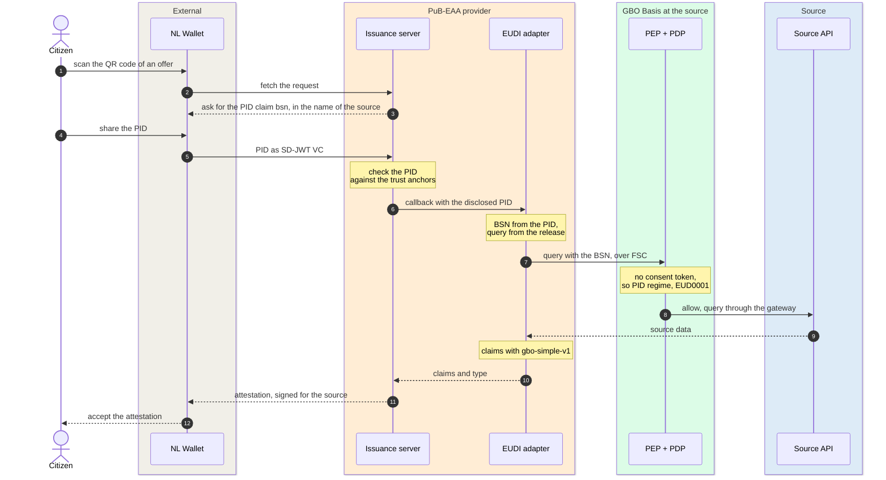
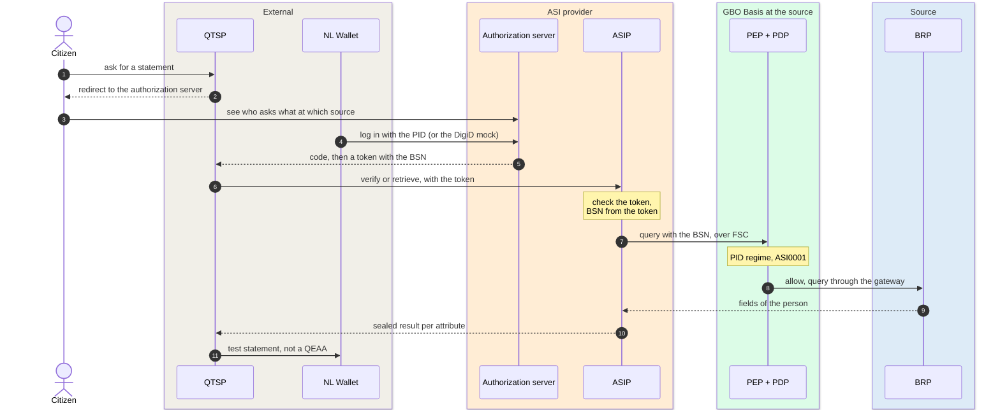

# EUDI wallet channel

In the EUDI wallet channel, a citizen gets data from a government source in
the EUDI wallet. Interaction pattern A of the
[Globaal Ontwerp](https://ictu.github.io/GBO-GO/main/#patroon-a-burger-gebruikt-eudi-wallet)
has two flows. In flow A, the source issues an attestation itself, as a
PuB-EAA. In flow B, a QTSP verifies or retrieves the data at the source and
issues a QEAA. GBO delivers one component for each flow, and both
components reach the source through GBO Basis.

[Overview](../index.md) › EUDI wallet channel

## Inside the channel

```mermaid
flowchart LR
  burger(["Citizen"])
  subgraph extp["External parties"]
    direction TB
    wallet["NL Wallet<br/>PID, attestations"]
    qtsp["QTSP<br/><i>reference QTSP in the demo</i>"]
  end
  subgraph pub["PuB-EAA provider: flow A"]
    direction TB
    is("Issuance server<br/>nl-wallet")
    ad("EUDI adapter")
  end
  subgraph asi["ASI provider: flow B"]
    direction TB
    az("Authorization server<br/>login, tokens")
    asip("ASIP<br/>verify, retrieve")
  end
  reg[("Source registry<br/>active release")]
  subgraph basis["GBO Basis, at each source"]
    direction LR
    pdp("PEP + PDP<br/>PID regime") --> gw("Source<br/>gateway") --> api[("Source<br/>BD · BRP")]
  end

  burger --- wallet
  burger -- "B · asks for a statement" --> qtsp
  wallet -- "A · PID, then<br/>attestation" --> is
  is -- "callback<br/>with the PID" --> ad
  wallet -. "B · login with the PID" .-> az
  qtsp -- "token" --> az
  qtsp -- "verify, retrieve" --> asip
  ad -- "query + BSN<br/>over FSC" --> pdp
  asip -- "query + BSN<br/>over FSC" --> pdp
  reg -. "eudi" .-> ad
  reg -. "asi" .-> asip

--8<-- "mermaid/classes.mmd"
  class burger,api source
  class wallet,qtsp ext
  class is,ad,az,asip eudi
  class pdp,gw basis
  class reg store
  class is,ad,az,asip,pdp,gw,reg zoom
  style pub fill:#F4F5F7,stroke:#EA580C
  style asi fill:#F4F5F7,stroke:#EA580C
  style basis fill:#F4F5F7,stroke:#16A34A
  style extp fill:#F4F5F7,stroke:#D1D5DB

  click is "pubeaa/" "PuB-EAA provider"
  click ad "pubeaa/" "PuB-EAA provider"
  click az "asi/" "ASI provider"
  click asip "asi/" "ASI provider"
  click pdp "../gbo-basis/" "GBO Basis"
  click gw "../gbo-basis/#the-request-path" "Request path"
  click reg "../../concepts/source-onboarding/" "Source onboarding"
```

*Figure 1: The EUDI wallet channel. Orange: the GBO components of the
channel, with GBO Basis in green. Thick border: click to zoom in.*
{: .caption }

The channel has these parts:

| Part | Role | Zoom in |
|---|---|---|
| PuB-EAA provider | The technical issuance facility. The issuance server asks the wallet for the PID. The EUDI adapter gets the source data and turns it into claims. The bronhouder stays the PuB-EAA provider ([ADR-0028](../../decisions/0028-pubeaa-productization.md), proposed). | [PuB-EAA provider](pubeaa.md) |
| ASI provider | Lets a QTSP verify or retrieve attributes at the source (eIDAS article 45e). It has its own OAuth authorization server. The QTSP is an OAuth client there, and not an FSC participant ([F-87](../../traceability/findings.md#f-87)). | [ASI provider](asi.md) |
| Source registry | Holds the active release of every source description. The source describes its attestations (`eudi`) and its attributes (`asi`) itself. | [Source onboarding](../../concepts/source-onboarding.md) |
| GBO Basis | Decides every request of the channel under the PID regime, with the rules EUD0001, EUD0002 and ASI0001. | [GBO Basis](../gbo-basis/index.md) |
| NL Wallet and QTSP | External parties. The wallet holds the PID of the citizen. The demo runs a reference QTSP, which is not a real QTSP. | [ASI verification](../../runtime/asi-verification.md) |

## Flow A: the source issues a PuB-EAA {#flow-a-the-source-issues-a-pubeaa}

In flow A, the citizen shares the PID with the issuance facility and gets an
attestation back. The attestation carries the name of the source as the
issuer:



*Figure 2: Flow A, at essence level. The runtime page has every hop.*
{: .caption }

The facility signs with the certificate set of the source. The wallet shows
the source as the issuer. GBO plays no part when the citizen later presents
the attestation to a dienstverlener. For every hop, with the data and the
error paths, see [EUDI issuance](../../runtime/eudi-issuance.md).

## Flow B: a QTSP verifies at the source

In flow B, the QTSP asks the ASI provider to verify or retrieve attributes
at the source. The citizen approves the request by logging in at the
authorization server:



*Figure 3: Flow B, at essence level. Discovery and registration of the QTSP
happen once, before the first request.*
{: .caption }

A token is valid for one data service, and each data service serves one
source. The QTSP issues the QEAA itself. In the demo, the reference QTSP
issues a test statement through the issuance server of flow A. For every
hop, see [ASI verification](../../runtime/asi-verification.md).

## Who sees which identifier

The channel does not use BSNk. The BSN goes into the source query as a
plain value:

```mermaid
flowchart LR
  subgraph need["Needs the BSN"]
    direction TB
    wallet["NL Wallet<br/>PID of the citizen"]
    is("Issuance server<br/>checks the PID")
    ad("EUDI adapter<br/>BSN from the PID")
    az("Authorization server<br/>BSN from the login")
    asip("ASIP<br/>BSN from the token")
    api[("Source<br/>after the allow")]
  end
  subgraph extra["Holds the BSN without a need"]
    direction TB
    qtsp["QTSP<br/>reads the token"]
    pdp("PDP input")
    adl[("ADL and console<br/>decision log")]
  end
  subgraph none["Holds no BSN"]
    direction TB
    ldv[("LDV records<br/>logbook pseudonym")]
    logs[("ASIP logs<br/>and traces")]
    stmt["QTSP login and<br/>test statement"]
  end
--8<-- "mermaid/classes.mmd"
  class wallet,qtsp,stmt ext
  class is,ad,az,asip eudi
  class api source
  class pdp basis
  class adl,ldv,logs store
  style need fill:#FFF7ED,stroke:#EA580C
  style extra fill:#FFF1F0,stroke:#E28F80
  style none fill:#F0FDF4,stroke:#16A34A
```

*Figure 4: Where the BSN can appear in the EUDI wallet channel. Red: the
BSN is there without a need.*
{: .caption }

In flow A, the EUDI adapter takes the BSN from the disclosed PID. In flow
B, the ASIP takes it from the access token. Both components put the BSN in
the query variables. As a result, the BSN is in two kinds of places that do
not need it:

- The PDP input, and with it the ADL and the console decision log. This is
  a known violation of [REQ-60](../../requirements/logging-audit.md#req-60).
  The proposed fix keeps identifiers out of the PDP input
  ([ADR-0043](../../decisions/0043-identifiers-out-of-pdp-input.md),
  proposed).
- The access token of flow B. ETSI requires the identification data in the
  token, and the QTSP can read the BSN
  ([F-86](../../traceability/findings.md#f-86)).

The LDV records hold no BSN, because the logbook refuses one. For the
detail, see
[Exception: the BSN in the EUDI and ASI routes](../../concepts/pseudonymization.md#exception-the-bsn-in-the-eudi-and-asi-routes).

## The PID regime

Neither flow carries a consent proof. The evidence in the request selects
the regime, so both flows land in the PID regime
([ADR-0031](../../decisions/0031-regime-from-evidence.md)):

```mermaid
flowchart LR
  q{"Consent token<br/>in the request?"}
  c["Consent regime<br/>DvTP"]
  p["PID regime<br/>EUD0001 · EUD0002 · ASI0001"]
  a{"Caller on the<br/>actor list?"}
  s{"BSN in the<br/>root argument?"}
  f{"Fields and limits<br/>of the rule?"}
  ok(["Allow"])
  no(["Deny"])
  ev("Verified PID as<br/>positive evidence<br/><i>design only</i>")
  q -- "one" --> c
  q -- "none" --> p
  p --> a
  a -- "yes" --> s
  s -- "yes" --> f
  f -- "yes" --> ok
  a -. "ACTOR_NOT_ALLOWED" .-> no
  s -. "PID_NOT_PRESENT" .-> no
  f -. "FIELD_NOT_PERMITTED" .-> no
  ev -. "REQ-45" .-> p
--8<-- "mermaid/classes.mmd"
  class q,a,s,f,ok basis
  class c,no dvtp
  class p eudi
  class ev planned
  class p zoom
  click p "../gbo-basis/authorization/#regime-from-evidence" "Regime from evidence"
```

*Figure 5: The PID regime. Dashed: the positive evidence that the design
asks for. Demo v0.9.0 does not build it.*
{: .caption }

Each PID rule admits only named callers: the FSC peer of the EUDI adapter,
or the ASIP peer. Only consent is positive evidence. A request enters the
PID regime because it carries no token
([F-70](../../traceability/findings.md#f-70)). For that reason, the actor
lists of the PID rules must stay disjoint from the consent consumers. The
fix in the design is a verified PID disclosure, bound to the subject of the
query ([REQ-45](../../requirements/eudi-issuance.md#req-45)).

In demo v0.9.0, the callback that carries the PID is not authenticated.
[The callback gap](pubeaa.md#the-callback-gap) shows what that allows.

### Approval in the wallet is no legal basis

In flow A, the citizen chooses in the wallet to share the PID. In flow B,
the citizen approves one request by logging in
([REQ-90](../../requirements/asi.md#req-90)). The ARF says that approval in
the wallet is never a legal basis for the relying party
([F-83](../../traceability/findings.md#f-83)). The approval of flow B is
also not stored, and the citizen cannot revoke it. A DvTP consent and a
wallet approval cannot replace each other. For the detail, see
[Wallet approval is not a legal basis](../../concepts/authorization.md#wallet-approval-is-not-a-legal-basis).

## Compared with the Globaal Ontwerp

The demo follows the two flows of pattern A. It differs in six steps:

| Step | Globaal Ontwerp | Demo v0.9.0 |
|---|---|---|
| Start of flow A | The wallet sends a credential request to the PuB-EAA voorziening. | The citizen scans a QR code. The issuance server first asks for the PID (disclosure-based issuance, [ADR-0018](../../decisions/0018-eudi-disclosure-issuance.md)). |
| Authorization in flow A | An Autorisatievoorziening asks the wallet for the PID and authorizes the PuB-EAA voorziening. | No separate service. The nl-wallet issuance server checks the PID and calls the adapter. The adapter does not authenticate that call. |
| Authorization in flow B | The verify and retrieve service uses the same Autorisatievoorziening of GBO. | The ASI provider has its own OAuth authorization server, with a wallet verifier and a DigiD mock ([ADR-0037](../../decisions/0037-asi-oauth-front-door.md)). |
| Approval by the citizen | The wallet shows the request and asks for consent. | Flow A: the citizen shares the PID. Flow B: the citizen logs in. Neither is a stored consent. |
| Format of the attestation | SD-JWT VC or mdoc | SD-JWT VC (`dc+sd-jwt`) only |
| Result of flow B | The QTSP issues a QEAA. | The reference QTSP issues a test statement, marked as not qualified. |

The GO also says that a request over ISO 15000 needs no authorization. The
demo offers clause 6.1 of ETSI TS 119 478 only
([REQ-112](../../requirements/asi.md#req-112)). In both the GO and the demo,
GBO itself is not a PuB-EAA provider.

## Open points

The main open points in the EUDI wallet channel are these:

- Nothing binds the BSN in the source query of flow A to a checked PID
  disclosure ([REQ-45](../../requirements/eudi-issuance.md#req-45),
  [Q-18](../../traceability/open-questions.md#q-18)).
- The BSN is in the PDP input and in both decision logs
  ([F-54](../../traceability/findings.md#f-54)).
- The QTSP can read the BSN in the access token
  ([F-86](../../traceability/findings.md#f-86)).
- Nothing links the citizen who logs in at the QTSP to the citizen who logs
  in at the authorization server
  ([F-93](../../traceability/findings.md#f-93)).
- The regulatory frame for PuB-EAA issuance and the designation of the
  issuer ([F-81](../../traceability/findings.md#f-81),
  [Q-28](../../traceability/open-questions.md#q-28)).

## Traceability

- Requirements: [REQ-45](../../requirements/eudi-issuance.md#req-45),
  [REQ-60](../../requirements/logging-audit.md#req-60),
  [REQ-74](../../requirements/authorization.md#req-74),
  [REQ-90](../../requirements/asi.md#req-90),
  [REQ-112](../../requirements/asi.md#req-112)
- Findings: [F-54](../../traceability/findings.md#f-54) (open),
  [F-70](../../traceability/findings.md#f-70) (open),
  [F-81](../../traceability/findings.md#f-81) (open),
  [F-83](../../traceability/findings.md#f-83) (open),
  [F-86](../../traceability/findings.md#f-86) (open),
  [F-87](../../traceability/findings.md#f-87) (open),
  [F-93](../../traceability/findings.md#f-93) (open)
- Open questions: [Q-18](../../traceability/open-questions.md#q-18) (open),
  [Q-28](../../traceability/open-questions.md#q-28) (open)
- Demo increments: [SL-19](../../traceability/increments.md#sl-19) (done),
  [SL-26](../../traceability/increments.md#sl-26) (done),
  [SL-28](../../traceability/increments.md#sl-28) (done)
