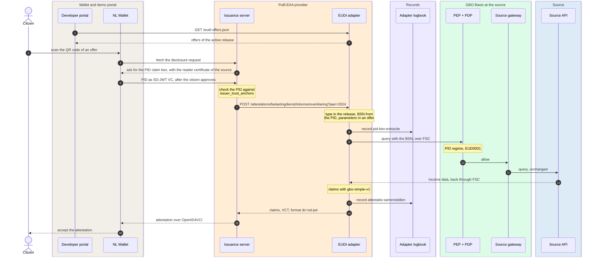

# PuB-EAA provider

The PuB-EAA provider (PubEAA-voorziening) issues an attestation with source data to the EUDI
wallet of the citizen. It is flow A of interaction pattern A in the
[Globaal Ontwerp](https://ictu.github.io/GBO-GO/main/#patroon-a-burger-gebruikt-eudi-wallet).
GBO operates the technical issuance facility, and each bronhouder stays
the PuB-EAA provider of its own attestations
([ADR-0028](../../decisions/0028-pubeaa-productization.md), proposed). The
facility runs on the nl-wallet issuance server
([ADR-0018](../../decisions/0018-eudi-disclosure-issuance.md)). The
[EUDI issuance](../../runtime/eudi-issuance.md) runtime page has every hop
and the links to the code.

[Overview](../index.md) › [EUDI wallet channel](index.md) › PuB-EAA provider

## Components and interfaces

```mermaid
flowchart LR
  subgraph front["Citizen side"]
    direction TB
    portal["Developer portal<br/>QR panel"]
    wallet["NL Wallet"]
  end
  subgraph fac["Issuance facility"]
    direction TB
    is("Issuance server<br/>nl-wallet v0.5.0")
    init("Issuance init<br/>writes the server<br/>configuration")
    certs[("Certificate set<br/>per source")]
    subgraph ad["EUDI adapter"]
      direction TB
      off("Offers<br/>GET /eudi-offers.json")
      cb("Callback<br/>POST /attestations")
      tm("Type Metadata<br/>GET /types/...")
      rt("Release runtime")
    end
    lb[("Adapter logbook<br/>LDV")]
  end
  subgraph cfg["Source configuration"]
    direction TB
    rec("Source reconciler")
    reg[("Source registry<br/>releases")]
  end
  doc[("Source document<br/>/.well-known/gbo")]
  pdp("GBO Basis<br/>PEP + PDP")

  portal -- "offers" --> off
  wallet -- "PID, then attestation" --> is
  wallet -. "VCT" .-> tm
  is -- "disclosed PID" --> cb
  cb -- "query + BSN<br/>over FSC" --> pdp
  cb -.-> lb
  certs -.-> init
  init -- "at restart" --> is
  doc -- "over FSC" --> rec
  rec -- "validate,<br/>promote" --> reg
  reg -. "poll" .-> rt
  reg -. "read" .-> init
--8<-- "mermaid/classes.mmd"
  class wallet ext
  class portal mock
  class is,init,off,cb,tm,rt eudi
  class certs,lb,reg store
  class rec,pdp basis
  class doc source
  class cb,tm,certs,rec,reg,pdp zoom
  style front fill:#F4F5F7,stroke:#D1D5DB
  style fac fill:#F4F5F7,stroke:#EA580C
  style ad fill:#FFFFFF,stroke:#EA580C
  style cfg fill:#F4F5F7,stroke:#16A34A
  click cb "#the-callback-gap" "The callback gap"
  click tm "#from-source-description-to-claims" "Claims and Type Metadata"
  click certs "../../../concepts/source-onboarding/#a-certificate-set-per-source" "Certificate set"
  click rec "../../../concepts/source-onboarding/" "Source onboarding"
  click reg "../../../concepts/source-onboarding/" "Source onboarding"
  click pdp "../../gbo-basis/authorization/#the-rules" "The rules"
```

*Figure 1: The components of the PuB-EAA provider and their interfaces.
Thick border: click to zoom in.*
{: .caption }

Each component has one job:

| Component | Job | Never does |
|---|---|---|
| Issuance server | Asks the wallet for the PID over OpenID4VP and checks it against its PID trust anchors. Issues the attestation over OpenID4VCI, signed with the issuer certificate of the source. | Calls the source |
| EUDI adapter | Takes the BSN from the PID. Builds the query from the active release and calls the source through its own FSC Outway. Turns the answer into claims and writes two LDV records. | Keeps source data, or has a query or mapping of its own ([REQ-44](../../requirements/authorization.md#req-44)) |
| Release runtime | Polls the active release and rebuilds the bindings of the adapter. If an error occurs, it keeps the previous snapshot. | Fetches source metadata itself |
| Source reconciler and registry | The reconciler fetches and validates the source document. Promotion writes an immutable release and sets the active pointer. | Activates a source because of a valid FSC contract ([REQ-65](../../requirements/sources-identity.md#req-65)) |
| Certificate set | Issuer, reader and status-list certificates of one source. The wallet shows the issuer and the purpose from these certificates. | Serves another source ([REQ-58](../../requirements/eudi-issuance.md#req-58)) |
| Issuance init | Writes the configuration of the issuance server from the active release. The server reads it only at startup, so a new release needs a controlled restart. | — |

## The issuance flow

One issuance of the income statement (inkomensverklaring) for 2024 takes
these steps:



*Figure 2: One issuance, at essence level.*
{: .caption }

Three properties of this flow matter for the design:

- The issuance server checks the PID. The adapter trusts the callback
  without a check of the caller ([The callback gap](#the-callback-gap)).
- The adapter writes an LDV record before it calls the source. If the
  logbook does not acknowledge the record, the adapter does not call the
  source. Neither record holds the BSN
  ([REQ-72](../../requirements/logging-audit.md#req-72)).
- The offer and the policy are separate limits. The source offers 2024 and
  2025, and EUD0001 allows the same years. Publication by the source does
  not authorize the data ([F-74](../../traceability/findings.md#f-74)).

For every hop, with the data and the code, see
[EUDI issuance](../../runtime/eudi-issuance.md#sequence).

## From source description to claims

The source describes each attestation once, in the `eudi` capability of
its source document. GBO derives the rest:

```mermaid
flowchart LR
  subgraph doc["Source document: capabilities.eudi"]
    direction TB
    off["offers<br/>for example year 2024"]
    gq["graphql<br/>query, subject variable,<br/>result_pointer"]
    disp["display<br/>name, summary per language"]
    cl["claims<br/>pointer, datatype, label, sd"]
  end
  subgraph gen["Generated by GBO"]
    direction TB
    cfg("Issuance configuration<br/>offers, disclosure")
    tm("Type Metadata<br/>VCT with an integrity hash")
    prof("gbo-simple-v1<br/>projection rules")
  end
  subgraph run["For each issuance"]
    direction TB
    ans[("Answer of<br/>the source")]
    flat("Flat scalar claims")
    att["Attestation<br/>SD-JWT VC"]
  end
  off --> cfg
  disp --> tm
  cl --> tm
  cl --> prof
  gq --> ans
  ans --> prof
  prof --> flat
  flat --> att
  tm -. "type" .-> att
--8<-- "mermaid/classes.mmd"
  class off,gq,disp,cl,ans source
  class cfg,tm,prof,flat eudi
  class att ext
  class tm zoom
  style doc fill:#FFFFFF,stroke:#6F94B8,stroke-dasharray:4 3
  style gen fill:#F4F5F7,stroke:#EA580C
  style run fill:#F4F5F7,stroke:#D1D5DB
  click tm "../../../concepts/source-onboarding/#the-eudi-capability-claims-once-type-metadata-generated" "The eudi capability"
```

*Figure 3: From the `eudi` capability to an attestation.*
{: .caption }

A claim has a pointer into the answer, a datatype, a label and a setting
for selective disclosure. GBO derives the projection from the claims. It
also generates the SD-JWT VC Type Metadata from `display` and `claims`
([ADR-0017](../../decisions/0017-gbo-simple-v1.md),
[REQ-64](../../requirements/sources-identity.md#req-64)). As a result, the
schema in the Type Metadata always matches what the projection fills.

The URL of the Type Metadata is the VCT of the type version. A change to
the claims or the display changes the bytes behind that URL, so the change
needs a new `type_version`. The profile gbo-simple-v1 allows only scalar
claims. Nested claims are not built
([REQ-78](../../requirements/eudi-issuance.md#req-78)).

The demo has two attestation types:

| Type | Source and service | Rule | Offers | Subject of the data |
|---|---|---|---|---|
| Income statement | Belastingdienst, `bri` | EUD0001 | `jaar` (year) 2024 and 2025 | The PID holder |
| Death certificate (akte van overlijden) | RvIG, `brp` | EUD0002 | One, without parameters | The deceased partner of the PID holder |

## Error contract

The adapter checks a callback in a fixed order. The first failed check
decides the HTTP status:

```mermaid
flowchart LR
  in(["Callback"])
  c1{"Release<br/>loaded?"}
  c2{"Type in the<br/>release?"}
  c3{"Source metadata<br/>fresh or in grace?"}
  c4{"PID with<br/>a BSN?"}
  c5{"Parameters<br/>in an offer?"}
  c6{"Source answer<br/>without errors?"}
  c7{"One result that<br/>fits the claims?"}
  ok(["200<br/>claims"])
  e503(["503"])
  e404(["404"])
  e400(["400"])
  e502(["502"])
  in --> c1 --> c2 --> c3 --> c4 --> c5 --> c6 --> c7
  c7 -- "yes" --> ok
  c1 & c3 -. "no" .-> e503
  c2 -. "no" .-> e404
  c4 & c5 -. "no" .-> e400
  c6 -. "no, or a PDP deny" .-> e502
  c7 -. "no result" .-> e404
  c7 -. "more, or no fit" .-> e502
--8<-- "mermaid/classes.mmd"
  class in ext
  class c1,c2,c3,c4,c5,c6,c7,ok eudi
  class e503,e404,e400,e502 dvtp
```

*Figure 4: The checks of the adapter, in order. Red: the HTTP status that
the issuance server gets.*
{: .caption }

The issuance server gets only the HTTP status. The reason is in the
adapter log (`stage`), and for a PDP deny also in the ADL. The FSC Inway
removes the reason of a deny on the way back. These rules hold for every
error path:

- No attestation reaches the wallet, and a partial attestation does not
  exist ([REQ-116](../../requirements/eudi-issuance.md#req-116)).
- A PDP deny (`ACTOR_NOT_ALLOWED`, `PID_NOT_PRESENT`, `YEAR_NOT_ALLOWED`,
  `FIELD_NOT_PERMITTED`) gives 502, the same status as a chain that does
  not answer.
- If the logbook does not acknowledge an LDV record, the adapter answers
  500 and does not continue.
- A missing or incomplete certificate set blocks only that source
  ([REQ-58](../../requirements/eudi-issuance.md#req-58)).

The offer list is an exception to the isolation per source. If one source
is past its grace period, `/eudi-offers.json` answers 503 for every source
([#606](https://github.com/ICTU/GBO-demo/issues/606)). For all
triggers, see [Error paths](../../runtime/eudi-issuance.md#error-paths).

## The callback gap

The issuance server checks the PID. The adapter does not know that a
callback comes from the issuance server:

```mermaid
flowchart LR
  wallet["NL Wallet"]
  x["Any caller that<br/>reaches the adapter"]
  is("Issuance server<br/>checks the PID")
  cb("Adapter callback<br/>no caller authentication")
  pdp("PDP<br/>checks the caller peer<br/>and a BSN in the query")
  src[("Source")]
  f1("Adapter checks<br/>the SD-JWT itself")
  f2("Authenticated callback<br/>with signed evidence")
  wallet -- "PID" --> is
  is -- "BSN from the PID" --> cb
  x -- "any BSN" --> cb
  cb -- "as the designated issuer" --> pdp
  pdp --> src
  f1 -.-> cb
  f2 -.-> cb
--8<-- "mermaid/classes.mmd"
  class wallet ext
  class x mock
  class is,cb eudi
  class pdp basis
  class src source
  class f1,f2 planned
```

*Figure 5: The callback gap. Dashed: the two fixes that REQ-45 names. Demo
v0.9.0 builds neither.*
{: .caption }

No mechanism binds the BSN in the callback to a checked disclosure
([REQ-45](../../requirements/eudi-issuance.md#req-45),
[Q-18](../../traceability/open-questions.md#q-18),
[#133](https://github.com/ICTU/GBO-demo/issues/133)). The PDP sees the
designated issuer peer and a BSN, so it allows. The list of designated
issuers is the only gate of the PID regime
([F-70](../../traceability/findings.md#f-70)). The demo uses the gap
itself: a playground in the developer portal posts a typed BSN to the
adapter.

The demo dropped a PID check in the adapter, because the issuance server
checks the signature ([SL-25](../../traceability/increments.md#sl-25)).
The PID trust list of the issuance server is also too broad. Next to the
PID provider, it trusts the GBO development CA and the issuer CA of every
source. Both fixes of REQ-45 need a binding of the disclosure to the
request.

## Related-person attestation

The death certificate holds data about the deceased partner of the
citizen who shares the PID. The subject of the claims differs from the
person who discloses the PID
([F-47](../../traceability/findings.md#f-47),
[REQ-57](../../requirements/eudi-issuance.md#req-57)):

```mermaid
flowchart LR
  holder(["PID holder"])
  ad("EUDI adapter<br/>BSN of the holder")
  pdp("PDP, rule EUD0002<br/>sees only the flat output")
  brp[("BRP source<br/>resolves the relation")]
  rel["Marriage ended by<br/>the death of the partner"]
  att["Death certificate<br/>claims about the partner"]
  holder -- "PID" --> ad
  ad -- "akteVanOverlijden(bsn)" --> pdp
  pdp --> brp
  brp --- rel
  brp -. "fields of the<br/>deceased partner" .-> att
--8<-- "mermaid/classes.mmd"
  class holder,brp,rel source
  class ad eudi
  class pdp basis
  class att ext
```

*Figure 6: A related-person attestation. The source, and not GBO, knows
the relation.*
{: .caption }

The source selects the marriage that ended by the death of the partner. If
the partner died on another date than the dissolution, the source returns
nothing, and the adapter answers 404. The PDP does not see the relation.
The deceased is not a data subject under the GDPR, so the source logs the
requester and the living parents
([AV-10](../../requirements/admission.md#av-10)).

The preferred design puts the relation in filter arguments of the
published schema. The policy then requires these arguments with fixed
values ([#425](https://github.com/ICTU/GBO-demo/issues/425),
[Q-14](../../traceability/open-questions.md#q-14)). In demo v0.9.0, a
caller can ask for the death certificate of any BSN, because of the callback gap.

## Trust roles and the PuB-EAA provider

Each bronhouder needs its own certificate per role, and one certificate
never fills two roles. The following figure shows the roles around one
bronhouder:

```mermaid
flowchart LR
  subgraph legal["Legal role"]
    bh["Bronhouder<br/>PuB-EAA provider"]
  end
  subgraph tech["Technical role"]
    fac("GBO issuance facility<br/>probably the EEAIssuer")
  end
  subgraph certs["Certificate set of one bronhouder"]
    direction TB
    iss[("Issuer certificate<br/>production: qualified seal<br/>in a QSCD")]
    rdr[("Reader certificate<br/>production: access certificate")]
    stl[("Status-list certificate")]
    regc("Registration certificate<br/><i>not in the demo</i>")
  end
  subgraph open["Open decisions"]
    direction TB
    q28("Designation and<br/>supervision: Q-28")
    q30("Trust list for<br/>PuB-EAA providers: Q-30")
    q17("Custody of the seal and<br/>status-list keys: Q-17")
  end
  bh -- "instructs: validity,<br/>revocation" --> fac
  fac -- "signs with" --> iss
  fac --- rdr
  fac --- stl
  certs ~~~ open
--8<-- "mermaid/classes.mmd"
  class bh source
  class fac eudi
  class iss,rdr,stl store
  class regc,q28,q30,q17 planned
  class fac zoom
  style legal fill:#FFFFFF,stroke:#6F94B8,stroke-dasharray:4 3
  style tech fill:#F4F5F7,stroke:#EA580C
  style certs fill:#F4F5F7,stroke:#7C3AED
  style open fill:#FFFFFF,stroke:#9CA3AF,stroke-dasharray:6 4
  click fac "../../../concepts/identity-trust/#eudi-trust-roles" "EUDI trust roles"
```

*Figure 7: Trust roles in PuB-EAA issuance. Dashed: not built or not
decided.*
{: .caption }

[ADR-0028](../../decisions/0028-pubeaa-productization.md) (proposed)
divides the roles. The bronhouder is the PuB-EAA provider and stays
legally responsible for content, validity and revocation. GBO operates the
technical issuance facility and is probably the `EEAIssuer` in the
notification of each bronhouder. The facility is optional: a bronhouder
can run its own credential issuer.

Since August 2026, PuB-EAA issuance falls under the same standard as QEAA
issuance ([F-81](../../traceability/findings.md#f-81)). That frame asks
for these parts:

- Designation of the issuer.
- A registration certificate.
- A qualified seal in a QSCD.
- Conformity with ETSI TS 119 471 and TS 119 472-3.

Demo v0.9.0 is not checked against this frame. One development CA fills
all roles. Three decisions are open: who designates the issuer
([Q-28](../../traceability/open-questions.md#q-28)), on which trust list
the providers appear ([Q-30](../../traceability/open-questions.md#q-30)),
and who holds the keys ([Q-17](../../traceability/open-questions.md#q-17)).
For the certificate roles, see
[EUDI trust roles](../../concepts/identity-trust.md#eudi-trust-roles).

## Compared with the Globaal Ontwerp

The demo follows flow A of pattern A. It differs in three points:

| Point | Globaal Ontwerp | Demo v0.9.0 |
|---|---|---|
| Role of GBO | A technical, central and optional facility. GBO is not a PuB-EAA provider. | The same. The bronhouder is the provider ([ADR-0028](../../decisions/0028-pubeaa-productization.md), proposed). |
| Authorization | An authorization facility (autorisatievoorziening) authorizes the PuB-EAA facility after a PID login. | The issuance server checks the PID itself. No separate authorization service exists. |
| Semantic mapping | A shared GBO facility translates the format of the source. | The source maps its own fields to claims with gbo-simple-v1. No translation layer exists. |

## Open points

The main open points in the PuB-EAA provider are these:

- The callback gap: nothing binds the disclosure to the source query
  ([REQ-45](../../requirements/eudi-issuance.md#req-45),
  [Q-18](../../traceability/open-questions.md#q-18)).
- The regulatory frame for PuB-EAA issuance, and who designates the
  issuer ([F-81](../../traceability/findings.md#f-81),
  [Q-28](../../traceability/open-questions.md#q-28)).
- The trust list for PuB-EAA providers
  ([Q-30](../../traceability/open-questions.md#q-30)).
- Every attestation is valid for 365 days. GBO gets no change signal from
  the source, so it cannot revoke on a change
  ([F-82](../../traceability/findings.md#f-82),
  [REQ-77](../../requirements/eudi-issuance.md#req-77)).
- The source description does not mark the relation behind a
  related-person attestation ([F-47](../../traceability/findings.md#f-47)).

## Traceability

- Requirements: [REQ-44](../../requirements/authorization.md#req-44),
  [REQ-45](../../requirements/eudi-issuance.md#req-45),
  [REQ-57](../../requirements/eudi-issuance.md#req-57),
  [REQ-58](../../requirements/eudi-issuance.md#req-58),
  [REQ-64](../../requirements/sources-identity.md#req-64),
  [REQ-65](../../requirements/sources-identity.md#req-65),
  [REQ-72](../../requirements/logging-audit.md#req-72),
  [REQ-77](../../requirements/eudi-issuance.md#req-77),
  [REQ-78](../../requirements/eudi-issuance.md#req-78),
  [REQ-116](../../requirements/eudi-issuance.md#req-116)
- Findings: [F-47](../../traceability/findings.md#f-47) (open),
  [F-70](../../traceability/findings.md#f-70) (open),
  [F-74](../../traceability/findings.md#f-74) (open),
  [F-81](../../traceability/findings.md#f-81) (open),
  [F-82](../../traceability/findings.md#f-82) (open)
- Open questions: [Q-14](../../traceability/open-questions.md#q-14) (open),
  [Q-17](../../traceability/open-questions.md#q-17) (open),
  [Q-18](../../traceability/open-questions.md#q-18) (open),
  [Q-28](../../traceability/open-questions.md#q-28) (open),
  [Q-30](../../traceability/open-questions.md#q-30) (open)
- Demo increments: [SL-25](../../traceability/increments.md#sl-25) (dropped),
  [SL-26](../../traceability/increments.md#sl-26) (done),
  [SL-43](../../traceability/increments.md#sl-43) (done),
  [SL-46](../../traceability/increments.md#sl-46) (done)
