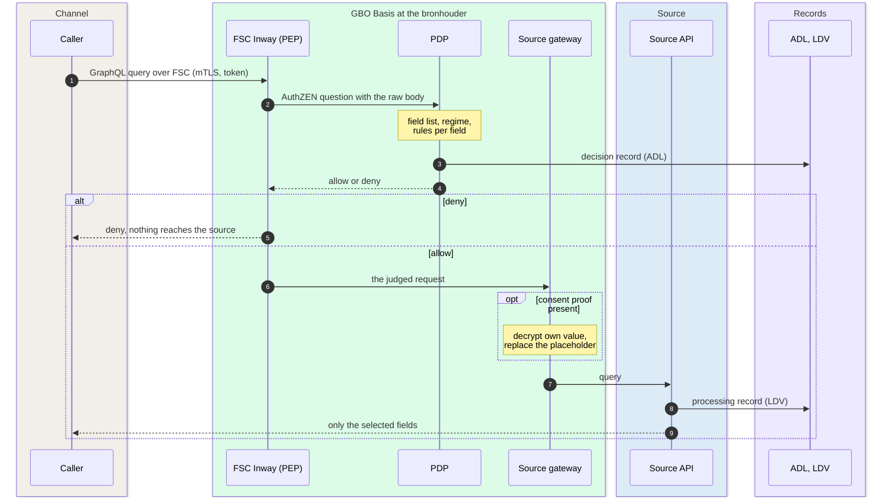

# GBO Basis

GBO Basis opens a government source in one standard way, for every
channel. It runs at the bronhouder: each source has its own FSC Inway, its
own PDP and its own source gateway. No central server decides for all
sources ([ADR-0004](../../decisions/0004-federated-authorization.md)).
GBO delivers the components, and the bronhouder runs them
([P-10](https://ictu.github.io/GBO-PSA/main/architectuurprincipes/)).

[Overview](../index.md) › GBO Basis

## Inside GBO Basis

The Globaal Ontwerp names four parts: a standard interface, source access,
configurable authorization, and GBO tools. The following figure
shows the components that make up these parts in gbo-demo v0.9.0:

```mermaid
flowchart LR
  caller["Caller<br/>(any channel)"]
  subgraph bh["Bronhouder"]
    direction LR
    subgraph fsc["Standard interface: FSC"]
      direction TB
      inway("FSC Inway<br/>= PEP")
      mgr("FSC Manager<br/>contracts, tokens")
    end
    subgraph authz["Configurable authorization"]
      direction TB
      pdp("PDP<br/>OpenFTV + OPA/Rego")
      pol("Policy set<br/>engine + 5 rules")
    end
    subgraph access["Source access"]
      direction TB
      gw("Source gateway")
      dec("Decryption<br/>component")
      api[("Source API<br/>GraphQL")]
      meta[("Source metadata<br/>/.well-known/gbo")]
    end
    rec[("Records<br/>ADL · LDV · txlog")]
  end
  subgraph shared["Shared GBO facilities"]
    direction TB
    adm[("Admission register")]
    reg[("Source registry")]
    tools("GBO tools<br/><i>design only</i>")
  end
  tr[("Consent register")]

  caller -- "FSC request" --> inway
  caller -. "contract proposal" .-> mgr
  inway -- "AuthZEN" --> pdp
  mgr -- "AuthZEN autosign" --> pdp
  pdp --- pol
  adm -. "PIP pull" .-> pdp
  pdp -. "status (DvTP only)" .-> tr
  inway -- "after allow" --> gw
  gw --> dec
  gw --> api
  meta -. "fetched over FSC" .-> reg
  pdp -.-> rec
  api -.-> rec

--8<-- "mermaid/classes.mmd"
  class caller ext
  class inway,mgr,pdp,pol,gw,dec basis
  class api,meta source
  class adm,reg,rec store
  class tools planned
  class tr dvtp
  class pdp,pol,gw,mgr,meta,reg,rec zoom
  style bh fill:#FFFFFF,stroke:#6F94B8,stroke-dasharray:4 3
  style fsc fill:#F4F5F7,stroke:#16A34A
  style authz fill:#F4F5F7,stroke:#16A34A
  style access fill:#F4F5F7,stroke:#16A34A
  style shared fill:#F4F5F7,stroke:#D1D5DB

  click pdp "authorization/" "Authorization"
  click pol "policy/" "Policy rules"
  click mgr "authorization/#admission-of-parties" "Admission"
  click gw "source-access/" "Source access"
  click meta "source-configuration/" "Source configuration"
  click reg "source-configuration/" "Source configuration"
  click rec "records/" "Records"
```

*Figure 1: The parts of GBO Basis. Thick border: click to zoom in.*
{: .caption }

The parts have the following roles:

| Part | Components | Role | Zoom in |
|---|---|---|---|
| Standard interface | FSC Inway, FSC Manager, FSC Outway of the caller | Every connection to a source runs over FSC, with mTLS and a contract ([ADR-0003](../../decisions/0003-fsc-connectivity.md)). The Inway is the PEP. | [FSC group](../components.md#level-2-fsc-group) |
| Configurable authorization | PDP, policy set, admission register | The PDP decides on every request and on every contract proposal. Policy is configuration, not code. | [Authorization](authorization.md) |
| Source access | Source gateway, decryption component, source API | The source answers one GraphQL query. Under consent, the gateway first puts the citizen in the query. | [Source access](source-access.md) |
| Policy rules | Policy set, its tests and its distribution | The rules are data for the PDP. Each bronhouder manages its own set. | [Policy rules](policy.md) |
| Records | ADL, LDV logbooks, FSC txlog | Every decision, processing and transport leaves a record, linked by one trace ID. | [Records](records.md) |
| Source configuration | Source metadata, source registry | The source describes its own services. GBO validates and activates that description. | [Source configuration](source-configuration.md) |
| GBO tools | Translation layer, onboarding toolkit | Help a bronhouder without a GraphQL API. Not built. | [ADR-0027](../../decisions/0027-onboarding-toolkit.md) |

## The request path

A request through GBO Basis has the same steps in every channel. The PDP
decides before anything reaches the source. The source gateway does its
work only after an allow:



*Figure 2: One request through GBO Basis.*
{: .caption }

The steps work as follows:

1. The caller sends a GraphQL query through its FSC Outway. The Inway
   checks the certificate and the contract of the caller.
2. The Inway sends the request, with its raw body, to the PDP as an
   AuthZEN question. The Inway does not read the query
   ([REQ-42](../../requirements/authorization.md#req-42)).
3. The PDP turns the query into a list of fields, selects the regime from
   the evidence, and decides each field.
   [Authorization](authorization.md) shows how.
4. The PDP writes the decision to the ADL, the audit record of decisions
   ([ADR-0036](../../decisions/0036-adl-decision-record.md)).
5. On a deny, the source sees nothing. By design, the caller gets a
   coarse reason code. The FSC Inway of demo v0.9.0 drops that code on
   the way back.
6. On an allow, the Inway passes the request to the source gateway. Only
   the Inway can reach the gateway
   ([ADR-0033](../../decisions/0033-gateway-decrypts-after-allow.md)).
7. Under consent, the gateway decrypts the value that the consent proof
   holds for this source. It puts the BSN or the source pseudonym in the
   place of the placeholder. Without a consent proof, it passes the query
   unchanged.
8. The source runs the query and returns only the selected fields
   ([REQ-08](../../requirements/authorization.md#req-08)). It logs the
   processing in its own LDV logbook.

## What the bronhouder runs {#what-the-bronhouder-runs}

GBO delivers the components as reference components. The bronhouder
chooses to run them, or a working equivalent that meets the same
interfaces. The following figure shows who owns what at one source:

```mermaid
flowchart TB
  subgraph own["Owned by the bronhouder"]
    direction LR
    api[("Source API<br/>and schema")]
    meta[("Service description")]
    keys[("Decryption keys")]
    log[("LDV logbook")]
    pol("Policy set<br/>and its management")
  end
  subgraph deliv["Delivered by GBO, run by the bronhouder"]
    direction LR
    inway("FSC Inway")
    pdp("PDP")
    gw("Source gateway")
    ldvc("LDV client")
  end
  subgraph run["Run by GBO for all sources"]
    direction LR
    adm[("Admission register")]
    reg[("Source registry")]
    tr[("Consent register")]
  end
  own ~~~ deliv ~~~ run
--8<-- "mermaid/classes.mmd"
  class api,meta,keys,log source
  class pol,inway,pdp,gw,ldvc basis
  class adm,reg store
  class tr dvtp
  style own fill:#FFFFFF,stroke:#6F94B8,stroke-dasharray:4 3
  style deliv fill:#F4F5F7,stroke:#16A34A
  style run fill:#F4F5F7,stroke:#D1D5DB
```

*Figure 3: Ownership at one source.*
{: .caption }

The PEP, the PDP, policy management and source access are decentral, at
the bronhouder. The consent facility (toestemmingsvoorziening) is central and mandatory for
DvTP ([Q-10](../../traceability/answered-questions.md#q-10),
[ADR-0021](../../decisions/0021-central-pap-signed-bundles.md)). The PSA
has not decided who operates the central facilities (open decisions
[B-06 and B-17](https://ictu.github.io/GBO-PSA/main/vraagstukken/#besluitregister)).
The demo runs everything in one stack and shares one PDP between the
sources. That is a demo shortcut.

## Open points

The main open points in GBO Basis are these:

- The PID regime has no positive evidence of its own. A request without a
  consent proof enters it ([F-70](../../traceability/findings.md#f-70)).
- The rule "only after the decision" depends on the network. Only the
  Inway can be allowed to reach the source gateway
  ([F-79](../../traceability/findings.md#f-79)).
- The ADL record holds only what the consumer also sees
  ([F-72](../../traceability/findings.md#f-72)).
- A broken policy module stops every decision, without a visible
  fallback ([F-52](../../traceability/findings.md#f-52)).

## Traceability

- Requirements: [REQ-04](../../requirements/authorization.md#req-04),
  [REQ-08](../../requirements/authorization.md#req-08),
  [REQ-42](../../requirements/authorization.md#req-42),
  [REQ-46](../../requirements/sources-identity.md#req-46),
  [REQ-81](../../requirements/pseudonymization.md#req-81)
- Findings: [F-52](../../traceability/findings.md#f-52) (open),
  [F-70](../../traceability/findings.md#f-70) (open),
  [F-72](../../traceability/findings.md#f-72) (open),
  [F-79](../../traceability/findings.md#f-79) (open)
- Open questions: [Q-02](../../traceability/answered-questions.md#q-02) (answered),
  [Q-10](../../traceability/answered-questions.md#q-10) (answered)
- Demo increments: [SL-42](../../traceability/increments.md#sl-42) (done),
  [SL-45](../../traceability/increments.md#sl-45) (done),
  [SL-51](../../traceability/increments.md#sl-51) (done)
