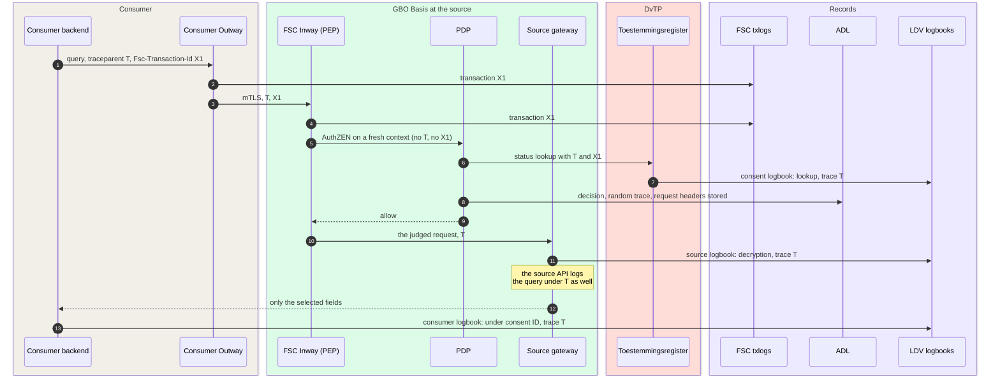
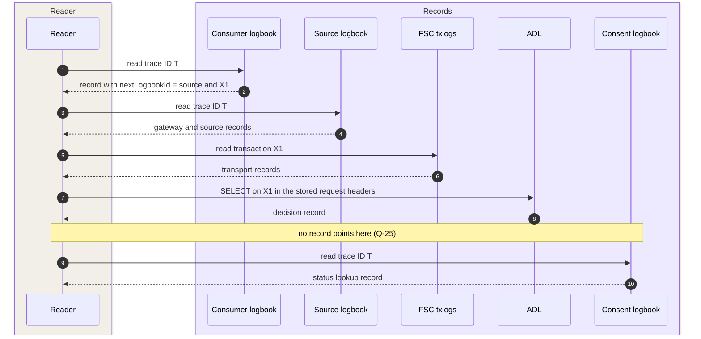

# Records: decisions, processing, transport

Every data exchange through GBO must be reconstructable afterwards. A
reader must see who asked for what, under which basis, with which
decision, and who processed which personal data
([P-12](https://ictu.github.io/GBO-PSA/main/architectuurprincipes/)). GBO
keeps three authoritative records, one per Logius standard. One W3C trace
ID joins them, and each record stores the FSC transaction ID next to it.
This is capability S09 of the Globaal Ontwerp. The
[Logging, audit and traceability](../../concepts/logging.md) concept page
has the detail and the links to the code.

[Overview](../index.md) › [GBO Basis](index.md) › Records

## Three records

```mermaid
flowchart LR
  subgraph dec["Decision"]
    direction TB
    pdp("PDP<br/>OpenFTV")
    adl[("ADL<br/>ftv_adl")]
    pdp --> adl
  end
  subgraph proc["Processing"]
    direction TB
    comp("Gateway, source API,<br/>register, consumer,<br/>EUDI adapter")
    ldv[("LDV logbook<br/>per controller")]
    comp --> ldv
  end
  subgraph tra["Transport"]
    direction TB
    fsc("FSC Inway<br/>and Outway")
    tx[("FSC txlog<br/>per peer")]
    fsc --> tx
  end
  subgraph obs["Observability, not audit"]
    direction TB
    all("All services")
    jg[("Traces<br/>Jaeger, 7 days")]
    lk[("Logs<br/>Loki, 7 days")]
    all --> jg
    all --> lk
  end
  dec ~~~ proc ~~~ tra ~~~ obs
--8<-- "mermaid/classes.mmd"
  class pdp,comp,fsc basis
  class adl,ldv,tx store
  class all ext
  class jg,lk mock
  class adl,ldv,tx zoom
  style dec fill:#F5F3FF,stroke:#7C3AED
  style proc fill:#F5F3FF,stroke:#7C3AED
  style tra fill:#F5F3FF,stroke:#7C3AED
  style obs fill:#F4F5F7,stroke:#D1D5DB,stroke-dasharray:4 3
  click adl "../../../concepts/logging/#decision-records-adl" "Decision records"
  click ldv "../../../concepts/logging/#processing-records-ldv" "Processing records"
  click tx "../../components/#level-2-fsc-group" "FSC group"
```

*Figure 1: The three authoritative records and the observability stores.
Thick border: click to zoom in.*
{: .caption }

Each record answers one question:

| Record | Standard | Question it answers | Writer | Store in the demo |
|---|---|---|---|---|
| Decision | Authorization Decision Log (ADL) | Which decision did the PDP take on this request or contract? | The PDP | Postgres database `ftv_adl` |
| Processing | Logboek Dataverwerkingen (LDV) 1.0.0 | Which organization processed which personal data, for which activity? | Each component, in the logbook of its own controller | One logbook per controller |
| Transport | FSC-Logging (draft) | Which FSC transaction took place between which peers? | FSC Inway and Outway | Transaction log per FSC peer |

A PDP decision is not a processing, so it gets no LDV record. On the
DvTP path, the LDV records are at three processings:

- The consent status lookup at the register.
- The decryption at the source gateway.
- The query at the source.

Traces and logs are for debugging. They are sampled or best effort, and
nobody cites them as evidence
([REQ-32](../../requirements/logging-audit.md#req-32)). The console
decision log of the policy engine goes to Loki. It holds the rule per
field and the step trace. The developer portal shows it as detail next to
the ADL record. The portal sets the color of the PDP from the ADL record
alone ([ADR-0036](../../decisions/0036-adl-decision-record.md)).

## One request leaving its trail

For one DvTP query, every component on the path writes its own record.
The following figure shows which identifier lands in which record:



*Figure 2: The trail of one DvTP query. The runtime page
[DvTP query](../../runtime/dvtp-query.md) has every hop.*
{: .caption }

Two identifiers link the records
([REQ-55](../../requirements/logging-audit.md#req-55),
[ADR-0035](../../decisions/0035-w3c-trace-context.md)):

| | W3C trace ID | `Fsc-Transaction-Id` |
|---|---|---|
| Made by | The application that starts the processing | The FSC Outway, or the entry component |
| Count per processing | One | One per FSC transaction |
| Recorded in | LDV `trace_id`, ADL `trace_id`, spans, logs | FSC txlog, ADL `adl.fsc.transaction_id`, span attribute `gbo.fsc.transaction_id` |

Every component takes the trace ID unchanged from the incoming
`traceparent` and sends it on every outbound call. The transaction ID
never replaces an incoming trace. The earlier rule "trace ID equals
transaction ID" broke for a caller with its own trace, for one processing
over several sources, and at every extra FSC hop
([F-67](../../traceability/findings-closed.md#f-67)).

The Inway copies the headers of the request into the AuthZEN context.
From there, the policy sends T and X1 on the status lookup. As a result,
the record of the register lands in the trace of the request.

## Decision records (ADL)

The PDP writes one ADL record for each evaluation, contract decisions
included ([REQ-71](../../requirements/logging-audit.md#req-71)). The PDP
does not start without the database `ftv_adl`, so the ADL runs in every
deployment profile. A reader gets the SELECT-only role `adl_reader`.

The record holds the AuthZEN request and the answer `{allow, reason}`.
By design, the Inway returns that reason to the consumer, so per-field
detail cannot go into the answer. The record therefore holds only what
the consumer can also see. The FSC Inway of demo v0.9.0 drops the reason
on the way back ([F-72](../../traceability/findings.md#f-72)).

## Records per controller (LDV)

Every GBO-delivered component that processes personal data writes one LDV
record per processing and per data subject. It writes to the logbook of
its own controller
([REQ-72](../../requirements/logging-audit.md#req-72),
[ADR-0026](../../decisions/0026-ldv-integration.md)). Only trace metadata
crosses an organization boundary, so the demo runs one logbook image as
seven logbooks:

| Logbook | Controller | Writers |
|---|---|---|
| `logboek-bd` | Belastingdienst | `bron-sidecar`, `graphql-server` |
| `logboek-brp` | RvIG | `brp-sidecar`, `brp-graphql-server` |
| `logboek-lvg` | LVG | `lvg-sidecar`, `lvg-graphql-server` |
| `logboek-toestemming` | GBO toestemmingsvoorziening | `consent-register`, `consent-portal-backend` |
| `logboek-eudi-adapter` | GBO issuance facility | `eudi-adapter` |
| `logboek-afnemer` | Hypotheek-BV (demo consumer) | `dienstverlener-backend`, `integrator-backend` |
| `logboek-ir` | Installatie Register (demo consumer) | `ir-backend` |

In production, each controller runs its own logbook, and GBO ships the
LDV client. Each record carries the trace context, a versioned processing
activity, and the data subject in the own pseudonym space of the
controller. If the component calls another party, the record also points
to the read API of that party in `dpl.read.nextLogbookId`.

Three properties make the records reliable:

- Durable first, delivered after. A component stores the record in a
  local outbox, with an fsync, before its response leaves. It delivers
  the record afterwards with retries. A logbook outage delays records and
  does not fail requests. If the component cannot store the record
  locally, it refuses the processing.
- No BSN. The logbook scans every write for a nine-digit run that passes
  the elfproef, and refuses a match. The check is word-bounded, so a
  20-digit OIN passes.
- Separate tokens. A component that can write cannot read with that token.

In demo v0.9.0, the ASIP writes no LDV records, although it processes
personal data.

## How to read a chain

A read starts at the application that started the processing. From there,
a reader follows `nextLogbookId`. The LDV read extension selects records by
trace ID, processing activity, or data subject:



*Figure 3: Reading the chain of one DvTP query.*
{: .caption }

Two gaps limit this route
([F-68](../../traceability/findings.md#f-68)):

- The chain starts at a party that LDV does not bind. In DvTP, a private
  consumer starts the processing. Without its records, nobody knows which
  sources one processing touched. The consumer logs under the consent ID,
  because it has no citizen identifier
  ([Q-27](../../traceability/open-questions.md#q-27)).
- No pointer leads from the decision to the consent logbook. The ADL has
  no field like `nextLogbookId`. The demo applies option 3 of
  [Q-25](../../traceability/open-questions.md#q-25): a reader calls the
  consent logbook by trace ID.

The register records form a second index over the chain. Every source
call leads to a status lookup, and the register logs it with trace ID and
consent ID.

## Gaps in demo v0.9.0

The records have these known gaps:

| Gap | Effect | Link |
|---|---|---|
| ADL behind the Inway is not correlated | The Inway sends neither `traceparent` nor `Fsc-Transaction-Id` to the PDP. The record gets a random trace and no transaction ID. A reader finds it through the stored request headers. The fix is upstream in open-fsc | [#369](https://github.com/ICTU/GBO-demo/issues/369) |
| No policy version | The records carry `policies: 0`. A reader cannot see which policy decided | [REQ-59](../../requirements/logging-audit.md#req-59) |
| Only `{allow, reason}` | The record lacks the consent status answer and the configuration. Nobody can replay a decision from it | [F-72](../../traceability/findings.md#f-72) |
| BSN in the decision logs | In the EUDI and ASI routes, the ADL and the console log hold the plain BSN. Neither masks it | [REQ-60](../../requirements/logging-audit.md#req-60), [ADR-0043](../../decisions/0043-identifiers-out-of-pdp-input.md) (proposed) |
| A chain reads forward only | The read starts at the consumer, and no pointer leads to the consent logbook | [F-68](../../traceability/findings.md#f-68) |

No record type has tamper evidence or a retention period in demo v0.9.0.
Who can read which records, and how long they are kept, is open
([Q-08](../../traceability/open-questions.md#q-08)).

## Compared with the Globaal Ontwerp

The Globaal Ontwerp names the three standards and leaves their use in GBO
open. The demo fills it in as follows:

| Topic | Globaal Ontwerp | Demo v0.9.0 |
|---|---|---|
| Standards | FSC-Logging, LDV and ADL are available. The GBO use is open | One authoritative record per standard ([ADR-0036](../../decisions/0036-adl-decision-record.md), [ADR-0026](../../decisions/0026-ldv-integration.md)) |
| Chain-wide traceability | Agreements still to make | The W3C trace ID is the join key, with the transaction ID next to it ([ADR-0035](../../decisions/0035-w3c-trace-context.md)) |
| Link with the authorization chain | Still to make | The PDP writes the ADL. The record is not correlated behind the Inway, and it has no pointer to the consent logbook |

## Open points

The main open points in the records are these:

- The decision record holds only what the consumer also sees, so a
  decision cannot be replayed ([F-72](../../traceability/findings.md#f-72)).
- A chain read goes forward only and starts at a party that LDV does not
  bind ([F-68](../../traceability/findings.md#f-68)).
- Masking in the policy engine has no effect, and the BSN is in the
  decision logs of the EUDI and ASI routes
  ([F-54](../../traceability/findings.md#f-54)).
- How a reader finds the step from the decision to the consent logbook
  ([Q-25](../../traceability/open-questions.md#q-25)).
- Read access and retention of the records
  ([Q-08](../../traceability/open-questions.md#q-08)).

## Traceability

- Requirements: [REQ-32](../../requirements/logging-audit.md#req-32),
  [REQ-55](../../requirements/logging-audit.md#req-55),
  [REQ-59](../../requirements/logging-audit.md#req-59),
  [REQ-60](../../requirements/logging-audit.md#req-60),
  [REQ-71](../../requirements/logging-audit.md#req-71),
  [REQ-72](../../requirements/logging-audit.md#req-72)
- Findings: [F-54](../../traceability/findings.md#f-54) (open),
  [F-67](../../traceability/findings-closed.md#f-67) (resolved in demo),
  [F-68](../../traceability/findings.md#f-68) (open),
  [F-72](../../traceability/findings.md#f-72) (open)
- Open questions: [Q-08](../../traceability/open-questions.md#q-08) (open),
  [Q-25](../../traceability/open-questions.md#q-25) (open),
  [Q-27](../../traceability/open-questions.md#q-27) (open)
- Demo increments: [SL-38](../../traceability/increments.md#sl-38) (done),
  [SL-50](../../traceability/increments.md#sl-50) (done),
  [SL-51](../../traceability/increments.md#sl-51) (done)
