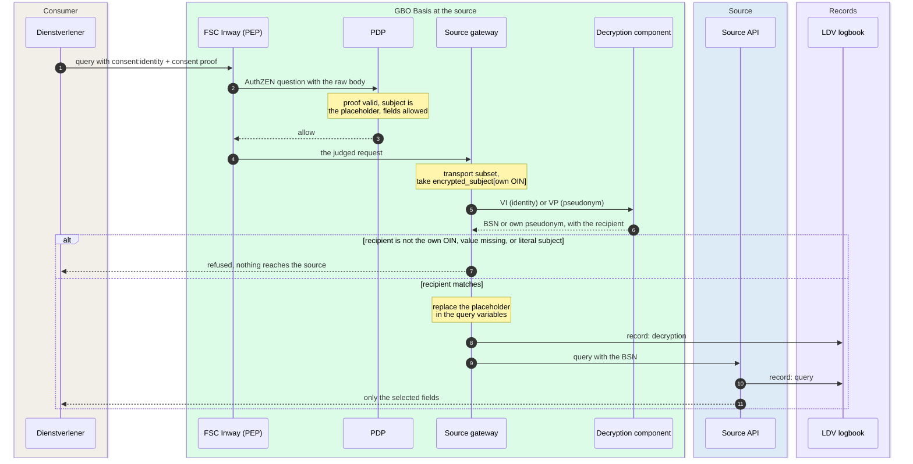

# Generic source access

The Globaal Ontwerp calls this part "generieke bronontsluiting". It is the
path behind the PEP: after the PDP allows a request, the source gateway
passes it to the source API. Under consent, the gateway first puts the
citizen into the query. The source answers one GraphQL query and returns
only the fields that the query selects. The
[Pseudonymization](../../concepts/pseudonymization.md) and
[Authorization](../../concepts/authorization.md) concept pages have the
detail and the links to the code.

[Overview](../index.md) › [GBO Basis](index.md) › Generic source access

## Components behind the PEP

```mermaid
flowchart LR
  out["Outway of<br/>the caller"]
  subgraph bh["At the bronhouder"]
    direction LR
    pep("FSC Inway<br/>PEP")
    subgraph pdpg["PDP"]
      direction TB
      pdp("Mapper + policy")
      copy[("Schema copy<br/>and pins")]
    end
    subgraph acc["Generic source access"]
      direction TB
      gw("Source gateway<br/>bron-sidecar")
      dec("Decryption<br/>component")
    end
    api[("Source API<br/>GraphQL")]
    log[("LDV logbook<br/>of the source")]
  end

  out -- "request + raw body" --> pep
  pep -- "AuthZEN" --> pdp
  pdp --- copy
  pep -- "only after allow" --> gw
  gw -- "own value" --> dec
  gw -- "judged query" --> api
  gw -.-> log
  api -.-> log
--8<-- "mermaid/classes.mmd"
  class out ext
  class pep,pdp,gw,dec basis
  class copy,log store
  class api source
  class pdp,copy,gw,dec zoom
  style bh fill:#FFFFFF,stroke:#6F94B8,stroke-dasharray:4 3
  style pdpg fill:#F4F5F7,stroke:#16A34A
  style acc fill:#F4F5F7,stroke:#16A34A
  click pdp "../authorization/" "Authorization"
  click copy "#the-pdp-copy-of-the-schema" "Schema copy"
  click gw "#placeholder-substitution-under-consent" "Substitution"
  click dec "../../../concepts/pseudonymization/#where-the-boundary-is-enforced" "Pseudonymization"
```

*Figure 1: The components of generic source access at one source. Thick
border: click to zoom in.*
{: .caption }

Each component has one job:

| Component | Job | Never does |
|---|---|---|
| Source gateway | Accepts only the request shape that the PDP judged. Under consent, it replaces the placeholder with the own value of the source. Without consent, it passes the query on unchanged. | Verifies the consent proof again, or forwards a literal subject under a consent proof |
| Decryption component | Reads a VI or a VP with the keys of the source. | Calls BSNk or another service at query time ([REQ-21](../../requirements/pseudonymization.md#req-21)) |
| Source API | Runs the GraphQL query and logs the processing in the LDV logbook of its controller. | Returns a field that the query did not select ([REQ-08](../../requirements/authorization.md#req-08)) |
| Schema copy and pins | One copy of the source schema per FSC service, so the PDP can resolve each field. The policy bundle pins its digest. | Changes without a new policy bundle |

The source gateway belongs to the source, and each source has its own
instance. It sits between the Inway and the API
([ADR-0033](../../decisions/0033-gateway-decrypts-after-allow.md)). The
gateway writes two LDV records: one for the decryption and one for the
query that it forwards. The answer goes back to the caller through the
Inway. A GBO-delivered channel component calls the source again for each
request and does not store the answer
([REQ-11](../../requirements/authorization.md#req-11)).

## The transport subset

The PDP judges one form of request. The source gateway accepts only that
form, so a request that the PDP never judged cannot run. In demo v0.9.0,
the gateway refuses a request in these cases:

| Request | Answer of the gateway |
|---|---|
| Path other than `/graphql` | `404` |
| Method other than `POST` | `405` |
| A query string | `400` |
| A `Content-Type` that the mapper does not accept | `415` |
| An `Upgrade` or `Content-Encoding` header | `400` |

The path check compares the raw request target byte for byte. It does not
clean or decode the path
([`transport.go`](https://github.com/ICTU/GBO-demo/blob/v0.9.0/services/bron-sidecar/transport.go)).
The PDP refuses the same forms. The second check at the gateway covers a
request that reaches the gateway by another route.

## Placeholder substitution under consent

Under consent, the consumer does not know who the citizen is. Its query
names the citizen with a fixed placeholder. The gateway fills in the
citizen after the allow:



*Figure 2: Substitution of the placeholder after the allow. The runtime
page [DvTP query](../../runtime/dvtp-query.md) has every hop.*
{: .caption }

The query names the form that the source API takes. Each placeholder maps
to one value in the consent proof:

| Placeholder | Value in the proof | Becomes | Who gets the value |
|---|---|---|---|
| `consent:identity` | VI, `encrypted_subject[<OIN>].identity` | The BSN | Only a source on the BSN authorization list |
| `consent:pseudonym` | VP, `encrypted_subject[<OIN>].pseudonym` | The own pseudonym of the source | Every source |

Under a consent, the subject comes only from the proof
([REQ-79](../../requirements/pseudonymization.md#req-79)). The gateway
takes only the value for its own OIN. It accepts the result only if the
decrypted value names that OIN as the recipient
([REQ-80](../../requirements/pseudonymization.md#req-80)). The key in
the proof is not evidence. The value that BSNk made is the evidence.

The gateway refuses the request in three cases, and the request goes no
further:

- The proof has no value in the requested form, for example no VI for a
  source that is not on the BSN authorization list.
- The decrypted value names another recipient.
- The query names the subject with a literal value under a consent proof.

Substitution works only on query variables. If the query text holds a
literal placeholder, the PDP allows it, the gateway leaves it, and the
query finds nobody. In demo v0.9.0, no rule accepts `consent:pseudonym`,
and no source API answers on a pseudonym
([#474](https://github.com/ICTU/GBO-demo/issues/474)).

## Pass-through without consent

The evidence decides what the gateway does, as it decides the regime at
the PDP. The gateway reads no grant property:

| Evidence in the request | Regime at the PDP | Gateway |
|---|---|---|
| Consent proof, subject is a placeholder | Consent | Decrypts its own value and replaces the placeholder |
| Consent proof, subject is a literal value | Consent | Refuses: the PDP denies this, so it arrives only by another route |
| No consent proof | PID | Passes the query on unchanged |

The EUDI adapter and the ASIP send no consent proof. They put the BSN from
the PID or from the access token in the query variables themselves. As a
result, the BSN is in the PDP input and in both decision logs
([REQ-60](../../requirements/logging-audit.md#req-60)). The proposed fix
keeps identifiers out of the PDP input
([ADR-0043](../../decisions/0043-identifiers-out-of-pdp-input.md)).

## Network isolation is the control

The gateway does not verify the consent proof again. The PDP verified it
on the same request, and a consumer holds real proofs. So the rule "only
after the decision" depends on one thing: nothing but the Inway reaches
the gateway ([REQ-81](../../requirements/pseudonymization.md#req-81)):

```mermaid
flowchart LR
  out["Outway of<br/>a consumer"]
  subgraph sg["Network source-gateways"]
    direction TB
    pep("FSC Inway<br/>PEP")
    gw("Source gateway<br/>no published port")
  end
  subgraph src["Network sources"]
    direction TB
    dec("Decryption<br/>component")
    api[("Source API")]
    log[("Source logbook")]
  end
  subgraph other["Networks backend and fsc-infra"]
    direction TB
    meta("FSC metadata<br/>service")
    any["Other<br/>containers"]
  end
  out -- "mTLS" --> pep
  pep -- "after allow" --> gw
  gw --> dec
  gw --> api
  gw -.-> log
  meta -. "direct, demo limit" .-> api
  any -. "can reach the API,<br/>demo limit" .-> api
--8<-- "mermaid/classes.mmd"
  class out,any ext
  class pep,gw,dec,meta basis
  class api source
  class log store
  class gw zoom
  style sg fill:#F0FDF4,stroke:#16A34A
  style src fill:#F4F5F7,stroke:#6F94B8
  style other fill:#FFF1F0,stroke:#E28F80,stroke-dasharray:4 3
  click gw "../../../deployment/#deployment-units-and-network-zones" "Network zones"
```

*Figure 3: Network zones around the source gateway in demo v0.9.0. Red:
the limits of the isolation.*
{: .caption }

In the demo, the gateways publish no port. They are on two Docker
networks only. The source Inways share `source-gateways` with them. The
source APIs, the decryption component, and the source logbooks share
`sources`. No consumer is on either network.

The isolation has three limits
([F-79](../../traceability/findings.md#f-79)):

- The source APIs are also on `backend` and `fsc-infra`, because the FSC
  metadata services point at them directly. A container on those networks
  can reach a source API without the PDP.
- The Helm chart has no NetworkPolicy. A Kubernetes deployment needs one,
  or an equivalent control.
- A nonce that binds a value to one consent, as a second line, is not
  built.

## The PDP copy of the schema

The source owns its GraphQL schema. The PDP needs the schema to give each
field its parent type. So the PDP keeps its own copy, and three controls
keep the judged request equal to the executed request:

```mermaid
flowchart LR
  subgraph srcs["Source"]
    s[("Source schema<br/>owned by the source")]
  end
  subgraph bundle["Policy bundle"]
    direction TB
    m[("PDP copy<br/>one per FSC service")]
    p[("Schema pins<br/>graphql_schemas.rego")]
  end
  subgraph pdpg["PDP"]
    direction TB
    map("Mapper<br/>parent types")
    eng("Engine<br/>pin check")
  end
  no(["Deny<br/>SCHEMA_MISMATCH"])
  s -- "CI drift check<br/>check-schema-drift.sh" --- m
  m -- "gen-graphql-pins.sh" --> p
  m -- "resolve fields" --> map
  p -- "pinned digests" --> eng
  map --> eng
  eng -- "schema not pinned" --> no
--8<-- "mermaid/classes.mmd"
  class s source
  class m,p store
  class map,eng basis
  class no dvtp
  class map zoom
  style bundle fill:#F4F5F7,stroke:#16A34A
  style pdpg fill:#F4F5F7,stroke:#16A34A
  style srcs fill:#FFFFFF,stroke:#6F94B8,stroke-dasharray:4 3
  click map "../../../concepts/authorization/#query-mapping-ftv-graphql-profile" "Query mapping"
```

*Figure 4: The PDP copy of the schema, the pins, and the drift check.*
{: .caption }

The three controls work as follows:

| Control | What it does | Where |
|---|---|---|
| Schema pins | The policy bundle pins the digest of each copy. An evaluation against a schema that is not pinned gets `CONFIG_ERROR SCHEMA_MISMATCH`. | [`graphql_schemas.rego`](https://github.com/ICTU/GBO-demo/blob/v0.9.0/policies/gbo/graphql_schemas.rego) |
| Drift check | A CI job compares each copy with the schema that the source runs. | [`check-schema-drift.sh`](https://github.com/ICTU/GBO-demo/blob/v0.9.0/scripts/check-schema-drift.sh) |
| Transport subset | The gateway runs only the request form that the PDP judged. | [The transport subset](#the-transport-subset) |

The copy has no directives. In demo v0.9.0, the copies are `bd.graphql`
for `bri`, `eudi/brp.graphql` for `brp`, and `lvg.graphql` for `lvg`. The
year selector is an argument in the schema. As a result, the PDP can check
consent per year. A change to a source schema needs a new copy, new pins,
and a new policy bundle.

## Invariants that stay at the source

Some rules depend on data that only the source sees. The PDP cannot check
them, so the source holds them and their tests.

The akte van overlijden is the example in the demo. A surviving partner
discloses her own PID and gets an attestation about her deceased partner.
The BRP source offers the flat view `akteVanOverlijden(bsn)`. The source
picks the marriage and the deceased partner. The PDP sees only the output
fields of the view
([F-47](../../traceability/findings.md#f-47)).

[REQ-57](../../requirements/eudi-issuance.md#req-57) asks for more. The
source records the relation in its service description, and the
reference policy denies another entry point. A filter that the schema
cannot express stays a tested invariant of the source. The test for the
death certificate is not built
([#425](https://github.com/ICTU/GBO-demo/issues/425)).

## Three demo sources

Demo v0.9.0 has three sources. Each source has its own API, its own
gateway, and its own logbook:

| FSC service | Source | Offers | Rules | Logbook |
|---|---|---|---|---|
| `bri` | Belastingdienst profile (`graphql-server`, `bron-sidecar`) | Income declarations per year | DVT0001, EUD0001 | `logboek-bd` |
| `brp` | BRP profile of RvIG (`brp-graphql-server`, `brp-sidecar`) | Persoonslijst and the akte van overlijden view | EUD0002, ASI0001 | `logboek-brp` |
| `lvg` | LVG mock (`lvg-graphql-server`, `lvg-sidecar`) | The ownership check `vbo(bsn, vboId) { vboId }` | LVG0001 | `logboek-lvg` |

The demo takes two shortcuts in this part:

- The three sources share one decryption component.
- The three sources share one OIN.

Production needs one decryption component per source, each with its own
OIN. Because of the shortcuts, the demo cannot show that the values of
two sources are not linkable.

## Compared with the Globaal Ontwerp

The demo follows the Globaal Ontwerp in the use of GraphQL for selective
queries. It differs in three places:

| Topic | Globaal Ontwerp | Demo v0.9.0 |
|---|---|---|
| Allowed queries | A dienstencatalogus lists the allowed queries per application | The rules are the catalog: a field that no rule names is denied ([ADR-0009](../../decisions/0009-closed-world-rules.md)) |
| Source without GraphQL | A GBO translation layer turns an existing API into a GraphQL source | Not built. All three sources run GraphQL ([ADR-0027](../../decisions/0027-onboarding-toolkit.md), proposed) |
| From proof to BSN | BSNk PP keeps the BSN away from the private dienstverlener | The same, and the source gateway converts its own value after the allow. BSNk is not in the query path |

## Open points

The main open points in generic source access are these:

- The isolation of the gateway outside Docker Compose, and a nonce as a
  second line ([F-79](../../traceability/findings.md#f-79)).
- The PDP checks that the subject comes from the proof. It does not check
  who the subject is ([F-77](../../traceability/findings.md#f-77)).
- A relation to another person stays an invariant of the source that the
  policy cannot check ([F-47](../../traceability/findings.md#f-47)).
- In the PID regime, the BSN is in the PDP input and in both decision
  logs ([F-54](../../traceability/findings.md#f-54)).
- How the PDP models fields, recursion, and arguments for future sources
  ([Q-14](../../traceability/open-questions.md#q-14)).

## Traceability

- Requirements: [REQ-08](../../requirements/authorization.md#req-08),
  [REQ-11](../../requirements/authorization.md#req-11),
  [REQ-21](../../requirements/pseudonymization.md#req-21),
  [REQ-57](../../requirements/eudi-issuance.md#req-57),
  [REQ-60](../../requirements/logging-audit.md#req-60),
  [REQ-79](../../requirements/pseudonymization.md#req-79),
  [REQ-80](../../requirements/pseudonymization.md#req-80),
  [REQ-81](../../requirements/pseudonymization.md#req-81)
- Findings: [F-47](../../traceability/findings.md#f-47) (open),
  [F-54](../../traceability/findings.md#f-54) (open),
  [F-77](../../traceability/findings.md#f-77) (open),
  [F-79](../../traceability/findings.md#f-79) (open)
- Open questions: [Q-14](../../traceability/open-questions.md#q-14) (open)
- Demo increments: [SL-22](../../traceability/increments.md#sl-22) (done),
  [SL-51](../../traceability/increments.md#sl-51) (done)
