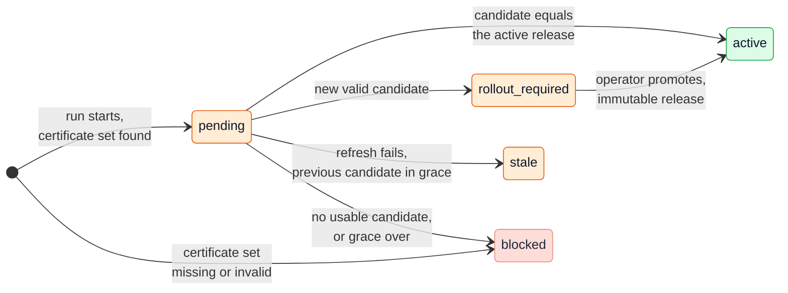

# Source configuration

The Globaal Ontwerp gives each bronhouder a "decentraal
configuratiecomponent": the source configures what the central GBO
facilities offer for it. In the demo, the source describes its own
services in one document. GBO validates that description and activates
it as an immutable release. The EUDI adapter, the issuance server and the
ASIP read only the active release. The
[Source onboarding](../../concepts/source-onboarding.md) concept page has
the detail and the links to the code.

[Overview](../index.md) › [GBO Basis](index.md) › Source configuration

## Components

```mermaid
flowchart LR
  subgraph bh["At the bronhouder"]
    direction TB
    meta[("Source document<br/>/.well-known/gbo")]
    pep("PEP + PDP<br/>metadata service")
  end
  subgraph op["GBO configuration"]
    direction TB
    cfg[("Source file<br/>sources/configured/")]
    certs[("Certificate set<br/>per source")]
    cat[("Attribute catalog<br/>asi-attributes.json")]
  end
  subgraph fac["Shared GBO facilities"]
    direction TB
    rec("Source reconciler")
    fm("FSC Manager<br/>contracts")
    out("FSC Outway")
    reg[("Source registry<br/>PostgreSQL")]
  end
  subgraph readers["Readers of the active release"]
    direction TB
    adp("EUDI adapter")
    init("Issuance init<br/>container")
    asip("ASIP")
  end
  cfg & certs & cat --> rec
  rec -- "list contracts" --> fm
  rec -- "GET /.well-known/gbo" --> out --> pep --> meta
  rec -- "writer role" --> reg
  reg -- "reader role, every 5 s" --> adp
  reg -- "reader role, every 5 s" --> asip
  reg -- "at a restart" --> init
--8<-- "mermaid/classes.mmd"
  class meta source
  class pep,fm,out basis
  class cfg,certs,cat,reg store
  class rec,adp,init,asip eudi
  class meta,rec,reg,adp,asip zoom
  style bh fill:#FFFFFF,stroke:#6F94B8,stroke-dasharray:4 3
  style op fill:#F4F5F7,stroke:#D1D5DB
  style fac fill:#F4F5F7,stroke:#EA580C
  style readers fill:#F4F5F7,stroke:#EA580C
  click meta "#the-source-document" "The source document"
  click rec "../../../runtime/admission/#source-activation" "Source activation"
  click reg "#lifecycle-of-a-source" "Lifecycle"
  click adp "../../../runtime/eudi-issuance/" "EUDI issuance"
  click asip "../../../runtime/asi-verification/" "ASI verification"
```

*Figure 1: The components of source configuration. Thick border: click to
zoom in.*
{: .caption }

Each component has one job:

| Component | Job | Never does |
|---|---|---|
| Source document | Describes the data service, the query, the offers, the claims and the ASI attributes of the source. | Holds the GraphQL schema or an access decision |
| Source file | Names the transport, the metadata location and the FSC Peer ID of the source. | Holds the OIN or the organization name |
| Source reconciler | Fetches the document, validates it, binds it to the data contract, and writes a candidate. It is the only component that fetches source metadata. | Calls the Kubernetes API, or activates a source on a contract alone |
| Source registry | Stores candidates, states, immutable releases and one active pointer. It has a writer role and a read-only role. | Stores private key material |
| Readers | Build a snapshot from the active release and swap it in memory. | Fetch source metadata themselves |

The nl-wallet issuance server reads its configuration only at start. A new
release therefore needs a controlled restart of that server.

## Who owns what

Four parties own a part of the description of one source. GBO never adds
to the part of the bronhouder
([REQ-64](../../requirements/sources-identity.md#req-64)):

```mermaid
flowchart LR
  subgraph own["Owned by the bronhouder"]
    direction TB
    doc[("Source document<br/>service, query, offers,<br/>claims, attributes")]
    cs[("Certificate set<br/>OIN, organization name,<br/>issuer name")]
  end
  subgraph agr["Agreed between bronhouder and GBO"]
    direction TB
    fsc[("FSC contracts<br/>and grant hashes")]
  end
  subgraph opr["Owned by the GBO operator"]
    direction TB
    yaml[("Source file<br/>source_id, transport,<br/>location, Peer ID")]
  end
  subgraph gbo["Owned by GBO"]
    direction TB
    vs[("value_schema per<br/>ASI attribute")]
    tm[("Type Metadata<br/>generated")]
    rel[("Candidates, releases,<br/>active pointer")]
  end
  own ~~~ agr ~~~ opr ~~~ gbo
--8<-- "mermaid/classes.mmd"
  class doc,cs source
  class fsc ext
  class yaml,vs,tm,rel store
  style own fill:#FFFFFF,stroke:#6F94B8,stroke-dasharray:4 3
  style agr fill:#F4F5F7,stroke:#D1D5DB
  style opr fill:#F4F5F7,stroke:#D1D5DB
  style gbo fill:#F4F5F7,stroke:#EA580C
```

*Figure 2: The owners of the parts that describe one source.*
{: .caption }

The source file is small. This is the file for the Belastingdienst in
demo v0.9.0:

```yaml
metadata_endpoint:
  transport: fsc
  provider_peer_id: "99999999900000000200"
  service_reference: gbo-metadata-bd
```

The file name is the stable `source_id`. The legal identity comes from the
certificate set under the same key: the OIN from `serialNumber` and the
name from `O`. GBO refuses a configured value that differs
([REQ-67](../../requirements/sources-identity.md#req-67)). The data service
and the grant hash come from the document and from the FSC contracts in
force.

A source has a metadata leg and a data leg. Each leg selects one of three
transports:

| Transport | Metadata leg | Data leg | Use |
|---|---|---|---|
| `fsc` | Fixed path `/.well-known/gbo`, through a separate FSC metadata service | The data service in the document, under its contract | The intended form |
| `file` | A document in the metadata directory of the operator | Not possible: a file cannot answer a query | A source without its own endpoint, as a temporary exception that needs the agreement of the bronhouder ([AV-08](../../requirements/admission.md#av-08)) |
| `unsecured` | An absolute HTTP or HTTPS URL, without FSC headers or redirects | An absolute URL | Local demonstrations only |

The reconciler refuses `fsc` metadata with `unsecured` data. The registry
reports one authentication flag per leg. With one flag for both legs, an
FSC data call can hide that its description came over an unauthenticated
channel.

## Lifecycle of a source

Every reconcile run takes each configured source through the same states.
A source fails or ages on its own, without effect on the other sources:



*Figure 3: The states of a source per reconcile run. The next run starts
again at `pending`.*
{: .caption }

The run has these steps:

1. The reconciler loads the certificate set of the source. Without a
   valid set, the source is `blocked` before any network call.
2. For the `fsc` transport, the reconciler finds the metadata contract and
   the data contract of the configured peer in the FSC Manager.
3. It fetches the document with `ETag` and `If-None-Match`. A `304` only
   extends the freshness. It validates every `200` in full.
4. A valid result becomes a complete candidate. If the candidate differs
   from the active release, the state is `rollout_required`.
5. Promotion writes one release from the complete candidate set. The
   SHA-256 of the content identifies the release, and the release never
   changes.
6. In the same database transaction, promotion sets the singleton
   `active_release_id`. If promotion fails, the previous release stays
   active.
7. The readers poll the active pointer and swap the new release in
   memory.

In the demo, the reconciler promotes by itself (`--auto-promote`).
Automatic promotion is off by default. Compose and the Helm example turn
it on, and then the source file is the management action.

## A contract is not activation

A valid FSC contract does not take a source into use. It also does not put
the offer of the source in the wallet
([REQ-65](../../requirements/sources-identity.md#req-65),
[F-58](../../traceability/findings-closed.md#f-58)). Transport and mandate
are two decisions with two owners. Each situation has a fixed result:

| Situation | Result |
|---|---|
| Valid metadata contract, no source file | Nothing happens |
| Source file, no metadata contract | `blocked`: `METADATA_CONTRACT_NOT_FOUND` |
| Source file, no contract for the data service | `blocked`: `DATA_CONTRACT_NOT_FOUND` |
| FSC Manager unreachable | `FSC_MANAGER_UNAVAILABLE`. The candidate stays within grace |
| Valid candidate without promotion | Not active |

Demo v0.9.0 does not build two things. No control decides who can add a
source file. No record keeps the admission decision
([REQ-123](../../requirements/admission.md#req-123), PSA B-09 in the
[besluitregister](https://ictu.github.io/GBO-PSA/main/vraagstukken/#besluitregister)).

## Freshness, versions and rollback

Source metadata fails closed for each source, ages within fixed bounds,
and can be rolled back
([REQ-66](../../requirements/sources-identity.md#req-66)). The bounds in
demo v0.9.0 are these:

| Bound | Value |
|---|---|
| Fresh after a successful check | 15 minutes at most |
| Stale grace after that | One hour at most |
| Validity left at acceptance | At least one hour |
| Answer for a source past its grace | HTTP 503, for that source only |

The issuance route shows `X-GBO-Metadata-Cache: fresh` or `stale`. The
versioning rules are these:

- Activation refuses a lower `version` than the last validated candidate.
  It also refuses the same version with other content. This rule has no
  test ([#610](https://github.com/ICTU/GBO-demo/issues/610)).
- A change to `claims` or `display` needs a new `type_version`, because
  `vct#integrity` covers the exact bytes of the Type Metadata. GBO never
  deletes a published type version automatically.
- An operator rolls back with `activate-source-release --release-id`. The
  command refuses a release that the adapter cannot load. An auto-promoter
  keeps the rollback until new content arrives.

Demo v0.9.0 has two deviations from the isolation rule
([#606](https://github.com/ICTU/GBO-demo/issues/606)). Promotion needs a
valid version of every configured source, so one broken source freezes new
releases for all sources. The offer list `/eudi-offers.json` takes the
shortest grace of all sources, so it fails for all sources at the same
time.

Policy bundles do not have this lifecycle of validation, bounded
staleness, atomic promotion and rollback
([F-59](../../traceability/findings-closed.md#f-59)). For the policy
side, see [Policy rules and their management](policy.md).

## A certificate set per source

Every source has its own certificate set for issuance: an issuer, a
reader and a status-list certificate. GBO never shares a set between
sources and never substitutes one
([REQ-58](../../requirements/eudi-issuance.md#req-58)). The wallet shows
the issuer name and the purpose from these certificates. A fallback to the
set of another source made the wallet show the wrong issuer
([F-50](../../traceability/findings-closed.md#f-50)).

Missing material fails for that source only. Without a set, the source is
`blocked` with `CERTIFICATE_SET_NOT_FOUND`. A set without an OIN or an
organization name gives `CERTIFICATE_SET_INVALID`. The reconciler gets only
public certificates. Only the issuance init container gets the private
keys.

## The source document

The document is closed JSON, validated against
`gbo-source-metadata-v1`. Validation refuses unknown fields:

```mermaid
flowchart LR
  doc[("Source document<br/>gbo-source-metadata-v1")]
  env["Envelope<br/>schema_version 1.0 or 1.1<br/>source_oin · version<br/>issued_at · expires_at"]
  e["capabilities.eudi<br/>one entry per attestation"]
  a["capabilities.asi<br/>schema 1.1 only"]
  t["type_id · type_version"]
  o["offers<br/>fixed parameters"]
  q["graphql<br/>one read operation,<br/>subject_variable, result_pointer"]
  c["display · claims<br/>gbo-simple-v1 rule per claim"]
  as["authentic_source<br/>legal name, country"]
  aq["graphql<br/>one query ending in ...Selected"]
  at["attributes<br/>pointer · join · const · each"]
  gen("Generated by GBO<br/>Type Metadata, VCT path")
  doc --> env
  doc --> e
  doc --> a
  e --> t & o & q & c
  a --> as & aq & at
  c -. "derives" .-> gen
--8<-- "mermaid/classes.mmd"
  class doc,env,e,a,t,o,q,c,as,aq,at source
  class gen eudi
```

*Figure 4: The structure of the source document.*
{: .caption }

A new attestation type, offer or tax year is a change in the document. It
needs no change in GBO code, because the adapter takes its parameters from
the source ([Q-19](../../traceability/answered-questions.md#q-19)).

The `eudi` capability defines each claim once. GBO derives the mapping
and generates the SD-JWT VC Type Metadata from `display` and `claims`. As
a result, the schema of an attestation cannot differ from what the mapping
fills. The VCT of a type version is
`/types/{source-id}/{type-id}/v{type-version}`.

The `asi` capability describes the attributes that the ASIP can verify
([ADR-0039](../../decisions/0039-asi-source-described-attributes.md)). Each
`identifier` must exist in the attribute catalog of GBO. If `asi` has an
error, onboarding refuses the whole source, also when `eudi` is valid. How
many sources the ASIP must connect, and how fast, is open
([Q-38](../../traceability/open-questions.md#q-38)).

The document does not hold the GraphQL schema: the PDP keeps its own copy.
It also holds no access decision: the rules decide which fields a channel
gets. The source does not sign the document. Its origin rests on the
authenticated FSC transport and the OIN in the certificate set.

## Compared with the Globaal Ontwerp

The demo follows the idea of the Globaal Ontwerp: the bronhouder
configures, and the central facilities read that configuration. It differs
in three places:

| Topic | Globaal Ontwerp | Demo v0.9.0 |
|---|---|---|
| Form of the configuration | A decentral configuration component at the bronhouder | One closed JSON document per source at `/.well-known/gbo`, a proposal for PSA S10 ([ADR-0016](../../decisions/0016-source-owned-metadata.md)) |
| Findability | A dienstencatalogus with a shared profile and central findability, based on DCAT-AP-NL | No central findability and no DCAT-AP-NL reference ([F-57](../../traceability/findings.md#f-57)) |
| Channels | Every channel reads the configuration | EUDI and ASI read it. DvTP does not: the GBO rules hold the DvTP offer ([F-74](../../traceability/findings.md#f-74)) |

## Open points

The main open points in source configuration are these:

- The description lacks the read API of the logbook of the source, a
  DCAT-AP-NL reference and central findability
  ([F-57](../../traceability/findings.md#f-57)).
- The `file` transport has no recorded agreement of the bronhouder
  ([F-71](../../traceability/findings.md#f-71)).
- DvTP scope comes from the demand side and EUDI scope from the supply
  side ([F-74](../../traceability/findings.md#f-74)).
- The central issuance server holds the private keys of every source
  ([Q-17](../../traceability/open-questions.md#q-17)).
- The ASI attribute identifiers are placeholders until the EU catalog of
  attributes exists ([Q-31](../../traceability/open-questions.md#q-31)).

## Traceability

- Requirements: [REQ-58](../../requirements/eudi-issuance.md#req-58),
  [REQ-64](../../requirements/sources-identity.md#req-64),
  [REQ-65](../../requirements/sources-identity.md#req-65),
  [REQ-66](../../requirements/sources-identity.md#req-66),
  [REQ-67](../../requirements/sources-identity.md#req-67),
  [REQ-123](../../requirements/admission.md#req-123),
  [AV-08](../../requirements/admission.md#av-08)
- Findings: [F-50](../../traceability/findings-closed.md#f-50) (closed),
  [F-57](../../traceability/findings.md#f-57) (open),
  [F-58](../../traceability/findings-closed.md#f-58) (closed),
  [F-59](../../traceability/findings-closed.md#f-59) (closed),
  [F-71](../../traceability/findings.md#f-71) (open),
  [F-74](../../traceability/findings.md#f-74) (open)
- Open questions: [Q-17](../../traceability/open-questions.md#q-17) (open),
  [Q-19](../../traceability/answered-questions.md#q-19) (answered),
  [Q-31](../../traceability/open-questions.md#q-31) (open),
  [Q-38](../../traceability/open-questions.md#q-38) (partly answered)
- Demo increments: [SL-32](../../traceability/increments.md#sl-32) (done),
  [SL-46](../../traceability/increments.md#sl-46) (done),
  [SL-49](../../traceability/increments.md#sl-49) (done)
