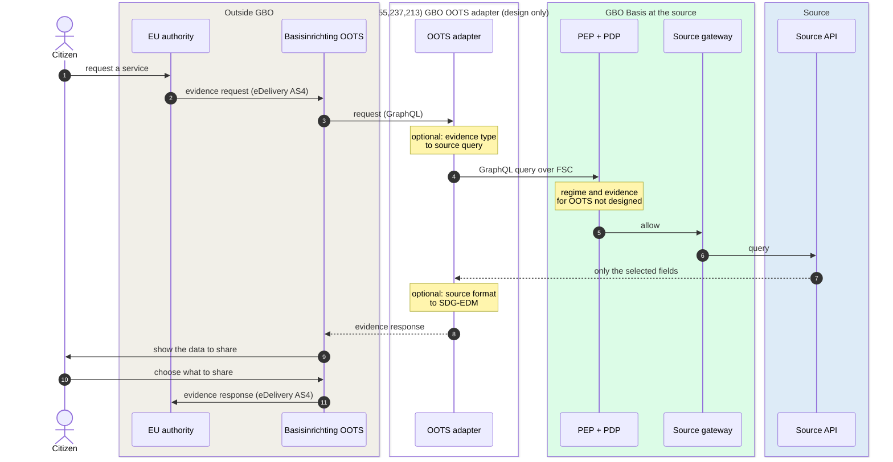

# OOTS channel

In the OOTS channel, a public authority in another EU member state gets
evidence from a Dutch source. The authority needs the evidence for a
procedure under the Single Digital Gateway Regulation. The Basisinrichting OOTS handles the European
transport and the interaction with the citizen. GBO adds an OOTS adapter
in front of GBO Basis, so the source holder (bronhouder) sees a normal FSC request. This
is interaction pattern B of the
[Globaal Ontwerp](https://ictu.github.io/GBO-GO/main/#patroon-b-grensoverschrijdend-verzoek-via-oots).
The channel is design only: it is not built in demo v0.9.0.

[Overview](index.md) › OOTS channel

## Inside the channel

```mermaid
flowchart LR
  burger(["Citizen"])
  subgraph eu["Other member state"]
    direction TB
    ca["Competent<br/>authority"]
    cs["OOTS common<br/>services"]
  end
  subgraph bi["Basisinrichting OOTS"]
    direction TB
    ap["Access point<br/>eDelivery AS4"]
    oov["OOTS-V<br/>re-authentication,<br/>preview, consent to send"]
  end
  subgraph oa["GBO OOTS adapter"]
    direction TB
    pa("Protocol adapter<br/><i>design only</i>")
    map("Semantic mapping<br/>to SDG-EDM, optional<br/><i>design only</i>")
  end
  subgraph basis["GBO Basis, at each source"]
    direction LR
    pdp("PEP + PDP") --> gw("Source<br/>gateway") --> api[("Source<br/>API")]
  end

  burger -- "uses a service" --> ca
  ca -. "discovery" .-> cs
  ca -- "① evidence request<br/>AS4, OOTS-EDM" --> ap --> oov
  oov -- "② request" --> pa
  pa --- map
  pa -- "③ GraphQL over FSC" --> pdp
  burger -. "preview" .- oov
--8<-- "mermaid/classes.mmd"
  class burger,api source
  class ca,cs,ap,oov ext
  class pa,map planned
  class pdp,gw basis
  class pa,map,pdp,gw zoom
  style eu fill:#F4F5F7,stroke:#D1D5DB
  style bi fill:#F4F5F7,stroke:#D1D5DB
  style oa fill:#FFFFFF,stroke:#EA580C,stroke-dasharray:6 4
  style basis fill:#F4F5F7,stroke:#16A34A
  click pa "../../runtime/design-level/#sdg-oots" "SDG-OOTS scenario"
  click map "../../decisions/0024-canonical-semantic-models/" "Canonical semantic models"
  click pdp "../gbo-basis/authorization/" "Authorization"
  click gw "../gbo-basis/source-access/" "Generic source access"
```

*Figure 1: The OOTS channel. Dashed: design only (not built in demo
v0.9.0). Grey: parties outside GBO.*
{: .caption }

The channel has these parts:

| Part | Role | Zoom in |
|---|---|---|
| Basisinrichting OOTS | Delivered by RINIS for the ministries of BZK and EZK. Its part OOTS-V receives evidence requests and has the citizen authenticate again. It checks for a mix-up of identities, fetches the data, and shows them to the citizen before it sends them. Not a GBO component | [GO pattern B](https://ictu.github.io/GBO-GO/main/#patroon-b-grensoverschrijdend-verzoek-via-oots) |
| Protocol adapter | Translates the OOTS request into a GraphQL query over FSC and passes it on. It decides nothing about source data ([REQ-44](../requirements/authorization.md#req-44)) | [ADR-0020](../decisions/0020-as4-bridge-for-oots.md) |
| Semantic mapping | Maps the source format to the SDG Evidence Data Model, if the source holder configures a mapping. Optional for the source holder | [ADR-0024](../decisions/0024-canonical-semantic-models.md) |
| GBO Basis | Decides at the source, field by field, and only then asks the source. The same chain as for every other channel | [GBO Basis](gbo-basis/index.md) |

## One evidence request

The Globaal Ontwerp describes the request in this order. The OOTS process
steps stay with the Basisinrichting OOTS:



*Figure 2: One OOTS evidence request, after GO pattern B. The runtime
page [Design-level scenarios](../runtime/design-level.md#sdg-oots) has
every hop.*
{: .caption }

OOTS-V sends the data only after the citizen agrees. The member states
use eDelivery, AS4, ebMS and RegRep. OOTS-EDM specifies the request and
response messages, and SDG-EDM describes the evidence. The source holder
applies none of these standards itself.

## Two designs for the edge

The Globaal Ontwerp and the design decision of this TO put the AS4 edge
in different places:

```mermaid
flowchart LR
  subgraph go["Globaal Ontwerp, pattern B"]
    direction LR
    g1["Basisinrichting OOTS<br/>access point + protocol<br/>translator to GraphQL"]
    g2("GBO facility<br/>optional semantic mapping")
    g3("GBO Basis")
    g1 -- "GraphQL" --> g2 -- "FSC" --> g3
  end
  subgraph adr["ADR-0020"]
    direction LR
    a1("GBO OOTS adapter<br/>Domibus access point,<br/>OOTS-EDM adapter,<br/>FSC translator")
    a3("GBO Basis")
    a1 -- "FSC" --> a3
  end
  as4(["AS4 from<br/>a member state"])
  as4 --> g1
  as4 --> a1
--8<-- "mermaid/classes.mmd"
  class as4,g1 ext
  class g2,a1 planned
  class g3,a3 basis
  style go fill:#F4F5F7,stroke:#D1D5DB
  style adr fill:#F4F5F7,stroke:#D1D5DB
```

*Figure 3: Where the AS4 edge sits in the two designs.*
{: .caption }

In both designs, AS4 exists only at the edge, and the source holder sees a
normal FSC request through the standard PEP and PDP chain. The difference
is who builds the protocol translation. It is open whether GBO builds the
adapter, or the OOTS-V operator extends its facility with the GBO
interface ([Q-79](../traceability/open-questions.md#q-79), PSA
[B-12](https://ictu.github.io/GBO-PSA/main/vraagstukken/#besluitregister)).

## What the adapter reuses from GBO Basis

The adapter is a protocol adapter in front of GBO Basis. It reuses every
part of GBO Basis and adds no decision of its own:

| Part of GBO Basis | Use for OOTS | State |
|---|---|---|
| FSC connection and admission | The adapter calls the source as an FSC consumer, with a contract after admission ([REQ-46](../requirements/sources-identity.md#req-46)) | Design |
| PDP and policy | The PDP of the source decides on every field. OOTS needs a regime, evidence and a rule of its own | Not designed |
| Source gateway | Without a consent proof, the gateway passes the query on unchanged | Built for other channels |
| Source configuration | The Globaal Ontwerp takes the mapping configuration from the source holder. The source document has no OOTS capability | Not designed |
| Records | ADL, LDV and the FSC txlog record the request like any other request | Built for other channels |

A channel adapter that GBO delivers does only protocol translation
([REQ-44](../requirements/authorization.md#req-44)). It does not decide
which data a party gets. It does not fetch decision information such as
consent or admission. It carries no knowledge of a source in code. It
uses the source access that the source offers for all interaction
patterns, and never a interface (koppelvlak) for one channel.

The mapping depends on a canonical model per source. The proposed
decision makes the GraphQL schema of the source profile (bronprofiel) that canonical model
([ADR-0024](../decisions/0024-canonical-semantic-models.md), proposed).
GBO then derives the OOTS-EDM evidence-type mappings from it. No central
canonical model exists. Source holders and domains own their models
([Q-11](../traceability/answered-questions.md#q-11)).

## What demo v0.9.0 does

The demo does not touch OOTS. It has no adapter, no access point and no
rule for OOTS. The following figure shows what happens if a peer sends an
OOTS-like request today:

```mermaid
flowchart LR
  r(["Request from an<br/>adapter peer"])
  q{"Consent proof<br/>in the request?"}
  p["PID regime<br/>EUD0001 · EUD0002 · ASI0001"]
  a{"Caller on a<br/>PID actor list?"}
  d(["Deny<br/>actor check fails"])
  r --> q
  q -- "no" --> p --> a
  a -- "no" --> d
--8<-- "mermaid/classes.mmd"
  class r planned
  class q,a basis
  class p eudi
  class d dvtp
  class a zoom
  click a "../gbo-basis/authorization/#regime-from-evidence" "Regime from evidence"
```

*Figure 4: An OOTS request in demo v0.9.0 ends in a deny.*
{: .caption }

The request carries no consent proof, so it enters the PID regime. The
PID rules admit only named callers, and an OOTS adapter is not one of
them. The regime follows from the evidence in the request
([REQ-74](../requirements/authorization.md#req-74)). Without evidence of
its own, an OOTS request cannot get an allow. Risk
[R2](../risks.md#r2) tracks the missing bridge.

## Compared with the Globaal Ontwerp

The TO design follows pattern B in the main line. It differs in the
edge, and the demo has no part of it:

| Topic | Globaal Ontwerp | TO design | Demo v0.9.0 |
|---|---|---|---|
| AS4 access point | In the Basisinrichting OOTS | Domibus at the GBO edge ([ADR-0020](../decisions/0020-as4-bridge-for-oots.md)) | None |
| Protocol translation to GraphQL | A translator in the Basisinrichting OOTS. OOTS-V must also support GraphQL | The FSC translator of the GBO adapter | None |
| Semantic mapping | An optional GBO facility, configured by the source holder | An OOTS-EDM adapter, based on the canonical model per source ([ADR-0024](../decisions/0024-canonical-semantic-models.md)) | None |
| Basis for the request | Policy checks a basis other than consent | A legal-basis path in the Gov-to-Gov style, needed and not built | No rule: the PDP denies |

## Open points

The main open points in the OOTS channel are these:

- Who builds the adapter, and where the boundary between OOTS-V and the
  mapping function is ([Q-79](../traceability/open-questions.md#q-79)).
- The regime and the evidence for an OOTS request. A request without
  evidence of its own enters the PID regime
  ([F-70](../traceability/findings.md#f-70)).
- Whether the service description of the source must refer to a managed
  schema and concept framework, as PSA S10 asks
  ([Q-11](../traceability/answered-questions.md#q-11)).
- The mapping to SDG-EDM needs traceable versions, as
  [REQ-124](../requirements/eudi-issuance.md#req-124) asks for issuance.
  The requirements register has no OOTS requirement
  ([Q-79](../traceability/open-questions.md#q-79)).

## Traceability

- Requirements: [REQ-44](../requirements/authorization.md#req-44),
  [REQ-46](../requirements/sources-identity.md#req-46),
  [REQ-74](../requirements/authorization.md#req-74),
  [REQ-124](../requirements/eudi-issuance.md#req-124)
- Findings: [F-70](../traceability/findings.md#f-70) (open)
- Open questions: [Q-11](../traceability/answered-questions.md#q-11) (answered),
  [Q-79](../traceability/open-questions.md#q-79) (open)
- Demo increments: none
