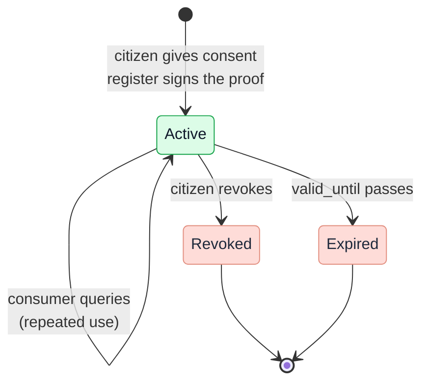
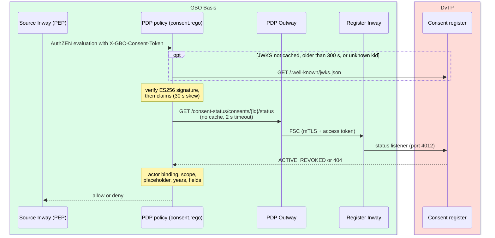

# Consent

In DvTP, the consent of the citizen is the legal basis for delivery of
source data to a private consumer (afnemer). A consent proof carries the consent to
the source, and the PDP of the source verifies that proof on every
request. A consent has a lifecycle of validity, revocation, and repeated
use.
The consent model realizes capability
[S01](https://ictu.github.io/GBO-PSA/main/capabilities/#s01-toestemmingsregistratie)
for the consent register (toestemmingsregister) and capability
[S02](https://ictu.github.io/GBO-PSA/main/capabilities/#s02-toestemmingsportaal)
for the consent portal (toestemmingsportaal).

The main decision is [ADR-0032](../decisions/0032-consent-proof.md). It
defines the consent proof in five points:

- The register signs the proof.
- The proof carries a value per source.
- The consumer can name the citizen only with a placeholder.
- The status stays online over FSC.
- The policy verifies the proof.

For the scenarios, see the runtime view:
[DvTP consent](../runtime/dvtp-consent.md),
[DvTP query](../runtime/dvtp-query.md), and
[DvTP citizen access](../runtime/dvtp-citizen-access.md).

## Roles

Five roles take part in consent:

| Role | Component in the demo | Does |
|---|---|---|
| Consent portal (S02) | `toestemmingsportaal-frontend`, consent portal backend | Shows the request, logs the citizen in, makes the values per source at BSNk, and lets the citizen view and revoke consents |
| Consent register (S01) | `consent-register` | Stores the consent record, signs the proof, and answers the status over FSC |
| Consumer | `dienstverlener-backend` | Starts the request, receives the proof, and sends it unchanged with every query |
| PDP of the source | OpenFTV PDP, `consent.rego` | Verifies the proof and gets the status at every request |
| Source gateway | `bron-sidecar` | After the allow, decrypts its own value from the proof |

It is an open question whether the register and the portal backend are
one system ([Q-49](../traceability/open-questions.md#q-49)). For the
requirements on the roles, see
[Consent roles](../requirements/consent.md#consent-roles).

## Lifecycle

The register stores the status `ACTIVE` or `REVOKED`. The status Expired
follows from `valid_until`. The citizen overview shows Active, Expired,
and Revoked. Demo v0.9.0 does not build a "retrieved" status. Two points
are open: when a consent counts as retrieved, and how the register learns
this ([Q-42](../traceability/open-questions.md#q-42)). The FR-DvTP texts
name the statuses with different words
([F-97](../traceability/findings.md#f-97)).

A consent is bound to one consumer, one service, and named data sets
([REQ-12](../requirements/consent.md#req-12)). It covers a whole data set.
Within a set, the citizen does not pick fields
([REQ-10](../requirements/consent.md#req-10)). The portal shows only the
data sets that the consumer asks for. It refuses a data set that it
cannot describe. For the record model, see
[consent register](../requirements/consent.md#consent-register).

## The consent proof

When the citizen gives consent, the consent register signs a JWT with
these parts
([`consent_token.go#L130-L152`](https://github.com/ICTU/GBO-demo/blob/v0.9.0/services/consent-register/consent_token.go#L130-L152)):

| Part | Content |
|---|---|
| Header | `alg=ES256`, `typ=gbo-consent+jwt`, `kid`. The public keys are in the JWKS of the register |
| `consent_id`, `jti` | The consent and a unique token ID |
| `scopes`, `scope_entries` | The data sets, per source |
| `dienstverlener_oin` | The represented party. In the demo, this field holds the FSC Peer ID ([Q-68](../traceability/open-questions.md#q-68)) |
| `valid_until`, `exp` | The end of the validity. The two values are equal |
| `iss`, `aud`, `iat`, `nbf` | Issuer, audience (default `gbo:dvtp:pdp`), and times |
| `encrypted_subject` | For each source OIN: a `pseudonym` (VP) and, only for a source on the BSN authorization list, an `identity` (VI). Each value has its `key_set_version` |

The proof holds no BSN and no PI
([REQ-20](../requirements/pseudonymization.md#req-20)). Only the source
that a value in `encrypted_subject` was made for can read that value
([REQ-80](../requirements/pseudonymization.md#req-80)). The register
refuses a proof without a pseudonym for every party
([`consent_token.go#L45-L64`](https://github.com/ICTU/GBO-demo/blob/v0.9.0/services/consent-register/consent_token.go#L45-L64)).
The PDP denies such a proof too, with `CONSENT_CONTEXT_INVALID`. For how
the values are made, see [Pseudonymization](pseudonymization.md).

The portal returns the proof to the consumer in the URL fragment of the
return redirect. The consumer frontend removes the proof from the visible
URL at once
([`consent-flow.md#L130-L133`](https://github.com/ICTU/GBO-demo/blob/v0.9.0/docs/consent-flow.md#L130-L133)).
The question of what the return redirect gives back is partly answered
([Q-44](../traceability/open-questions.md#q-44)).

The consumer sends the proof unchanged in `X-GBO-Consent-Token`
([AV-05](../requirements/admission.md#av-05)). In its query,
the consumer names the citizen only with a placeholder: `consent:identity`
for a BSN API, `consent:pseudonym` for a source-pseudonym API
([REQ-79](../requirements/pseudonymization.md#req-79)). The consumer can
read `consent_id` and `scopes` from the proof. It cannot read who the
citizen is ([F-76](../traceability/findings.md#f-76)).

### The integrator is not in the proof

An integrator calls the source for a consumer under FSC delegation
([ADR-0034](../decisions/0034-integrator-delegation.md)). The proof binds
only the represented party, which is the consumer. The integrator needs
its own mandate for each consumer and rule in the admission register
([REQ-106](../requirements/consent.md#req-106)). If this mandate is
absent, the PDP denies with `INTEGRATOR_NOT_REGISTERED`.

It is an open question whether the proof must also bind the integrator
([Q-46](../traceability/open-questions.md#q-46)). The working assumption
is that it does not. If the integrator is in the proof, a change of
integrator makes all running consents unusable. If the integrator is not
in the proof, every registered integrator of that consumer can use the
proof.

### Bearer token

The proof is a bearer token. The actor binding stops use by another
consumer. It does not stop replay by the same consumer
([`consent-flow.md#L268-L273`](https://github.com/ICTU/GBO-demo/blob/v0.9.0/docs/consent-flow.md#L268-L273)).
Production needs a shorter validity and proof-of-possession binding to the
FSC identity ([Risks](../risks.md)).

The location and the rotation of the signing key are open
([Q-55](../traceability/open-questions.md#q-55)). If the register uses a
persistent store, it needs a fixed signing key
(`CONSENT_SIGNING_KEY_PATH`). Then proofs stay valid after a restart
([`main.go#L84-L86`](https://github.com/ICTU/GBO-demo/blob/v0.9.0/services/consent-register/main.go#L84-L86)).

## Verification and status

The PDP of the source decides only on a consent that it checked itself
([REQ-68](../requirements/consent.md#req-68)). It establishes the origin,
the binding, and the status at evaluation time. The policy does this work.
The request mapper has no part in it
([`consent.rego`](https://github.com/ICTU/GBO-demo/blob/v0.9.0/policies/gbo/consent.rego)).
The policy verifies the proof and gets the status in this sequence:

The policy handles keys, claims, and status as follows:

- Keys: the policy gets the JWKS directly from the register. It caches
  the JWKS for 300 seconds and fetches it again on an unknown `kid`, so a
  new key works at once. No stale-key fallback exists, because the
  register that serves the keys also answers the status
  ([`consent.rego#L70-L90`](https://github.com/ICTU/GBO-demo/blob/v0.9.0/policies/gbo/consent.rego#L70-L90)).
- Claims: the policy verifies type, issuer, audience, required claims,
  `nbf`, `iat`, and `valid_until == exp`, with 30 seconds of clock skew.
  The policy reads the claims only after the signature verifies, so a
  forged token never reaches the register
  ([`consent.rego#L169-L186`](https://github.com/ICTU/GBO-demo/blob/v0.9.0/policies/gbo/consent.rego#L169-L186)).
- Status: the policy gets the status for each evaluation, with no cache,
  a 2-second timeout, and `raise_error: false`. The call carries
  `traceparent` and `Fsc-Transaction-Id`
  ([`consent.rego#L190-L200`](https://github.com/ICTU/GBO-demo/blob/v0.9.0/policies/gbo/consent.rego#L190-L200)).
  It goes over FSC, from the Outway of the PDP (peer `…0800`) to the
  Inway of the register (peer `…0700`, FSC service `consent-status`).

The register serves the status on its own listener. This listener serves
nothing else
([`status.go#L13-L26`](https://github.com/ICTU/GBO-demo/blob/v0.9.0/services/consent-register/status.go#L13-L26)).
A lookup without an FSC peer gets 401. The register logs each lookup as a
processing, with the calling peer as processor
([REQ-76](../requirements/consent.md#req-76)).

The FSC Manager of the register signs a contract only for the peer of the
PDP. Still, any connected peer can get the status of a consent if it holds
the consent ID. Demo v0.9.0 does not restrict lookups to the PDP of the
source that the consent is for.

Each failure has its own reason code. For the table of codes, see
[Authorization](authorization.md#consent-verification-in-policy).

### Freshness is asymmetric on purpose

The legal basis travels as a proof, and the status stays online
([F-61](../traceability/findings-closed.md#f-61)). Each part has its own
freshness:

| What | Freshness | Why |
|---|---|---|
| Proof content (scopes, party, validity) | Fixed at consent, verified locally | The register signed it. The PDP needs no lookup for it |
| Verification keys | Up to 300 seconds old | Keys change rarely. An unknown `kid` causes a fetch at once |
| Status | Live at every request | A revocation must deny the next request ([REQ-14](../requirements/consent.md#req-14)) |

If the status is unknown, the PDP denies. So the register is a dependency
of every DvTP request ([REQ-75](../requirements/consent.md#req-75)). The
values for propagation time, availability, and latency are open
([Q-47](../traceability/open-questions.md#q-47)). The question of who is
authoritative for revocation and expiry is answered: the register, with
the status online and fail closed
([Q-05](../traceability/answered-questions.md#q-05)).

The status answer is not in the PDP input. As a result, the input, the
policy, and the data do not reproduce a decision. The ADL does not hold
the answer ([F-72](../traceability/findings.md#f-72)).

## Validity

A consent has a finite validity. After the validity ends, the PDP denies
([REQ-19](../requirements/consent.md#req-19)). Three rules set
the validity:

- The register sets `valid_until` at creation, and the proof has
  `exp = valid_until`.
- The PDP checks both values. Within 30 seconds after `valid_until`, it
  denies with `CONSENT_EXPIRED`. After that, the token check denies first,
  with `CONSENT_TOKEN_EXPIRED`.
- In the demo, the consumer chooses the period with `validity_seconds`.
  The default is one year, with no upper bound
  ([`main.go#L48-L51`](https://github.com/ICTU/GBO-demo/blob/v0.9.0/services/consent-register/main.go#L48-L51),
  [`main.go#L421-L424`](https://github.com/ICTU/GBO-demo/blob/v0.9.0/services/consent-register/main.go#L421-L424)).
  The citizen cannot change the period
  ([F-11](../traceability/findings-closed.md#f-11),
  [#380](https://github.com/ICTU/GBO-demo/issues/380)).

Since November 2, 2026, the question of who sets the validity period is
open again ([Q-13](../traceability/open-questions.md#q-13)). Under FR-11,
the default can come from the service catalog, and the citizen can adjust
it within bounds. It is a policy and UX choice whether the citizen must be
able to do this. It is also open whether the validity can differ per
source within one consent
([Q-76](../traceability/open-questions.md#q-76)). The working assumption
is one validity per consent.

## Revocation

The citizen views and revokes consents in the portal
([REQ-38](../requirements/consent.md#req-38)). Before it revokes a
consent, the portal backend derives the reference of the citizen. It then
checks that the consent belongs to that citizen
([`portal.go#L268-L293`](https://github.com/ICTU/GBO-demo/blob/v0.9.0/services/consent-portal-backend/consent/portal.go#L268-L293),
[REQ-40](../requirements/consent.md#req-40)). Viewing and revoking
need no BSNk call.

The register sets the status to `REVOKED` and keeps the record. It writes
the processing record in the same transaction
([`main.go#L585-L596`](https://github.com/ICTU/GBO-demo/blob/v0.9.0/services/consent-register/main.go#L585-L596)).
For the next request on that proof, the status is `REVOKED`, and the PDP
denies with `CONSENT_WITHDRAWN`
([REQ-14](../requirements/consent.md#req-14)). Another active consent of
the same citizen cannot take its place, because the PDP checks only the
`consent_id` from the signed proof.

Three points on revocation are open:

- Revocation of a valid consent only
  ([REQ-109](../requirements/consent.md#req-109)).
- Whether the register records the moment of revocation
  ([Q-48](../traceability/open-questions.md#q-48)).
- A pointer to the rights of the citizen at the consumer after revocation
  ([REQ-120](../requirements/consent.md#req-120)).

## Repeated use, not single use

Within its validity, a consumer can use a consent again
([REQ-19](../requirements/consent.md#req-19)). The design
removed single use ([Q-04](../traceability/answered-questions.md#q-04),
answered, after FR-11). The demo has no reuse check. The status machine
of [SL-01b](../traceability/increments.md#sl-01b) waits for the
"retrieved" status ([Q-42](../traceability/open-questions.md#q-42)).

The LVG pilot uses repeated use. The Installatie Register keeps the proof.
It sends a new request at every installer access, under one consent.
Revocation stops this use
([`lvg-ir.md#L59-L61`](https://github.com/ICTU/GBO-demo/blob/v0.9.0/docs/lvg-ir.md#L59-L61)).

## The proof freezes at consent

BSNk transforms only while the citizen is logged in
([BSNK-04](../requirements/pseudonymization.md#bsnk-04)). So all values
in the proof are made at consent time. Parties, key versions, BSN
authorization, and proof form are fixed for the whole validity period
([F-78](../traceability/findings.md#f-78)). This has four consequences:

- A source that joins later needs a new consent.
- If a source gets a new key version, it keeps its old keys while proofs
  for the old version are valid
  ([AV-09](../requirements/admission.md#av-09)).
- A source that joins the BSN authorization list later has only a
  pseudonym in older consents.
- A new proof form makes every outstanding proof fail with
  `CONSENT_CONTEXT_INVALID`. The proof has no version field.

It is an open question what counts as a change of a consent
([Q-77](../traceability/open-questions.md#q-77)). When consent is given,
the register must know the OIN, the key version, and the BSN
authorization of each source
([REQ-82](../requirements/pseudonymization.md#req-82)).

## Consent in other routes

DvTP consent is a registered, revocable legal basis. Approval in the
wallet (EUDI) and login at the ASI authorization server are a different
thing. They are the choice of the citizen for each presentation or each
request. Neither is a legal basis, and neither replaces the other
([F-83](../traceability/findings.md#f-83),
[Authorization](authorization.md#wallet-approval-is-not-a-legal-basis)).

## What travels where

Each tag names a kind of data that a hop carries. The runtime view uses
the same tags. The tags are in order of sensitivity:

| Tag | Meaning | Sensitivity | Where |
|---|---|---|---|
| query and variables | GraphQL query and variables. They select data sets and carry no identity data under consent | low | Every transport hop |
| OIN / Peer ID | Organization identifier of the consumer | low | FSC token, PDP input, decision logs |
| scope | Data-set code, for example `bd:ib:2025` | low | Every DvTP and EUDI hop |
| FSC token | Certificate-bound JWT of the FSC Manager of the provider. It carries no grant properties | medium (transport authentication) | Outway, Inway, PDP. The source gateway reads only the caller, for its logbook |
| `consent_id` | Handle to the consent record | medium (linkable to the citizen through the register) | Inside the proof. Alone, only in the status lookup and the citizen UI |
| consent proof | Signed (ES256), audience-bound JWT with `consent_id`, `encrypted_subject`, `scopes`, `dienstverlener_oin`, and `valid_until` | medium-high (carries the values per source and the legal basis) | Consumer → FSC → PDP → source gateway, in `X-GBO-Consent-Token`. Never in observer or history payloads |
| VI (encrypted identity) | Value that BSNk makes for one party and key version. That party decrypts it to the BSN. Only for a party on the BSN authorization list | high at the recipient, unreadable for others (readable in the demo: the mock does not encrypt) | Only inside the proof. The source gateway takes its own value after the allow |
| VP (encrypted pseudonym) | Value that BSNk makes for one party and key version. That party decrypts it to its own pseudonym of the citizen. Every party gets one | medium at the recipient, unreadable for others (readable in the demo) | Only inside the proof. Demo v0.9.0 does not build a VP for the consumer ([#478](https://github.com/ICTU/GBO-demo/issues/478)) |
| placeholder | `consent:identity` or `consent:pseudonym` in the place of the subject | none (identifies nobody) | Consumer → FSC → PDP → source gateway, which replaces it |
| PI / PP | Polymorphic identity and pseudonym of BSNk. Only the requester can use them | medium (only BSNk can transform them) | Portal backend. Stored in the register under `subject_ref` (route D) |
| `subject_ref` | HMAC of the BSN with the secret key of the portal | medium (computable from a BSN with the key) | Portal backend, register |
| BSN | Plain citizen service number | high (personal data) | DvTP: the portal backend at login, and the source after the allow. EUDI and ASI: through the flow, and in both PDP decision logs ([ADR-0043](../decisions/0043-identifiers-out-of-pdp-input.md)) |

## Open points

Nine points on consent are open:

- Purpose binding in the proof ([Q-69](../traceability/open-questions.md#q-69)).
- Proof of what the citizen saw at consent ([Q-51](../traceability/open-questions.md#q-51),
  [REQ-107](../requirements/consent.md#req-107),
  [REQ-117](../requirements/consent.md#req-117)).
- Mandatory minimal data sets ([Q-45](../traceability/open-questions.md#q-45)).
- Consent by an authorized representative
  ([Q-73](../traceability/open-questions.md#q-73),
  [REQ-118](../requirements/consent.md#req-118)).
- Recording of a refusal ([Q-43](../traceability/open-questions.md#q-43)).
- Recording of the first use of a consent, which the FR-22 usage status
  needs ([F-19](../traceability/findings.md#f-19)).
- Durability and recovery of the register storage
  ([Q-54](../traceability/open-questions.md#q-54)).
- What the management organization records or delivers for the consent
  process ([Q-62](../traceability/open-questions.md#q-62)).
- Security requirements for the portal UI inside MijnOverheid, and what
  MijnOverheid must deliver or allow ([Q-59](../traceability/open-questions.md#q-59),
  [Q-61](../traceability/open-questions.md#q-61)).

## Traceability

- Requirements: [REQ-10](../requirements/consent.md#req-10), [REQ-12](../requirements/consent.md#req-12), [REQ-14](../requirements/consent.md#req-14), [REQ-19](../requirements/consent.md#req-19), [REQ-20](../requirements/pseudonymization.md#req-20), [REQ-38](../requirements/consent.md#req-38), [REQ-40](../requirements/consent.md#req-40), [REQ-68](../requirements/consent.md#req-68), [REQ-75](../requirements/consent.md#req-75), [REQ-76](../requirements/consent.md#req-76), [REQ-79](../requirements/pseudonymization.md#req-79), [REQ-80](../requirements/pseudonymization.md#req-80), [REQ-82](../requirements/pseudonymization.md#req-82), [REQ-106](../requirements/consent.md#req-106), [REQ-107](../requirements/consent.md#req-107), [REQ-109](../requirements/consent.md#req-109), [REQ-117](../requirements/consent.md#req-117), [REQ-118](../requirements/consent.md#req-118), [REQ-120](../requirements/consent.md#req-120), [AV-05](../requirements/admission.md#av-05), [AV-09](../requirements/admission.md#av-09), [BSNK-04](../requirements/pseudonymization.md#bsnk-04)
- Findings: [F-11](../traceability/findings-closed.md#f-11) (closed), [F-19](../traceability/findings.md#f-19) (open), [F-61](../traceability/findings-closed.md#f-61) (closed), [F-72](../traceability/findings.md#f-72) (open), [F-76](../traceability/findings.md#f-76) (open), [F-78](../traceability/findings.md#f-78) (open), [F-83](../traceability/findings.md#f-83) (open), [F-97](../traceability/findings.md#f-97) (open)
- Open questions: [Q-04](../traceability/answered-questions.md#q-04) (answered), [Q-05](../traceability/answered-questions.md#q-05) (answered), [Q-13](../traceability/open-questions.md#q-13) (open), [Q-42](../traceability/open-questions.md#q-42) (open), [Q-43](../traceability/open-questions.md#q-43) (partly answered), [Q-44](../traceability/open-questions.md#q-44) (partly answered), [Q-45](../traceability/open-questions.md#q-45) (open), [Q-46](../traceability/open-questions.md#q-46) (open), [Q-47](../traceability/open-questions.md#q-47) (open), [Q-48](../traceability/open-questions.md#q-48) (open), [Q-49](../traceability/open-questions.md#q-49) (open), [Q-51](../traceability/open-questions.md#q-51) (open), [Q-54](../traceability/open-questions.md#q-54) (open), [Q-55](../traceability/open-questions.md#q-55) (open), [Q-59](../traceability/open-questions.md#q-59) (open), [Q-61](../traceability/open-questions.md#q-61) (open), [Q-62](../traceability/open-questions.md#q-62) (open), [Q-68](../traceability/open-questions.md#q-68) (open), [Q-69](../traceability/open-questions.md#q-69) (open), [Q-73](../traceability/open-questions.md#q-73) (open), [Q-76](../traceability/open-questions.md#q-76) (open), [Q-77](../traceability/open-questions.md#q-77) (open)
- Demo increments: [SL-01a](../traceability/increments.md#sl-01a) (done), [SL-01b](../traceability/increments.md#sl-01b) (blocked), [SL-11](../traceability/increments.md#sl-11) (done), [SL-47](../traceability/increments.md#sl-47) (done), [SL-51](../traceability/increments.md#sl-51) (done)
