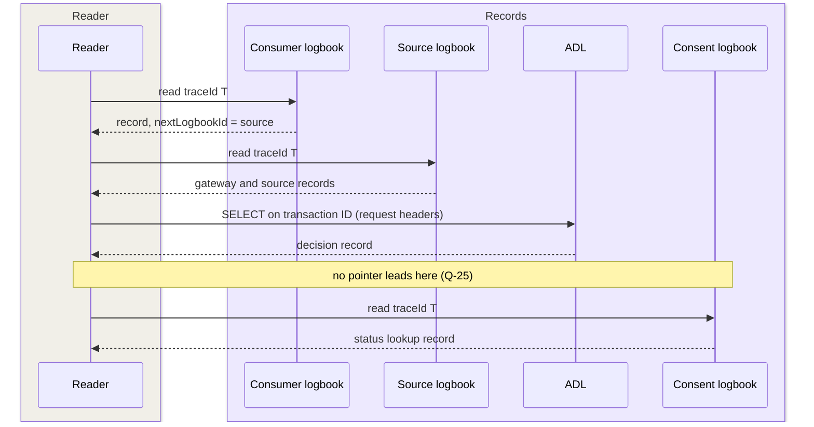

# Logging, audit and traceability

Every data exchange must be reconstructable afterwards: who asked for what,
under which basis, with which decision, and which organization processed
which personal data
([P-12](https://ictu.github.io/GBO-PSA/main/architectuurprincipes/),
capability
[S09](https://ictu.github.io/GBO-PSA/main/capabilities/#s09-logging-audit-traceerbaarheid)).
The record and correlation model on this page is the model that gbo-demo
v0.9.0 implements. The decisions behind the model are
[ADR-0035](../decisions/0035-w3c-trace-context.md) (correlation),
[ADR-0036](../decisions/0036-adl-decision-record.md) (decision records),
and [ADR-0026](../decisions/0026-ldv-integration.md) (processing records).

A controller (Verantwoordelijke) is the organization that is responsible
for a processing under the GDPR. A data subject (Betrokkene) is the
person whom a processing is about.

## Three records, one chain

Logius maintains three related logging standards. Each standard records a
different thing. GBO uses all three, together with traces and logs
([F-63](../traceability/findings-closed.md#f-63)):

| Record | Standard | What it records | Writer | Store in the demo | Role |
|---|---|---|---|---|---|
| Decision | Authorization Decision Log (ADL) | each PDP evaluation | the PDP (OpenFTV) | Postgres database `ftv_adl` | authoritative |
| Processing | Logboek Dataverwerkingen (LDV) 1.0.0 | each processing of personal data | each component, in the logbook of its controller | one logbook per controller | authoritative |
| Transport | FSC-Logging (draft) | each FSC transaction | FSC Inway and Outway | transaction log per FSC peer | authoritative |
| Traces | OpenTelemetry (OTLP) | technical operations | all services | Jaeger, 7 days | observability |
| Logs | none | operational log lines, including the console decision log of the policy engine | all services | Loki, 7 days | observability |

A PDP decision is not a processing, so it gets no LDV record. The LDV
records are at three processings
([F-64](../traceability/findings-closed.md#f-64)):

- the consent status lookup at the register
- the decryption at the source gateway
- the query at the source

Traces and logs are for debugging. They are sampled or best-effort, and
nobody cites them as evidence. The audit records are in separate stores
with their own guarantees
([REQ-32](../requirements/logging-audit.md#req-32),
[OBSERVABILITY.md](https://github.com/ICTU/GBO-demo/blob/v0.9.0/OBSERVABILITY.md#L61-L64)).
The components write their records to these stores:

```mermaid
flowchart LR
    C[Consumer backend] -->|traceparent T<br/>Fsc-Transaction-Id X1| OW[Consumer Outway]
    OW --> IW[Source Inway]
    IW -->|AuthZEN| PDP
    PDP -->|status lookup<br/>T, X1| CR[Consent register]
    IW --> GW[Source gateway] --> SRC[Source GraphQL]

    C -.-> LA[(Consumer logbook<br/>LDV)]
    GW -.-> LS[(Source logbook<br/>LDV)]
    SRC -.-> LS
    CR -.-> LT[(Consent logbook<br/>LDV)]
    PDP -.-> ADL[(ADL<br/>decision)]
    OW -.-> TX[(FSC transaction logs)]
    IW -.-> TX

--8<-- "mermaid/classes.mmd"
    class C ext
    class OW,IW,PDP,GW basis
    class CR dvtp
    class SRC source
    class LA,LS,LT,ADL,TX store
```

## Correlation: trace ID and transaction ID

Two identifiers link the records
([REQ-55](../requirements/logging-audit.md#req-55),
[ADR-0035](../decisions/0035-w3c-trace-context.md)):

| | W3C trace ID | `Fsc-Transaction-Id` |
|---|---|---|
| Made by | the application that starts the processing | the FSC Outway (or the entry component) |
| Count per processing | one | one per FSC transaction |
| Recorded in | LDV `trace_id`, ADL `trace_id`, spans, operational logs | FSC transaction log, ADL `adl.fsc.transaction_id`, span attribute `gbo.fsc.transaction_id` |

Four rules apply to correlation:

- Every component takes the trace ID unchanged from the incoming
  `traceparent`. The component sets the span of the caller as parent only
  for a caller in the same trace. It sends `traceparent` and `tracestate`
  on every outbound call.
- The component looks for the trace ID in a fixed order: `traceparent`,
  then `Fsc-Transaction-Id`, then `X-Request-Id`, then the ambient span.
  If none of these is present, it starts a new trace
  ([`tracecontext.go#L78`](https://github.com/ICTU/GBO-demo/blob/v0.9.0/services/ldv-client/tracecontext.go#L78),
  [`#L181`](https://github.com/ICTU/GBO-demo/blob/v0.9.0/services/ldv-client/tracecontext.go#L181)).
- The transaction ID never replaces an incoming trace. A component that
  starts or receives an FSC transaction records the transaction ID next to
  the trace ID.
- If an entry component receives no `traceparent`, it can tie its new
  trace to the UUIDv7 transaction ID that it mints
  ([`consumerhttp.go#L166-L182`](https://github.com/ICTU/GBO-demo/blob/v0.9.0/services/dienstverlener-backend/consumerhttp/consumerhttp.go#L166-L182)).
  If a request crosses FSC once, the trace ID and the transaction ID then
  have the same value. After a second FSC hop, they differ.

The earlier rule "trace ID equals transaction ID"
([ADR-0019](../decisions/0019-fsc-transaction-id-tracing.md)) broke in
three cases ([F-67](../traceability/findings-closed.md#f-67)):

- a caller that sends its own `traceparent`
- one processing that calls several sources
- every extra FSC hop

FSC forwards `traceparent` on the data path. One hop breaks the context:
the Inway calls the PDP over AuthZEN on a fresh context, with only
`X-Request-Id` ([F-39](../traceability/findings-closed.md#f-39),
[F-41](../traceability/findings-closed.md#f-41)).

The Inway copies the headers of the original request into the AuthZEN
context. When the policy calls the consent register (toestemmingsregister) for a status, it
reads the trace from this context. The status request carries the trace
ID of the request with a new span. It also carries the transaction ID
([`consent.rego#L190-L245`](https://github.com/ICTU/GBO-demo/blob/v0.9.0/policies/gbo/consent.rego#L190-L245)).
As a result, the LDV record of the register lands in the trace of the
request.

The status lookup goes through the own Outway of the PDP. It is a second
FSC transaction, but it sends the transaction ID of the consumer.
FSC-Logging says that a transaction ID is unique per transaction. Nobody
checked on a running stack whether the Outway accepts a duplicate ID from
the client.

Separate units of work keep separate traces. The `consent_id` joins
consent issuance and the later query. The two do not share a trace
([F-16](../traceability/findings-closed.md#f-16)).

In most services, operational logs carry the trace ID through structured
logging
([`graphql-server/slogctx.go#L15-L24`](https://github.com/ICTU/GBO-demo/blob/v0.9.0/services/graphql-server/slogctx.go#L15-L24)).
Logs and traces join on equal identifiers. Time stamps play no part in
the join. In demo v0.9.0, the operational logs of `bron-sidecar`,
`eudi-adapter`, and `asi-provider` carry no trace ID.

## Decision records (ADL)

The PDP writes one ADL record for each evaluation, to the Postgres
database `ftv_adl`
([REQ-71](../requirements/logging-audit.md#req-71),
[ADR-0036](../decisions/0036-adl-decision-record.md)). The PDP does not
start without this database, so the ADL runs in every deployment profile
([`docker-compose.yml#L117-L126`](https://github.com/ICTU/GBO-demo/blob/v0.9.0/docker-compose.yml#L117-L126)).
Contract-acceptance decisions are ADL records too. A reader gets a
SELECT-only role, `adl_reader`
([`adl-reader.sql`](https://github.com/ICTU/GBO-demo/blob/v0.9.0/services/openftv-manager/adl/adl-reader.sql)).

The embedded OPA also writes a console decision log line for each
evaluation. This line goes to Loki. It holds the full policy result: for
each field, the rule that granted or denied it, and the step trace. The
line is observability data. The developer portal shows it as detail next
to the ADL record. The portal sets the color of the PDP from the ADL
record alone ([F-53](../traceability/findings-closed.md#f-53)).

The ADL record holds the AuthZEN request and answer. OpenFTV takes only
`allow` and `reason` from the policy. On a deny, `reason` becomes
`reason_user.en`
([`authz.rego#L42-L51`](https://github.com/ICTU/GBO-demo/blob/v0.9.0/policies/authz.rego#L42-L51)).
Per-field detail cannot go in the answer, because the FSC Inway returns
the reason to the consumer. So the record can hold only what the consumer
can also see ([F-72](../traceability/findings.md#f-72)).

The decision record has five known gaps:

- No correlation behind the Inway: the Inway sends neither `traceparent`
  nor `Fsc-Transaction-Id` to the PDP. The record gets a random trace and
  no `adl.fsc.transaction_id`. A reader finds the record through the
  request headers stored in it
  ([`adl.go#L48-L66`](https://github.com/ICTU/GBO-demo/blob/v0.9.0/services/dev-portal-backend/adl.go#L48-L66),
  [#369](https://github.com/ICTU/GBO-demo/issues/369)). The fix is
  upstream in open-fsc.
- No policy version: the records carry `policies: 0`
  ([REQ-59](../requirements/logging-audit.md#req-59)). A reader cannot
  see in the record which policy decided. For more information, see
  [Policy lifecycle](policy-lifecycle.md).
- Only `{allow, reason}`: the record lacks the consent status answer
  (`adl.core.information`) and the configuration
  ([F-72](../traceability/findings.md#f-72)). Because the policy fetches
  the consent status during evaluation, nobody can replay a decision from
  the record.
- No pointer to the consent logbook
  ([Q-25](../traceability/open-questions.md#q-25)). For more information,
  see [Reading a chain](#reading-a-chain).
- A BSN in the EUDI and ASI routes. For more information, see
  [Data handling](#data-handling).

## Processing records (LDV)

Every GBO-delivered component that processes personal data writes one LDV
record per processing and per data subject. It writes to the logbook of
its own controller
([REQ-72](../requirements/logging-audit.md#req-72),
[ADR-0026](../decisions/0026-ldv-integration.md)). Only trace metadata
crosses an organization boundary. A shared logbook breaks this rule,
so the demo runs one
[`ldv-logboek`](https://github.com/ICTU/GBO-demo/blob/v0.9.0/services/ldv-logboek/README.md)
image as seven logbooks
([`docker-compose.yml#L410-L598`](https://github.com/ICTU/GBO-demo/blob/v0.9.0/docker-compose.yml#L410-L598)):

| Logbook | Controller | Writers |
|---|---|---|
| `logboek-afnemer` | Hypotheek-BV (demo consumer) | `dienstverlener-backend`, `integrator-backend` |
| `logboek-ir` | Installatie Register (demo consumer) | `ir-backend` |
| `logboek-bd` | Belastingdienst | `bron-sidecar`, `graphql-server` |
| `logboek-brp` | RvIG | `brp-sidecar`, `brp-graphql-server` |
| `logboek-lvg` | LVG | `lvg-sidecar`, `lvg-graphql-server` |
| `logboek-toestemming` | GBO | `consent-register`, `consent-portal-backend` |
| `logboek-eudi-adapter` | GBO | `eudi-adapter` |

In production, GBO does not build these logbooks. Each controller runs
its own logbook, and GBO ships the client
([`services/ldv-client`](https://github.com/ICTU/GBO-demo/tree/v0.9.0/services/ldv-client)).
The client holds the parts that are the same everywhere: configuration,
the acknowledged write, trace and span IDs, and the attribute map. It
also decodes FSC claims and derives the data subject.

Each record carries five elements:

- Trace context, as defined in
  [ADR-0035](../decisions/0035-w3c-trace-context.md).
- The data subject, never a BSN: `dpl.core.data_subject_id` names the
  data subject in the own identifier space of the controller. The field
  `data_subject_id_type` makes the type explicit:

    | Type | Meaning | Used by |
    |---|---|---|
    | `consent-id` | the consent that the consumer acted under | consumer |
    | `logboek-pseudoniem` | HMAC over the BSN with a key of this controller | sources, EUDI adapter |
    | `portal-subject` | the reference that the consent portal (toestemmingsportaal) derives | consent register and portal |
    | `brp-persoon-id` | the own record ID of RvIG, for a person named in a certificate about another person | RvIG only |

- A processing activity: `processing_activity_id` refers to a versioned,
  resolvable activity, for example `bd-ib-2025@v1`. Each logbook serves a
  stand-in register of processing activities
  (`GET /verwerkingsactiviteiten`). The logbook validates writes against
  this register. The stand-in has no legal status
  ([Q-08](../traceability/open-questions.md#q-08)).
- A pointer to the next logbook: if a component calls another party, it
  sets `dpl.read.nextLogbookId` to the read API of that party. The
  consumer does this for each source call. The EUDI adapter does it on the
  attestation record. The portal points to BSNk. That value is a demo
  placeholder, because the BSNk mock has no read API.
- The calling party: on a lookup over FSC,
  `dpl.core.foreign_operation.processor` names the FSC peer of the caller.
  At the consent register, this is the peer verified from
  `Fsc-Authorization`
  ([`client.go#L441-L452`](https://github.com/ICTU/GBO-demo/blob/v0.9.0/services/ldv-client/client.go#L441-L452),
  [REQ-76](../requirements/consent.md#req-76)).

The LDV integration rests on six design choices:

- One record per data subject: a further data subject of the same
  processing gets a child record under the first record. In the
  death-certificate flow, every further person that the certificate names
  gets a child record
  ([`ldv_query.go#L218-L285`](https://github.com/ICTU/GBO-demo/blob/v0.9.0/services/brp-graphql-server/ldv_query.go#L218-L285)).
  A query over several tax years gives one record per activity.
- Each logbook has its own pseudonym space: the pseudonym key is per
  controller. The same citizen is not recognizable across the logbooks of
  different controllers. A source logs under its own pseudonym, never
  under a value that the caller sends
  ([F-69](../traceability/findings-closed.md#f-69)). Since
  [SL-51](../traceability/increments.md#sl-51), no pseudonym travels in
  the chain at all.
- The logbook refuses a BSN: it scans every write for a nine-digit run
  that passes the BSN checksum (elfproef). The scan covers all values, the record name,
  and the resource. The logbook refuses a match. The check is
  word-bounded, so a 20-digit OIN passes
  ([`validate.go#L141-L157`](https://github.com/ICTU/GBO-demo/blob/v0.9.0/services/ldv-logboek/internal/ldv/validate.go#L141-L157)).
- Durable first, delivered after: a component stores the record in a
  local outbox, with an fsync, before its response leaves. It delivers
  the record afterwards with retries
  ([`outbox.go#L17-L38`](https://github.com/ICTU/GBO-demo/blob/v0.9.0/services/ldv-client/outbox.go#L17-L38)).
  A logbook outage delays records. It does not fail requests and does not
  lose records.

    If a component cannot store the record locally, it refuses the
    processing. The reason is that a withheld response does not undo a
    processing that already happened. The primary key
    `(trace_id, span_id)` makes a replay idempotent.

    The consent register keeps its outbox as a table in the same database
    as the consents. So a consent and its record commit in one
    transaction.

- Separate write and read tokens: a component that can write cannot read
  with that token.
- A local extension: the consent register, the portal, and the EUDI
  adapter write `dpl.gbo.*` attributes. This extension has no approval
  from Logius. The honest claim is "LDV core with a local extension"
  ([Q-72](../traceability/open-questions.md#q-72)).

In demo v0.9.0, the ASIP writes no LDV records, although it is a
GBO-delivered component that processes personal data.

## How to read a chain {#reading-a-chain}

The LDV read extension is `POST /data-processing-operations`. It selects
records by `traceId`, `processingActivityId`, or `dataSubjectId`. A read
starts at the application that started the processing. From there, a
reader follows `nextLogbookId`
([docs/ldv/README.md](https://github.com/ICTU/GBO-demo/blob/v0.9.0/docs/ldv/README.md)).
For one DvTP query, a reader does these steps:

1. Call the consumer logbook with trace ID `T`.
2. Follow `nextLogbookId` in the consumer record to the read API of the
   source.
3. Call the source logbook with `T`. It returns the records of the source
   gateway and of the source.
4. Use the transaction ID for the FSC transaction logs. Find the ADL
   record through the transaction ID in the stored request headers
   ([#369](https://github.com/ICTU/GBO-demo/issues/369)).
5. Call the consent logbook with `T`. No record points there.



Two gaps limit this route ([F-68](../traceability/findings.md#f-68)):

- The start is at a party that LDV does not bind. In DvTP, a private
  consumer starts the processing. Without its records, nobody knows which
  sources one processing touched. A consumer that calls two sources writes
  two records under one trace ID. Each record has its own pointer and its
  own transaction ID.

    The minimum for a consumer is trace context and the transaction ID
    ([AV-01](../requirements/admission.md#av-01)). LDV for the
    consumer is a candidate condition
    ([AV-02](../requirements/admission.md#av-02)). The demo
    consumer logs under the consent ID, because it has no citizen
    identifier ([Q-27](../traceability/open-questions.md#q-27)).

    The register records form a second index over the whole chain. Every
    source call leads to a status lookup, and the register logs this
    lookup with trace and consent ID.

- The step from the decision to the consent logbook. The PDP writes only
  an ADL record and no LDV record. The ADL has no field like
  `nextLogbookId`. The demo applies option 3 of
  [Q-25](../traceability/open-questions.md#q-25): a reader calls the
  consent logbook by trace ID. The chain view in the developer portal
  shows that logbook as "reached without pointer"
  ([`dev-portal-backend/ldv.go`](https://github.com/ICTU/GBO-demo/blob/v0.9.0/services/dev-portal-backend/ldv.go)).

A caller can fill `nextLogbookId` only if the source publishes the read
API of its logbook. In demo v0.9.0, the source metadata does not carry
this API. The consumer and the EUDI adapter get it from configuration
([REQ-64](../requirements/sources-identity.md#req-64),
[Source onboarding](source-onboarding.md)).

Citizen access works per controller, through the read extension of each
logbook, by data subject. Each controller answers for its own processings
(GDPR article 15) ([F-65](../traceability/findings-closed.md#f-65)). Demo v0.9.0
does not build a view of the processings per consent.

## Data handling

Logging holds no BSN that the processing does not need. Masking in the
decision log is never the only safeguard
([REQ-60](../requirements/logging-audit.md#req-60)). Each record type
handles the BSN as follows, per route:

| Record | Consent route (DvTP) | EUDI and ASI routes |
|---|---|---|
| LDV | no BSN. The logbook refuses one | no BSN. The logbook refuses one |
| ADL and console decision log | a placeholder, no identity ([SL-51](../traceability/increments.md#sl-51)) | the plain BSN, from the PID or the token |
| Spans and operational logs | no BSN | no BSN |

In the consent route, the PDP input holds a placeholder for the subject.
The source gateway replaces the placeholder after the allow
([ADR-0033](../decisions/0033-gateway-decrypts-after-allow.md),
[Pseudonymization](pseudonymization.md)).

In the EUDI and ASI routes, the query variables hold the plain BSN
([`eudi-adapter/source_metadata.go#L273`](https://github.com/ICTU/GBO-demo/blob/v0.9.0/services/eudi-adapter/source_metadata.go#L273),
[`asi-provider/internal/graphqlsource/source.go#L94`](https://github.com/ICTU/GBO-demo/blob/v0.9.0/services/asi-provider/internal/graphqlsource/source.go#L94)).
Neither decision log masks anything. The ADL has no masking option, and
the console log ignores the OPA mask policy
([F-54](../traceability/findings.md#f-54)).

Earlier, the request mapper pseudonymized the BSN before evaluation.
[PR #370](https://github.com/ICTU/GBO-demo/pull/370) removed this step
when the mapper became a pure mapper. Until
[#368](https://github.com/ICTU/GBO-demo/issues/368) decides, the demo
accepts the BSN in both decision logs. The proposal is to keep
identifiers out of the PDP input
([ADR-0043](../decisions/0043-identifiers-out-of-pdp-input.md)).

## Protection and retention

[REQ-32](../requirements/logging-audit.md#req-32) requires three things
of audit records: protection against change and deletion, no sampling,
and separation from operational logs. Demo v0.9.0 has this status for
each property:

| Property | ADL | LDV logbooks | FSC transaction logs |
|---|---|---|---|
| Separate store | yes | yes, SQLite per logbook, `synchronous = FULL` | yes, per peer |
| Never sampled | yes | yes, acknowledged per record | yes |
| Read access | SELECT-only role | read token | intra-organization API or the remote Manager ([F-42](../traceability/findings-closed.md#f-42)) |
| Tamper evidence (WORM, hash chain, notary) | no | no | no |
| Retention period | not set | not set | not set |

Two points are open: who can read which records, and how long the
records are kept ([Q-08](../traceability/open-questions.md#q-08)). The
ADL source-reference model adds a constraint: a source that a record
points to must stay available as long as the record exists.

## Traceability

- Requirements: [REQ-32](../requirements/logging-audit.md#req-32),
  [REQ-55](../requirements/logging-audit.md#req-55),
  [REQ-59](../requirements/logging-audit.md#req-59),
  [REQ-60](../requirements/logging-audit.md#req-60),
  [REQ-71](../requirements/logging-audit.md#req-71),
  [REQ-72](../requirements/logging-audit.md#req-72),
  [REQ-76](../requirements/consent.md#req-76),
  [AV-01](../requirements/admission.md#av-01),
  [AV-02](../requirements/admission.md#av-02)
- Findings: [F-16](../traceability/findings-closed.md#f-16) (closed),
  [F-39](../traceability/findings-closed.md#f-39) (resolved in demo),
  [F-41](../traceability/findings-closed.md#f-41) (resolved in demo),
  [F-42](../traceability/findings-closed.md#f-42) (closed),
  [F-53](../traceability/findings-closed.md#f-53) (resolved in demo),
  [F-54](../traceability/findings.md#f-54) (open),
  [F-63](../traceability/findings-closed.md#f-63) (closed),
  [F-64](../traceability/findings-closed.md#f-64) (resolved in demo),
  [F-65](../traceability/findings-closed.md#f-65) (closed),
  [F-67](../traceability/findings-closed.md#f-67) (resolved in demo),
  [F-68](../traceability/findings.md#f-68) (open),
  [F-69](../traceability/findings-closed.md#f-69) (resolved in demo),
  [F-72](../traceability/findings.md#f-72) (open)
- Open questions: [Q-08](../traceability/open-questions.md#q-08) (open),
  [Q-25](../traceability/open-questions.md#q-25) (open),
  [Q-27](../traceability/open-questions.md#q-27) (open),
  [Q-72](../traceability/open-questions.md#q-72) (open)
- Demo increments: [SL-38](../traceability/increments.md#sl-38) (done),
  [SL-50](../traceability/increments.md#sl-50) (exploration done, build
  delivered), [SL-51](../traceability/increments.md#sl-51) (done)
- Decisions: [ADR-0026](../decisions/0026-ldv-integration.md),
  [ADR-0035](../decisions/0035-w3c-trace-context.md),
  [ADR-0036](../decisions/0036-adl-decision-record.md),
  [ADR-0043](../decisions/0043-identifiers-out-of-pdp-input.md) (proposed)
