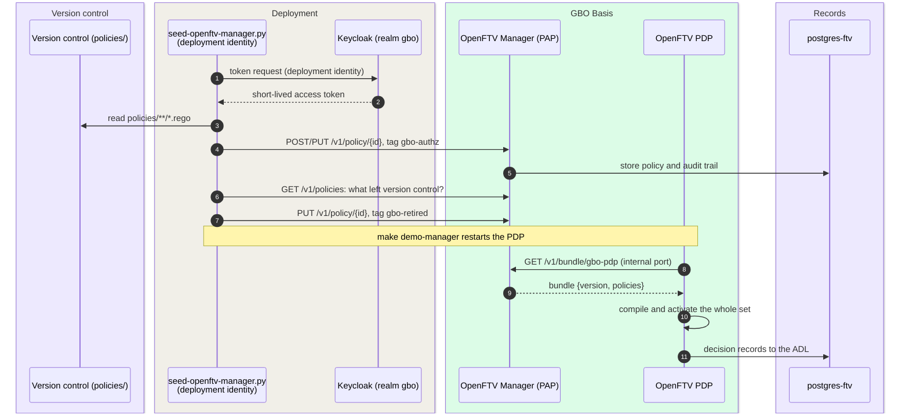

# Policy lifecycle

Each bronhouder owns, writes, and publishes the policy that its own PDP
evaluates. GBO supplies a reference policy set, an engine choice, and
guidelines. GBO does not supply a central policy service. The following
sections show how a policy travels from version control to a decision in
demo v0.9.0, and which points are open.

The policy lifecycle realizes
capability
[S06](https://ictu.github.io/GBO-PSA/main/capabilities/#s06-beleidsbeheer-distributie).
The decision is
[ADR-0021](../decisions/0021-central-pap-signed-bundles.md). For the
management-plane scenario, see
[Policy distribution](../runtime/policy-distribution.md).

## Ownership per bronhouder {#ownership-per-source-holder}

The PAP and the PDP are at each bronhouder. The PDP is behind the FSC
Inway of the bronhouder, and the management function serves only that
PDP. The policy belongs to the source
([P-10](https://ictu.github.io/GBO-PSA/main/architectuurprincipes/)).

The question of who can manage and publish the policy of a bronhouder
has an answer: the bronhouder itself
([Q-21](../traceability/answered-questions.md#q-21), October 28, 2026). PSA S06
sets the norm for publication control. The norm asks for these items:

- An owner.
- An approver.
- An effective date.
- A change history.
- Tests before publication.
- An emergency and rollback procedure.

Authority over policy is with competent public parties. As a result, GBO
sets no requirements on the policy installation of another party. The
management practices are guidelines (RL-01 to RL-05, in the guidelines
table later on this page). A
guideline becomes a requirement only if GBO delivers the management setup
itself ([Policy management guidelines](../requirements/authorization.md#policy-management)).

In the demo, all components run in one compose stack. This is a demo
artifact and makes no statement about the architecture.

## Policy authoring

All authorization policies are Rego in version control
([`policies/`](https://github.com/ICTU/GBO-demo/blob/v0.9.0/policies)),
with tests next to the rules. The set has four parts:

| Part | Files | Role |
|---|---|---|
| Entrypoint | `authz.rego` | The package that OpenFTV evaluates. It maps the engine response to `allow` and `reason` |
| Engine and readers | `gbo/engine.rego`, `gbo/lib.rego`, `gbo/consent.rego`, `gbo/graphql_schemas.rego` | Generic machinery: regime and service binding, the closed world, reason codes, the consent proof, schema pins |
| Rules | `gbo/rules/dvtp/`, `gbo/rules/eudi/`, `gbo/rules/asi/` | One package per access verdict: DVT0001, LVG0001, EUD0001, EUD0002, ASI0001 |
| Contract policy | `fsc/autosign.rego` | Contract acceptance for the provider's FSC Manager ([ADR-0015](../decisions/0015-contract-acceptance-by-policy.md)) |

A new access verdict is a new rule file with tests. The engine does not
change. For the rule model, see
[Authorization](authorization.md#rule-model).

Scripts generate two files, and CI checks them:

- The schema pins (`scripts/gen-graphql-pins.sh`).
- The rule list that the developer portal shows (`scripts/gen-rules-json.sh`).
  OpenFTV has no data API, so the portal reads a generated file.

## Validation before activation

The PDP compiles the policy set as a whole. One bad module does not give a
deny. Instead, it breaks every decision
([F-52](../traceability/findings.md#f-52)). The demo had this type of fault
several times:

- A stale policy declared the same package as an existing rule. Every
  request got HTTP 500.
- A non-Rego file under `policies/` silently removed every policy after it
  in walk order.
- A second file with the same name replaced the first, because the PAP
  keys policies by file name.
- The PAP reports a module that does not compile as loaded, while the old
  policy continues to decide
  ([#151](https://github.com/ICTU/GBO-demo/issues/151)).

The local safety net is `make policy-check`
([`Makefile#L92-L106`](https://github.com/ICTU/GBO-demo/blob/v0.9.0/Makefile#L92-L106)).
It refuses non-Rego files and duplicate file names under `policies/`. Then
it runs `opa check`. Every make target that starts the PDP depends on it.

`make policy-test` adds `opa fmt --diff` and `opa test`
([`Makefile#L115-L117`](https://github.com/ICTU/GBO-demo/blob/v0.9.0/Makefile#L115-L117)).
CI repeats these steps. CI also checks that the generated files are up to
date
([`ci.yml#L135-L182`](https://github.com/ICTU/GBO-demo/blob/v0.9.0/.github/workflows/ci.yml#L135-L182)).

Validation and a visible fallback at activation are not built
([RL-05](../requirements/authorization.md#rl-05)). If a PDP gets a
broken bundle, it does not keep the last valid set. It also does not
report that a later version did not load. Source metadata has this
lifecycle in demo v0.9.0: validation before activation, atomic promotion,
and rollback ([F-59](../traceability/findings-closed.md#f-59),
[REQ-66](../requirements/sources-identity.md#req-66)). For policy, this
lifecycle is a backlog item.

The contract policy is in the same set. As a result, one broken module also
stops the admission of new participants. The contract policy has a fixed
package name (`doelbinding.auto_sign_contract`). If someone renames it, it
resolves to nothing, and every contract stays pending.

## Distribution

The demo distributes policy in two modes:

| Mode | How | When |
|---|---|---|
| Mount (default) | The PDP image carries the policies ([`Dockerfile#L62-L67`](https://github.com/ICTU/GBO-demo/blob/v0.9.0/services/openftv-pdp/Dockerfile#L62-L67)). Compose mounts `./policies` over them ([`docker-compose.yml#L157`](https://github.com/ICTU/GBO-demo/blob/v0.9.0/docker-compose.yml#L157)) | Every `make demo*` target. Edit and save while you write Rego |
| Bundle (opt-in) | The OpenFTV Manager stores the policies in Postgres. Bundle `gbo-pdp` collects every policy with tag `gbo-authz`, with a version. If `PDP_BUNDLE_MANAGER` is set, the PDP pulls the bundle at start ([`docker-compose.yml#L145-L149`](https://github.com/ICTU/GBO-demo/blob/v0.9.0/docker-compose.yml#L145-L149)) | `make demo-manager`, `make manager-seed` |

Version control is the source of the content. The Manager is the
distribution mechanism. Policy enters the Manager only through its API.
An administrator in the management interface uses the same path.

The distribution has these properties:

- The PDP pulls, and nothing pushes. The PDP authorizes its own management
  endpoints with the decision policy. That policy denies every request
  that is not a data request, so a push gets 403
  ([F-51](../traceability/findings.md#f-51),
  [`gbo-pdp.yaml#L18-L32`](https://github.com/ICTU/GBO-demo/blob/v0.9.0/services/openftv-manager/bundles/gbo-pdp.yaml#L18-L32)).
  The bundle has no push targets. The PDP pulls at start, so a new seed
  needs a PDP restart.
- The seed script retires policy and does not delete it. A delete fails
  upstream on a foreign key to the audit trail. The seed script removes
  the bundle tag from every policy that left version control
  ([`seed-openftv-manager.py#L116-L122`](https://github.com/ICTU/GBO-demo/blob/v0.9.0/scripts/seed-openftv-manager.py#L116-L122)).
  Without that reconciliation, a renamed rule stays in the bundle
  ([RL-04](../requirements/authorization.md#rl-04)).
- Cedar policies authorize the management API. The Manager authorizes
  its own API with Cedar policies, separate from the Rego decision policy:
  [`admin.cedar`](https://github.com/ICTU/GBO-demo/blob/v0.9.0/services/openftv-manager/authz/admin.cedar),
  [`auditor.cedar`](https://github.com/ICTU/GBO-demo/blob/v0.9.0/services/openftv-manager/authz/auditor.cedar),
  and
  [`pdp-bundle.cedar`](https://github.com/ICTU/GBO-demo/blob/v0.9.0/services/openftv-manager/authz/pdp-bundle.cedar).
  Since OpenFTV v0.1.0, the bundle pull runs through the same authorizer.
  The PDP shows no identity, so `pdp-bundle.cedar` allows only GET on the
  one bundle path ([RL-02](../requirements/authorization.md#rl-02)).
- The Cedar store seeds once. The Manager seeds its Cedar policies into
  Postgres only while the store is empty. After that, the Manager uses the
  store as the source of truth. An existing volume does not pick up a
  changed Cedar file
  ([CHANGELOG](https://github.com/ICTU/GBO-demo/blob/v0.9.0/CHANGELOG.md#L737-L747)).
  While its policy store is empty, the engine switches authorization off.
- Writing and publishing are separate. The realm has the roles `admin`,
  `author`, and `auditor`. Publication uses a non-personal deployment
  identity with a short-lived token
  ([RL-03](../requirements/authorization.md#rl-03)).
- The bundle has no signature. The bundle has an ID and a version. A bundle
  gets a signature only when it crosses an organization boundary. Inside
  one organization, signing is not planned
  ([#426](https://github.com/ICTU/GBO-demo/issues/426), closed as not
  planned). If a bronhouder lets another organization build or host
  its bundles, signing and verification become a requirement
  ([F-09](../traceability/findings-closed.md#f-09)).

Two components have the name Manager. The OpenFTV Manager manages policy.
The FSC Manager manages contracts and issues access tokens. Always name
which Manager you mean.

The ADL database (`postgres-ftv`) runs in every profile, because the PDP
does not start without it. Only the OpenFTV Manager, its management
interface, and Keycloak are opt-in.

## Policy data

Rules use data from four sources, each with its own lifecycle:

| Source | Examples | Lifecycle |
|---|---|---|
| In the rule | `allowed_years` of EUD0001, `designated_issuers` shared by the EUDI rules ([`eudi_helper.rego#L13-L20`](https://github.com/ICTU/GBO-demo/blob/v0.9.0/policies/gbo/rules/eudi/eudi_helper.rego#L13-L20)), the `asip` peer of ASI0001 | Changes with the policy set |
| In the bundle | Schema digests per FSC service (`graphql_schemas.rego`) | Generated from the bundled schemas. CI checks drift |
| PIP pull | Admission register: `active`, `allowed_source_peer_ids`, integrator mandates `acts_for` ([`dvtp-onboarding.yaml`](https://github.com/ICTU/GBO-demo/blob/v0.9.0/services/openftv-pdp/pip-pull/dvtp-onboarding.yaml)) | Refreshed every 5 seconds |
| Per request | The consent proof and its status, resolved by the policy itself (`consent.rego`) | Status live, keys cached 300 seconds ([Consent](consent.md#verification-and-status)) |

A place on a PID actor list (`designated_issuers`, `asip`) is an admission
decision with authorization weight. In every environment, those lists must
stay disjoint from the consent consumers
([F-70](../traceability/findings.md#f-70),
[Authorization](authorization.md#regime-selection)). In demo v0.9.0, the
lists are policy data and not register data.

## Guidelines for bronhouders {#guidelines-for-source-holders}

Each guideline has a demo status in demo v0.9.0:

| Guideline | Demo status |
|---|---|
| [RL-01](../requirements/authorization.md#rl-01) Deliver policy as a versioned bundle. Do not bake it into the PDP | Opt-in only (`make demo-manager`). The default mounts the policies. No signature |
| [RL-02](../requirements/authorization.md#rl-02) Authorize the management API with its own policy set. Deny on an empty store | Built for the Manager (Cedar). The PDP itself does not obey it ([F-51](../traceability/findings.md#f-51)). The engine opens up on an empty store |
| [RL-03](../requirements/authorization.md#rl-03) Separate writing from publishing. Publish with a non-personal, short-lived identity | Deployment identity built. The `author` role grants no action, so writing and publishing are not separate |
| [RL-04](../requirements/authorization.md#rl-04) Withdraw policy, and do not delete it. Reconcile with version control | Built: `retire_stale` at every seed |
| [RL-05](../requirements/authorization.md#rl-05) Validate a bundle before activation. Fall back visibly to the last valid set | Local check built (`make policy-check`). Visible fallback not built |

Each guideline is a SHOULD for the bronhouder. A promotion rule names
when the guideline becomes a requirement.

## Policy version and the decision record

The decision record must name the policy version that decided
([REQ-59](../requirements/logging-audit.md#req-59)). This is not built.
The ADL records show no policy version, also when the PDP runs on a
versioned bundle. Without the version, nobody can trace a decision back to
the rule text.

Withdrawn policy stays in the Manager. This is a precondition for the
trace (RL-04). For the ADL itself, see
[Logging](logging.md).

## Divergence: Rego, not ODRL

PSA S06 names ODRL as a policy language option. GBO uses Rego for every
decision, and the OpenFTV Manager uses Cedar for its own API. GBO keeps
this choice. [Risks and technical debt](../risks.md) records the deviation.
Per [D-13](https://ictu.github.io/GBO-PSA/main/ontwerpprincipes/), the
deviation must go to the standards bodies. It is open how the reference
policy shows that it is not tied to one language or engine
([Q-78](../traceability/open-questions.md#q-78)).

## Traceability

- Requirements: [RL-01](../requirements/authorization.md#rl-01), [RL-02](../requirements/authorization.md#rl-02), [RL-03](../requirements/authorization.md#rl-03), [RL-04](../requirements/authorization.md#rl-04), [RL-05](../requirements/authorization.md#rl-05), [REQ-59](../requirements/logging-audit.md#req-59), [REQ-66](../requirements/sources-identity.md#req-66)
- Findings: [F-09](../traceability/findings-closed.md#f-09) (closed by ADR-0021), [F-51](../traceability/findings.md#f-51) (open), [F-52](../traceability/findings.md#f-52) (open), [F-59](../traceability/findings-closed.md#f-59) (closed), [F-70](../traceability/findings.md#f-70) (open)
- Open questions: [Q-02](../traceability/answered-questions.md#q-02) (answered), [Q-21](../traceability/answered-questions.md#q-21) (answered), [Q-78](../traceability/open-questions.md#q-78) (open)
- Demo increments: [SL-13](../traceability/increments.md#sl-13) (done), [SL-44](../traceability/increments.md#sl-44) (done)
