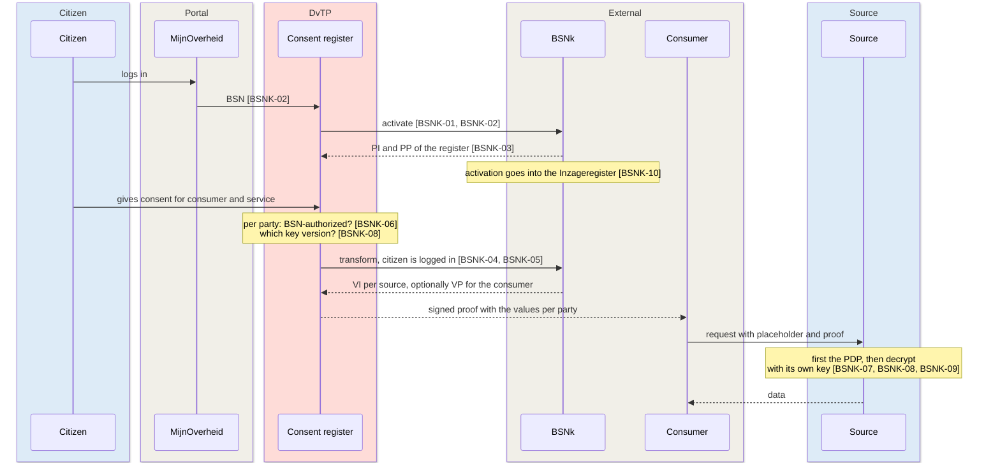
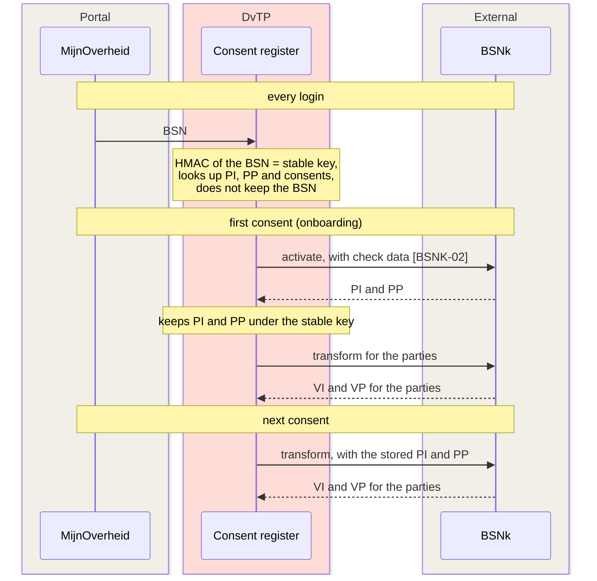
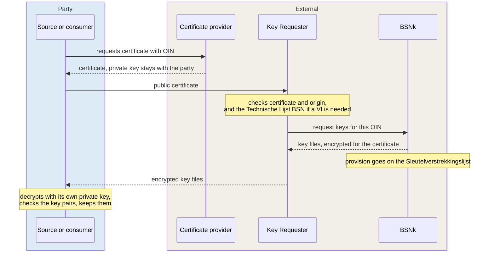

# Pseudonymization and BSNk requirements

These requirements cover how the citizen is identified without a BSN for the consumer, and the preconditions that BSNk PP sets for that design. For the design, see [Who sees which identifier](../building-blocks/dvtp/index.md#who-sees-which-identifier) and [Pseudonymization](../concepts/pseudonymization.md).

This page has the following parts:

- [Pseudonymization and subject identifier requirements](#pseudonymization)
- [BSNk PP preconditions for the DvTP design](#bsnk-preconditions)

## Pseudonymization and subject identifier requirements {#pseudonymization}

In the consent path, the consumer holds no identifier of the citizen at
all. This applies to the BSN and to every other identifier. The
requirements on this page cover four topics:

- what the consent proof carries about the citizen
- how a request names the subject
- where the value from the proof becomes a BSN or a source pseudonym
- what the consent facility (toestemmingsvoorziening) must know to make those values

The design of demo increment [SL-51](../traceability/increments.md#sl-51)
works in four steps:

1. At consent time, the consent portal (toestemmingsportaal) backend asks BSNk PP for a value
   for each receiving source. Every source gets an encrypted pseudonym
   (VP). Only a source on the BSN Authorization List (Autorisatielijst BSN)
   also gets an encrypted identity (VI). BSNk transforms only while the
   citizen is logged in ([BSNK-04](pseudonymization.md#bsnk-04)).
2. The consent register (toestemmingsregister) signs these values into the proof as
   `encrypted_subject`, keyed by the OIN of each source. It does not keep
   the values. It keeps the polymorphic identity (PI) and the polymorphic
   pseudonym (PP) of the portal under a reference to the citizen.
3. The consumer names the subject with a placeholder. It uses
   `consent:identity` for a BSN API and `consent:pseudonym` for an API on
   the own pseudonym of the source. The PDP sees no identifier of the
   citizen.
4. After the allow, the source gateway (`bron-sidecar`) takes the value
   for its own OIN. The decryption component of the source reads the
   value. The gateway checks that the value names its own OIN as
   recipient. Then the gateway puts the result in the place of the
   placeholder. There is no BSNk call at query time.

[ADR 0032](../decisions/0032-consent-proof.md) records the proof and the
placeholder. [ADR 0033](../decisions/0033-gateway-decrypts-after-allow.md)
records the decryption at the gateway.
[BSNk preconditions](pseudonymization.md#bsnk-preconditions) lists what BSNk PP imposes.

In the demo, the BSNk mock follows the BSNk interface but does not
encrypt. As a result, anyone can read the values. The three demo sources
share one OIN and one decryption component.
### REQ-20: In the consent path the consumer gets no BSN in the proof or in the response {#req-20}

> In the consent path, the consumer MUST NOT receive a BSN. The BSN MUST NOT be in the consent proof, in another value from the consent facility, or in the answer of the source. The consumer MUST be able to make a request without knowing an identifier of the citizen. A rule in the consent regime MUST NOT allow a field that returns the BSN. A policy set MUST enforce that with a test per rule.

| Case | Outcome |
|---|---|
| The consumer reads the consent proof | only the consent ID and the scopes. The citizen is in the proof only as values that the sources can read. |
| Under consent, the consumer asks for the BSN field of the source | denied with `NO_APPLICABLE_RULE`. The consumer sees `FIELD_NOT_PERMITTED`. |

- **Status**: draft

??? note "Source, evidence and notes"

    - **Source**: design:
      [P-04](https://ictu.github.io/GBO-PSA/main/architectuurprincipes/),
      [PSA S03](https://ictu.github.io/GBO-PSA/main/capabilities/#s03-burgeridentificatie-pseudonimisering)
      ("voorkomen dat onbevoegde afnemers het BSN ontvangen"),
      [GO, building blocks](https://ictu.github.io/GBO-GO/main/#bouwstenen-die-hergebruikt-worden)
      (BSNk PP for all DvTP requests, before a private service provider (dienstverlener) receives
      data), and FR-35 criteria 2 and 3.
    - **Addressee**: GBO-delivered component: the consent portal and the
      consent register (what the proof carries), and the reference policy
      of the PDP (which fields are allowed under consent). Interface
      agreement: what the consumer sees.
    - **Evidence**: to build:
      [ICTU/GBO-demo#604](https://github.com/ICTU/GBO-demo/issues/604).
      [PR #469](https://github.com/ICTU/GBO-demo/pull/469) gives this evidence:
        - The consumer reads only the consent ID and the scopes
          ([`token.go#L11-L18`](https://github.com/ICTU/GBO-demo/blob/v0.9.0/services/dienstverlener-backend/consumer/token.go#L11-L18)).
        - The consumer names the subject with a placeholder
          ([`kind.go#L39-L54`](https://github.com/ICTU/GBO-demo/blob/v0.9.0/services/dienstverlener-backend/consumer/kind.go#L39-L54),
          test
          [`consumer_test.go#L84-L99`](https://github.com/ICTU/GBO-demo/blob/v0.9.0/services/dienstverlener-backend/consumer/consumer_test.go#L84-L99)).
        - The portal has values made only for the sources
          ([`portal.go#L197-L224`](https://github.com/ICTU/GBO-demo/blob/v0.9.0/services/consent-portal-backend/consent/portal.go#L197-L224),
          test
          [`portal_test.go#L444-L457`](https://github.com/ICTU/GBO-demo/blob/v0.9.0/services/consent-portal-backend/consent/portal_test.go#L444-L457)).
        - Under consent, no rule covers the BSN field
          ([`dvt0001.rego#L32-L45`](https://github.com/ICTU/GBO-demo/blob/v0.9.0/policies/gbo/rules/dvtp/dvt0001.rego#L32-L45)
          against
          [`bd.graphql#L45-L51`](https://github.com/ICTU/GBO-demo/blob/v0.9.0/schemas/pdp-mirror/bd.graphql#L45-L51)).
        - No test covers the answer path.
    - **Related**: [REQ-17](authorization.md#req-17), [REQ-21](#req-21),
      [REQ-69](#req-69), [REQ-79](#req-79), [REQ-80](#req-80),
      [F-15](../traceability/findings-closed.md#f-15),
      [F-30](../traceability/findings-closed.md#f-30),
      [F-76](../traceability/findings.md#f-76),
      [Q-01](../traceability/open-questions.md#q-01),
      [Q-27](../traceability/open-questions.md#q-27).
    - **Notes**:
        - The requirement applies to the consent path. In the EUDI path, the
          request carries a BSN that the PDP sees.
          [ICTU/GBO-demo#368](https://github.com/ICTU/GBO-demo/issues/368)
          covers how to keep that BSN out of the decision log.
        - P-04 and FR-35 criterion 2 allow a party-specific pseudonym for the
          consumer. That pseudonym is outside this requirement and not built
          ([ICTU/GBO-demo#478](https://github.com/ICTU/GBO-demo/issues/478)).
          Its form is [Q-01](../traceability/open-questions.md#q-01).
        - The consumer holds no identifier. As a result, what the consumer
          records about "this person" depends on the consent
          ([F-76](../traceability/findings.md#f-76),
          [Q-27](../traceability/open-questions.md#q-27)).
        - In demo v0.9.0, the answer path depends only on the closed world of
          the rules. No test checks, for each rule in the consent regime, that
          the rule covers no BSN field.

### REQ-21: The source converts the value from the proof itself, only after a positive decision and without a central party {#req-21}

> The source MUST convert the value from the consent proof itself, to the BSN or to its own pseudonym. The conversion MUST take place after a positive decision of its PDP, and MUST NOT take place after a deny. The BSN MUST stay limited to the source and exists there only for the source call. The conversion MUST NOT need a call to BSNk or another central party. If the conversion fails, the request MUST NOT reach the source.

| Case | Outcome |
|---|---|
| Allowed request with `consent:identity` | one decryption. The source gets the BSN in the place of the placeholder. |
| Allowed request with `consent:pseudonym` | the source gets its own pseudonym. The identity is not read. |
| Request without a subject | passes unchanged, and nothing is decrypted |
| Request outside the transport subset of the profile | refused, and nothing is decrypted |
| Decryption fails | not forwarded, and recorded as a failed processing |
| Decryption cannot be recorded | not forwarded |

- **Status**: ready for review

??? note "Source, evidence and notes"

    - **Source**: design:
        - [PSA S03](https://ictu.github.io/GBO-PSA/main/capabilities/#s03-burgeridentificatie-pseudonimisering)
          ("de inrichting voert identiteitsvertaling alleen uit voor een
          toegestane dienst en gegevensvraag"), with the provision "veilige
          omzetting aan de kant van de source holder (bronhouder)"
        - FR-35 criterion 3
        - precondition [BSNK-04](pseudonymization.md#bsnk-04): BSNk
          transforms only while the citizen is logged in, so it does not
          transform at query time
    - **Addressee**: GBO-delivered component: the source gateway and its link
      with the decryption component of the source.
    - **Evidence**: [PR #469](https://github.com/ICTU/GBO-demo/pull/469),
      [PR #477](https://github.com/ICTU/GBO-demo/pull/477), and
      [PR #494](https://github.com/ICTU/GBO-demo/pull/494) give this evidence:
        - The gateway acts on the proof and substitutes only behind the Inway
          ([`main.go#L1-L9`](https://github.com/ICTU/GBO-demo/blob/v0.9.0/services/bron-sidecar/main.go#L1-L9),
          [`#L232-L259`](https://github.com/ICTU/GBO-demo/blob/v0.9.0/services/bron-sidecar/main.go#L232-L259),
          [`substitution.go#L149-L211`](https://github.com/ICTU/GBO-demo/blob/v0.9.0/services/bron-sidecar/substitution/substitution.go#L149-L211)).
        - A component that offers nothing of BSNk decrypts with the own keys
          of the source
          ([`decryption.go#L1-L8`](https://github.com/ICTU/GBO-demo/blob/v0.9.0/services/bron-sidecar/decryption/decryption.go#L1-L8),
          [`docker-compose.yml#L773-L793`](https://github.com/ICTU/GBO-demo/blob/v0.9.0/docker-compose.yml#L773-L793),
          [`httpapi.go#L34-L53`](https://github.com/ICTU/GBO-demo/blob/v0.9.0/services/bsnk-mock/internal/httpapi/httpapi.go#L34-L53)).
        - The tests are
          [`ldv_test.go#L182-L221`](https://github.com/ICTU/GBO-demo/blob/v0.9.0/services/bron-sidecar/ldv_test.go#L182-L221),
          [`#L228-L273`](https://github.com/ICTU/GBO-demo/blob/v0.9.0/services/bron-sidecar/ldv_test.go#L228-L273),
          [`#L383-L410`](https://github.com/ICTU/GBO-demo/blob/v0.9.0/services/bron-sidecar/ldv_test.go#L383-L410),
          [`#L494-L510`](https://github.com/ICTU/GBO-demo/blob/v0.9.0/services/bron-sidecar/ldv_test.go#L494-L510),
          [`transport_test.go#L82-L104`](https://github.com/ICTU/GBO-demo/blob/v0.9.0/services/bron-sidecar/transport_test.go#L82-L104),
          and
          [`substitution_test.go#L160-L181`](https://github.com/ICTU/GBO-demo/blob/v0.9.0/services/bron-sidecar/substitution/substitution_test.go#L160-L181).
    - **Related**: [REQ-04](authorization.md#req-04), [REQ-20](#req-20),
      [REQ-79](#req-79), [REQ-80](#req-80), [REQ-81](#req-81),
      [F-30](../traceability/findings-closed.md#f-30),
      [F-37](../traceability/findings-closed.md#f-37),
      [F-79](../traceability/findings.md#f-79),
      [ADR 0033](../decisions/0033-gateway-decrypts-after-allow.md).
    - **Notes**:
        - Design choice: the conversion is in a gateway behind the Inway, and
          not in a plugin on the Inway. A plugin after the authorization is
          possible only in an own build of the Inway
          ([ICTU/GBO-demo#364](https://github.com/ICTU/GBO-demo/issues/364)).
        - If the conversion takes place before the PDP, the PDP cannot tell a
          converted BSN from a BSN that the consumer filled in itself.
        - The gateway acts on the presence of a consent token. A request
          without a token passes unchanged (the PID regime of the EUDI path).
        - The conversion is "after the decision" only because nothing other
          than the Inway reaches the gateway
          ([REQ-04](authorization.md#req-04), [REQ-81](#req-81),
          [F-79](../traceability/findings.md#f-79)). The gateway does not
          check the proof itself
          ([`substitution.go#L105-L107`](https://github.com/ICTU/GBO-demo/blob/v0.9.0/services/bron-sidecar/substitution/substitution.go#L105-L107)).
        - In the demo, the sources share one decryption component and one
          OIN. In production, every source runs its own.

### REQ-69: The consent register stores the polymorphic values under its own reference and no encrypted values per party {#req-69}

> The consent register MUST NOT record more identifying data about the citizen than it needs to manage and show consents. It MAY keep the polymorphic identity and the polymorphic pseudonym of the first activation under its own reference to the citizen. This reference is not a BSN. It MUST NOT keep the encrypted identity and the encrypted pseudonym for a receiving party. Those values travel in the signed proof to that party.

- **Status**: ready for review

??? note "Source, evidence and notes"

    - **Source**: design:
      [PSA S01](https://ictu.github.io/GBO-PSA/main/capabilities/#s01-toestemmingsregistratie)
      ("het register bevat geen BSN als een pseudonieme identificatie
      volstaat"),
      [P-03 and P-04](https://ictu.github.io/GBO-PSA/main/architectuurprincipes/),
      and FR-35 criterion 1. The design tightens FR-35 criterion 1 and
      deliberately fills it in differently (see the notes). Precondition:
      [BSNK-03](pseudonymization.md#bsnk-03).
    - **Addressee**: GBO-delivered component: the consent register (S01).
    - **Evidence**: [PR #238](https://github.com/ICTU/GBO-demo/pull/238) and
      [PR #469](https://github.com/ICTU/GBO-demo/pull/469) give this evidence:
        - The stored model knows only the reference
          ([`main.go#L33-L46`](https://github.com/ICTU/GBO-demo/blob/v0.9.0/services/consent-register/main.go#L33-L46)).
        - The values per party go only into the signed proof
          ([`#L449`](https://github.com/ICTU/GBO-demo/blob/v0.9.0/services/consent-register/main.go#L449)).
        - The register stores PI and PP separately under the reference, and
          the first pair stays
          ([`postgres_store.go#L52-L60`](https://github.com/ICTU/GBO-demo/blob/v0.9.0/services/consent-register/postgres_store.go#L52-L60),
          [`#L122-L129`](https://github.com/ICTU/GBO-demo/blob/v0.9.0/services/consent-register/postgres_store.go#L122-L129)).
        - The reference is in
          [`subjectref.go#L11-L25`](https://github.com/ICTU/GBO-demo/blob/v0.9.0/services/consent-portal-backend/consent/subjectref.go#L11-L25).
        - The tests are
          [`polymorphic_test.go#L39`](https://github.com/ICTU/GBO-demo/blob/v0.9.0/services/consent-register/polymorphic_test.go#L39),
          [`#L85`](https://github.com/ICTU/GBO-demo/blob/v0.9.0/services/consent-register/polymorphic_test.go#L85),
          [`portal_test.go#L348-L385`](https://github.com/ICTU/GBO-demo/blob/v0.9.0/services/consent-portal-backend/consent/portal_test.go#L348-L385),
          and
          [`#L389-L419`](https://github.com/ICTU/GBO-demo/blob/v0.9.0/services/consent-portal-backend/consent/portal_test.go#L389-L419).
    - **Related**: [REQ-20](#req-20), [REQ-23](consent.md#req-23),
      [REQ-68](consent.md#req-68), [REQ-80](#req-80),
      [F-98](../traceability/findings.md#f-98),
      [Q-01](../traceability/open-questions.md#q-01),
      [Q-49](../traceability/open-questions.md#q-49),
      [Q-56](../traceability/open-questions.md#q-56),
      [Q-57](../traceability/open-questions.md#q-57),
      [ADR 0040](../decisions/0040-route-d-citizen-recognition.md).
    - **Notes**:
        - Design choice: the register keeps PI and PP, so the portal activates
          a citizen once and not at every consent
          ([route D](pseudonymization.md#route-d)).
        - This choice deliberately deviates from the text of FR-35
          criterion 1. That criterion allows the register to record only "een
          partijspecifiek kenmerk ter vervanging van het BSN en het bewijs van
          toestemming". The design differs from that text in three ways:
            - The register keeps PI and PP under its own reference.
            - The register keeps no party-specific values.
            - The register does not keep the proof, but signs it.
        - [F-98](../traceability/findings.md#f-98) reports this deviation to
          the owner of FR-DvTP.
        - A polymorphic value is specific to the party that requested it, and
          does not leave that party ([BSNK-03](pseudonymization.md#bsnk-03)).
          Only the encrypted values are specific to a recipient.
        - The portal (S02) requests the values and the register (S01) keeps
          them. That split fits only if both belong to the same BSNk
          participant ([Q-49](../traceability/open-questions.md#q-49)).
        - [Q-57](../traceability/open-questions.md#q-57) covers the protection
          of the kept PI and PP.
          [Q-56](../traceability/open-questions.md#q-56) covers the rotation
          of the key behind the reference.
          [Q-01](../traceability/open-questions.md#q-01) covers whether the
          recipient-specific pseudonym fits legally.

### REQ-79: Under a consent the subject comes only from the proof {#req-79}

> A request under a consent MUST name the subject with a fixed placeholder. The request MUST NOT carry its own value for the subject. The placeholder states which form the source API takes: the BSN or the own pseudonym of the source. Every rule MUST name the placeholders that its API accepts. The PDP MUST deny a request that has anything other than such a placeholder in the place of the subject.

> The placeholder MUST apply only under a proof that the PDP verified itself. Without such a proof, the placeholder stands for nobody. The placeholder MUST come as a variable of the request. If the placeholder is written literally in the query text, the PDP MUST deny.

| Case | Outcome |
|---|---|
| Verified proof, placeholder that the rule accepts | the subject is the citizen of the proof, and the other checks decide |
| Literal BSN under a proof | denied with `CONSTRAINT_MISMATCH` |
| Placeholder literally in the query text | denied (in the demo: allowed, and the source finds nobody) |
| Placeholder that the rule does not accept (`consent:pseudonym` for DVT0001 and LVG0001) | denied with `CONSTRAINT_MISMATCH` |
| Unknown placeholder (`consent:subject`) | denied with `CONSTRAINT_MISMATCH` |
| Placeholder under a proof that does not verify | denied with the reason of the proof, and with `CONSTRAINT_MISMATCH` |
| Subject only from a schema default | denied with `CONSTRAINT_MISMATCH` |
| Placeholder without a proof | PID regime, denied with `PID_NOT_PRESENT` |
| A literal value under a proof still reaches the source gateway | refused, and nothing is decrypted |

- **Status**: ready for review

??? note "Source, evidence and notes"

    - **Source**: derived. The requirement serves
      [P-01](https://ictu.github.io/GBO-PSA/main/architectuurprincipes/) and
      [PSA S05](https://ictu.github.io/GBO-PSA/main/capabilities/#s05-autorisatie).
      If the consumer can fill in the subject itself, the consent of one
      citizen applies to the data of another citizen. Also design: FR-35
      criteria 2 and 3, and
      [P-04](https://ictu.github.io/GBO-PSA/main/architectuurprincipes/)
      (the consumer does not know the BSN).
    - **Addressee**: interface agreement: the placeholder in the request.
      GBO-delivered component: the reference policy of the PDP and the source
      gateway.
    - **Evidence**: to build:
      [ICTU/GBO-demo#603](https://github.com/ICTU/GBO-demo/issues/603).
      [PR #469](https://github.com/ICTU/GBO-demo/pull/469),
      [PR #476](https://github.com/ICTU/GBO-demo/pull/476),
      [PR #507](https://github.com/ICTU/GBO-demo/pull/507), and
      [PR #484](https://github.com/ICTU/GBO-demo/pull/484) give this evidence:
        - The placeholders are in
          [`lib.rego#L43-L53`](https://github.com/ICTU/GBO-demo/blob/v0.9.0/policies/gbo/lib.rego#L43-L53).
        - The placeholders apply only under a verified proof
          ([`dvtp_helper.rego#L67-L74`](https://github.com/ICTU/GBO-demo/blob/v0.9.0/policies/gbo/rules/dvtp/dvtp_helper.rego#L67-L74)).
        - Each rule names its placeholders
          ([`dvt0001.rego#L72-L80`](https://github.com/ICTU/GBO-demo/blob/v0.9.0/policies/gbo/rules/dvtp/dvt0001.rego#L72-L80),
          [`lvg0001.rego#L50-L56`](https://github.com/ICTU/GBO-demo/blob/v0.9.0/policies/gbo/rules/dvtp/lvg0001.rego#L50-L56)).
        - The PID regime takes no placeholder
          ([`eudi_helper.rego#L32-L39`](https://github.com/ICTU/GBO-demo/blob/v0.9.0/policies/gbo/rules/eudi/eudi_helper.rego#L32-L39)).
        - The consumer sends a placeholder per kind of question
          ([`kind.go#L39-L54`](https://github.com/ICTU/GBO-demo/blob/v0.9.0/services/dienstverlener-backend/consumer/kind.go#L39-L54)).
        - The gateway refuses a literal value
          ([`substitution.go#L167-L179`](https://github.com/ICTU/GBO-demo/blob/v0.9.0/services/bron-sidecar/substitution/substitution.go#L167-L179)).
        - The tests are
          [`dvt0001_test.rego#L128-L158`](https://github.com/ICTU/GBO-demo/blob/v0.9.0/policies/gbo/rules/dvtp/dvt0001_test.rego#L128-L158),
          [`lvg0001_test.rego#L52-L55`](https://github.com/ICTU/GBO-demo/blob/v0.9.0/policies/gbo/rules/dvtp/lvg0001_test.rego#L52-L55),
          [`dvtp_helper_test.rego#L31-L56`](https://github.com/ICTU/GBO-demo/blob/v0.9.0/policies/gbo/rules/dvtp/dvtp_helper_test.rego#L31-L56),
          [`engine_test.rego#L272-L285`](https://github.com/ICTU/GBO-demo/blob/v0.9.0/policies/gbo/engine_test.rego#L272-L285),
          [`#L340-L347`](https://github.com/ICTU/GBO-demo/blob/v0.9.0/policies/gbo/engine_test.rego#L340-L347),
          [`eud0001_test.rego#L75-L79`](https://github.com/ICTU/GBO-demo/blob/v0.9.0/policies/gbo/rules/eudi/eud0001_test.rego#L75-L79),
          [`ldv_test.go#L291-L305`](https://github.com/ICTU/GBO-demo/blob/v0.9.0/services/bron-sidecar/ldv_test.go#L291-L305),
          and
          [`substitution_test.go#L139-L158`](https://github.com/ICTU/GBO-demo/blob/v0.9.0/services/bron-sidecar/substitution/substitution_test.go#L139-L158).
    - **Related**: [REQ-06](authorization.md#req-06),
      [REQ-17](authorization.md#req-17), [REQ-20](#req-20),
      [REQ-21](#req-21), [REQ-48](authorization.md#req-48),
      [REQ-68](consent.md#req-68), [REQ-74](authorization.md#req-74),
      [F-44](../traceability/findings-closed.md#f-44),
      [F-77](../traceability/findings.md#f-77),
      [ADR 0032](../decisions/0032-consent-proof.md).
    - **Notes**:
        - Design choice: the names `consent:identity` and `consent:pseudonym`
          come from the demo.
        - The argument at the source is called `bsn`, also when a pseudonym
          goes into it. This fact belongs in the connection documentation for
          consumers.
        - One placeholder per form means one subject per request. A question
          about more than one person does not fit this design
          ([F-77](../traceability/findings.md#f-77), point 2).
        - The gateway substitutes only variables. A placeholder written
          literally in the query text passes the PDP and is not substituted.
          The source then finds nobody
          ([F-77](../traceability/findings.md#f-77), point 3).
        - A separate check ([REQ-48](authorization.md#req-48)) covers that the
          consent was given to this caller.
        - If the PDP denies, the consumer sees `FIELD_NOT_PERMITTED`
          ([REQ-06](authorization.md#req-06)).
        - In demo v0.9.0, the subject variable is not in one place
          ([ICTU/GBO-demo#479](https://github.com/ICTU/GBO-demo/issues/479)).

### REQ-80: The proof carries a value per party that only that party can read, and the recipient checks that the value is meant for it {#req-80}

> The consent proof MUST name the citizen only in values that are made per receiving party. Each value carries the identification of that party and the version of its keys. A recipient MUST decrypt its value itself, with keys that it received in advance. A recipient MUST refuse a value that, according to the value itself, was made for another party. The consent register and the consumer MUST NOT be able to read the values.

| Case | Outcome |
|---|---|
| Proof without values, or with a party without a pseudonym | the register gives no consent. The PDP denies with `CONSENT_CONTEXT_INVALID`. |
| Proof without a value for this source | refused at the source, and nothing is decrypted |
| Value under the OIN of the source, but made for another party | refused at the source |
| Identity asked, the source has only a pseudonym | refused at the source. The source does not read the pseudonym instead. |
| A source that points to a key directory without keys | the gateway does not start |

- **Status**: ready for review

??? note "Source, evidence and notes"

    - **Source**: design:
      [P-04](https://ictu.github.io/GBO-PSA/main/architectuurprincipes/),
      [PSA S03](https://ictu.github.io/GBO-PSA/main/capabilities/#s03-burgeridentificatie-pseudonimisering)
      ("een private afnemer zonder wettelijke BSN-bevoegdheid ontvangt een
      partijspecifieke identiteit of pseudoniem", "pseudoniemen voor
      verschillende partijen of contexten zijn niet onderling koppelbaar"),
      [GO, building blocks](https://ictu.github.io/GBO-GO/main/#bouwstenen-die-hergebruikt-worden)
      (BSNk PP for all DvTP requests), and FR-35 criteria 2 and 4.
      Preconditions: [BSNK-03](pseudonymization.md#bsnk-03),
      [BSNK-07](pseudonymization.md#bsnk-07),
      [BSNK-08](pseudonymization.md#bsnk-08), and
      [BSNK-09](pseudonymization.md#bsnk-09).
    - **Addressee**: GBO-delivered component: the portal (has the values
      made), the register (signs them into the proof), and the source gateway
      (reads them). Interface agreement: the claim `encrypted_subject` in the
      proof.
    - **Evidence**: [PR #466](https://github.com/ICTU/GBO-demo/pull/466),
      [PR #469](https://github.com/ICTU/GBO-demo/pull/469), and
      [PR #477](https://github.com/ICTU/GBO-demo/pull/477) give this evidence:
        - The claim is in
          [`consent_token.go#L22-L36`](https://github.com/ICTU/GBO-demo/blob/v0.9.0/services/consent-register/consent_token.go#L22-L36)
          and
          [`#L70-L80`](https://github.com/ICTU/GBO-demo/blob/v0.9.0/services/consent-register/consent_token.go#L70-L80).
        - The register and the PDP require a pseudonym per party
          ([`consent_token.go#L45-L64`](https://github.com/ICTU/GBO-demo/blob/v0.9.0/services/consent-register/consent_token.go#L45-L64),
          [`consent.rego#L154-L161`](https://github.com/ICTU/GBO-demo/blob/v0.9.0/policies/gbo/consent.rego#L154-L161)).
        - The portal has values made per form
          ([`portal.go#L197-L224`](https://github.com/ICTU/GBO-demo/blob/v0.9.0/services/consent-portal-backend/consent/portal.go#L197-L224)).
        - The source reads with its own keys
          ([`decryption.go#L1-L8`](https://github.com/ICTU/GBO-demo/blob/v0.9.0/services/bron-sidecar/decryption/decryption.go#L1-L8),
          [`#L44-L71`](https://github.com/ICTU/GBO-demo/blob/v0.9.0/services/bron-sidecar/decryption/decryption.go#L44-L71))
          and checks the recipient
          ([`substitution.go#L213-L251`](https://github.com/ICTU/GBO-demo/blob/v0.9.0/services/bron-sidecar/substitution/substitution.go#L213-L251)).
        - The consumer does not read the values
          ([`token.go#L11-L18`](https://github.com/ICTU/GBO-demo/blob/v0.9.0/services/dienstverlener-backend/consumer/token.go#L11-L18)).
        - The tests are
          [`substitution_test.go#L110-L137`](https://github.com/ICTU/GBO-demo/blob/v0.9.0/services/bron-sidecar/substitution/substitution_test.go#L110-L137),
          [`#L183-L196`](https://github.com/ICTU/GBO-demo/blob/v0.9.0/services/bron-sidecar/substitution/substitution_test.go#L183-L196),
          [`#L232-L245`](https://github.com/ICTU/GBO-demo/blob/v0.9.0/services/bron-sidecar/substitution/substitution_test.go#L232-L245),
          [`ldv_test.go#L275-L289`](https://github.com/ICTU/GBO-demo/blob/v0.9.0/services/bron-sidecar/ldv_test.go#L275-L289),
          [`main_test.go#L151-L158`](https://github.com/ICTU/GBO-demo/blob/v0.9.0/services/bron-sidecar/main_test.go#L151-L158),
          and
          [`consent_test.rego#L406-L424`](https://github.com/ICTU/GBO-demo/blob/v0.9.0/policies/gbo/consent_test.rego#L406-L424).
          The register test is
          [`main_test.go#L197`](https://github.com/ICTU/GBO-demo/blob/v0.9.0/services/consent-register/main_test.go#L197).
    - **Related**: [REQ-21](#req-21), [REQ-68](consent.md#req-68),
      [REQ-69](#req-69), [REQ-82](#req-82),
      [AV-09](admission.md#av-09),
      [F-75](../traceability/findings.md#f-75),
      [F-78](../traceability/findings.md#f-78),
      [Q-01](../traceability/open-questions.md#q-01),
      [Q-26](../traceability/open-questions.md#q-26).
    - **Notes**:
        - The demo tries out the form and the split of roles. It uses a mock
          that follows the BSNk interface but does not encrypt.
        - In the demo, anyone can read the values. As a result, the demo does
          not demonstrate the last sentence of the requirement.
        - The real BSNk needs pre-production access.
        - In the demo, the sources share one OIN, so there is one value per
          form.
        - Proofs from before SL-51 (with a `pi` claim) are refused.
        - An own pseudonym for the consumer is not built
          ([ICTU/GBO-demo#478](https://github.com/ICTU/GBO-demo/issues/478)).
          No demo source takes a pseudonym
          ([ICTU/GBO-demo#474](https://github.com/ICTU/GBO-demo/issues/474)).
        - [ICTU/GBO-demo#467](https://github.com/ICTU/GBO-demo/issues/467) and
          [BSNK-09](pseudonymization.md#bsnk-09) cover how a source gets its
          keys.
        - A source keeps the keys of an older version as long as proofs for
          that version are valid
          ([`decryption.go#L44-L46`](https://github.com/ICTU/GBO-demo/blob/v0.9.0/services/bron-sidecar/decryption/decryption.go#L44-L46),
          [AV-09](admission.md#av-09)). For more information, see
          [REQ-82](#req-82).

### REQ-81: Only the component that enforces the decision reaches the source gateway {#req-81}

> The source gateway converts the value from the consent proof to the BSN or to the own pseudonym of the source. The gateway MUST be reachable only for the component that enforces the authorization decision (the PEP of the source). This way, the conversion can take place only after a positive decision. A check of the proof by the gateway itself MUST NOT replace this restriction.

| Case | Outcome |
|---|---|
| Request through the Inway of the source | reaches the gateway, after the decision of the PDP |
| Request from the network of a consumer, directly to the gateway | not reachable |
| Request from the host | not reachable, because the gateway publishes no port |

- **Status**: ready for review

??? note "Source, evidence and notes"

    - **Source**: derived. The requirement serves
      [PSA S05](https://ictu.github.io/GBO-PSA/main/capabilities/#s05-autorisatie)
      ("iedere gegevensvraag doorloopt een PEP-PDP-keten") and
      [PSA S03](https://ictu.github.io/GBO-PSA/main/capabilities/#s03-burgeridentificatie-pseudonimisering)
      ("de inrichting voert identiteitsvertaling alleen uit voor een toegestane
      dienst en gegevensvraag"). A party that reaches the gateway outside the
      PEP has a real proof converted without a decision. A consumer has such
      proofs.
    - **Addressee**: GBO-delivered component: the source gateway and the
      deployment that GBO delivers with it. Guideline for source holders: the
      isolation in their own network.
    - **Evidence**: [PR #469](https://github.com/ICTU/GBO-demo/pull/469) gives
      this evidence:
        - The gateways are only on a network with the Inways and on the source
          network. They publish no port
          ([`docker-compose.yml#L829-L836`](https://github.com/ICTU/GBO-demo/blob/v0.9.0/docker-compose.yml#L829-L836),
          [`#L881-L888`](https://github.com/ICTU/GBO-demo/blob/v0.9.0/docker-compose.yml#L881-L888),
          [`#L966-L973`](https://github.com/ICTU/GBO-demo/blob/v0.9.0/docker-compose.yml#L966-L973),
          [`#L1893-L1902`](https://github.com/ICTU/GBO-demo/blob/v0.9.0/docker-compose.yml#L1893-L1902)).
        - Only the Inways of the sources are on that network
          ([`fsc-infra/docker-compose.yml#L744-L748`](https://github.com/ICTU/GBO-demo/blob/v0.9.0/fsc-infra/docker-compose.yml#L744-L748),
          [`#L1840-L1844`](https://github.com/ICTU/GBO-demo/blob/v0.9.0/fsc-infra/docker-compose.yml#L1840-L1844)).
        - The gateway relies on the decision and does not check the proof
          itself
          ([`substitution.go#L105-L107`](https://github.com/ICTU/GBO-demo/blob/v0.9.0/services/bron-sidecar/substitution/substitution.go#L105-L107)).
        - A manual test showed that the gateway is not reachable from the
          consumer networks and from the host. The Inways can reach it. No
          automated test exists.
    - **Related**: [REQ-04](authorization.md#req-04), [REQ-21](#req-21),
      [REQ-68](consent.md#req-68), [REQ-80](#req-80),
      [F-79](../traceability/findings.md#f-79),
      [ADR 0033](../decisions/0033-gateway-decrypts-after-allow.md).
    - **Notes**:
        - Design choice: the isolation is in the network, and the gateway has
          no own proof check. Such a check does not stop a consumer with a
          real proof.
        - The isolation exists only in compose. In Kubernetes, the isolation
          needs a NetworkPolicy or an equivalent.
        - Open point: bind the value to the consent for which it was made,
          with what [BSNk offers in addition](pseudonymization.md#spec-extras).
          Then the value is unusable under another proof. This binding is not
          built.
        - In the demo, the source services themselves publish a port for the
          GraphQL playground
          ([`docker-compose.yml#L613-L614`](https://github.com/ICTU/GBO-demo/blob/v0.9.0/docker-compose.yml#L613-L614)).
          That port falls under [REQ-04](authorization.md#req-04) and not
          under this requirement.

### REQ-82: When consent is given, the consent facility knows the OIN, the key version, and the BSN authorization of each source {#req-82}

> Some sources need to find the citizen under a consent. When the consent is given, the consent facility MUST know the identification (OIN) of each of these sources. It MUST also know the current version of the keys of each source and its authorization to process the BSN. The consent facility MUST have a value made for each source, in the form that belongs to that authorization. If no value can be made for one of those sources, a consent MUST NOT be given. If it is not established at that moment which sources are allowed to process the BSN, a consent MUST NOT be given either.

| Case | Outcome |
|---|---|
| Source on the Autorisatielijst BSN | a pseudonym and an identity |
| Source not on the list | only a pseudonym |
| No source configured | no consent, and BSNk is not called |
| BSNk makes no value for a source | no consent, and nothing is kept |
| Copy of the list expired and cannot be renewed | no consent |

- **Status**: draft

??? note "Source, evidence and notes"

    - **Source**: derived. The requirement serves
      [PSA S03](https://ictu.github.io/GBO-PSA/main/capabilities/#s03-burgeridentificatie-pseudonimisering).
      Without the OIN, the key version, and the BSN authorization of every
      source, BSNk cannot make a value that the source can read. BSNk cannot
      make that value later either, because BSNk transforms only while the
      citizen is logged in ([BSNK-04](pseudonymization.md#bsnk-04)).
      Preconditions: [BSNK-06](pseudonymization.md#bsnk-06),
      [BSNK-07](pseudonymization.md#bsnk-07), and
      [BSNK-08](pseudonymization.md#bsnk-08).
    - **Addressee**: GBO-delivered component: the consent portal (S02),
      which has the values made at BSNk.
    - **Evidence**: [PR #469](https://github.com/ICTU/GBO-demo/pull/469) and
      [PR #477](https://github.com/ICTU/GBO-demo/pull/477) give this evidence:
        - The sources come from the configuration
          ([`main.go#L153-L189`](https://github.com/ICTU/GBO-demo/blob/v0.9.0/services/consent-portal-backend/main.go#L153-L189)).
        - Without a source, there is no consent
          ([`portal.go#L126-L128`](https://github.com/ICTU/GBO-demo/blob/v0.9.0/services/consent-portal-backend/consent/portal.go#L126-L128)).
        - The form follows the authorization
          ([`portal.go#L197-L224`](https://github.com/ICTU/GBO-demo/blob/v0.9.0/services/consent-portal-backend/consent/portal.go#L197-L224)).
        - The Autorisatielijst BSN and its maximum age are in
          [`bsnk.go#L84-L100`](https://github.com/ICTU/GBO-demo/blob/v0.9.0/services/consent-portal-backend/bsnk/bsnk.go#L84-L100),
          [`portal.go#L226-L247`](https://github.com/ICTU/GBO-demo/blob/v0.9.0/services/consent-portal-backend/consent/portal.go#L226-L247),
          and
          [`main.go#L132-L135`](https://github.com/ICTU/GBO-demo/blob/v0.9.0/services/consent-portal-backend/main.go#L132-L135).
        - The tests are
          [`portal_test.go#L459-L491`](https://github.com/ICTU/GBO-demo/blob/v0.9.0/services/consent-portal-backend/consent/portal_test.go#L459-L491),
          [`#L493-L508`](https://github.com/ICTU/GBO-demo/blob/v0.9.0/services/consent-portal-backend/consent/portal_test.go#L493-L508),
          [`#L510-L548`](https://github.com/ICTU/GBO-demo/blob/v0.9.0/services/consent-portal-backend/consent/portal_test.go#L510-L548),
          [`#L550-L562`](https://github.com/ICTU/GBO-demo/blob/v0.9.0/services/consent-portal-backend/consent/portal_test.go#L550-L562),
          and
          [`#L639-L651`](https://github.com/ICTU/GBO-demo/blob/v0.9.0/services/consent-portal-backend/consent/portal_test.go#L639-L651).
    - **Related**: [REQ-64](sources-identity.md#req-64),
      [REQ-68](consent.md#req-68), [REQ-80](#req-80),
      [F-74](../traceability/findings.md#f-74),
      [F-78](../traceability/findings.md#f-78),
      [Q-26](../traceability/open-questions.md#q-26),
      [Q-49](../traceability/open-questions.md#q-49).
    - **Notes**:
        - Design choice (stand-in): the sources are in the configuration of
          the portal (`CONSENT_SOURCES=<OIN>@<key set version>`). Every
          consent gets values for all configured sources, whatever the
          service.
        - In the target design, the sources come from a service catalog
          ([ICTU/GBO-demo#382](https://github.com/ICTU/GBO-demo/issues/382)).
          The keys come from onboarding
          ([ICTU/GBO-demo#467](https://github.com/ICTU/GBO-demo/issues/467)).
        - The mock gives the list without a validity period. So the portal
          uses its copy for a configurable time at most
          (`BSN_AUTHORISATION_LIST_MAX_AGE`), by default one hour. That period
          is an assumption. [Q-26](../traceability/open-questions.md#q-26)
          sub-question 8 covers how the list is delivered.
        - BSNk takes at most four recipients per request
          ([BSNK-05](pseudonymization.md#bsnk-05)). The portal splits the
          request
          ([`bsnk.go#L102-L115`](https://github.com/ICTU/GBO-demo/blob/v0.9.0/services/consent-portal-backend/bsnk/bsnk.go#L102-L115)).
        - The proof fixes parties and key versions for its whole life
          ([F-78](../traceability/findings.md#f-78)). If a source changes
          keys, it must keep the old keys as long as proofs for them are
          valid. The proof itself carries no version.
        - [Q-49](../traceability/open-questions.md#q-49) covers who is the
          BSNk participant: the portal or the register.

## BSNk PP preconditions for the DvTP design {#bsnk-preconditions}

BSNk PP is the polymorphic pseudonymization of the BSN connection point.
Logius runs it. BSNk PP sets preconditions for the DvTP design
([ICTU/GBO-demo#364](https://github.com/ICTU/GBO-demo/issues/364)). In
that design, the consent proof holds an encrypted value per party. The
source decrypts its value itself, after the authorization decision.

This page also holds the analysis of how the consent facility recognizes a
citizen at a later login (routes A, B, C, and D). That analysis is the
basis of [ADR 0040](../decisions/0040-route-d-citizen-recognition.md).

GBO does not set the preconditions. BSNk sets them for GBO. They follow
from the specification of a provision that GBO does not own, and GBO cannot
change them. For this reason, the preconditions have their own namespace,
`BSNK-NN`, and no requirement status. Each entry states what the
specification says, why BSNk does it so, and what it means for the design.
If the "why" is a reading of the GBO team and not in the specification, the
entry says so.

The main source is the BSNk technical specifications v11.2 (December 2025).
In this page, "p. n" refers to a page in that document. Two documents
describe the Logius decryption component: the Design Specification v1.2 and
the Software Architecture Document v1.0. The GBO team wrote this page on
September 30, 2026. The working assumptions date from October 5, 2026.

### Assumptions

The design starts from four working assumptions:

- The design is the one of
  [ICTU/GBO-demo#364](https://github.com/ICTU/GBO-demo/issues/364).
- The citizen logs in at MijnOverheid. The consent portal and the
  consent register are behind MijnOverheid.
- After the login, MijnOverheid passes the BSN to the consent portal.
  The variant in which MijnOverheid passes the BSN encrypted for BSNk is
  part of the [open design choice](#recognition).
- The consent register becomes a recognized BSNk participant and
  requests activation and transformation itself.

In the demo, the consent portal backend activates and transforms, and the
register stores the polymorphic values. In the rest of this page, "the
register" means the party that talks to BSNk. Which component that is, is
open ([Q-49](../traceability/open-questions.md#q-49)).

### Terms

The BSNk specification uses the terms in the following table:

| Term | Meaning | Spec |
|---|---|---|
| Participant (recognized party) | A party in the authentication chain that, as the Minister of BZK established, meets the requirements. The roles are Middelenuitgever (means issuer), Authenticatiedienst (authentication service), Machtigingsdienst (authorization service), Toegangsdienst (access service), and Sleutelaanvrager (key requester) | p. 24, 34 |
| Service provider | Receives and decrypts. A service provider is not a Participant | p. 38 |
| Key Requester (Sleutelaanvrager) | A Participant that requests the keys at BSNk for a service provider. It has no other role in login or connection | p. 26, 37 |
| Polymorphic identity (PI) | An encrypted BSN that only the requester can have transformed. Nobody can decrypt the PI itself | p. 25, 43 |
| Polymorphic pseudonym (PP) | The same as the PI, but it leads to a pseudonym instead of the BSN | p. 43 |
| Encrypted identity (VI) | A PI transformed for one recipient. Only that recipient decrypts it, to the BSN. The English text says EI | p. 29 |
| Encrypted pseudonym (VP) | A PP transformed for one recipient. Only that recipient decrypts it, to a pseudonym that is valid only for that recipient. The English text says EP | p. 29 |
| Activate | Offer a BSN to BSNk and get a PI and PP for it | p. 52 |
| Transform | Have BSNk convert a PI or PP to a VI or VP for a recipient | p. 54 |
| OIN | Identifies the recipient. BSNk derives the keys and the pseudonym from it | p. 23 |
| BSN Authorization List (Autorisatielijst BSN) | A list of RvIG with the parties that are allowed to process the BSN. Logius publishes it per OIN as the Technische Lijst BSN | p. 17, 28 |

### The chain with the preconditions in it

The following diagram shows the basic setup, with the preconditions at each
step:

BSNk takes part only when the citizen gives consent. It has no part in the
query. The [open design choice](#recognition)
covers how the register finds the citizen again at a later login, and
whether it keeps the PI.

### Overview

BSNk sets 11 preconditions for the design, as listed in the following table:

| ID | Precondition | Kind | Status |
|---|---|---|---|
| [BSNK-01](#bsnk-01) | Only a recognized party can activate and transform | administrative | fixed, recognition open |
| [BSNK-02](#bsnk-02) | Activation needs the BSN and check data | technical | fixed, delivery to check |
| [BSNK-03](#bsnk-03) | A PI belongs to the requester and nobody else | technical | fixed |
| [BSNK-04](#bsnk-04) | Transformation is possible only while the citizen is logged in | technical | fixed, application to check |
| [BSNK-05](#bsnk-05) | At most four recipients per request | technical | fixed |
| [BSNK-06](#bsnk-06) | The BSN Authorization List sets BSN or pseudonym | technical | fixed |
| [BSNK-07](#bsnk-07) | The recipient is an OIN | technical | fixed |
| [BSNK-08](#bsnk-08) | An encrypted value belongs to one key version | technical | fixed |
| [BSNK-09](#bsnk-09) | The recipient gets its keys through an Access Service or Key Requester | technical | fixed, who fills the role is open |
| [BSNK-10](#bsnk-10) | The party that activates has the inspection duty | technical | fixed |
| [BSNK-11](#bsnk-11) | The interfaces are SOAP with PKIoverheid | technical | fixed |

"Fixed" means that the precondition follows directly from the specification.

### BSNK-01: Only a recognized party can activate and transform {#bsnk-01}

> BSNk accepts an activation only from a Middelenuitgever, a
> Machtigingsdienst, or the eIDAS message service, and a transformation only
> from those three or an Authenticatiedienst.

- **Status**: fixed, recognition open.

??? note "Source, evidence and notes"

    - **What the specification says**:
        - BSNk opens the interfaces per role (p. 79, 132).
        - The certificate of the requester must contain its OIN and be in the
          metadata (p. 75 to 76).
        - A party must not deliver metadata for a role for which it is not
          recognized. In the test environment, a party can deliver metadata
          for a role for which it requested recognition (p. 213).
        - Participants must not contact or accept parties that are not in the
          metadata (p. 211).
    - **Why**: the metadata is the trust list of the chain. The GBO team reads
      it as follows: activation and transformation touch the BSN of every
      citizen, so BSNk admits only assessed parties.
    - **Consequence for the design**: BZK must recognize the register as a
      Middelenuitgever or Machtigingsdienst. Neither role is written for a
      consent facility. The specification names future roles, among them
      attribute services, but does not work them out (p. 34). After the
      register requests recognition, trials in the test environment are
      possible.
    - **Related**: [F-75](../traceability/findings.md#f-75),
      [Q-26](../traceability/open-questions.md#q-26),
      [Q-49](../traceability/open-questions.md#q-49).
    - **Kind**: administrative (a decision of BZK).

### BSNK-02: Activation needs the BSN and check data {#bsnk-02}

> BSNk activates on a BSN. It does not activate on an existing polymorphic
> identity. BSNk checks the BSN with name and date of birth against the BRP.

- **Status**: fixed, delivery to check.

??? note "Source, evidence and notes"

    - **What the specification says**:
        - The input is a plain BSN, an encrypted BSN, or an encrypted identity
          (p. 93). An encrypted BSN can be "bij de bron al direct versleuteld"
          (p. 53).
        - A BSN alone is not sufficient: check data must come with it. If a
          party does the identification itself, it goes on an exception list.
          Then BSNk checks only the BSN (p. 94).
        - The eIDAS message service is exempt, because its link with the BSN
          already rests on the BRP (p. 97).
        - After registration, the BSN must be erased (p. 44).
    - **Why**: "Only providing the BSN is not deemed to identify a subject with
      sufficient assurance" (p. 94). BSNk wants to be sure that the BSN belongs
      to this person.
    - **Consequence for the design**:
        - MijnOverheid passes the BSN. The register uses it for a short time
          and does not keep it ([REQ-20](pseudonymization.md#req-20),
          [route D](#route-d)). It uses the BSN to derive its own key for the
          citizen, and to activate at the first consent.
        - The register activates once per citizen. After that, it only
          transforms.
        - If the register is not on the exception list, it must also send name
          and date of birth with that one activation. Then the register
          processes more data about the citizen than
          [REQ-69](pseudonymization.md#req-69) wants.
        - If MijnOverheid passes the BSN encrypted for BSNk, the register never
          sees the BSN. But then it also cannot recognize the citizen by it
          ([routes A, B, and C](#routes-abc)).
    - **To check**:
        - Is MijnOverheid allowed to pass the BSN to the consent portal?
        - On which legal basis (grondslag) does the register process the BSN?
        - Can the register get on the exception list?
    - **Kind**: technical.

### BSNK-03: A PI belongs to the requester and nobody else {#bsnk-03}

> Only the register can have the PI and PP that it receives transformed.

- **Status**: fixed.

??? note "Source, evidence and notes"

    - **What the specification says**:
        - BSNk makes PI and PP with key material specific to the requester
          (p. 42). The notation is PI@MU (p. 25).
        - Another party can use them only as an Authenticatiedienst with a
          registered affiliation (p. 56, 214).
        - BSNk signs them, so no other party can make one (p. 42 to 43).
    - **Why**: "Dit verhoogt de robuustheid van de oplossing" (p. 42). A PI that
      leaks is of no use to another party.
    - **Consequence for the design**: the PI does not belong in the consent
      proof. The source and the PDP can do nothing with it. The design of #364
      agrees with this: the proof holds only values per recipient. The PI of
      the DigiD login is not usable for the register either. The register needs
      an activation of its own.
    - **Storing is allowed**: the party that activates keeps PI and PP "zodanig
      dat ze betrouwbaar zijn gekoppeld aan de Natuurlijk persoon" (p. 53).
      Whether storing is useful depends on how the register finds the citizen
      again. For more information, see the
      [open design choice](#recognition).
    - **Related**: [REQ-69](pseudonymization.md#req-69),
      [REQ-80](pseudonymization.md#req-80).
    - **Kind**: technical.

### BSNK-04: Transformation is possible only while the citizen is logged in {#bsnk-04}

> The requester must have authenticated the user at the requested level of
> assurance before it requests a transformation.

- **Status**: fixed, application to check.

??? note "Source, evidence and notes"

    - **What the specification says**: "MUST authenticate a User at the
      requested Level of Assurance before requesting a transformation". A
      Machtigingsdienst must have authenticated the representative and
      registered the authorization (p. 135).
    - **Why**: the specification gives no reason. The GBO team reads it as
      follows: a transformation delivers an identity to a recipient. The link
      to a fresh login stops a Participant from handing out identities of
      citizens who are not present.
    - **Consequence for the design**: BSNk makes all values in the proof when
      the citizen gives consent. At query time, days later and
      without the citizen, no party is allowed to transform. The design of #364
      does not transform at query time either. This has two consequences:
        - All parties of a service must be known at consent time
          ([ICTU/GBO-demo#382](https://github.com/ICTU/GBO-demo/issues/382)).
        - To extend a consent to an extra source, the citizen must log in
          again.
    - **To check**: does the login at MijnOverheid count as authentication by
      the register? The register is not an Authenticatiedienst itself.
    - **Related**: [REQ-21](pseudonymization.md#req-21),
      [REQ-24](consent.md#req-24),
      [REQ-82](pseudonymization.md#req-82),
      [F-78](../traceability/findings.md#f-78).
    - **Kind**: technical.

### BSNK-05: At most four recipients per request {#bsnk-05}

> One transformation request serves a limited number of recipients. The
> initial threshold is four.

- **Status**: fixed.

??? note "Source, evidence and notes"

    - **What the specification says**: "Will be limited. Initial threshold will
      be set to 4" (p. 133). The requester chooses identity or pseudonym per
      recipient (p. 134).
    - **Why**: "To reduce linkability risks […] the number of Relying parties
      will be limited" (p. 137).
    - **Consequence for the design**: a service with more than four parties
      (sources plus consumer) needs more than one request. This is extra work.
      It does not block the design.
    - **In the demo** ([PR #477](https://github.com/ICTU/GBO-demo/pull/477)):
      the portal splits the parties over requests of at most four, per form
      ([`bsnk.go#L106`](https://github.com/ICTU/GBO-demo/blob/v0.9.0/services/consent-portal-backend/bsnk/bsnk.go#L106)).
      A test tried a consent with five sources. It gave two requests for the
      pseudonyms and one for the identity
      ([`bsnk_test.go#L77`](https://github.com/ICTU/GBO-demo/blob/v0.9.0/services/consent-portal-backend/bsnk/bsnk_test.go#L77)).
    - **Related**: [REQ-82](pseudonymization.md#req-82).
    - **Kind**: technical.

### BSNK-06: The BSN Authorization List sets BSN or pseudonym {#bsnk-06}

> If a recipient is on the BSN Authorization List, it gets an encrypted
> identity. Otherwise, it gets an encrypted pseudonym.

- **Status**: fixed.

??? note "Source, evidence and notes"

    - **What the specification says**:
        - Before the requester has a PI transformed, it "MUST check the relying
          party is listed in the Autorisatielijst BSN" (p. 135).
        - The requester must process the list periodically and automatically.
          It must not use the list after its validity period (p. 229).
        - BSNk also gives the key to decrypt a VI only to parties on that list
          (p. 154).
    - **Why**: BSNk uses the BSN only where that is strictly necessary and
      allowed by law. In all other cases, it uses a pseudonym (p. 42).
    - **Consequence for the design**: in #364, "may process the BSN" is a
      lookup by OIN in a list of RvIG. The GBO team does not make this
      judgement itself. The register must process that list. The lock is
      double: if a party is not on the list, it gets no VI and also no key.
    - **In the demo** ([PR #477](https://github.com/ICTU/GBO-demo/pull/477)):
        - The portal reads the list from the mock
          ([`bsnk.go#L86`](https://github.com/ICTU/GBO-demo/blob/v0.9.0/services/consent-portal-backend/bsnk/bsnk.go#L86)).
        - Every source gets a VP. Only a source on the list also gets a VI
          ([`portal.go#L197`](https://github.com/ICTU/GBO-demo/blob/v0.9.0/services/consent-portal-backend/consent/portal.go#L197)).
        - The list of the mock has no validity period. For this reason, the
          portal uses its copy for at most `BSN_AUTHORISATION_LIST_MAX_AGE`
          (default one hour).
        - If the copy is expired and the portal cannot renew it, the portal
          gives no consent
          ([`portal.go#L228`](https://github.com/ICTU/GBO-demo/blob/v0.9.0/services/consent-portal-backend/consent/portal.go#L228)).
        - The period of one hour is an assumption. How the list is delivered
          in practice is open
          ([Q-26](../traceability/open-questions.md#q-26), sub-question 8).
    - **Related**: [REQ-82](pseudonymization.md#req-82),
      [REQ-117](consent.md#req-117).
    - **Kind**: technical.

### BSNK-07: The recipient is an OIN {#bsnk-07}

> An encrypted value is made for one OIN. The keys and the pseudonym are
> derived from that OIN.

- **Status**: fixed.

??? note "Source, evidence and notes"

    - **What the specification says**:
        - BSNk uses the OIN "voor het afleiden van de DV-sleutels waarmee de EI
          en EP vercijferd zijn en voor het DV-unieke pseudoniem" (p. 23).
        - Separate administrations within one organization have "their own OIN
          and hence their own Pseudonyms" (p. 108).
        - The transformation request has no parameter for a service. `Role` and
          `TransactionID` are "reserved for future use" (p. 135).
    - **Why**: compartmentalization is a design goal. A service provider cannot
      recognize a citizen by the pseudonym of that citizen at another
      service provider (p. 69).
    - **Consequence for the design**: this precondition answers the open point
      in #364 about more than one peer.
        - Two peers with the same OIN share one VI and one key.
        - A peer with another OIN needs its own VI, and must itself be on the
          BSN Authorization List.
        - A pseudonym per service is possible only with a separate OIN per
          service. Each OIN then has its own certificate and keys.
    - **Related**: [REQ-80](pseudonymization.md#req-80),
      [REQ-82](pseudonymization.md#req-82),
      [Q-68](../traceability/open-questions.md#q-68).
    - **Kind**: technical.

### BSNK-08: An encrypted value belongs to one key version {#bsnk-08}

> A VI or VP is encrypted for one key version of the recipient, and that
> version is the issue date of its certificate.

- **Status**: fixed.

??? note "Source, evidence and notes"

    - **What the specification says**:
        - The transformation request names the key version per recipient
          (p. 134).
        - For a service provider, the key version is the issue date of the
          certificate with which it requested the keys, as YYYYMMDD (p. 170,
          192).
        - The closing key sets the pseudonym. It has its own version (p. 183).
        - The public Sleutelverstrekkingslijst (key provision list, p. 231 to
          232) shows which versions BSNk provided.
    - **Why**: a party requests the keys with its certificate. A new
      certificate gives a new set of keys. The Design Specification of the
      decryption component says: "When SP-keys are renewed/replaced, persisted
      pseudonyms will change" (use case 5).
    - **Consequence for the design**: the precondition has three consequences:
        - The register must know the current key version per party. The
          Sleutelverstrekkingslijst gives it.
        - The source must keep old keys as long as proofs encrypted with them
          are in use. That is as long as the longest consent.
        - If a consumer gets a VP, its pseudonyms change with a new closing
          key. The decryption component has a conversion function for that.
    - **Related**: [REQ-80](pseudonymization.md#req-80),
      [REQ-82](pseudonymization.md#req-82),
      [AV-09](admission.md#av-09),
      [F-78](../traceability/findings.md#f-78).
    - **Kind**: technical.

### BSNK-09: The recipient gets its keys through an Access Service or Key Requester {#bsnk-09}

> A source or consumer cannot get its keys from BSNk itself.

- **Status**: fixed, who fills the role is open.

??? note "Source, evidence and notes"

    - **What the specification says**:
        - Only a Toegangsdienst or Sleutelaanvrager calls `provideDVKeys`, and
          only for a contracted service provider (p. 146, 155).
        - The service provider needs a PKIoverheid certificate with the OIN
          (p. 154). The keys come encrypted for that certificate (p. 185 to
          186).
        - BSNk publishes every provision with OIN and name (p. 231).
        - The service provider needs no HSM (p. 27).
    - **Why**: the public list is there for transparency, "like Certificate
      Transparency" (p. 231).
    - **Consequence for the design**:
        - Every source needs a connection through a Toegangsdienst or
          Sleutelaanvrager. If the consumer gets a VP, it needs such a
          connection too. As a result, participation is publicly visible.
        - Decryption itself needs no construction work. The Logius decryption
          component is a container without its own storage. It gets all keys
          with each call and needs no outgoing connection (Software
          Architecture Document §2.4, §4.7).
    - **Onboarding**: the key request is a step in the admission of a source or
      consumer. For more information, see
      [consequence for onboarding](#onboarding-keys).
    - **Related**: [REQ-80](pseudonymization.md#req-80),
      [ADR 0033](../decisions/0033-gateway-decrypts-after-allow.md).
    - **Kind**: technical.

### BSNK-10: The party that activates has the inspection duty {#bsnk-10}

> BSNk records every activation in the Inzageregister (inspection
> register). The party that activated must keep the status there up to
> date.

- **Status**: fixed.

??? note "Source, evidence and notes"

    - **What the specification says**:
        - At activation, BSNk registers the relation between the requester and
          the citizen in the Inzageregister (p. 54).
        - A Middelenuitgever or Machtigingsdienst MUST keep the status up to
          date (p. 61) and implement the interface for it (p. 110).
        - The citizen sees the overview in MijnOverheid (p. 39).
        - The registration holds a description that the citizen can read
          (p. 119).
    - **Why**: the Inzageregister exists so that citizens can see if a party
      issued something in their name without their knowledge (p. 44).
    - **Consequence for the design**:
        - The consent register appears in the overview of login means and
          authorizations of the citizen. The register must report status
          changes.
        - That overview is not made for consent. For this reason, the
          description must explain what the citizen sees there.
        - This duty is also a reason why the design activates a citizen only
          once ([route D](#route-d)).
    - **Kind**: technical.

### BSNK-11: The interfaces are SOAP with PKIoverheid {#bsnk-11}

> All interfaces are SOAP 1.1 over mutual TLS with PKIoverheid
> certificates, with a signature on every message.

- **Status**: fixed.

??? note "Source, evidence and notes"

    - **What the specification says**:
        - The interfaces use Digikoppeling profile 2W-be, with a WS-Security
          signature on request and answer (p. 74 to 75).
        - TLS uses the PKIoverheid G1 private root (p. 76).
        - Clocks can differ by two seconds at most (p. 74).
        - Participants must publish DNSSEC (p. 76).
    - **Why**: interoperability and security based on open standards (p. 73).
    - **Consequence for the design**: the register needs integration work. This
      does not block the design. The source and the PDP do not talk to BSNk, so
      nothing changes for them. The demo mock offers the BSNk interface as JSON
      instead of SOAP.
    - **Kind**: technical.

### Open design choice: how does the register find the citizen again? {#recognition}

The preconditions say what must happen. They do not say how the register
recognizes a citizen at a later login. The working assumption is that
MijnOverheid passes the BSN. With that assumption, the provisional choice
is [route D](#route-d). There is no decision
([Q-49](../traceability/open-questions.md#q-49),
[ADR 0040](../decisions/0040-route-d-citizen-recognition.md), proposed).
Routes A, B, and C belong to the variant in which MijnOverheid passes the
BSN encrypted for BSNk.

#### The problem

The register needs two things from a logged-in citizen:

1. A stable key for its own administration. With this key, the register
   shows and revokes the consents of this citizen without a BSN
   ([REQ-20](pseudonymization.md#req-20)).
2. A PI and PP. With these, the register has BSNk make the values for the
   parties at a new consent ([BSNK-03](#bsnk-03)).

A stored PI or PP is not a stable key itself, for three reasons:

- The register cannot get the BSN out of it.
- The register cannot compute it from a BSN.
- BSNk gives other values at every activation.

As a result, a party that holds only a BSN at a later login cannot find
which stored PI and PP belong to that citizen.

#### Route D: an own pseudonym from the BSN (working assumption) {#route-d}

If MijnOverheid passes the BSN, the register derives a stable key itself.
The key is an HMAC of the BSN with a secret key of the register. The
register keeps PI and PP under that stable key. The following diagram
shows route D:

Route D has the following properties:

- One activation per citizen: the register activates at the first consent
  and only transforms after that. Viewing and revoking need no BSNk.
- The stable key exists before onboarding: the register computes the key
  itself, so it has the key at the first login. If the register finds
  nothing under that key, the citizen is new.
- The HMAC must meet four conditions:
    - The secret key is the only protection. There are about a billion
      BSNs, so without the key, any party can compute every pseudonym back.
      The key is in an HSM or KMS.
    - The input is unambiguous (nine digits, with leading zeros) and gets a
      fixed prefix. Thus the pseudonym never equals another HMAC under the
      same key.
    - The pseudonym is at least 128 bits.
    - Every record keeps the key version with which the register made the
      pseudonym. With a new key, the register cannot recompute the
      pseudonyms itself, because it does not have the BSN. At a login it
      can, with the BSN that comes in at that login.
- Route D does not need BSNk for the stable key. An own VP of the register
  is also a stable key. But to get the VP again at a later login, the
  register must activate again ([route A](#route-a)), or MijnOverheid must
  pass the VP ([route B](#route-b)). Route D needs neither.
- Route D has a cost. The register processes the BSN for a short time at
  every login, and that needs a legal basis. Also, the register can compute
  for every BSN itself whether consents exist, without a trace elsewhere.
  In route A, that is possible only through BSNk, and every activation goes
  into the Inzageregister ([BSNK-10](#bsnk-10)).

The demo builds route D
([PR #469](https://github.com/ICTU/GBO-demo/pull/469)):

- The consent portal backend derives its stable key with an HMAC of the
  BSN under its own secret key (`SUBJECT_REF_KEY`, versioned,
  [`subjectref.go#L40`](https://github.com/ICTU/GBO-demo/blob/v0.9.0/services/consent-portal-backend/consent/subjectref.go#L40)).
- At the first consent, the backend activates and keeps PI and PP under
  that key in the consent register. At every later consent, it only has
  values transformed
  ([`portal.go#L298-L314`](https://github.com/ICTU/GBO-demo/blob/v0.9.0/services/consent-portal-backend/consent/portal.go#L298-L314),
  [`polymorphic.go#L10-L17`](https://github.com/ICTU/GBO-demo/blob/v0.9.0/services/consent-register/polymorphic.go#L10-L17)).
- Viewing and revoking do not call BSNk.
- A new secret key gives every citizen a new stable key. For this reason,
  the key version is part of the key. The demo does not build migration of
  existing data ([Q-56](../traceability/open-questions.md#q-56)).
- The protection of the stored PI and PP is
  [Q-57](../traceability/open-questions.md#q-57).
- This setup fits only if the backend and the register are one BSNk
  participant ([Q-49](../traceability/open-questions.md#q-49)).
- The setup deviates on purpose from FR-35 criterion 1
  ([REQ-69](pseudonymization.md#req-69),
  [F-98](../traceability/findings.md#f-98)).

#### With an encrypted BSN: three routes to the stable key {#routes-abc}

If MijnOverheid passes an encrypted BSN, that value gives no stable key.
The value is different at every login, because the specification demands
a new random key per encrypted element (p. 78). Also, the register cannot
read it.

##### Route A: own pseudonym through BSNk {#route-a}

The register activates and has the PP transformed to a VP for itself. Then
it decrypts the VP to its own pseudonym for this citizen. The register
needs BSNk at every login (activate and transform). The route depends on
nothing extra.

##### Route B: pseudonym through the login {#route-b}

At the login, MijnOverheid asks a VP for the register and passes it on.
The register decrypts it locally. The register does not need BSNk at every
login. The route depends on DigiD and MijnOverheid: both must be able to do
this.

##### Route C: reference from MijnOverheid {#route-c}

MijnOverheid passes its own stable reference to the citizen. The register
does not need BSNk at every login. The route depends on MijnOverheid: it
must have such a reference and be allowed to pass it on.

##### Comparison

The four routes compare as follows:

| Route | How | BSNk at every login | Depends on |
|---|---|---|---|
| [A](#route-a). Own pseudonym through BSNk | Activate, VP for itself, decrypt | Yes: activate and transform | Nothing extra |
| [B](#route-b). Pseudonym through the login | MijnOverheid passes a VP for the register | No | DigiD and MijnOverheid must be able to do it |
| [C](#route-c). Reference from MijnOverheid | MijnOverheid passes its own reference | No | MijnOverheid must have it and be allowed to pass it |
| [D](#route-d). Own pseudonym from the BSN | HMAC of the plain BSN | No (only the first activation) | MijnOverheid passes the BSN, and the register has a legal basis |

The routes differ in the following points:

- A and B give the same pseudonym for the same key version
  ([BSNK-08](#bsnk-08)). A pseudonym is always the same for one citizen at
  one recipient, "ongeacht de Authenticatiedienst of het gebruikte
  Authenticatiemiddel" (p. 29).
- B already exists for another register. MijnOverheid lets the citizen log
  in "voor zichzelf en voor het Inzageregister", and so gets a value for
  that register (p. 39). The consent register is as fixed at login as
  the Inzageregister.
- For A and B, the register needs its own keys to decrypt a VP
  ([BSNK-09](#bsnk-09)). In route A, the register counts as one of the four
  recipients ([BSNK-05](#bsnk-05)).
- C is the simplest, and B gives the strongest separation. With C, the
  register knows the citizen under a reference that MijnOverheid also
  knows. With A or B, the register knows the citizen only under a
  pseudonym that is valid nowhere else.

The route decides whether storing PI and PP is useful:

- In route A, storing is useless. To compute the pseudonym, the register
  already activated, so it already holds a fresh PI. The register
  activates at every login at which it must recognize the citizen, also if
  the citizen only views the consents. It throws PI and PP away after use.
- In routes B and C, storing is useful. The register activates once per
  citizen and keeps PI and PP under the stable key. After that, a new
  consent needs only a transformation, and viewing or revoking needs no
  BSNk. The register needs the encrypted BSN only the first time.
- In route B, the "stable key" is the pseudonym that the register decrypts
  from the passed VP. In route C, it is the reference of MijnOverheid.

#### What is fixed for every route

Three points do not depend on the route:

- Transformation is possible only when the citizen gives consent, with the
  citizen logged in ([BSNK-04](#bsnk-04)).
- The PI stays in the register and does not go into the proof
  ([BSNK-03](#bsnk-03)).
- The register must be a recognized party ([BSNK-01](#bsnk-01)).

#### Questions to answer

The routes depend on answers from other parties, as listed in the
following table:

| Question | For route | Addressee |
|---|---|---|
| Is MijnOverheid allowed to pass the BSN to the consent portal, and on which legal basis does the register process it? | D | MijnOverheid, lawyer, BZK |
| Can MijnOverheid get a VP for the consent register at the login, as for the Inzageregister? | B | MijnOverheid, Logius |
| Does MijnOverheid have its own stable reference to the citizen, and is it allowed to pass it on? | C | MijnOverheid |
| How does the Inzageregister handle repeated activation for the same citizen? | A | Logius |
| If the register gets new keys, does a stored PI stay usable? | B, C, D | Logius |

[Q-26](../traceability/open-questions.md#q-26) also holds these questions.

### Consequence for onboarding: certificate and keys per party {#onboarding-keys}

A source or consumer can read a value from the proof only if it got keys
in advance. That follows from [BSNK-06](#bsnk-06), [BSNK-08](#bsnk-08), and
[BSNK-09](#bsnk-09). The key request is a step in the admission of a
party. It is not a step in the data exchange. The design and demo v0.9.0
do not have this step.
[ICTU/GBO-demo#467](https://github.com/ICTU/GBO-demo/issues/467) asks for
it.

#### Two kinds of certificate

Both kinds are PKIoverheid certificates with the OIN of the organization.
BSNk issues neither kind. A party requests its certificate at a
PKIoverheid certificate provider. The following table shows the two kinds:

| Certificate | Of whom | For what | Spec |
|---|---|---|---|
| Communication certificates | The party that calls BSNk: the register, and the party that requests the keys | TLS and the signature on every message. The certificate must be in the metadata of that Participant | p. 75 to 76 |
| Recipient certificate | Every source or consumer that must read a value | BSNk encrypts the key files with it, and its issue date becomes the key version. The OIN is in `Subject.serialNumber` and the certificate allows keyEncipherment | p. 154, 192 |

The recipient certificate is not a decryption key itself. The decryption
keys are separate keys that BSNk makes.

#### Who makes and keeps what

Each party makes and keeps different items, as listed in the following
table:

| What | Made by | Kept by | Spec |
|---|---|---|---|
| Certificate and its private key | The party itself, through a PKIoverheid certificate provider | The party. Only the public certificate goes to other parties | p. 154 |
| EP Decryption and EP Closing, to read a VP | BSNk key management | The party. An HSM is not mandatory | p. 27, 155, 188 |
| EI Decryption, to read a VI | BSNk key management, only for a party on the Technische Lijst BSN | The party | p. 154 to 155 |
| Sleutelverstrekkingslijst | BSNk management organization | Public | p. 231 |

The decryption component keeps nothing. The party gives the keys with
every call ([BSNK-09](#bsnk-09)).

The following diagram shows the key request:

The party does not talk to BSNk. The Key Requester cannot read the keys,
because every file is encrypted with the certificate of the party (p. 185
to 186). The party must check that the private and public key in every file
match (p. 195).

The party that requests the keys has duties. The specification states the
following duties for a Toegangsdienst (p. 155):

- It requests keys only for a contracted service provider.
- It establishes that the request comes from that service provider, and
  records this in a way that it can prove.
- It checks that the certificate is valid.
- It makes sure that a party that wants to decrypt the BSN is on the
  Technische Lijst BSN.

The Sleutelaanvrager role covers "slechts één specifieke
verantwoordelijkheid" of the Toegangsdienst (p. 37). The GBO team reads
this as follows: the same duties then apply to a Sleutelaanvrager.

#### When the step comes back

The key request comes back in three cases:

- A new certificate: a new certificate gives a new key version and new keys
  ([BSNK-08](#bsnk-08)). The pseudonyms change with it. The register must
  know the new version before it transforms for that party.
- Another OIN: another OIN needs separate migration keys. The party
  requests them the same way (p. 156).
- A party that becomes BSN-authorized later: BSNk provides the key for a VI
  only to a party on the Technische Lijst BSN (p. 154). The GBO team reads
  this as follows: if a party gets on the list later, the party must make
  the request again.

#### What is open

Two points about the key request are open:

- Who requests the keys for sources and consumers:
    - The GBO parties talk to MijnOverheid and the consent register.
      They do not talk to BSNk.
    - Thus one of the parties that does talk to BSNk must be Toegangsdienst
      or Sleutelaanvrager. As an alternative, an existing Sleutelaanvrager
      comes in between.
    - A Participant can combine roles (p. 34).
    - The register must already be recognized for activation and
      transformation ([BSNK-01](#bsnk-01)), and it already admits parties.
      These facts argue for giving the role to the register.
    - There is no decision, and recognition is a decision of BZK
      ([Q-26](../traceability/open-questions.md#q-26)).
- Where in admission the step goes:
    - The demo has an admission register for DvTP.
    - Per consumer, it records the FSC Peer ID, the name, and the sources
      to which the consumer is admitted. Sources are in it as
      configuration.
    - It knows no certificate, key version, or BSN authorization.

### What BSNk does not offer

BSNk does not offer the following:

- A pseudonym per service or per consent within one OIN (p. 135).
- The way back from pseudonym to BSN. A recipient cannot trace its
  pseudonym back (p. 29). Thus a source cannot look up anybody by the
  pseudonym of a consumer.
- A shorter route through the direct variants:
    - BSNk allows the directly encrypted pseudonym only for separate
      administrations within an Authenticatiedienst, Middelenuitgever, or
      Machtigingsdienst. It also needs consultation with BSNk (p. 99,
      108).
    - The directly encrypted identity is in the notation, but no interface
      delivers it.
- A role for a consent facility (p. 34).

### What the specification offers in addition {#spec-extras}

The specification offers two things that touch an open point from #364.
That point is whether the source checks the signature of the proof again.

- A VI is signed by BSNk itself and names the recipient (p. 176 to 177).
  Thus the source can check, apart from the proof, that the value is real
  and meant for it. The decryption component does that check before
  decryption (Design Specification, use case 1).
- BSNk can sign a nonce with the VI. Per recipient, the transformation
  request can give a nonce of 8 to 128 letters and digits, which goes into
  the VI (p. 134, 181). With the consent ID as nonce, the VI itself is
  bound to this one consent, in addition to the signature of the proof.
  Demo v0.9.0 does not build this nonce
  ([REQ-81](pseudonymization.md#req-81)).

### Open: administrative and legal

The following administrative and legal points are open:

- The recognition of the consent register, and in which role
  ([BSNK-01](#bsnk-01), [Q-26](../traceability/open-questions.md#q-26)).
- A private consumer outside the public domain. The specification is
  written for service providers with a public task (p. 26). This point
  matters only if the consumer gets a VP. In #364, the VP for the consumer
  is optional ([Q-01](../traceability/open-questions.md#q-01)).
- The consumer carries an encrypted BSN. The VI for the source is in the
  proof that the consumer sends, and the consumer cannot read it. The
  lawyer must decide whether this counts as processing of the BSN
  ([Q-01](../traceability/open-questions.md#q-01)).

### Not verified

The GBO team did not verify the following points:

- Is MijnOverheid allowed to pass the BSN to the consent portal, or
  can it encrypt the BSN for BSNk?
- Can the register get on the exception list for the BRP check?
- Does the login at MijnOverheid meet [BSNK-04](#bsnk-04)?
- For which recipient must BSNk make an encrypted identity that is the
  input for activation (p. 93)?
- How long does a VI stay usable? It carries an issue month and no end
  date (p. 177). The specification says nothing about this.
- Do source holders already have BSNk keys from their DigiD connection?
- Can a party use the certificate that it already has for FSC for the key
  request? The certificate must have the OIN in `Subject.serialNumber`
  and allow keyEncipherment (p. 154).
- Which requirements does BZK set for a Sleutelaanvrager? Do the duties of
  a Toegangsdienst at a key request (p. 155) apply in full to a
  Sleutelaanvrager?
- The questions under [questions to answer](#recognition): what
  MijnOverheid can pass at login, and how BSNk handles repeated activation
  and new keys of the register.
- Can the mock make the encrypted structures itself? The decryption
  component contains only the decryption side. The demo mock does not
  encrypt: anyone can read its values.

