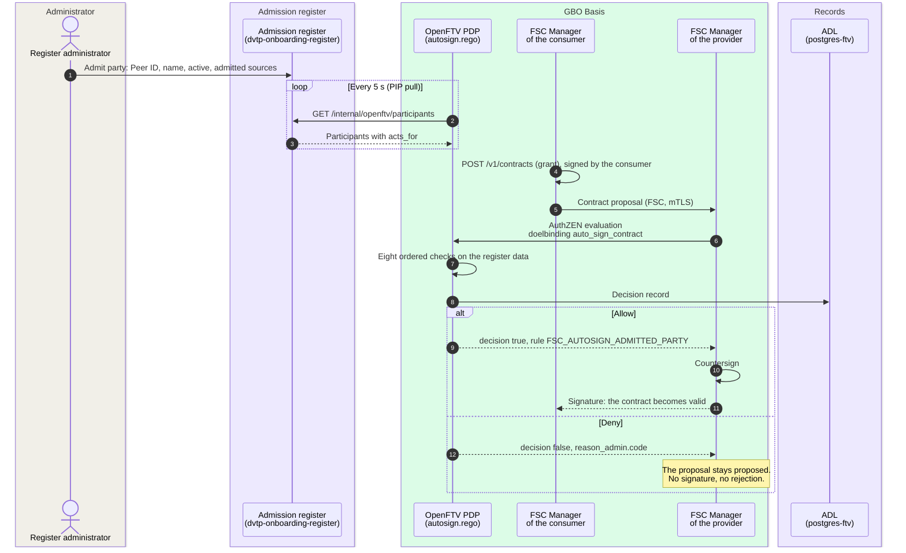
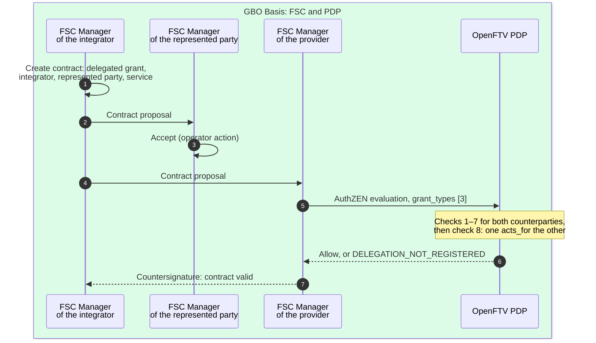
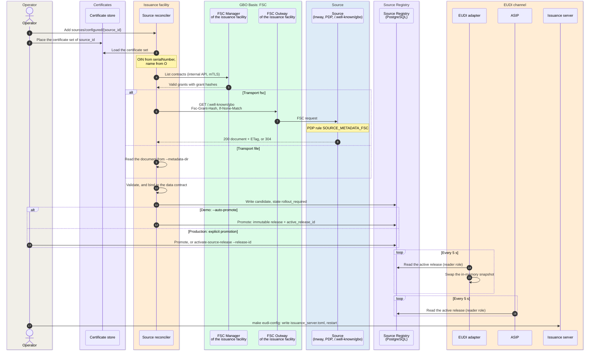

# Admission and activation

Two management-plane scenarios come before the first request:

1. Contract admission: a party asks for an FSC contract. The FSC
   Manager of the provider asks the PDP whether that party is admitted.
2. Source activation: the operator of a GBO component takes a source
   into use. The component fetches the service description of the source,
   validates it, and activates it as an immutable release.

Both scenarios carry no citizen data. They share one principle: a valid
contract is necessary, but it is not enough. Admission comes from a
register and does not follow from the contract
([REQ-61](../requirements/admission.md#req-61)). Activation is an
explicit management action and does not follow from the contract either
([REQ-65](../requirements/sources-identity.md#req-65)).

For the concepts, see
[Authorization: admission and contract acceptance](../concepts/authorization.md#admission-and-contract-acceptance)
and [Source onboarding](../concepts/source-onboarding.md). The
decisions are [ADR-0015](../decisions/0015-contract-acceptance-by-policy.md)
and [ADR-0016](../decisions/0016-source-owned-metadata.md).

## Scenario 1: contract admission {#contract-admission}

A consumer, an integrator, or a GBO component (the issuance facility, the
ASIP, the PDP itself) wants to connect to an FSC service of a source
holder. The party creates a contract proposal in its own FSC Manager. The
FSC Manager of the provider does not sign on a flag. It sends every proposal
to the OpenFTV PDP as an AuthZEN evaluation and signs only on allow
([`fsc-infra/docker-compose.yml#L701-L702`](https://github.com/ICTU/GBO-demo/blob/v0.9.0/fsc-infra/docker-compose.yml#L701-L702)).
The FSC Managers of the BRP peer and the consent register peer use the
same policy
([`#L892-L893`](https://github.com/ICTU/GBO-demo/blob/v0.9.0/fsc-infra/docker-compose.yml#L892-L893),
[`#L1079-L1080`](https://github.com/ICTU/GBO-demo/blob/v0.9.0/fsc-infra/docker-compose.yml#L1079-L1080)).

### Data per hop

Each hop of contract admission carries the following data:

| # | From → to | Interface | Data | Notes |
|---|---|---|---|---|
| 1 | Administrator → register | Register UI (`localhost:9415`), CSRF-protected forms | FSC Peer ID (20 characters), display name, `active`, Peer IDs of the admitted source holders | The register has no accounts. Anyone who reaches the UI locally is administrator ([README](https://github.com/ICTU/GBO-demo/blob/v0.9.0/services/dvtp-onboarding-register/README.md)). Integrations (`acts_for`) and technical participants are part of the deployment configuration. The UI does not manage them |
| 2 to 3 | PDP → register | `GET /internal/openftv/participants` ([`handler.go#L63`](https://github.com/ICTU/GBO-demo/blob/v0.9.0/services/dvtp-onboarding-register/internal/httpapi/handler.go#L63)), interval 5 s, timeout 2 s | `data.entities.dvtp_participant`, keyed by Peer ID: `name`, `active`, `allowed_source_peer_ids`, `acts_for` ([`dvtp-onboarding.yaml`](https://github.com/ICTU/GBO-demo/blob/v0.9.0/services/openftv-pdp/pip-pull/dvtp-onboarding.yaml#L1-L31)) | The pull uses a network that only the register and the PDP share. Every entry carries `acts_for`. If the party acts for nobody, `acts_for` is empty. As a result, a withdrawn mandate replaces the old entity |
| 4 | Consumer → own FSC Manager | `POST /v1/contracts`, internal API, mTLS ([`seed-bri-connection-hv.sh#L113-L135`](https://github.com/ICTU/GBO-demo/blob/v0.9.0/fsc-infra/scripts/seed-bri-connection-hv.sh#L113-L135)) | Contract content: grant (type and service), validity, the peers | FSC grants carry no properties ([ADR-0031](../decisions/0031-regime-from-evidence.md)) |
| 5 | Consumer Manager → provider Manager | FSC Manager interface, mTLS with the organization certificate (demo CA) | Signed contract proposal | The contract hash identifies the proposal. A new submission is a new proposal with a new hash |
| 6 | Provider Manager → PDP | AuthZEN, `https://openftv-pdp:8443/authzen/v1`, the Manager pins the PDP CA | `subject` (`self_peer_id`, `peer_ids`), `action` `autosign_contract`, `resource` (contract hash, `grant_types`), `context.doelbinding` = `auto_sign_contract` ([`autosign.rego#L12-L15`](https://github.com/ICTU/GBO-demo/blob/v0.9.0/policies/fsc/autosign.rego#L12-L15)) | The input has no service name and no delegation direction. The PDP judges who connects. It does not judge to which service ([F-56](../traceability/findings-closed.md#f-56)) |
| 7 to 8 | PDP | Package `doelbinding.auto_sign_contract`, separate from the request policy ([REQ-62](../requirements/admission.md#req-62)) | Decision record in the ADL, next to the request decisions | The doelbinding selects the package. A renamed package resolves to nothing ([`autosign.rego#L8-L10`](https://github.com/ICTU/GBO-demo/blob/v0.9.0/policies/fsc/autosign.rego#L8-L10)) |
| 9 to 11 | PDP → provider Manager → consumer Manager | AuthZEN response, then FSC signature | Allow: `FSC_AUTOSIGN_ADMITTED_PARTY`, counterparties, source Peer ID. Deny: first failing code, counterparties, grant types ([`autosign.rego#L184-L202`](https://github.com/ICTU/GBO-demo/blob/v0.9.0/policies/fsc/autosign.rego#L184-L202)) | The response holds only Peer IDs and no personal data |

### Ordered refusal codes

The policy runs eight checks in a fixed order. The first check that fails
names the refusal
([`autosign.rego#L165-L175`](https://github.com/ICTU/GBO-demo/blob/v0.9.0/policies/fsc/autosign.rego#L165-L175)).
Each check defaults to false, so malformed input leads to a refusal
instead of an undefined check. The policy refuses a contract for one of
eight reasons, in this order:

| # | Code | Refuses when | Tests (v0.9.0) |
|---|---|---|---|
| 1 | `NOT_AN_AUTOSIGN_REQUEST` | The action is not `autosign_contract`, the resource is not a contract, or attributes are missing | [`autosign_test.rego#L223`](https://github.com/ICTU/GBO-demo/blob/v0.9.0/policies/fsc/autosign_test.rego#L223), [`#L230`](https://github.com/ICTU/GBO-demo/blob/v0.9.0/policies/fsc/autosign_test.rego#L230), [`#L239`](https://github.com/ICTU/GBO-demo/blob/v0.9.0/policies/fsc/autosign_test.rego#L239) |
| 2 | `GRANT_TYPE_NOT_ALLOWED` | The grants are not all type 2 (service connection) and not all type 3 (delegated service connection): a publication, a mix, or no grant | [`#L149`](https://github.com/ICTU/GBO-demo/blob/v0.9.0/policies/fsc/autosign_test.rego#L149), [`#L205`](https://github.com/ICTU/GBO-demo/blob/v0.9.0/policies/fsc/autosign_test.rego#L205), [`#L209`](https://github.com/ICTU/GBO-demo/blob/v0.9.0/policies/fsc/autosign_test.rego#L209), [`#L213`](https://github.com/ICTU/GBO-demo/blob/v0.9.0/policies/fsc/autosign_test.rego#L213) |
| 3 | `NO_COUNTERPARTY` | The contract names no party other than the provider | [`#L219`](https://github.com/ICTU/GBO-demo/blob/v0.9.0/policies/fsc/autosign_test.rego#L219) |
| 4 | `ADMISSION_REGISTER_UNAVAILABLE` | The PIP pull supplied no register | [`#L86`](https://github.com/ICTU/GBO-demo/blob/v0.9.0/policies/fsc/autosign_test.rego#L86), [`#L91`](https://github.com/ICTU/GBO-demo/blob/v0.9.0/policies/fsc/autosign_test.rego#L91) |
| 5 | `PARTY_NOT_IN_REGISTRY` | A counterparty is not in the register. This also applies when the register is empty | [`#L130`](https://github.com/ICTU/GBO-demo/blob/v0.9.0/policies/fsc/autosign_test.rego#L130), [`#L96`](https://github.com/ICTU/GBO-demo/blob/v0.9.0/policies/fsc/autosign_test.rego#L96), [`#L190`](https://github.com/ICTU/GBO-demo/blob/v0.9.0/policies/fsc/autosign_test.rego#L190) |
| 6 | `PARTY_NOT_ACTIVE` | A counterparty is suspended (`active` is not `true`) | [`#L138`](https://github.com/ICTU/GBO-demo/blob/v0.9.0/policies/fsc/autosign_test.rego#L138), [`#L185`](https://github.com/ICTU/GBO-demo/blob/v0.9.0/policies/fsc/autosign_test.rego#L185), [`#L195`](https://github.com/ICTU/GBO-demo/blob/v0.9.0/policies/fsc/autosign_test.rego#L195) |
| 7 | `SOURCE_NOT_ALLOWED` | A counterparty is not admitted for the Peer ID of this source | [`#L109`](https://github.com/ICTU/GBO-demo/blob/v0.9.0/policies/fsc/autosign_test.rego#L109), [`#L113`](https://github.com/ICTU/GBO-demo/blob/v0.9.0/policies/fsc/autosign_test.rego#L113) |
| 8 | `DELEGATION_NOT_REGISTERED` | The contract has a delegated grant, but no integration between the two counterparties is registered | [`#L176`](https://github.com/ICTU/GBO-demo/blob/v0.9.0/policies/fsc/autosign_test.rego#L176), [`#L180`](https://github.com/ICTU/GBO-demo/blob/v0.9.0/policies/fsc/autosign_test.rego#L180), [`#L201`](https://github.com/ICTU/GBO-demo/blob/v0.9.0/policies/fsc/autosign_test.rego#L201) |

The tests
[`#L74`](https://github.com/ICTU/GBO-demo/blob/v0.9.0/policies/fsc/autosign_test.rego#L74),
[`#L117`](https://github.com/ICTU/GBO-demo/blob/v0.9.0/policies/fsc/autosign_test.rego#L117),
and [`#L171`](https://github.com/ICTU/GBO-demo/blob/v0.9.0/policies/fsc/autosign_test.rego#L171)
cover the allow paths. If the policy refuses one party among several, it
refuses the whole contract
([`#L143`](https://github.com/ICTU/GBO-demo/blob/v0.9.0/policies/fsc/autosign_test.rego#L143)).

A refusal leaves the proposal at *proposed*. The party can correct its
admission and submit again. The new submission gets a new assessment
([REQ-63](../requirements/admission.md#req-63)). This behavior is product
behavior of the FSC Manager. No automated test covers it. If a setup
configures an automatic refusal, the setup breaks the requirement.

### Delegated grant (integrator) {#delegated-grant}

An integrator connects on behalf of a consumer (the represented party).
The integrator uses one contract that holds a delegated service
connection grant (type 3). The contract has three signatures
([`seed-bri-delegation-int.sh#L1-L17`](https://github.com/ICTU/GBO-demo/blob/v0.9.0/fsc-infra/scripts/seed-bri-delegation-int.sh#L1-L17)):

Each hop of the delegated grant carries the following data:

| # | Data | Notes |
|---|---|---|
| 1 to 2 | Delegated grant with the Peer IDs of the integrator, the represented party, and the provider | The FSC Manager of the represented party has no autosign. In the demo, the seed script accepts on its behalf. The script does what the operator does in the Controller UI ([`#L147-L167`](https://github.com/ICTU/GBO-demo/blob/v0.9.0/fsc-infra/scripts/seed-bri-delegation-int.sh#L147-L167)) |
| 4 to 6 | `peer_ids` with the two counterparties, `grant_types` `[3]` | The integrator must be admitted in its own right. A mandate does not replace the admission of either party |

The contract check admits the pair of counterparties. It does not check
the direction
([`autosign.rego#L119-L139`](https://github.com/ICTU/GBO-demo/blob/v0.9.0/policies/fsc/autosign.rego#L119-L139)).
The input does not say which party delegates. The check refuses a third
counterparty. A contract that is signed the wrong way round passes this
check, but the request policy denies it on every call.

At request time, the provider Manager puts the represented party in the
`act` claim of the access token. The engine then requires a mandate for
the represented party and for the granting rule
([`engine.rego#L246-L267`](https://github.com/ICTU/GBO-demo/blob/v0.9.0/policies/gbo/engine.rego#L246-L267),
[ADR-0034](../decisions/0034-integrator-delegation.md)). The engine
decides as follows:

| Situation at request time | Code | Tests (v0.9.0) |
|---|---|---|
| Registered integrator, mandate for the represented party and the rule | allow | [`engine_test.rego#L613`](https://github.com/ICTU/GBO-demo/blob/v0.9.0/policies/gbo/engine_test.rego#L613) |
| No mandate for the represented party or the rule | `INTEGRATOR_NOT_REGISTERED` | [`#L621`](https://github.com/ICTU/GBO-demo/blob/v0.9.0/policies/gbo/engine_test.rego#L621) |
| The integrator is suspended | `INTEGRATOR_NOT_REGISTERED` | [`#L706`](https://github.com/ICTU/GBO-demo/blob/v0.9.0/policies/gbo/engine_test.rego#L706) |
| The register is missing from the PDP data | `INTEGRATOR_REGISTER_UNAVAILABLE` in the trace, request code `PIP_UNAVAILABLE`. The consumer sees `ACCESS_DENIED` | [`#L631`](https://github.com/ICTU/GBO-demo/blob/v0.9.0/policies/gbo/engine_test.rego#L631) |

The register attaches the mandates to the entry of the integrator
([`service_test.go#L245`](https://github.com/ICTU/GBO-demo/blob/v0.9.0/services/dvtp-onboarding-register/internal/onboarding/service_test.go#L245)).
The consent binds the represented party. It does not bind the integrator
([REQ-106](../requirements/consent.md#req-106)). For the DvTP query with
an integrator, see [DvTP query](dvtp-query.md).

### Register missing against register empty

The PDP data can be in two states that look the same but have a
different meaning
([`autosign.rego#L43-L59`](https://github.com/ICTU/GBO-demo/blob/v0.9.0/policies/fsc/autosign.rego#L43-L59),
[PR #579](https://github.com/ICTU/GBO-demo/pull/579)):

| PDP data | Meaning | Code |
|---|---|---|
| No `data.entities`, or no `dvtp_participant` document | The PIP pull supplied no register: an outage or a wrong mapping | `ADMISSION_REGISTER_UNAVAILABLE` |
| `dvtp_participant` is `{}` | The register is available and admits nobody | `PARTY_NOT_IN_REGISTRY` |

Both states lead to a refusal. The two codes tell the operator whether
the pull or the admission needs a repair. The readiness script of the demo waits for the first
successful pull before it seeds contracts
([`wait-openftv-admission.sh`](https://github.com/ICTU/GBO-demo/blob/v0.9.0/scripts/wait-openftv-admission.sh)).

The OpenFTV pull adds and replaces entities. If an entity disappears
from a later response, the pull does not remove it. For this reason, the
register deactivates a participant and never deletes it. A deleted
record leaves the old admission in the PDP
([REQ-61](../requirements/admission.md#req-61)).

### Main observations

Contract admission in gbo-demo v0.9.0 has these properties and gaps:

- **Admission is register data**
  ([F-55](../traceability/findings-closed.md#f-55)). No policy rule holds the
  admission. Adding, suspending, or withdrawing a party changes register
  data. The PDP sees the change within one pull interval of 5 s, without
  a policy change or a restart.
- **Contract and request rules are separate**
  ([REQ-62](../requirements/admission.md#req-62)). The two rule sets
  share no rules and no reason codes. They do share one policy set and
  one availability object. As a result, one broken module stops both
  ([F-52](../traceability/findings.md#f-52)).
- **A suspended consumer keeps its access.** A suspension stops only new
  contracts. At request time, the policy checks the status of an
  integrator. It does not check the status of a direct consumer. A
  suspended consumer with an existing contract can still request data,
  also with a valid consent
  ([REQ-110](../requirements/admission.md#req-110),
  [Q-53](../traceability/open-questions.md#q-53)).
- **Changes are not traceable.** The register has no accounts and no
  change log ([REQ-123](../requirements/admission.md#req-123)). The task
  to run the register is assigned to the management organization
  ([Q-22](../traceability/answered-questions.md#q-22)). It is open who builds
  the facility ([Q-74](../traceability/open-questions.md#q-74)).
- **The register key is the FSC Peer ID.** It is open whether policy can
  read the Peer ID as the OIN of the consumer
  ([Q-68](../traceability/open-questions.md#q-68)).

## Scenario 2: source activation {#source-activation}

For each source, the issuance facility and the ASIP need to know the data
service, the query, the mapping, and the offer. The source publishes that
description itself ([REQ-64](../requirements/sources-identity.md#req-64),
[F-57](../traceability/findings.md#f-57)). The source reconciler of the
EUDI adapter fetches the description, validates it, and writes it to the
Source Registry. The runtime readers read only activated releases.

First, the metadata contract and the data contract of the source must be
valid. They pass [contract admission](#contract-admission) like every
other contract, because the issuance facility is a technical participant
in the admission register.

### Data per hop

Each hop of source activation carries the following data:

| # | From → to | Interface | Data | Notes |
|---|---|---|---|---|
| 1 | Operator → reconciler | One file per source in `sources/configured/` ([`source_configuration.go#L16-L28`](https://github.com/ICTU/GBO-demo/blob/v0.9.0/services/eudi-adapter/source_configuration.go#L16-L28)) | `source_id` (file name), transport per leg, metadata locator, `provider_peer_id` | The file holds no OIN and no organization name. Those values come from the certificate |
| 2 to 4 | Operator → store → reconciler | Public certificate store (`--certificate-store=public-filesystem`) | Issuer, reader and status-list leaf certificates of the source | The reconciler gets only public leaves. Only the issuance init container gets the private keys ([REQ-58](../requirements/eudi-issuance.md#req-58)) |
| 5 to 6 | Reconciler → FSC Manager | Internal Manager API, mTLS ([`docker-compose.yml#L1846-L1865`](https://github.com/ICTU/GBO-demo/blob/v0.9.0/docker-compose.yml#L1846-L1865)) | Contract snapshot: per provider Peer ID and service, the grant hash | A contract without a source file activates nothing |
| 7 to 9 | Reconciler → Outway → source | `GET /.well-known/gbo` with `Fsc-Grant-Hash` and `If-None-Match` | Source metadata document (`gbo-source-metadata-v1`, version 1.0 or 1.1), `ETag` | The PDP of the source allows only known peers, on the metadata services, on exactly this path ([`authz.rego#L14-L36`](https://github.com/ICTU/GBO-demo/blob/v0.9.0/policies/authz.rego#L14-L36)). The document is public and holds no citizen data. A `304` extends only the freshness |
| 10 | Reconciler | Validation ([`service.go#L399-L416`](https://github.com/ICTU/GBO-demo/blob/v0.9.0/services/source-registry/onboarding/service.go#L399-L416)) | Schema, `source_oin` against the certificate, version, validity window, one read operation, mapping, offers, claims, the `asi` capability | The data service that the document names must have a valid data contract |
| 11 | Reconciler → registry | Writer role | Candidate per source, with state | The registry refuses private key material |
| 12 | Reconciler or operator → registry | One database transaction ([`store.go#L300-L390`](https://github.com/ICTU/GBO-demo/blob/v0.9.0/services/source-registry/postgresregistry/store.go#L300-L390)) | Release (identified by the SHA-256 of its content) and the singleton `active_release_id` | A release never changes. Automatic promotion is off by default ([`reconcile_command.go#L197`](https://github.com/ICTU/GBO-demo/blob/v0.9.0/services/eudi-adapter/reconcile_command.go#L197)). Compose turns it on |
| 13 to 14 | Adapter → registry | Reader role, every 5 s ([`source_release_runtime.go#L59-L63`](https://github.com/ICTU/GBO-demo/blob/v0.9.0/services/eudi-adapter/source_release_runtime.go#L59-L63)) | Source snapshots, Type Metadata, offer catalog | The adapter loads the full material only when the release ID changes |
| 15 | ASIP → registry | Reader role, `ASIP_SOURCE_REGISTRY_REFRESH` = 5 s ([`asi-provider/main.go#L101`](https://github.com/ICTU/GBO-demo/blob/v0.9.0/services/asi-provider/main.go#L101)) | Per data service: query, attribute mapping, legal name of the authentic source, discovery records | |
| 16 | Operator → issuance server | Init container writes `issuance_server.toml` | Offers, disclosure, certificates, trust anchors | The issuance server reads its configuration only at start, so a new release needs a controlled restart |

For the document structure, the transports, and the release readers, see
[Source onboarding](../concepts/source-onboarding.md#lifecycle).

### Failure per source

A source that fails gets the state `stale` or `blocked`. The other
sources keep their state
([REQ-66](../requirements/sources-identity.md#req-66)). For the reason
codes, see
[`service.go#L141-L152`](https://github.com/ICTU/GBO-demo/blob/v0.9.0/services/source-registry/onboarding/service.go#L141-L152).
Source activation handles each failure as follows:

| Trigger | Result | Tests (v0.9.0) |
|---|---|---|
| Valid metadata contract, no source file | Nothing is activated | [`fsc_contract_discovery_test.go#L143`](https://github.com/ICTU/GBO-demo/blob/v0.9.0/services/eudi-adapter/fsc_contract_discovery_test.go#L143), [`#L89`](https://github.com/ICTU/GBO-demo/blob/v0.9.0/services/eudi-adapter/fsc_contract_discovery_test.go#L89) |
| Certificate set missing | That source gets `blocked`: `CERTIFICATE_SET_NOT_FOUND`. The reconciler checks this before any network call. The other sources continue | [`#L172`](https://github.com/ICTU/GBO-demo/blob/v0.9.0/services/eudi-adapter/fsc_contract_discovery_test.go#L172), [`#L278`](https://github.com/ICTU/GBO-demo/blob/v0.9.0/services/eudi-adapter/fsc_contract_discovery_test.go#L278), [`service_test.go#L130`](https://github.com/ICTU/GBO-demo/blob/v0.9.0/services/source-registry/onboarding/service_test.go#L130) |
| Certificate without OIN or organization name | `blocked`: `CERTIFICATE_SET_INVALID` | code ([`service.go#L283-L297`](https://github.com/ICTU/GBO-demo/blob/v0.9.0/services/source-registry/onboarding/service.go#L283-L297)) |
| FSC Manager unreachable | FSC sources get `FSC_MANAGER_UNAVAILABLE`, and the candidate stays within grace. Sources without FSC continue | [`service_test.go#L159`](https://github.com/ICTU/GBO-demo/blob/v0.9.0/services/source-registry/onboarding/service_test.go#L159), [`#L319`](https://github.com/ICTU/GBO-demo/blob/v0.9.0/services/source-registry/onboarding/service_test.go#L319), [`fsc_contract_discovery_test.go#L599`](https://github.com/ICTU/GBO-demo/blob/v0.9.0/services/eudi-adapter/fsc_contract_discovery_test.go#L599) |
| Source file, no metadata contract | `blocked`: `METADATA_CONTRACT_NOT_FOUND` | [`#L201`](https://github.com/ICTU/GBO-demo/blob/v0.9.0/services/eudi-adapter/fsc_contract_discovery_test.go#L201) |
| Fetch fails, previous candidate within grace | `stale`. Issuance continues on the previous version | [`#L549`](https://github.com/ICTU/GBO-demo/blob/v0.9.0/services/eudi-adapter/fsc_contract_discovery_test.go#L549), [`#L519`](https://github.com/ICTU/GBO-demo/blob/v0.9.0/services/eudi-adapter/fsc_contract_discovery_test.go#L519) |
| Fetch fails, no candidate, or file missing | `blocked`: `METADATA_FETCH_FAILED` | [`#L851`](https://github.com/ICTU/GBO-demo/blob/v0.9.0/services/eudi-adapter/fsc_contract_discovery_test.go#L851) |
| Document invalid: schema error, OIN differs from the certificate, more or less than one read operation, or valid for less than one hour | `METADATA_INVALID`. The last complete candidate stays | [`main_test.go#L628`](https://github.com/ICTU/GBO-demo/blob/v0.9.0/services/eudi-adapter/main_test.go#L628) |
| `asi` capability invalid, or a document with only `asi` | The whole source gets `METADATA_INVALID` | [`asi_onboarding_test.go#L152`](https://github.com/ICTU/GBO-demo/blob/v0.9.0/services/eudi-adapter/asi_onboarding_test.go#L152) |
| GBO attribute catalogue unreadable | Only sources with `asi` are refused | [`asi_onboarding_test.go#L227`](https://github.com/ICTU/GBO-demo/blob/v0.9.0/services/eudi-adapter/asi_onboarding_test.go#L227) |
| No contract for the data service in the document | `DATA_CONTRACT_NOT_FOUND` | [`service_test.go#L295`](https://github.com/ICTU/GBO-demo/blob/v0.9.0/services/source-registry/onboarding/service_test.go#L295) |
| Lower version, or the same version with other content | Not activated | none, code only ([`source_registry_backend.go#L163-L175`](https://github.com/ICTU/GBO-demo/blob/v0.9.0/services/eudi-adapter/source_registry_backend.go#L163-L175), [#610](https://github.com/ICTU/GBO-demo/issues/610)) |
| Registry write fails | `blocked`: `ACTIVATION_FAILED` | code ([`service.go#L418-L421`](https://github.com/ICTU/GBO-demo/blob/v0.9.0/services/source-registry/onboarding/service.go#L418-L421)) |
| Promotion fails | The previous release stays active | [`store_test.go#L94`](https://github.com/ICTU/GBO-demo/blob/v0.9.0/services/source-registry/postgresregistry/store_test.go#L94) |
| One configured source without a valid version | No new release for any source. The active release stays (deviation, [#606](https://github.com/ICTU/GBO-demo/issues/606)) | [`registry_test.go#L91`](https://github.com/ICTU/GBO-demo/blob/v0.9.0/services/source-registry/onboarding/registry_test.go#L91) |
| Operator rolls back to a stored release | The stored release becomes active. Automatic promotion keeps the rollback until new content arrives | [`registry_test.go#L116`](https://github.com/ICTU/GBO-demo/blob/v0.9.0/services/source-registry/onboarding/registry_test.go#L116), [`store_test.go#L147`](https://github.com/ICTU/GBO-demo/blob/v0.9.0/services/source-registry/postgresregistry/store_test.go#L147), [`source_registry_command_test.go#L47`](https://github.com/ICTU/GBO-demo/blob/v0.9.0/services/eudi-adapter/source_registry_command_test.go#L47) |
| Rollback to a release the adapter cannot load | Refused. The pointer does not change | [`source_registry_command_test.go#L72`](https://github.com/ICTU/GBO-demo/blob/v0.9.0/services/eudi-adapter/source_registry_command_test.go#L72) |
| Active version of a source past grace | Issuance for that source answers HTTP 503. The offer list `/eudi-offers.json` answers 503 for all sources (deviation, #606) | code only ([`main.go#L221-L225`](https://github.com/ICTU/GBO-demo/blob/v0.9.0/services/eudi-adapter/main.go#L221-L225)) |
| Adapter refresh fails | The previous complete snapshot stays in use | [`source_release_runtime_test.go#L125`](https://github.com/ICTU/GBO-demo/blob/v0.9.0/services/eudi-adapter/source_release_runtime_test.go#L125), [`#L89`](https://github.com/ICTU/GBO-demo/blob/v0.9.0/services/eudi-adapter/source_release_runtime_test.go#L89) |
| ASIP reads the release | The ASIP reads per data service from the active release | [`asi_onboarding_test.go#L323`](https://github.com/ICTU/GBO-demo/blob/v0.9.0/services/eudi-adapter/asi_onboarding_test.go#L323) |

### Main observations

Source activation in gbo-demo v0.9.0 has these properties and gaps:

- **A valid contract is not activation**
  ([F-58](../traceability/findings-closed.md#f-58)). The source file is the
  management action. Transport and mandate are two decisions with two
  owners. Two parts are not built: the rule for who can take the action,
  and the way GBO records the admission decision. These parts are PSA
  B-09 in the
  [besluitregister](https://ictu.github.io/GBO-PSA/main/vraagstukken/#besluitregister)
  and [REQ-123](../requirements/admission.md#req-123).
- **The source owns its description**
  ([F-57](../traceability/findings.md#f-57)). GBO validates and activates
  the description. Its origin is the authenticated FSC transport plus the
  OIN from the certificate. The document itself has no signature. The
  `file` transport is a visible, temporary exception for a source without
  an endpoint. The demo does not record the agreement of the bronhouder
  ([F-71](../traceability/findings.md#f-71),
  [AV-08](../requirements/admission.md#av-08)).
- **Releases have a full lifecycle**
  ([F-59](../traceability/findings-closed.md#f-59)). The lifecycle has
  validation before activation, bounded staleness, atomic promotion, and
  rollback. Policy bundles do not have this lifecycle. For a comparison,
  see [Policy distribution](policy-distribution.md).
- **Isolation is incomplete.** One failing source freezes new releases
  for all sources, and the offer list fails for all sources at the same
  time ([#606](https://github.com/ICTU/GBO-demo/issues/606)).
- **DvTP is not covered.** For DvTP, the GBO rules hold the offer of a
  source. A publication of the source does not hold it
  ([REQ-64](../requirements/sources-identity.md#req-64)). The question of
  how a source connects to the ASIP is partly answered
  ([Q-38](../traceability/open-questions.md#q-38)).

## Traceability

- Requirements: [REQ-61](../requirements/admission.md#req-61), [REQ-62](../requirements/admission.md#req-62), [REQ-63](../requirements/admission.md#req-63), [REQ-110](../requirements/admission.md#req-110), [REQ-123](../requirements/admission.md#req-123), [REQ-106](../requirements/consent.md#req-106), [REQ-64](../requirements/sources-identity.md#req-64), [REQ-65](../requirements/sources-identity.md#req-65), [REQ-66](../requirements/sources-identity.md#req-66), [REQ-58](../requirements/eudi-issuance.md#req-58), [AV-06](../requirements/admission.md#av-06), [AV-08](../requirements/admission.md#av-08)
- Findings: [F-55](../traceability/findings-closed.md#f-55) (closed), [F-56](../traceability/findings-closed.md#f-56) (closed), [F-52](../traceability/findings.md#f-52) (open), [F-73](../traceability/findings-closed.md#f-73) (closed), [F-57](../traceability/findings.md#f-57) (open), [F-58](../traceability/findings-closed.md#f-58) (closed), [F-59](../traceability/findings-closed.md#f-59) (closed), [F-71](../traceability/findings.md#f-71) (open)
- Open questions: [Q-22](../traceability/answered-questions.md#q-22) (answered), [Q-53](../traceability/open-questions.md#q-53) (open), [Q-68](../traceability/open-questions.md#q-68) (open), [Q-74](../traceability/open-questions.md#q-74) (open), [Q-38](../traceability/open-questions.md#q-38) (partly answered)
- Demo increments: [SL-45](../traceability/increments.md#sl-45) (done), [SL-46](../traceability/increments.md#sl-46) (done), [SL-09](../traceability/increments.md#sl-09) (partly covered)
