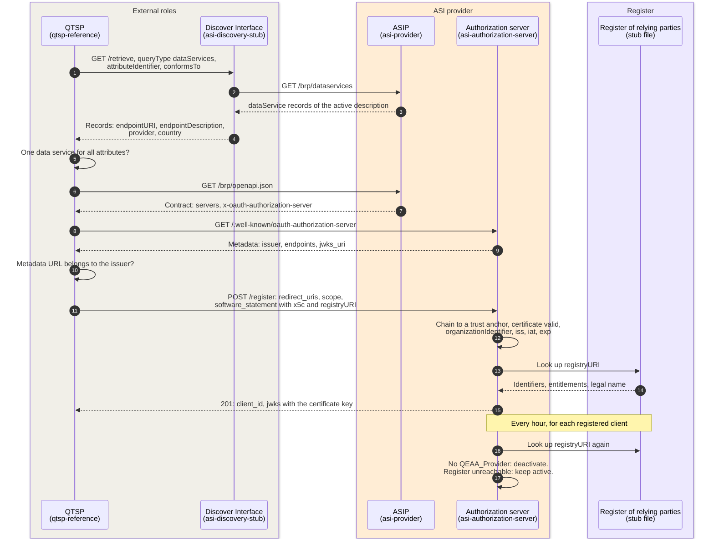
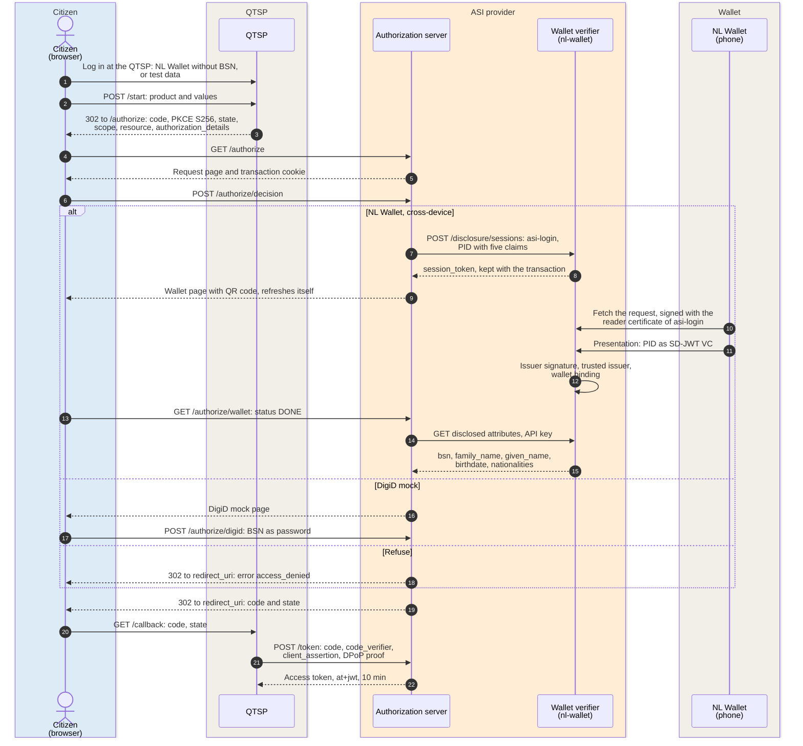
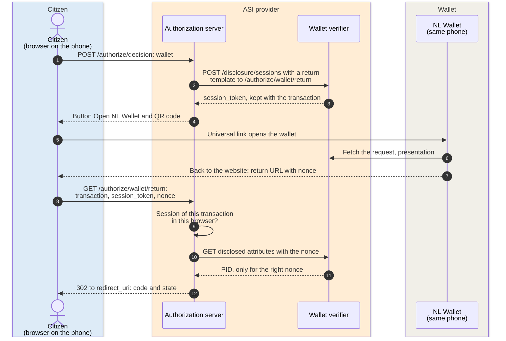
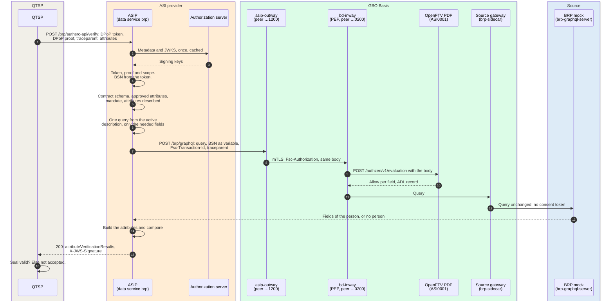
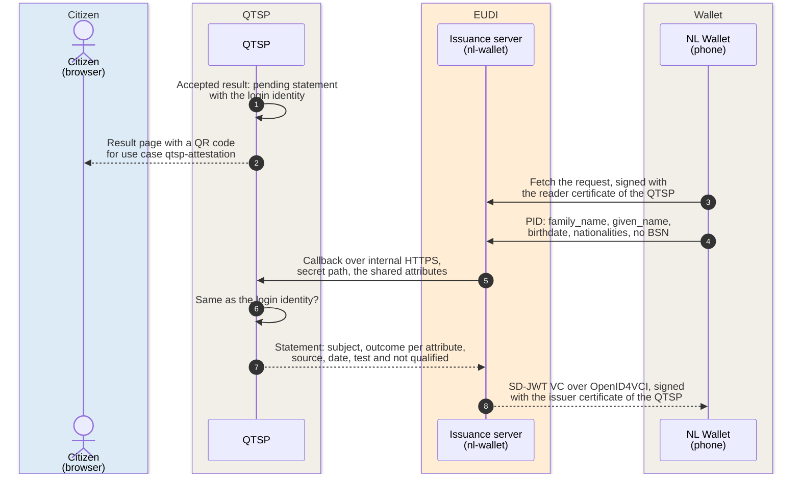

# ASI verification: a QTSP verifies or retrieves an attribute

A qualified trust service provider (QTSP) asks the Authentic Source
Interface Provider (ASIP) to verify or retrieve attributes of a citizen at
the authentic source. This exchange follows eIDAS Article 45e and ETSI TS
119 478, clause 6.1 ([ADR-0037](../decisions/0037-asi-oauth-front-door.md),
[GO: ASI provider](https://ictu.github.io/GBO-GO/main/#verificatie-en-retrievedienst-voor-qtsps-asi-provider)).
The citizen approves each request by logging in at the authorization
server of the ASIP.

The ASI route in gbo-demo
[v0.9.0](https://github.com/ICTU/GBO-demo/tree/v0.9.0) has four runs:

1. [Discovery and registration](#discovery-and-registration)
2. [Authorization and login](#authorization-and-login)
3. [Verify through the chain](#verify-through-the-chain)
4. [Test statement to the wallet](#test-statement-to-the-wallet)

For the concepts, see these pages:

- The components and the trust boundary:
  [Level 2: ASI chain](../building-blocks/components.md#level-2-asi-chain).
- The profile per ETSI clause: [ASI requirements](../requirements/asi.md#asi-profile).
- The trust roles: [ASI trust roles](../concepts/identity-trust.md#asi-trust-roles).
- The source description: [The `asi` capability](../concepts/source-onboarding.md#the-asi-capability-schema-11).
- What is real, stub, or interpretation in the demo:
  [`docs/asi-route.md`](https://github.com/ICTU/GBO-demo/blob/v0.9.0/docs/asi-route.md).

The demo runs one data service, `brp`, for the authentic source `rvig`
(BRP mock). Its base URL is `/brp/authsrc-api`
([ADR-0038](../decisions/0038-asi-data-service-per-source.md),
[`dataservices.json`](https://github.com/ICTU/GBO-demo/blob/v0.9.0/services/asi-provider/config/dataservices.json)).
The QTSP is the reference QTSP of the demo. It is not a real QTSP. The
route runs only in the local stack (`make demo-asi`).

## Discovery and registration

A QTSP finds the data service for an attribute without addresses in its
configuration ([REQ-99](../requirements/asi.md#req-99),
[REQ-100](../requirements/asi.md#req-100)). The QTSP registers once per
authorization server ([REQ-88](../requirements/asi.md#req-88)).

Each hop of discovery and registration carries the following data:

| # | From → To | Data | Notes |
|---|---|---|---|
| 1 to 4 | QTSP → Discover Interface → ASIP | In: an attribute identifier. Out: one record per attribute and data service | No personal data travels. The stub holds no records. It reads them per query from the ASIP and checks them against the ETSI schema ([`directory.go#L35-L40`](https://github.com/ICTU/GBO-demo/blob/v0.9.0/services/asi-discovery-stub/directory.go#L35-L40)). The ASIP lists the attributes of the active source description. If no description is active, the ASIP answers 503 ([`handler.go#L139-L165`](https://github.com/ICTU/GBO-demo/blob/v0.9.0/services/asi-provider/internal/httpapi/handler.go#L139-L165)). |
| 5 | QTSP (internal) | The records | A token is for one data service. If no data service provides all attributes, the QTSP stops before the authorization server ([`qtsp.go#L124-L162`](https://github.com/ICTU/GBO-demo/blob/v0.9.0/services/qtsp-reference/internal/qtsp/qtsp.go#L124-L162), [F-89](../traceability/findings.md#f-89)). |
| 6 to 7 | QTSP → ASIP | The contract (ETSI Annex B OpenAPI) | `servers` must equal the `endpointURI`. `x-oauth-authorization-server` is a GBO extension: ETSI requires the reference but gives no field ([F-91](../traceability/findings.md#f-91), [Q-39](../traceability/open-questions.md#q-39), [E1](../traceability/standards-feedback.md#e1)). |
| 8 to 10 | QTSP → authorization server | RFC 8414 metadata | The QTSP checks that the metadata URL is the RFC 8414 location for the issuer ([`qtsp.go#L190-L214`](https://github.com/ICTU/GBO-demo/blob/v0.9.0/services/qtsp-reference/internal/qtsp/qtsp.go#L190-L214)). |
| 11 to 12 | QTSP → authorization server | RFC 7591 request with a software statement, sealed with the QTSP certificate (`x5c`, `registryURI`) | No personal data travels. The certificate must chain to a trust anchor and carry an `organizationIdentifier`. In the demo, the certificate comes from the development reader CA. It is not an access certificate per ETSI TS 119 411-8 ([F-85](../traceability/findings.md#f-85)). |
| 13 to 15 | Authorization server ↔ register | `registryURI`. Out: identifiers, entitlements, legal name | The entry must carry `QEAA_Provider` and the `organizationIdentifier` of the certificate ([`registration.go#L199-L215`](https://github.com/ICTU/GBO-demo/blob/v0.9.0/services/asi-authorization-server/internal/authorization/registration.go#L199-L215)). It is open which identifier links the two ([Q-35](../traceability/open-questions.md#q-35)). The client key is the certificate key. The authorization server keeps clients in memory. |
| 16 to 17 | Authorization server ↔ register | The same lookup | The re-check runs every `AZSP_ENTITLEMENT_RECHECK_INTERVAL` (1 h) ([REQ-89](../requirements/asi.md#req-89), [`registration.go#L221-L245`](https://github.com/ICTU/GBO-demo/blob/v0.9.0/services/asi-authorization-server/internal/authorization/registration.go#L221-L245)). If the register is unreachable, the client stays active ([Q-34](../traceability/open-questions.md#q-34)). Tokens already issued stay valid ([Q-41](../traceability/open-questions.md#q-41)). |

## Authorization and login

The citizen starts at the QTSP and logs in there first. The QTSP then
sends the browser to the authorization server. One request page shows who
asks what at which source ([REQ-91](../requirements/asi.md#req-91)). The
citizen approves by logging in, or refuses
([REQ-90](../requirements/asi.md#req-90)). The diagram shows three
alternatives: the cross-device wallet login, the DigiD mock, and a
refusal.

Each hop of authorization and login carries the following data:

| # | From → To | Data | Notes |
|---|---|---|---|
| 1 | Citizen → QTSP | **name, birth date, nationalities** (no BSN) | The QTSP uses use case `qtsp-login` on the same verifier, with its own reader certificate. This shared verifier is a demo shortcut. The test-data login is a stub. The QTSP keeps the login in memory for 30 minutes. |
| 2 to 3 | Citizen → QTSP → browser | The product and the values to check (**address**) | The redirect carries PKCE S256, `state`, the operation as `scope`, `resource` = the `endpointURI`, and `authorization_details` with the attribute identifiers ([REQ-103](../requirements/asi.md#req-103), [ADR-0042](../decisions/0042-asi-attribute-token-binding.md)). The values stay at the QTSP. |
| 4 to 5 | Browser → authorization server | The authorization request. Out: the request page | If `resource` does not name exactly one data service, the answer is `invalid_target` ([REQ-95](../requirements/asi.md#req-95)). The page names the QTSP by its legal name from the register, the operation, the source, and the attributes. The transaction lives 5 minutes and is used once. A cookie binds the transaction to the browser. |
| 6 | Browser → authorization server | The choice: `wallet`, `digid`, or `deny` | The choice of a means starts the approval. The code comes only after a successful login. |
| 7 to 9 | Authorization server → verifier → browser | DCQL: `urn:eudi:pid:nl:1` with `bsn`, `family_name`, `given_name`, `birthdate`, `nationalities` | The authorization server keeps the session with the transaction and never takes one from the browser ([`provision.go#L33-L49`](https://github.com/ICTU/GBO-demo/blob/v0.9.0/services/asi-authorization-server/internal/walletverifier/provision.go#L33-L49)). |
| 10 to 12 | Wallet ↔ verifier | **PID** with the **BSN** | The reader certificate names the authorization server. It does not name the QTSP. Any phone can scan the QR code ([F-93](../traceability/findings.md#f-93)). The verifier verifies the issuer signature, the trusted issuer, and the wallet binding. The trusted issuers come from a fixed list. They do not come from a trusted list ([REQ-102](../requirements/asi.md#req-102), [Q-36](../traceability/open-questions.md#q-36)). |
| 13 to 15 | Authorization server ↔ verifier | **BSN**, names, birth date, nationalities | Only a PID of the right type with a BSN identifies the citizen. The NL PID has no place of birth ([F-94](../traceability/findings.md#f-94)). |
| 16 to 17 | Browser → DigiD mock | **BSN** | The DigiD mock is a stub. It checks only for nine digits and gives only the BSN ([F-88](../traceability/findings.md#f-88)). |
| 18 | Authorization server → browser | `error=access_denied` | No login takes place, and the source gets no request. |
| 19 to 20 | Browser → QTSP | `code`, `state` | The code is single use and valid for 60 s. Before the QTSP asks for a token, it checks its session and `state`. |
| 21 | QTSP → authorization server | `POST /token`: code, `code_verifier`, `private_key_jwt` client assertion, DPoP proof | From each pair of mechanisms that ETSI offers, the demo uses one: `private_key_jwt` and DPoP. The demo uses no mTLS and no PAR ([F-84](../traceability/findings.md#f-84), [Q-66](../traceability/open-questions.md#q-66)). |
| 22 | Authorization server → QTSP | RFC 9068 access token, ES256: `aud` = data service, `scope`, `authorization_details`, `cnf.jkt`, opaque `sub`, **BSN** claim, `acr`/`amr`, **PID claims** (wallet only) | The QTSP can read the BSN in the token ([F-86](../traceability/findings.md#f-86), [E7](../traceability/standards-feedback.md#e7), [#595](https://github.com/ICTU/GBO-demo/issues/595)). The token carries the means used ([REQ-86](../requirements/asi.md#req-86), [`tokens.go#L53-L85`](https://github.com/ICTU/GBO-demo/blob/v0.9.0/services/asi-authorization-server/internal/authorization/tokens.go#L53-L85)). |

### Same-device wallet login

If the browser and the wallet are on one phone, a button opens the
wallet. The wallet returns the browser with a nonce
([#548](https://github.com/ICTU/GBO-demo/issues/548),
[PR #573](https://github.com/ICTU/GBO-demo/pull/573)). This flow needs an
HTTPS issuer, because nl-wallet accepts only an HTTPS return URL. Over
local HTTP, the button is disabled, and only the QR code works. A run on a
real phone waits for the simulation environment
([#596](https://github.com/ICTU/GBO-demo/issues/596),
[#594](https://github.com/ICTU/GBO-demo/issues/594)).

These hops carry the data that is specific to the same-device login:

| # | From → To | Data | Notes |
|---|---|---|---|
| 2 | Authorization server → verifier | The return template | The verifier returns only after a same-device session (`session_type_return_url = "same_device"`, only for `asi-login`). |
| 7 to 9 | Wallet → browser → authorization server | `transaction`, `session_token`, `nonce` | The authorization server refuses another browser or another session before it calls the verifier. The browser also comes back after a refusal in the wallet ([`identification.go#L322-L356`](https://github.com/ICTU/GBO-demo/blob/v0.9.0/services/asi-authorization-server/internal/authorization/identification.go#L322-L356)). |
| 10 to 11 | Authorization server ↔ verifier | `nonce`. Out: **PID** with the **BSN** | The nonce binds the disclosure to the browser that the wallet returned. Another phone cannot finish this session ([F-93](../traceability/findings.md#f-93)). |

## Verify through the chain

The QTSP calls the ASIP with the token. The ASIP verifies the token, takes
the BSN from it, and calls the source once, through its own FSC Outway.
The generic GBO chain starts behind the ASIP
([F-87](../traceability/findings.md#f-87)).

Each hop of the verification carries the following data:

| # | From → To | Data | Notes |
|---|---|---|---|
| 1 | QTSP → ASIP | `Authorization: DPoP <token>`, DPoP proof with `ath`, **attribute values** to check | The values are personal data that the QTSP already has. `insufficient_scope` and every other token error give 401, as ETSI lists. |
| 2 to 3 | ASIP → authorization server | `jwks_uri` from the metadata | If the `kid` is unknown, the ASIP fetches the keys again. If the keys are not available, the ASIP answers 503 ([REQ-87](../requirements/asi.md#req-87)). |
| 4 | ASIP (internal) | Token, proof. Out: the **BSN** | The ASIP first verifies the token: signature, issuer, `aud`, expiry, DPoP binding and replay, and scope ([`handler.go#L222-L258`](https://github.com/ICTU/GBO-demo/blob/v0.9.0/services/asi-provider/internal/httpapi/handler.go#L222-L258)). The BSN comes only from the token. No log line holds the BSN. |
| 5 | ASIP (internal) | The request | Schema against the contract: 400. Attributes outside `authorization_details`: 401. `mandate`: 501. An attribute the source does not describe: 404 ([`handler.go#L260-L356`](https://github.com/ICTU/GBO-demo/blob/v0.9.0/services/asi-provider/internal/httpapi/handler.go#L260-L356), [`service.go#L129-L139`](https://github.com/ICTU/GBO-demo/blob/v0.9.0/services/asi-provider/internal/verification/service.go#L129-L139)). |
| 6 | ASIP (internal) | The `asi` description from the active release | The ASIP reads the active release every 5 s with the reader role. It derives one query with only the fields of the requested attributes ([REQ-92](../requirements/asi.md#req-92), [ADR-0039](../decisions/0039-asi-source-described-attributes.md)). |
| 7 | ASIP → asip-outway | `POST /brp/graphql` (grant link `/brp`): `{query, variables: {bsn}}` with the **BSN**, `Fsc-Transaction-Id`, `traceparent` | One FSC transaction per request. The span names the source, the transaction ID and the attribute identifiers, never the BSN or a value ([`source.go#L75-L104`](https://github.com/ICTU/GBO-demo/blob/v0.9.0/services/asi-provider/internal/graphqlsource/source.go#L75-L104), [REQ-55](../requirements/logging-audit.md#req-55)). |
| 8 | asip-outway → bd-inway | FSC, mTLS, with the body and the **BSN** | The hop uses the contract of the ASIP peer `…1200` for service `brp` on `…0200` ([FSC peers](../deployment.md#fsc-peers)). |
| 9 to 10 | bd-inway ↔ PDP | AuthZEN: actor `…1200`, service `brp`, the query with the **BSN** | ASI0001 grants the ASIP peer the BRP fields behind the attributes, on `brp` only. It does not check the token or the QTSP ([`asi0001.rego#L1-L72`](https://github.com/ICTU/GBO-demo/blob/v0.9.0/policies/gbo/rules/asi/asi0001.rego#L1-L72), [REQ-97](../requirements/authorization.md#req-97)). The PDP never sees the QTSP or the citizen. The ADL holds the BSN ([REQ-60](../requirements/logging-audit.md#req-60), [ADR-0043](../decisions/0043-identifiers-out-of-pdp-input.md)). |
| 11 to 12 | bd-inway → gateway → BRP mock | The judged query | If the query has no consent token, the gateway passes it through. The BRP logs its own processing. In demo v0.9.0, the ASIP writes no LDV records. |
| 13 | BRP mock → ASIP | **fields of the person**, or `null` | The answer goes back through the same FSC chain. |
| 14 | ASIP (internal) | Fields. Out: a result per attribute | `pointer`, `join`, `const`, and `each` build the attribute from the fields. The result is `Match`, `MatchWithVariation`, `NoMatch`, or `Unknown`. `Unknown` means only that the source holds no value ([REQ-84](../requirements/asi.md#req-84)). Fuzzy matching applies only to strings without a `format` ([REQ-113](../requirements/asi.md#req-113)). |
| 15 | ASIP → QTSP | results, `provider`, `authenticSource` (legal name from the description), header `X-JWS-Signature` | A verify response holds no source value ([REQ-85](../requirements/asi.md#req-85)). One authentic source per response ([REQ-94](../requirements/asi.md#req-94)). The seal is a detached JWS, ES256, with `x5c`, over the exact body. The ASIP does not seal errors ([REQ-83](../requirements/asi.md#req-83), [ADR-0041](../decisions/0041-asi-seal-format.md), [`handler.go#L402-L417`](https://github.com/ICTU/GBO-demo/blob/v0.9.0/services/asi-provider/internal/httpapi/handler.go#L402-L417)). |
| 16 | QTSP (internal) | The seal | The chain must lead to `QTSP_SEAL_TRUST_ANCHORS`. If it does not, the QTSP does not accept the result. |

The retrieve operation runs the same way at `POST /brp/authsrc-api/retrieve`
with scope `retrieve`. The request names attribute identifiers, without
values. The sealed 200 carries the values of every requested attribute. If
the source holds no value for one of them, the answer is 404. Retrieve
gives no partial result ([REQ-101](../requirements/asi.md#req-101)).

## Test statement to the wallet

After an accepted result, the reference QTSP issues a test statement to
the wallet of the citizen who logged in at the QTSP. The QTSP uses the central
issuance server of the EUDI route, with its own use case and its own
certificates ([`qtsp_issuance.go#L19-L27`](https://github.com/ICTU/GBO-demo/blob/v0.9.0/services/eudi-adapter/qtsp_issuance.go#L19-L27),
[EUDI issuance](eudi-issuance.md)).

Each hop of the test statement carries the following data:

| # | From → To | Data | Notes |
|---|---|---|---|
| 1 to 2 | QTSP → browser | The result and a fixed link per use case | This hop occurs only after `Match`, `MatchWithVariation`, or a retrieved value. The pending statement lives 10 minutes in memory and is used once. A later request of the same citizen replaces it. |
| 3 to 4 | Wallet → issuance server | **PID** without the BSN | A QTSP is not allowed to process the BSN. |
| 5 | Issuance server → QTSP | **name, birth date, nationalities** | The QTSP gets no session, only the shared attributes. The callback uses a secret path over CA-pinned HTTPS, without client authentication ([`qtsp_issuance.go#L134-L152`](https://github.com/ICTU/GBO-demo/blob/v0.9.0/services/eudi-adapter/qtsp_issuance.go#L134-L152)). |
| 6 | QTSP (internal) | The identity | The link to the login uses only these personal data. This link is a demo binding and does not check a unique identity ([F-93](../traceability/findings.md#f-93)). |
| 7 to 8 | QTSP → issuance server → wallet | **statement** | The statement is valid for 30 days, has `attestation_qualification = "EAA"`, and carries a clear test marking. It is not a QEAA. For `MatchWithVariation`, the statement records the value that the QTSP sent. It does not record a source value. |

## Error paths

The ASI route has the following error paths:

| Trigger | Outcome | Pinned by (v0.9.0) |
|---|---|---|
| No data service provides all requested attributes | The QTSP stops before the authorization server. Request API: 422. | [`api_e2e_test.go#L201`](https://github.com/ICTU/GBO-demo/blob/v0.9.0/services/qtsp-reference/api_e2e_test.go#L201) |
| No active source description | Records, verify, and retrieve answer 503. The contract stays published. | [`source_test.go#L168`](https://github.com/ICTU/GBO-demo/blob/v0.9.0/services/asi-provider/internal/httpapi/source_test.go#L168), [`graphqlsource/source_test.go#L148`](https://github.com/ICTU/GBO-demo/blob/v0.9.0/services/asi-provider/internal/graphqlsource/source_test.go#L148) |
| Software statement invalid: signature, chain, expiry, or no `organizationIdentifier` | `invalid_software_statement` | [`registration_test.go#L105`](https://github.com/ICTU/GBO-demo/blob/v0.9.0/services/asi-authorization-server/internal/httpapi/registration_test.go#L105) |
| No `QEAA_Provider`, or the identifier is not in the register entry | `unapproved_software_statement` ([REQ-88](../requirements/asi.md#req-88)) | [`registration_test.go#L152`](https://github.com/ICTU/GBO-demo/blob/v0.9.0/services/asi-authorization-server/internal/httpapi/registration_test.go#L152) |
| Register unreachable at registration | 503 `temporarily_unavailable` | [`registration_test.go#L324`](https://github.com/ICTU/GBO-demo/blob/v0.9.0/services/asi-authorization-server/internal/httpapi/registration_test.go#L324) |
| Entitlement withdrawn in the register | The next re-check deactivates the client: `invalid_client`. Issued tokens stay valid for up to 10 min ([Q-41](../traceability/open-questions.md#q-41)). | [`registration_test.go#L224`](https://github.com/ICTU/GBO-demo/blob/v0.9.0/services/asi-authorization-server/internal/httpapi/registration_test.go#L224), [`#L276`](https://github.com/ICTU/GBO-demo/blob/v0.9.0/services/asi-authorization-server/internal/httpapi/registration_test.go#L276) |
| Register unreachable at re-check | The client stays active (demo choice, [Q-34](../traceability/open-questions.md#q-34)) | [`registration_test.go#L306`](https://github.com/ICTU/GBO-demo/blob/v0.9.0/services/asi-authorization-server/internal/httpapi/registration_test.go#L306) |
| Unknown client or `redirect_uri` | Error page, no redirect | [`handler_test.go#L211`](https://github.com/ICTU/GBO-demo/blob/v0.9.0/services/asi-authorization-server/internal/httpapi/handler_test.go#L211) |
| `resource` missing or not exactly one data service | `invalid_target` ([REQ-95](../requirements/asi.md#req-95)) | [`handler_test.go#L153`](https://github.com/ICTU/GBO-demo/blob/v0.9.0/services/asi-authorization-server/internal/httpapi/handler_test.go#L153) |
| The citizen refuses | `access_denied`, without login | [`login_test.go#L61`](https://github.com/ICTU/GBO-demo/blob/v0.9.0/services/asi-authorization-server/internal/httpapi/login_test.go#L61) |
| DigiD mock: BSN is not nine digits | The page stays open with an error | [`login_test.go#L110`](https://github.com/ICTU/GBO-demo/blob/v0.9.0/services/asi-authorization-server/internal/httpapi/login_test.go#L110) |
| Wallet declines or the session expires | Back to the request page. The transaction stays. | [`wallet_test.go#L205`](https://github.com/ICTU/GBO-demo/blob/v0.9.0/services/asi-authorization-server/internal/httpapi/wallet_test.go#L205) |
| Verifier unreachable, also after DONE | 503 page. The transaction stays for the DigiD mock. | [`wallet_test.go#L299`](https://github.com/ICTU/GBO-demo/blob/v0.9.0/services/asi-authorization-server/internal/httpapi/wallet_test.go#L299) |
| Same-device return in another browser or for another session | Refused before the authorization server calls the verifier | [`wallet_test.go#L123`](https://github.com/ICTU/GBO-demo/blob/v0.9.0/services/asi-authorization-server/internal/httpapi/wallet_test.go#L123), [`#L148`](https://github.com/ICTU/GBO-demo/blob/v0.9.0/services/asi-authorization-server/internal/httpapi/wallet_test.go#L148) |
| Same-device return without the right nonce | Back to the request page with a message | [`wallet_test.go#L177`](https://github.com/ICTU/GBO-demo/blob/v0.9.0/services/asi-authorization-server/internal/httpapi/wallet_test.go#L177) |
| Wrong `code_verifier`, or a code that is used twice, expired, or of another client | `invalid_grant` | [`handler_test.go#L239`](https://github.com/ICTU/GBO-demo/blob/v0.9.0/services/asi-authorization-server/internal/httpapi/handler_test.go#L239), [`#L246`](https://github.com/ICTU/GBO-demo/blob/v0.9.0/services/asi-authorization-server/internal/httpapi/handler_test.go#L246) |
| Client assertion missing, wrong, or replayed | `invalid_client` | [`handler_test.go#L293`](https://github.com/ICTU/GBO-demo/blob/v0.9.0/services/asi-authorization-server/internal/httpapi/handler_test.go#L293), [`#L347`](https://github.com/ICTU/GBO-demo/blob/v0.9.0/services/asi-authorization-server/internal/httpapi/handler_test.go#L347) |
| No valid DPoP proof at the token endpoint | `invalid_dpop_proof` | [`handler_test.go#L374`](https://github.com/ICTU/GBO-demo/blob/v0.9.0/services/asi-authorization-server/internal/httpapi/handler_test.go#L374) |
| No token, an invalid token, or a DPoP proof that is missing, invalid, or replayed | 401 with `WWW-Authenticate: DPoP` | [`token_test.go#L46-L216`](https://github.com/ICTU/GBO-demo/blob/v0.9.0/services/asi-provider/internal/httpapi/token_test.go#L46-L216) |
| Scope does not cover the operation | 401 `insufficient_scope` | [`token_test.go#L217`](https://github.com/ICTU/GBO-demo/blob/v0.9.0/services/asi-provider/internal/httpapi/token_test.go#L217) |
| Attribute outside the approved `authorization_details` | 401 `insufficient_scope` ([REQ-103](../requirements/asi.md#req-103)) | [`token_test.go#L233`](https://github.com/ICTU/GBO-demo/blob/v0.9.0/services/asi-provider/internal/httpapi/token_test.go#L233) |
| Token for another data service | 401 ([REQ-95](../requirements/asi.md#req-95)) | [`dataservices_test.go#L16`](https://github.com/ICTU/GBO-demo/blob/v0.9.0/services/asi-provider/internal/httpapi/dataservices_test.go#L16) |
| Keys of the authorization server not available | 503 | [`token_test.go#L289`](https://github.com/ICTU/GBO-demo/blob/v0.9.0/services/asi-provider/internal/httpapi/token_test.go#L289) |
| Body not valid against the contract | 400, after the token check and before other checks | [`handler_test.go#L220`](https://github.com/ICTU/GBO-demo/blob/v0.9.0/services/asi-provider/internal/httpapi/handler_test.go#L220), [`token_test.go#L262`](https://github.com/ICTU/GBO-demo/blob/v0.9.0/services/asi-provider/internal/httpapi/token_test.go#L262) |
| `mandate` present | 501 ([REQ-114](../requirements/asi.md#req-114)) | [`handler_test.go#L186`](https://github.com/ICTU/GBO-demo/blob/v0.9.0/services/asi-provider/internal/httpapi/handler_test.go#L186), [`#L194`](https://github.com/ICTU/GBO-demo/blob/v0.9.0/services/asi-provider/internal/httpapi/handler_test.go#L194) |
| Attribute the source does not describe, also one of another data service | 404. The ASIP does not call the source. | [`handler_test.go#L151`](https://github.com/ICTU/GBO-demo/blob/v0.9.0/services/asi-provider/internal/httpapi/handler_test.go#L151), [`#L157`](https://github.com/ICTU/GBO-demo/blob/v0.9.0/services/asi-provider/internal/httpapi/handler_test.go#L157) |
| Source holds no value, or the BSN is unknown to the source | `Unknown` ([REQ-84](../requirements/asi.md#req-84)) | [`handler_test.go#L140`](https://github.com/ICTU/GBO-demo/blob/v0.9.0/services/asi-provider/internal/httpapi/handler_test.go#L140), [`token_test.go#L254`](https://github.com/ICTU/GBO-demo/blob/v0.9.0/services/asi-provider/internal/httpapi/token_test.go#L254) |
| Retrieve, and the source holds no value for one attribute | 404, no partial result ([REQ-101](../requirements/asi.md#req-101)) | [`handler_test.go#L291`](https://github.com/ICTU/GBO-demo/blob/v0.9.0/services/asi-provider/internal/httpapi/handler_test.go#L291) |
| Chain unreachable, or the Outway answers 5xx | 503, never `Unknown` ([REQ-93](../requirements/asi.md#req-93)) | [`graphqlsource/source_test.go#L157`](https://github.com/ICTU/GBO-demo/blob/v0.9.0/services/asi-provider/internal/graphqlsource/source_test.go#L157), [`source_test.go#L141`](https://github.com/ICTU/GBO-demo/blob/v0.9.0/services/asi-provider/internal/httpapi/source_test.go#L141) |
| PDP deny (the Inway answers 401), GraphQL errors, or an answer of another shape | 500, never `Unknown` | The same tests |
| PDP: the caller is not the ASIP peer | `ACTOR_NOT_ALLOWED` | [`asi0001_test.rego#L29`](https://github.com/ICTU/GBO-demo/blob/v0.9.0/policies/gbo/rules/asi/asi0001_test.rego#L29) |
| PDP: a consent token, or no BSN in the root argument | `PID_NOT_PRESENT` | [`asi0001_test.rego#L37-L49`](https://github.com/ICTU/GBO-demo/blob/v0.9.0/policies/gbo/rules/asi/asi0001_test.rego#L37-L49) |
| PDP: another service than `brp`, or another BRP field | Rule not bound, or the field falls to the closed world | [`asi0001_test.rego#L56-L61`](https://github.com/ICTU/GBO-demo/blob/v0.9.0/policies/gbo/rules/asi/asi0001_test.rego#L56-L61) |
| Seal from an unknown anchor | The QTSP does not accept the result | [`e2e_test.go#L285`](https://github.com/ICTU/GBO-demo/blob/v0.9.0/services/qtsp-reference/e2e_test.go#L285) |
| Test statement: `NoMatch` or `Unknown` | No pending statement | [`issuance_test.go#L97`](https://github.com/ICTU/GBO-demo/blob/v0.9.0/services/qtsp-reference/internal/issuance/issuance_test.go#L97) |
| Test statement: another PID, or a statement that is expired or used | Empty document list, nothing issued | [`issuance_test.go#L53`](https://github.com/ICTU/GBO-demo/blob/v0.9.0/services/qtsp-reference/internal/issuance/issuance_test.go#L53), [`callback_test.go#L38`](https://github.com/ICTU/GBO-demo/blob/v0.9.0/services/qtsp-reference/internal/issuancecallback/callback_test.go#L38) |

The conformance matrix gives each ETSI requirement ID a status and named
tests. At v0.9.0, the matrix has 55 passed, 4 stub, 21 not applicable, and
1 failing. If an ID or a test is missing, a CI job fails
([`etsi-ts-119478.yaml`](https://github.com/ICTU/GBO-demo/blob/v0.9.0/conformance/etsi-ts-119478.yaml),
[`ci.yml#L72-L73`](https://github.com/ICTU/GBO-demo/blob/v0.9.0/.github/workflows/ci.yml#L72-L73)).

## Main observations

The ASI route in gbo-demo v0.9.0 has these properties and gaps:

- **The QTSP is outside FSC.** Its admission is a certificate and a
  register entitlement at the authorization server. The source and the PDP
  see only the ASIP peer `…1200`. The ASIP passes nothing about the QTSP
  into the chain ([F-87](../traceability/findings.md#f-87),
  [Trust boundary](../building-blocks/components.md#trust-boundary)).
- **Two logins, no link.** The citizen logs in at the QTSP and at the
  authorization server. Nothing proves that it is the same person. In the
  cross-device route, another phone can scan the QR code
  ([F-93](../traceability/findings.md#f-93),
  [Q-40](../traceability/open-questions.md#q-40),
  [E6](../traceability/standards-feedback.md#e6)). Whether the
  authorization server offers the cross-device route at all is open
  ([Q-82](../traceability/open-questions.md#q-82)).
- **The BSN travels in two places where it is not needed.** The QTSP can read the BSN
  in the token ([F-86](../traceability/findings.md#f-86),
  [#595](https://github.com/ICTU/GBO-demo/issues/595)). The PDP input and
  the ADL also hold the BSN
  ([REQ-60](../requirements/logging-audit.md#req-60),
  [ADR-0043](../decisions/0043-identifiers-out-of-pdp-input.md)).
- **Approval is a login, not a consent.** The citizen approves one request.
  The demo stores no approval, and the citizen cannot revoke one
  ([REQ-90](../requirements/asi.md#req-90),
  [Wallet approval is not a legal basis](../concepts/authorization.md#wallet-approval-is-not-a-legal-basis)).
- **One token per source.** A QTSP that needs attributes of two sources
  authorizes twice. The citizen sees each source by name
  ([ADR-0038](../decisions/0038-asi-data-service-per-source.md),
  [F-89](../traceability/findings.md#f-89),
  [E3](../traceability/standards-feedback.md#e3)).
- **Per-attribute binding is optional.** If the request has no
  `authorization_details`, the token binds only per operation, as in ETSI.
  A configuration option makes the detail required ([ADR-0042](../decisions/0042-asi-attribute-token-binding.md),
  [F-95](../traceability/findings.md#f-95),
  [Q-33](../traceability/open-questions.md#q-33)).
- **No value with a variation.** `MatchWithVariation` returns no value. The
  conformance matrix records that row as failing
  ([F-92](../traceability/findings.md#f-92),
  [Q-29](../traceability/open-questions.md#q-29),
  [E2](../traceability/standards-feedback.md#e2)).
- **The seal format is a GBO choice.** ETSI defines no seal format
  ([Q-32](../traceability/open-questions.md#q-32),
  [E4](../traceability/standards-feedback.md#e4)). The demo seals with a
  development certificate.
- **Identification data is incomplete.** The NL PID has no place of birth.
  The DigiD mock gives only the BSN
  ([F-88](../traceability/findings.md#f-88),
  [F-94](../traceability/findings.md#f-94),
  [Q-36](../traceability/open-questions.md#q-36)).

## Not built in demo v0.9.0

Demo v0.9.0 does not build these parts of the ASI route:

- A resource list from the source descriptions. The authorization server
  takes its resource list from `AZSP_RESOURCES`. The rest of the `asi`
  capability is built ([#592](https://github.com/ICTU/GBO-demo/issues/592),
  [Q-38](../traceability/open-questions.md#q-38)).
- A deployment in the simulation environment, and a connection of an
  external QTSP ([#594](https://github.com/ICTU/GBO-demo/issues/594)).
- Protection of the BSN in the access token
  ([#595](https://github.com/ICTU/GBO-demo/issues/595),
  [F-86](../traceability/findings.md#f-86)).
- A same-device wallet login on a real phone. It is built and tested, and
  waits for #594 ([#596](https://github.com/ICTU/GBO-demo/issues/596)).
- `iss` in the authorization response, RFC 9207
  ([F-96](../traceability/findings.md#f-96),
  [E9](../traceability/standards-feedback.md#e9)). The effect of a
  withdrawn entitlement on issued tokens
  ([Q-41](../traceability/open-questions.md#q-41),
  [E10](../traceability/standards-feedback.md#e10)).
- LDV records by the ASIP and the authorization server
  ([REQ-72](../requirements/logging-audit.md#req-72)).
- Clause 6.2 (ISO 15000) and deferred answers
  ([REQ-112](../requirements/asi.md#req-112),
  [Q-64](../traceability/open-questions.md#q-64)). Requests on behalf of
  another person ([Q-65](../traceability/open-questions.md#q-65)).
- A production register, access certificates per ETSI TS 119 411-8, real
  DigiD, and a qualified seal certificate
  ([F-80](../traceability/findings.md#f-80),
  [F-85](../traceability/findings.md#f-85),
  [Q-28](../traceability/open-questions.md#q-28),
  [Q-37](../traceability/open-questions.md#q-37)).
- Registration of the data services in the Discover Interface
  ([Q-31](../traceability/open-questions.md#q-31),
  [Q-67](../traceability/open-questions.md#q-67)).

## Traceability

- Requirements: [REQ-55](../requirements/logging-audit.md#req-55),
  [REQ-60](../requirements/logging-audit.md#req-60),
  [REQ-72](../requirements/logging-audit.md#req-72),
  [REQ-83](../requirements/asi.md#req-83),
  [REQ-84](../requirements/asi.md#req-84),
  [REQ-85](../requirements/asi.md#req-85),
  [REQ-86](../requirements/asi.md#req-86),
  [REQ-87](../requirements/asi.md#req-87),
  [REQ-88](../requirements/asi.md#req-88),
  [REQ-89](../requirements/asi.md#req-89),
  [REQ-90](../requirements/asi.md#req-90),
  [REQ-91](../requirements/asi.md#req-91),
  [REQ-92](../requirements/asi.md#req-92),
  [REQ-93](../requirements/asi.md#req-93),
  [REQ-94](../requirements/asi.md#req-94),
  [REQ-95](../requirements/asi.md#req-95),
  [REQ-97](../requirements/authorization.md#req-97),
  [REQ-99](../requirements/asi.md#req-99),
  [REQ-100](../requirements/asi.md#req-100),
  [REQ-101](../requirements/asi.md#req-101),
  [REQ-102](../requirements/asi.md#req-102),
  [REQ-103](../requirements/asi.md#req-103),
  [REQ-112](../requirements/asi.md#req-112),
  [REQ-113](../requirements/asi.md#req-113),
  [REQ-114](../requirements/asi.md#req-114)
- Findings: [F-80](../traceability/findings.md#f-80) (open),
  [F-84](../traceability/findings.md#f-84) (open),
  [F-85](../traceability/findings.md#f-85) (open),
  [F-86](../traceability/findings.md#f-86) (open),
  [F-87](../traceability/findings.md#f-87) (open),
  [F-88](../traceability/findings.md#f-88) (open),
  [F-89](../traceability/findings.md#f-89) (open),
  [F-91](../traceability/findings.md#f-91) (open),
  [F-92](../traceability/findings.md#f-92) (open),
  [F-93](../traceability/findings.md#f-93) (open),
  [F-94](../traceability/findings.md#f-94) (open),
  [F-95](../traceability/findings.md#f-95) (open),
  [F-96](../traceability/findings.md#f-96) (open)
- Open questions: [Q-28](../traceability/open-questions.md#q-28),
  [Q-29](../traceability/open-questions.md#q-29),
  [Q-31](../traceability/open-questions.md#q-31),
  [Q-32](../traceability/open-questions.md#q-32),
  [Q-33](../traceability/open-questions.md#q-33),
  [Q-34](../traceability/open-questions.md#q-34),
  [Q-35](../traceability/open-questions.md#q-35),
  [Q-36](../traceability/open-questions.md#q-36),
  [Q-37](../traceability/open-questions.md#q-37),
  [Q-38](../traceability/open-questions.md#q-38) (partly answered),
  [Q-39](../traceability/open-questions.md#q-39),
  [Q-40](../traceability/open-questions.md#q-40),
  [Q-41](../traceability/open-questions.md#q-41),
  [Q-64](../traceability/open-questions.md#q-64),
  [Q-65](../traceability/open-questions.md#q-65),
  [Q-66](../traceability/open-questions.md#q-66),
  [Q-67](../traceability/open-questions.md#q-67),
  [Q-82](../traceability/open-questions.md#q-82)
- Standards feedback: [E1](../traceability/standards-feedback.md#e1),
  [E2](../traceability/standards-feedback.md#e2),
  [E3](../traceability/standards-feedback.md#e3),
  [E4](../traceability/standards-feedback.md#e4),
  [E6](../traceability/standards-feedback.md#e6),
  [E7](../traceability/standards-feedback.md#e7),
  [E9](../traceability/standards-feedback.md#e9),
  [E10](../traceability/standards-feedback.md#e10)
- Demo increments: [SL-28](../traceability/increments.md#sl-28)
