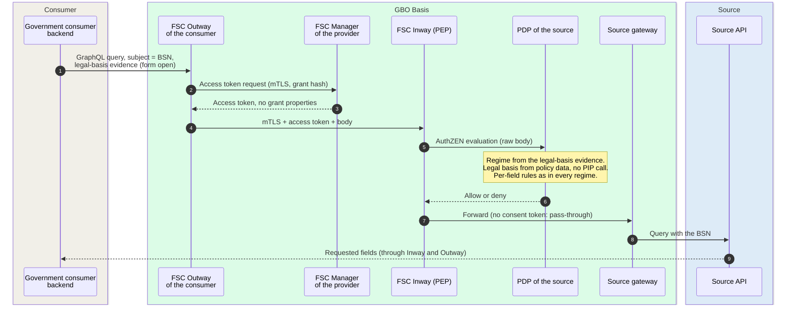
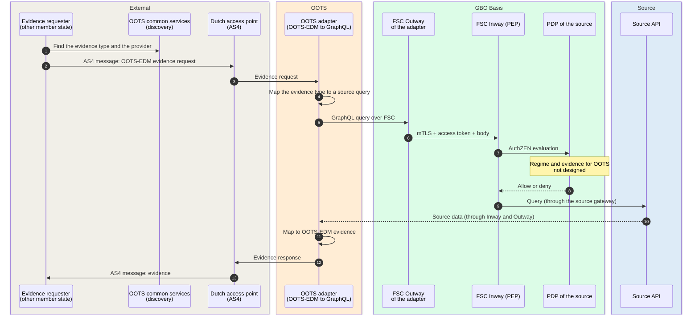
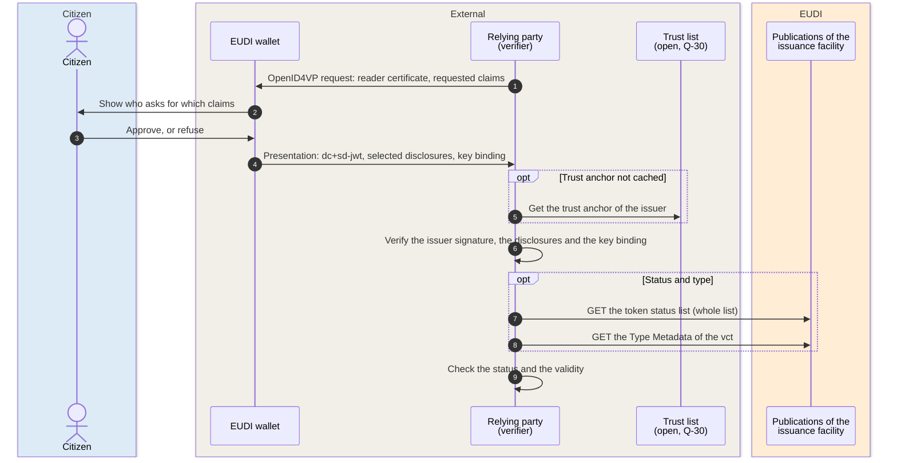

# Design-level scenarios

The scenarios on this page have no implementation in gbo-demo v0.9.0.
Each section gives the intended sequence, the behavior of v0.9.0 for such
a request, and the open points. The first two scenarios go through the
same chain as every built data-plane scenario, in this order:

1. the Outway,
2. the Inway of the source, as PEP,
3. the PDP of the source,
4. the source gateway,
5. the source API.

The third scenario uses no GBO runtime.

## Gov-to-Gov {#gov-to-gov}

A government consumer reads source data under a legal basis (grondslag).
The request has no consent and no pseudonymization, because both parties
can process the BSN. The design makes two decisions:

- The regime follows from the evidence that the request carries. A
  Gov-to-Gov regime needs its own positive evidence. It cannot be a third
  regime that the PDP selects because something is absent
  ([ADR-0031](../decisions/0031-regime-from-evidence.md),
  [F-70](../traceability/findings.md#f-70)).
- The PDP evaluates the legal basis locally from policy data, with no
  PIP call ([ADR-0004](../decisions/0004-federated-authorization.md)).

Demo v0.9.0 has no rule set, no evidence format, and no legal-basis data.
This gap is risk R3 in [Risks and technical debt](../risks.md).

### Data per hop

Each hop of the Gov-to-Gov request carries the following data:

| # | From → to | Data | Notes |
|---|---|---|---|
| 1 | Consumer → Outway | Query and variables, the BSN as subject, the legal-basis evidence | The form of the evidence is open. ADR-0031 rules out declarations, such as a header, a grant property, or a default |
| 2 to 3 | Outway ↔ provider Manager | FSC token | The contract first passes [contract admission](admission.md#contract-admission) |
| 4 to 7 | Inway → PDP → Inway | PDP input with the BSN | The BSN is in the PDP input and in the decision logs, as in the EUDI and ASI routes of demo v0.9.0 ([REQ-60](../requirements/logging-audit.md#req-60), [ADR-0043](../decisions/0043-identifiers-out-of-pdp-input.md)) |
| 8 to 10 | Inway → gateway → source | Query with the BSN, then the requested fields | The gateway passes a request without a consent token through ([ADR-0033](../decisions/0033-gateway-decrypts-after-allow.md)). Each controller logs its own processing ([ADR-0026](../decisions/0026-ldv-integration.md)) |

### What v0.9.0 does

Demo v0.9.0 handles a Gov-to-Gov request as follows:

| Request | Result | Evidence |
|---|---|---|
| Government peer without an admission for the source | Contract refused: `PARTY_NOT_IN_REGISTRY` or `SOURCE_NOT_ALLOWED` | [Admission](admission.md#contract-admission) |
| Admitted peer, no consent token, a real BSN as subject | PID regime, denied: `ACTOR_NOT_ALLOWED` (not a designated issuer) | [`engine_test.rego#L351`](https://github.com/ICTU/GBO-demo/blob/v0.9.0/policies/gbo/engine_test.rego#L351) |
| Service without a rule for the field | denied: `NO_APPLICABLE_RULE` | [`engine.rego#L282`](https://github.com/ICTU/GBO-demo/blob/v0.9.0/policies/gbo/engine.rego#L282) |

The chain fails closed. Until a rule set with its own evidence exists, a
government consumer gets no data.

### Open points

The Gov-to-Gov design has these open points:

- It is open what form the positive evidence for the legal basis has, and
  who issues it ([REQ-74](../requirements/authorization.md#req-74)).
- It is open where the legal-basis data lives (which consumer, which
  service, which grondslag, which fields), and who maintains it. ADR-0004
  puts it in policy data.
- The PID actor lists must stay disjoint from the consumers of other
  regimes. If a Gov-to-Gov consumer omits its evidence, it must not enter
  the PID regime ([F-70](../traceability/findings.md#f-70)).

## SDG-OOTS {#sdg-oots}

A competent authority in another member state requests evidence about a
citizen or company through the Once-Only Technical System. The design is
an OOTS adapter at the GBO edge
([ADR-0020](../decisions/0020-as4-bridge-for-oots.md),
[PSA S08](https://ictu.github.io/GBO-PSA/main/capabilities/#s08-oots-adapter)).
eDelivery AS4 exists only at the edge. The bronhouder sees a normal FSC
request through the standard PEP-PDP chain. It is open who builds the
adapter ([Q-79](../traceability/open-questions.md#q-79)).

The OOTS process steps around the request, such as the identification of
the user and the preview, stay with the Basisinrichting OOTS. The diagram
does not show them.

### Data per hop

Each hop of the OOTS request carries the following data:

| # | From → to | Data | Notes |
|---|---|---|---|
| 1 to 3 | Requester → access point → adapter | OOTS-EDM evidence request in an AS4 message: evidence type, the subject, the requester | Transport, discovery, and the European process stay with the Basisinrichting OOTS ([Q-79](../traceability/open-questions.md#q-79)) |
| 4 | Adapter | Evidence type → source query | The mapping depends on the canonical semantic models ([ADR-0024](../decisions/0024-canonical-semantic-models.md)) |
| 5 to 10 | Adapter → source | GraphQL query and FSC token, then source data | The same chain as every FSC consumer. The adapter translates the protocol. The decision stays with the PDP of the source ([REQ-44](../requirements/authorization.md#req-44), [REQ-46](../requirements/sources-identity.md#req-46)) |
| 11 to 13 | Adapter → requester | OOTS-EDM evidence | The mapping version must be traceable, as for issuance ([REQ-124](../requirements/eudi-issuance.md#req-124)) |

### What v0.9.0 does

The demo does not touch OOTS. It has no adapter, no access point, and no
rule for OOTS. If an adapter peer sends a request without a consent token, the request
enters the PID regime and fails the actor check, as in
[Gov-to-Gov](#gov-to-gov). The gap is risk R2 in
[Risks and technical debt](../risks.md).

### Open points

The OOTS design has these open points:

- It is open who builds the adapter: GBO, or the OOTS-V operator with the
  GBO interface ([Q-79](../traceability/open-questions.md#q-79)).
- The regime and the evidence for an OOTS request are open
  ([REQ-74](../requirements/authorization.md#req-74),
  [ADR-0031](../decisions/0031-regime-from-evidence.md)). If an OOTS
  request has no evidence of its own, the PDP denies it.
- The requirements register has no OOTS requirement.

## Relying-party presentation {#relying-party-presentation}

The citizen presents a wallet attestation from GBO to a relying party
over OpenID4VP, with selective disclosure. No GBO decision component and
no source take part at presentation time. This is the purpose of an
issuance-based trajectory. The data are fixed at issuance, and the source
carries no presentation load. For the issuance itself, see
[EUDI issuance](eudi-issuance.md).

### Data per hop

Each hop of the presentation carries the following data:

| # | From → to | Data | Notes |
|---|---|---|---|
| 1 to 3 | Relying party → wallet → citizen | Reader certificate of the relying party, the requested claims | The approval in the wallet is no legal basis for the relying party ([F-83](../traceability/findings.md#f-83)) |
| 4 | Wallet → relying party | Selected claims of the attestation, signed by the issuer, with key binding | The wallet sends only the claims that the citizen selects |
| 5 | Relying party → trust list | Trust anchor of the PuB-EAA issuer | It is open which list applies: a List of Trusted Entities or the trusted lists ([Q-30](../traceability/open-questions.md#q-30)) |
| 7 to 8 | Relying party → issuance facility | Status list per attestation type, Type Metadata | Static publications. The relying party fetches the whole list, so the issuer does not learn which attestation the relying party checks. No PDP, no FSC, and no source take part |

### What v0.9.0 does

For this scenario, demo v0.9.0 has these limits:

- The demo has no relying party for GBO attestations. The ASI wallet
  verifier asks only for the PID
  ([`asi-wallet-verifier/README.md`](https://github.com/ICTU/GBO-demo/blob/v0.9.0/services/asi-wallet-verifier/README.md)).
- Trust uses the development CA chain. The test wallet and the demo
  verifiers trust the development issuer CA.
- Every attestation is valid for 365 days. A status list exists per type,
  but revocation on instruction of the bronhouder is not built
  ([REQ-77](../requirements/eudi-issuance.md#req-77)).

### Open points

The relying-party scenario has these open points:

- The trust list for PuB-EAA providers
  ([Q-30](../traceability/open-questions.md#q-30)) and the designation of
  the Dutch PuB-EAA issuer ([Q-28](../traceability/open-questions.md#q-28))
  are open. In production, the relying party verifies the seal of the
  bronhouder as PuB-EAA provider. GBO operates the technical facility
  ([ADR-0028](../decisions/0028-pubeaa-productization.md)).
  [ADR-0023](../decisions/0023-identity-convergence.md) proposes the EUDI
  certificate roles.
- Freshness. The attestation shows the source data at issuance. GBO only
  reads the source on request. If the data change, GBO gets no signal.
  Long-lived attestations need a change feed and revocation
  ([F-82](../traceability/findings.md#f-82)).

## Traceability

- Requirements: [REQ-74](../requirements/authorization.md#req-74), [REQ-44](../requirements/authorization.md#req-44), [REQ-46](../requirements/sources-identity.md#req-46), [REQ-60](../requirements/logging-audit.md#req-60), [REQ-77](../requirements/eudi-issuance.md#req-77), [REQ-124](../requirements/eudi-issuance.md#req-124)
- Findings: [F-70](../traceability/findings.md#f-70) (open), [F-82](../traceability/findings.md#f-82) (open), [F-83](../traceability/findings.md#f-83) (open)
- Open questions: [Q-79](../traceability/open-questions.md#q-79) (open), [Q-30](../traceability/open-questions.md#q-30) (open), [Q-28](../traceability/open-questions.md#q-28) (open)
- Demo increments: none
