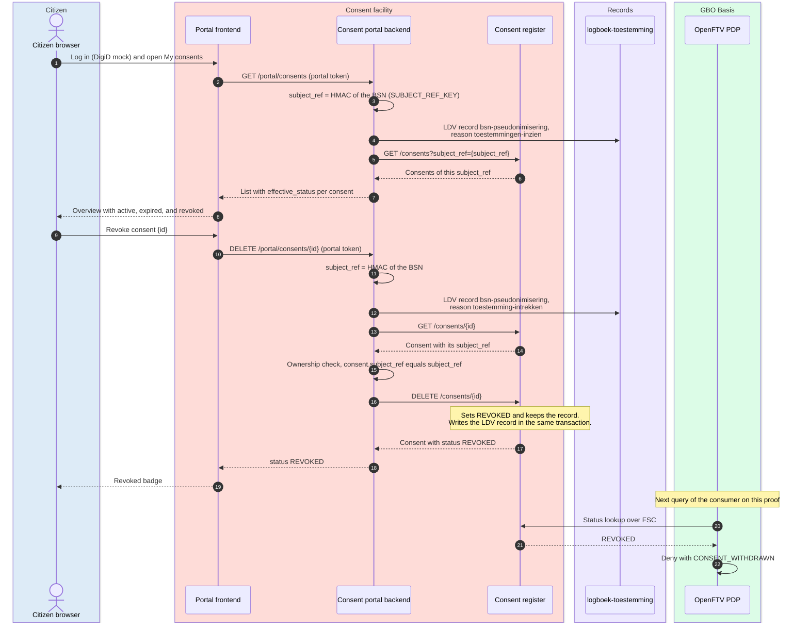

# DvTP: the citizen views and revokes consents

A logged-in citizen opens the page My consents (shown as "Mijn
toestemmingen") in the consent portal (toestemmingsportaal).
The portal shows the consents of the citizen with their status, and the
citizen revokes one consent. The portal finds the consents through its own
reference to the citizen, without a BSNk call. A revocation takes effect at
the next request of the consumer.

For the concepts, see [Revocation](../concepts/consent.md#revocation) and
[Citizen recognition: route D](../concepts/pseudonymization.md#citizen-recognition-route-d).
For the components, see
[Level 2: consent chain](../building-blocks/components.md#level-2-consent-chain). For
the requirements, see [Citizen access](../requirements/consent.md#citizen-access).

## Sequence

## Data per hop

The tags are the data classes of
[What travels where](../concepts/consent.md#what-travels-where). Each hop
carries the following data:

| # | From → to | Endpoint | In | Out | Data and notes |
|---|---|---|---|---|---|
| 1 | Citizen → portal frontend | (UI) | DigiD mock login | Portal token, `sub` = BSN | The same as hops 3 to 5 of [DvTP consent](dvtp-consent.md). In production, the identity comes from the MijnOverheid login ([REQ-24](../requirements/consent.md#req-24), [Q-50](../traceability/open-questions.md#q-50)) |
| 2 | Portal frontend → portal backend | `GET /portal/consents` | Portal token in `Authorization` | — | The **BSN** travels only inside the signed portal token. The citizen sends no reference and no BSN as a parameter ([REQ-40](../requirements/consent.md#req-40)) |
| 3 | Portal backend (internal) | — | BSN | `subject_ref` | The portal computes an HMAC with its own secret, versioned key ([route D](../requirements/pseudonymization.md#route-d)). The portal does not call BSNk ([`TestListingAndRevokingDoNotCallBSNk`](https://github.com/ICTU/GBO-demo/blob/v0.9.0/services/consent-portal-backend/consent/portal_test.go#L423)) |
| 4 | Portal backend → logbook | LDV write | `dataverwerking.bsn-pseudonimisering` under `subject_ref`, with attribute `dpl.gbo.pseudonimiseringAanleiding` = `toestemmingen-inzien` | — | The derivation is a separate processing ([REQ-72](../requirements/logging-audit.md#req-72), [`portal.go#L323-L340`](https://github.com/ICTU/GBO-demo/blob/v0.9.0/services/consent-portal-backend/consent/portal.go#L323-L340)). The record holds no BSN |
| 5 | Portal backend → register | `GET /consents?subject_ref={subject_ref}` | `subject_ref` | — | Medium. The register refuses a listing without `subject_ref` ([`TestAnUnscopedListingIsRefused`](https://github.com/ICTU/GBO-demo/blob/v0.9.0/services/consent-register/ldv_test.go#L253)). Only the network keeps other callers out ([REQ-39](../requirements/consent.md#req-39), [Q-58](../traceability/open-questions.md#q-58)) |
| 6 | Register → portal backend | — | — | Records with `consent_id`, `subject_ref`, `dienstverlener_oin`, `scopes`, `use_case`, `status`, `valid_until` | The records hold no BSN, no PI or PP, and no proof values ([REQ-69](../requirements/pseudonymization.md#req-69), [`TestNoConsentAnswerCarriesThePolymorphicValues`](https://github.com/ICTU/GBO-demo/blob/v0.9.0/services/consent-register/polymorphic_test.go#L85)). The register logs `dataverwerking.toestemming-inzage` |
| 7 | Portal backend → portal frontend | — | — | Records plus `effective_status` | The backend derives Revoked from the register status, Expired from `valid_until`, and otherwise Active ([`consent.go#L135-L146`](https://github.com/ICTU/GBO-demo/blob/v0.9.0/services/consent-portal-backend/consent/consent.go#L135-L146)). The payload holds no BSN ([REQ-20](../requirements/pseudonymization.md#req-20)) |
| 8 | Portal frontend → citizen | (UI) | — | Overview | The overview shows the statuses active (shown as "Actief"), expired (shown as "Verlopen"), and revoked (shown as "Ingetrokken") ([REQ-38](../requirements/consent.md#req-38)). The status retrieved (shown as "Opgehaald") is not built in demo v0.9.0 ([Q-42](../traceability/open-questions.md#q-42), [F-97](../traceability/findings.md#f-97)). The overview has no export ([REQ-108](../requirements/consent.md#req-108), [Q-52](../traceability/open-questions.md#q-52)) |
| 9 | Citizen → portal frontend | (UI) | Revoke on `consent_id` | — | The UI shows the button only for an active consent ([`MijnToestemmingenDetail.tsx#L127`](https://github.com/ICTU/GBO-demo/blob/v0.9.0/toestemmingsportaal-frontend/src/pages/MijnToestemmingenDetail.tsx#L127)) |
| 10 | Portal frontend → portal backend | `DELETE /portal/consents/{id}` | `consent_id`, portal token | — | Revocation changes the status of the record. The register keeps the record |
| 11 | Portal backend (internal) | — | BSN | `subject_ref` | As hop 3 |
| 12 | Portal backend → logbook | LDV write | As hop 4, with `dpl.gbo.pseudonimiseringAanleiding` = `toestemming-intrekken` | — | [`TestListAndRevokeLogTheirPseudonymisation`](https://github.com/ICTU/GBO-demo/blob/v0.9.0/services/consent-portal-backend/consent/logbook_test.go#L141) |
| 13 | Portal backend → register | `GET /consents/{id}` | `consent_id` | — | The backend reads the record to compare the owner. The register logs this read as `dataverwerking.toestemming-inzage` |
| 14 | Register → portal backend | — | — | Record with `subject_ref` | — |
| 15 | Portal backend (internal) | Ownership check | `consent.subject_ref`, `subject_ref` | Allow or `ErrNotOwned` | The check runs on the server side. The register cannot see who calls, so the portal backend does the check ([`portal.go#L268-L296`](https://github.com/ICTU/GBO-demo/blob/v0.9.0/services/consent-portal-backend/consent/portal.go#L268-L296)) |
| 16 | Portal backend → register | `DELETE /consents/{id}` | `consent_id` | — | The register sets `REVOKED`, keeps the record, and stores `dataverwerking.toestemming-intrekken` in the same transaction ([`main.go#L585-L596`](https://github.com/ICTU/GBO-demo/blob/v0.9.0/services/consent-register/main.go#L585-L596)). It stores no revocation time ([Q-48](../traceability/open-questions.md#q-48)) |
| 17 | Register → portal backend | — | — | Record with status `REVOKED` | — |
| 18 to 19 | Portal backend → portal frontend → citizen | — | — | `{"status": "REVOKED"}`, badge | The answer holds no pointer to the rights of the citizen at the consumer ([REQ-120](../requirements/consent.md#req-120)) |
| 20 | PDP → register | Status lookup over FSC | `consent_id` from the proof | — | Only at the next request of the consumer, as hops 10 to 12 of [DvTP query](dvtp-query.md). The consumer gets no message at revocation |
| 21 | Register → PDP | — | — | `REVOKED` | The PDP does not cache the status, so the revocation takes effect at the next request ([REQ-14](../requirements/consent.md#req-14)) |
| 22 | PDP (internal) | Rules | Resolved consent | Deny | Administrator code `CONSENT_WITHDRAWN`, consumer code `FIELD_NOT_PERMITTED`. Another active consent of the same citizen cannot replace the revoked one: the PDP checks only the `consent_id` from the proof |

## Error paths

Each error path shows the citizen an HTTP status and gives the
administrator a reason, as follows:

| Trigger | What the citizen sees | Administrator reason | Pinned by (v0.9.0) |
|---|---|---|---|
| No portal token, or an invalid one | The portal shows and changes nothing. HTTP 401 | `invalid token: …` | Code only: [`portalhttp.go#L138-L147`](https://github.com/ICTU/GBO-demo/blob/v0.9.0/services/consent-portal-backend/portalhttp/portalhttp.go#L138-L147) |
| The consent belongs to another citizen | HTTP 403 with `reason: consent_not_owned_by_caller`. The consent does not change. [REQ-40](../requirements/consent.md#req-40) asks for 404 `CONSENT_NOT_FOUND`, the same answer as for an unknown consent | `consent does not belong to authenticated citizen` | [`TestRevokeDeniedForOtherCitizen`](https://github.com/ICTU/GBO-demo/blob/v0.9.0/services/consent-portal-backend/consent/portal_test.go#L232) |
| The consent does not exist | HTTP 404 | `consent not found` | [`TestRevokeUnknownConsentIsNotFound`](https://github.com/ICTU/GBO-demo/blob/v0.9.0/services/consent-portal-backend/consent/portal_test.go#L266) |
| A direct backend call revokes an expired or already revoked consent | HTTP 200, status `REVOKED` again, with a new LDV record. [REQ-109](../requirements/consent.md#req-109) asks for a refusal with `CONSENT_NOT_REVOCABLE` ([#600](https://github.com/ICTU/GBO-demo/issues/600)) | None: the backend checks only ownership | Code only: [`main.go#L282-L299`](https://github.com/ICTU/GBO-demo/blob/v0.9.0/services/consent-register/main.go#L282-L299) |
| The portal cannot write its LDV record for the derivation | The portal shows and changes nothing. HTTP 502 | `log pseudonymisation: …` | Code only: [`portal.go#L323-L340`](https://github.com/ICTU/GBO-demo/blob/v0.9.0/services/consent-portal-backend/consent/portal.go#L323-L340) |
| The register cannot build its LDV record for the listing or the read | The portal shows nothing. The register answers 500, and the portal answers 502 | `the operation could not be logged; refusing it` | Code only: [`ldv_consent.go#L176-L180`](https://github.com/ICTU/GBO-demo/blob/v0.9.0/services/consent-register/ldv_consent.go#L176-L180) |
| The register is unreachable | The portal shows and changes nothing. HTTP 502 | `list consents: …` or `revoke: …` | Code only: [`portalhttp.go#L94-L106`](https://github.com/ICTU/GBO-demo/blob/v0.9.0/services/consent-portal-backend/portalhttp/portalhttp.go#L94-L106) |
| The operator replaced `SUBJECT_REF_KEY` | An empty overview, because older consents have the old reference. These consents stay valid for the consumer | None | Code only: [`subjectref.go#L40-L52`](https://github.com/ICTU/GBO-demo/blob/v0.9.0/services/consent-portal-backend/consent/subjectref.go#L40-L52) |

## Main observations

The citizen-access flow in gbo-demo v0.9.0 has these properties and gaps:

- **The server derives the reference.** The portal derives `subject_ref`
  from the BSN in the signed portal token. As a result, a citizen cannot
  list or revoke the consents of another citizen
  ([REQ-40](../requirements/consent.md#req-40),
  [`TestListIsolatesByCitizen`](https://github.com/ICTU/GBO-demo/blob/v0.9.0/services/consent-portal-backend/consent/portal_test.go#L327)).
- **Viewing and revoking need no BSNk.** The reference is an HMAC that the
  portal computes itself (route D,
  [ADR-0040](../decisions/0040-route-d-citizen-recognition.md), proposed).
  A new key gives every citizen a new reference. Migration to a new key is
  not built ([Q-56](../traceability/open-questions.md#q-56)). It is open
  whether the register and the portal backend are one system
  ([Q-49](../traceability/open-questions.md#q-49)).
- **Revocation keeps the record.** The status becomes `REVOKED` and the
  record stays. The effect reaches the consumer at its next request,
  through the online status lookup
  ([REQ-14](../requirements/consent.md#req-14),
  [DvTP query](dvtp-query.md)). The demo has no status cache, so the
  propagation time is one request. The norm for the propagation time is
  open ([REQ-75](../requirements/consent.md#req-75),
  [Q-47](../traceability/open-questions.md#q-47)).
- **Every step is a logged processing.** The portal logs each derivation
  of the reference with its reason. The register logs each read and the
  revocation under `subject_ref`. No record holds a BSN
  ([`TestNoBSNInAnyRecordedProcessing`](https://github.com/ICTU/GBO-demo/blob/v0.9.0/services/consent-portal-backend/consent/logbook_test.go#L188),
  [Logging](../concepts/logging.md#processing-records-ldv)).
- **The demo does not meet all requirements.** A revocation of the
  consent of another citizen gives 403, where
  [REQ-40](../requirements/consent.md#req-40) asks for 404. The demo
  accepts a second revocation
  ([REQ-109](../requirements/consent.md#req-109)). The demo has no
  export ([REQ-108](../requirements/consent.md#req-108)), no rights
  notice ([REQ-120](../requirements/consent.md#req-120)), no
  "retrieved" status ([Q-42](../traceability/open-questions.md#q-42)), and
  no revocation time ([Q-48](../traceability/open-questions.md#q-48)).
- **The register trusts its caller.** The register serves list, read, and
  revoke to every caller on its network. Only network placement limits this
  to the portal backend ([REQ-39](../requirements/consent.md#req-39),
  [Q-58](../traceability/open-questions.md#q-58)).

## Traceability

- Requirements: [REQ-14](../requirements/consent.md#req-14), [REQ-20](../requirements/pseudonymization.md#req-20), [REQ-24](../requirements/consent.md#req-24), [REQ-38](../requirements/consent.md#req-38), [REQ-39](../requirements/consent.md#req-39), [REQ-40](../requirements/consent.md#req-40), [REQ-69](../requirements/pseudonymization.md#req-69), [REQ-72](../requirements/logging-audit.md#req-72), [REQ-75](../requirements/consent.md#req-75), [REQ-108](../requirements/consent.md#req-108), [REQ-109](../requirements/consent.md#req-109), [REQ-120](../requirements/consent.md#req-120)
- Findings: [F-97](../traceability/findings.md#f-97) (open)
- Open questions: [Q-42](../traceability/open-questions.md#q-42) (open), [Q-47](../traceability/open-questions.md#q-47) (open), [Q-48](../traceability/open-questions.md#q-48) (open), [Q-49](../traceability/open-questions.md#q-49) (open), [Q-50](../traceability/open-questions.md#q-50) (open), [Q-52](../traceability/open-questions.md#q-52) (open), [Q-56](../traceability/open-questions.md#q-56) (open), [Q-58](../traceability/open-questions.md#q-58) (open)
- Demo increments: [SL-06b](../traceability/increments.md#sl-06b) (done), [SL-11](../traceability/increments.md#sl-11) (done), [SL-51](../traceability/increments.md#sl-51) (done)
