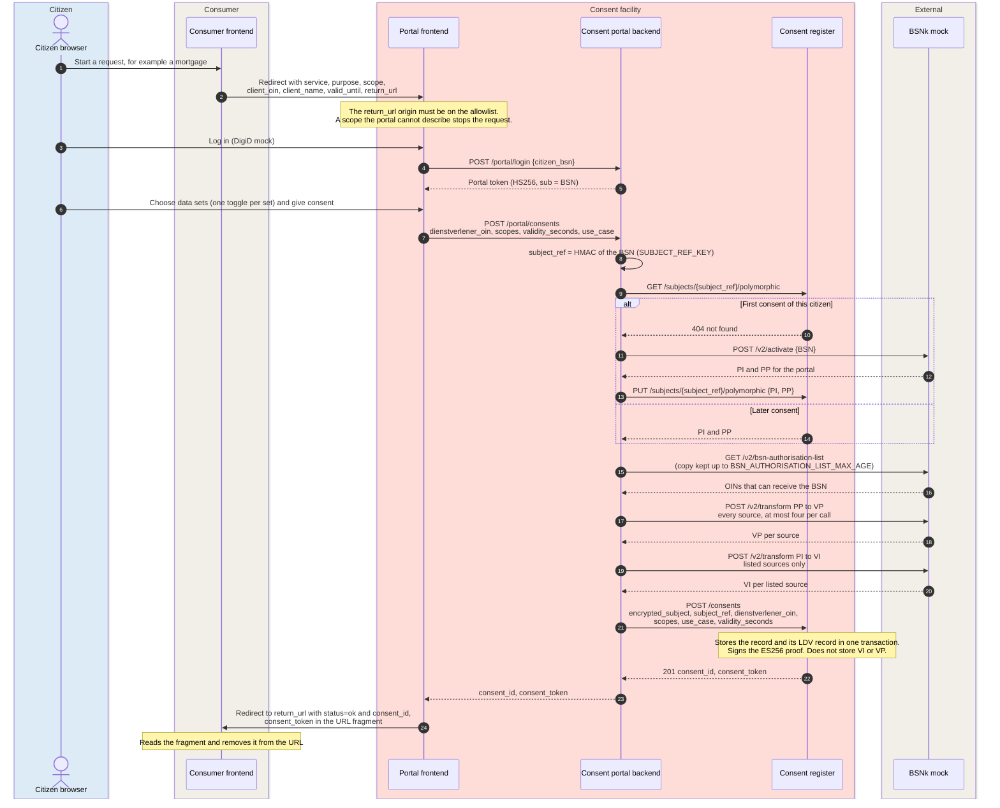

# DvTP: the citizen gives consent

In DvTP, the consumer is a private service provider (dienstverlener). A
citizen at the consumer goes to the consent portal (toestemmingsportaal),
logs in, and gives consent for one or more data sets.
The result is a consent record in the consent register (toestemmingsregister) and a signed
consent proof. The proof goes back to the consumer. The consumer uses the
proof in [DvTP query](dvtp-query.md).

For the concepts, see [Consent](../concepts/consent.md) and
[Pseudonymization](../concepts/pseudonymization.md). For the components,
see [Level 2: consent chain](../building-blocks/components.md#level-2-consent-chain).
The main decisions are [ADR-0032](../decisions/0032-consent-proof.md) (the
consent proof) and
[ADR-0040](../decisions/0040-route-d-citizen-recognition.md) (route D,
proposed).

## Sequence

## Data per hop

The tags in the last column are the data classes of
[What travels where](../concepts/consent.md#what-travels-where). Each hop
carries the following data:

| # | From → to | Endpoint | In | Out | Data and notes |
|---|---|---|---|---|---|
| 1 | Citizen → consumer frontend | (UI) | — | — | The consumer starts the request. No identity data travels at this hop |
| 2 | Consumer frontend → portal frontend | Redirect | `service`, `purpose`, `scope`, `client_oin`, `client_name`, `valid_until`, `return_url` | — | Low: OIN and scope. All values are unsigned and come from the URL ([`useRedirectContext.ts#L29-L41`](https://github.com/ICTU/GBO-demo/blob/v0.9.0/toestemmingsportaal-frontend/src/hooks/useRedirectContext.ts#L29-L41)). The portal checks only the return origin. [REQ-111](../requirements/consent.md#req-111) asks for the name, the purpose, and the return address from the registration. For more information, see [Q-60](../traceability/open-questions.md#q-60) |
| 3 | Citizen → portal frontend | (UI) | Login with the DigiD mock | — | The citizen types the BSN as the password. This shortcut exists only in the demo |
| 4 | Portal frontend → portal backend | `POST /portal/login` | `citizen_bsn` | — | The **BSN** is in the browser and on the wire. In production, the identity comes from the MijnOverheid login ([REQ-24](../requirements/consent.md#req-24), [Q-50](../traceability/open-questions.md#q-50)) |
| 5 | Portal backend → portal frontend | — | — | Portal token, HS256, `sub` = BSN | The **BSN** is inside the token ([`auth.go#L17-L36`](https://github.com/ICTU/GBO-demo/blob/v0.9.0/services/consent-portal-backend/portalhttp/auth.go#L17-L36)). Later calls send this token instead of a raw BSN |
| 6 | Citizen → portal frontend | (UI) | Data-set choice | — | One toggle per data set. The citizen cannot choose single fields ([REQ-10](../requirements/consent.md#req-10)). The portal shows only the requested sets |
| 7 | Portal frontend → portal backend | `POST /portal/consents` | Portal token, `dienstverlener_oin`, `scopes`, `validity_seconds`, `use_case` | — | The body holds no BSN. The backend takes the BSN from the verified token. `use_case` is the redirect `purpose` ([`PortaalConsent.tsx#L77-L87`](https://github.com/ICTU/GBO-demo/blob/v0.9.0/toestemmingsportaal-frontend/src/pages/PortaalConsent.tsx#L77-L87)). The consumer sets the validity ([Q-13](../traceability/open-questions.md#q-13)) |
| 8 | Portal backend (internal) | — | BSN | `subject_ref` | The portal computes an HMAC of the BSN with its own secret, versioned key ([`subjectref.go#L40-L52`](https://github.com/ICTU/GBO-demo/blob/v0.9.0/services/consent-portal-backend/consent/subjectref.go#L40-L52), [route D](../requirements/pseudonymization.md#route-d)). The portal does not call BSNk |
| 9 | Portal backend → register | `GET /subjects/{subject_ref}/polymorphic` | `subject_ref` | — | Medium: `subject_ref`. Only the portal asks for these values |
| 10 | Register → portal backend | — | — | 404 | The register has no values, because this is the first consent of this citizen |
| 11 | Portal backend → BSNk | `POST /v2/activate` | BSN, requester OIN and key set version of the portal | — | The portal sends the **BSN** to BSNk, once per citizen. The mock follows the BSNk interface, but uses JSON instead of SOAP ([BSNK-11](../requirements/pseudonymization.md#bsnk-11)) |
| 12 | BSNk → portal backend | — | — | PI and PP | Medium. Only the portal, as requester, can use them ([BSNK-03](../requirements/pseudonymization.md#bsnk-03)) |
| 13 | Portal backend → register | `PUT /subjects/{subject_ref}/polymorphic` | `subject_ref`, PI, PP | — | The register keeps PI and PP under the reference ([REQ-69](../requirements/pseudonymization.md#req-69)). The register gets no BSN and no per-party value |
| 14 | Register → portal backend | — | — | PI and PP | Later consent: the portal finds the values again and does not activate ([`portal.go#L298-L321`](https://github.com/ICTU/GBO-demo/blob/v0.9.0/services/consent-portal-backend/consent/portal.go#L298-L321)) |
| 15 | Portal backend → BSNk | `GET /v2/bsn-authorisation-list` | — | — | The portal reads the list only when its copy is older than `BSN_AUTHORISATION_LIST_MAX_AGE` (default 1 hour, an assumption) |
| 16 | BSNk → portal backend | — | — | OINs that can receive the BSN | The BSN authorization list ([BSNK-06](../requirements/pseudonymization.md#bsnk-06)). If the copy is too old and BSNk does not answer, the portal gives no consent |
| 17 | Portal backend → BSNk | `POST /v2/transform` | PP, per source `EntityID` (OIN), `KeySetVersion`, `IdentifierType=Pseudonym` | — | The portal makes this call for every source in `CONSENT_SOURCES`. One call holds at most four parties. More sources give more calls ([BSNK-05](../requirements/pseudonymization.md#bsnk-05)) |
| 18 | BSNk → portal backend | — | — | VP per source | Only its own source can read a VP ([BSNK-08](../requirements/pseudonymization.md#bsnk-08)). In the demo, anyone can read the values, because the mock does not encrypt |
| 19 | Portal backend → BSNk | `POST /v2/transform` | PI, per listed source `EntityID`, `KeySetVersion`, `IdentifierType=Identity` | — | The portal makes this call only for sources on the list. If no source is on the list, this call does not occur. A party can occur only once per call, so each form takes its own call |
| 20 | BSNk → portal backend | — | — | VI per listed source | High at the recipient, and unreadable for others. This call and calls 17 and 18 work only while the citizen is logged in ([BSNK-04](../requirements/pseudonymization.md#bsnk-04)) |
| 21 | Portal backend → register | `POST /consents` | `encrypted_subject` (per OIN a `pseudonym` and, if listed, an `identity`, each with `key_set_version`), `subject_ref`, `dienstverlener_oin`, `scopes`, `use_case`, `validity_seconds` | — | The register never gets a BSN ([REQ-23](../requirements/consent.md#req-23)). Before this call, the portal writes its LDV record `dataverwerking.bsn-pseudonimisering` under `subject_ref` ([`portal.go#L153-L174`](https://github.com/ICTU/GBO-demo/blob/v0.9.0/services/consent-portal-backend/consent/portal.go#L153-L174), [REQ-72](../requirements/logging-audit.md#req-72)) |
| 22 | Register → portal backend | — | — | `consent_id`, `consent_token` | The register signs the proof and stores the record with `dataverwerking.toestemming-verlenen` in one transaction ([`main.go#L449-L484`](https://github.com/ICTU/GBO-demo/blob/v0.9.0/services/consent-register/main.go#L449-L484)). It does not store the per-party values ([REQ-80](../requirements/pseudonymization.md#req-80)). For the proof claims, see [The consent proof](../concepts/consent.md#the-consent-proof) |
| 23 | Portal backend → portal frontend | — | — | `consent_id`, `consent_token` | Medium-high: the proof. The payload holds no BSN |
| 24 | Portal frontend → consumer frontend | Redirect to `return_url` | `status=ok`, `consent_id` in the query, `consent_token` in the fragment | — | The fragment does not reach a server log ([`PortaalBevestiging.tsx#L56-L64`](https://github.com/ICTU/GBO-demo/blob/v0.9.0/toestemmingsportaal-frontend/src/pages/PortaalBevestiging.tsx#L56-L64)). The consumer cannot read the citizen from the proof ([F-76](../traceability/findings.md#f-76)). The question of what the redirect gives back is partly answered ([Q-44](../traceability/open-questions.md#q-44)) |

## Error paths

The consent flow has no policy decision. Each failure stops the flow
before the register stores a consent. "No consent" means that the citizen
stays in the portal and the consumer gets no redirect. If a row states a
different result, the row applies. The consent flow has the following
error paths:

| Trigger | What the consumer sees | Administrator reason | Pinned by (v0.9.0) |
|---|---|---|---|
| The `return_url` origin is not on the allowlist, or a required redirect parameter is missing | No redirect. The portal has no request context and cannot send the citizen back | `validatedRedirectContext` returns null | [`redirectValidation.test.mjs#L24`](https://github.com/ICTU/GBO-demo/blob/v0.9.0/toestemmingsportaal-frontend/tests/redirectValidation.test.mjs#L24) |
| A requested scope that the portal cannot describe | No redirect. The citizen sees an unknown request (shown as "Onbekend verzoek") and cannot consent ([REQ-119](../requirements/consent.md#req-119) gap) | The scope is in `unknown` of `requestedScopeGroups` | [`scopeGroups.test.mjs#L16`](https://github.com/ICTU/GBO-demo/blob/v0.9.0/toestemmingsportaal-frontend/tests/scopeGroups.test.mjs#L16), [`PortaalConsent.tsx#L63-L75`](https://github.com/ICTU/GBO-demo/blob/v0.9.0/toestemmingsportaal-frontend/src/pages/PortaalConsent.tsx#L63-L75) |
| The citizen cancels the login or refuses consent | A redirect with `status=denied` and no `consent_id`. The portal does not record the refusal ([Q-43](../traceability/open-questions.md#q-43)) | — | Code only: [`PortaalConsent.tsx#L100-L106`](https://github.com/ICTU/GBO-demo/blob/v0.9.0/toestemmingsportaal-frontend/src/pages/PortaalConsent.tsx#L100-L106), [`DigiDAuth.tsx#L73-L80`](https://github.com/ICTU/GBO-demo/blob/v0.9.0/toestemmingsportaal-frontend/src/pages/DigiDAuth.tsx#L73-L80) |
| The portal token is missing, expired, or not signed by the portal | No consent. The portal answers HTTP 401 | `invalid token: …` | Code only: [`portalhttp.go#L138-L147`](https://github.com/ICTU/GBO-demo/blob/v0.9.0/services/consent-portal-backend/portalhttp/portalhttp.go#L138-L147) |
| No source configured in `CONSENT_SOURCES` | No consent (HTTP 502) | `no sources configured: a consent no source can read is not given` | [`TestGiveConsentNeedsASource`](https://github.com/ICTU/GBO-demo/blob/v0.9.0/services/consent-portal-backend/consent/portal_test.go#L552) |
| BSNk fails, or answers for another party, in another form, or without a value | No consent (HTTP 502) | `activate: …` or `encrypt the subject for the sources: …` | [`TestGiveConsentFailsWhenBSNkFails`](https://github.com/ICTU/GBO-demo/blob/v0.9.0/services/consent-portal-backend/consent/portal_test.go#L639), [`TestAnAnswerThatDoesNotMatchIsRefused`](https://github.com/ICTU/GBO-demo/blob/v0.9.0/services/consent-portal-backend/bsnk/bsnk_test.go#L98) |
| The copy of the BSN authorization list is too old and BSNk does not answer | No consent (HTTP 502) | `read the BSN authorisation list: …` | [`TestTheAuthorisationListIsNotUsedOutOfDate`](https://github.com/ICTU/GBO-demo/blob/v0.9.0/services/consent-portal-backend/consent/portal_test.go#L512) |
| The portal cannot write its LDV record for the pseudonymization | No consent (HTTP 502) | `log pseudonymisation: …` | [`TestGiveConsentThatCannotBeLoggedCreatesNoConsent`](https://github.com/ICTU/GBO-demo/blob/v0.9.0/services/consent-portal-backend/consent/logbook_test.go#L116) |
| The register gets no `encrypted_subject`, or a party without a pseudonym | No consent. The register answers 400, and the portal answers 502 | `encrypted_subject is required (no plain BSN accepted)` | [`TestCreateRefusesAConsentWithoutAnEncryptedSubject`](https://github.com/ICTU/GBO-demo/blob/v0.9.0/services/consent-register/main_test.go#L197) |
| The register cannot sign, store, or log the consent | No consent. The register answers 500 | `could not issue consent token`, `could not store consent`, or the refused LDV record | Code only: [`main.go#L449-L484`](https://github.com/ICTU/GBO-demo/blob/v0.9.0/services/consent-register/main.go#L449-L484) |

## Main observations

The consent flow in gbo-demo v0.9.0 has these properties and gaps:

- **The BSN boundary.** The BSN occurs only in these places:
    - the browser and the portal token (hops 3 to 5),
    - the portal backend (hop 8),
    - BSNk, at the first consent (hop 11).

    The register and the consumer never see the BSN
    ([REQ-20](../requirements/pseudonymization.md#req-20),
    [REQ-23](../requirements/consent.md#req-23)). The BSN in the
    browser is a demo shortcut.

- **One activation per citizen.** At every later consent, the portal finds
  PI and PP under its own reference. Then the portal only transforms
  ([`TestASecondConsentOnlyTransforms`](https://github.com/ICTU/GBO-demo/blob/v0.9.0/services/consent-portal-backend/main_test.go#L396)).
  A new `SUBJECT_REF_KEY` gives every citizen a new reference. Migration to
  a new key is not built in demo v0.9.0
  ([Q-56](../traceability/open-questions.md#q-56)).
- **No consumer identifier in the proof.** The proof carries values that
  only the sources can read. The consumer does not recognize the citizen
  across consents ([F-76](../traceability/findings.md#f-76)). A VP for the
  consumer itself is not built in demo v0.9.0
  ([#478](https://github.com/ICTU/GBO-demo/issues/478)).
- **The proof freezes at consent.** BSNk makes the values only while the
  citizen is present. As a result, the parties, the key versions, and the
  proof form are fixed for the whole validity
  ([F-78](../traceability/findings.md#f-78),
  [The proof freezes at consent](../concepts/consent.md#the-proof-freezes-at-consent)).
  The portal configuration (`CONSENT_SOURCES`) names the sources. No
  catalogue supplies them
  ([REQ-82](../requirements/pseudonymization.md#req-82)).
- **BSNk recognition is open.** Only a recognized party can activate and
  transform ([BSNK-01](../requirements/pseudonymization.md#bsnk-01)).
  It is open whether the consent facility (toestemmingsvoorziening) can be a recognized party. It is
  also open whether the register and the portal backend are one BSNk
  participant
  ([F-75](../traceability/findings.md#f-75),
  [Q-26](../traceability/open-questions.md#q-26),
  [Q-49](../traceability/open-questions.md#q-49)).
- **The initiation is not provable.** The consumer name, the purpose, and
  the return address come unsigned from the redirect URL
  ([REQ-37](../requirements/consent.md#req-37),
  [REQ-111](../requirements/consent.md#req-111),
  [#427](https://github.com/ICTU/GBO-demo/issues/427)). The record holds
  the purpose as `use_case`. The proof does not hold the purpose
  ([REQ-12](../requirements/consent.md#req-12),
  [Q-69](../traceability/open-questions.md#q-69)).
- **Some portal duties are not built.** Demo v0.9.0 does not have these
  portal duties:
    - a step in which the citizen states that they saw the information
      ([REQ-107](../requirements/consent.md#req-107)),
    - a plain-language summary to the norm of
      [REQ-117](../requirements/consent.md#req-117),
    - a separate confirmation of the choice to the citizen
      ([REQ-122](../requirements/consent.md#req-122)).

    It is open whether the portal must prove what the citizen saw
    ([Q-51](../traceability/open-questions.md#q-51)).

## Traceability

- Requirements: [REQ-10](../requirements/consent.md#req-10), [REQ-12](../requirements/consent.md#req-12), [REQ-20](../requirements/pseudonymization.md#req-20), [REQ-23](../requirements/consent.md#req-23), [REQ-24](../requirements/consent.md#req-24), [REQ-37](../requirements/consent.md#req-37), [REQ-69](../requirements/pseudonymization.md#req-69), [REQ-72](../requirements/logging-audit.md#req-72), [REQ-80](../requirements/pseudonymization.md#req-80), [REQ-82](../requirements/pseudonymization.md#req-82), [REQ-107](../requirements/consent.md#req-107), [REQ-111](../requirements/consent.md#req-111), [REQ-117](../requirements/consent.md#req-117), [REQ-119](../requirements/consent.md#req-119), [REQ-122](../requirements/consent.md#req-122), [BSNK-01](../requirements/pseudonymization.md#bsnk-01), [BSNK-03](../requirements/pseudonymization.md#bsnk-03), [BSNK-04](../requirements/pseudonymization.md#bsnk-04), [BSNK-05](../requirements/pseudonymization.md#bsnk-05), [BSNK-06](../requirements/pseudonymization.md#bsnk-06), [BSNK-08](../requirements/pseudonymization.md#bsnk-08), [BSNK-11](../requirements/pseudonymization.md#bsnk-11)
- Findings: [F-75](../traceability/findings.md#f-75) (open), [F-76](../traceability/findings.md#f-76) (open), [F-78](../traceability/findings.md#f-78) (open)
- Open questions: [Q-13](../traceability/open-questions.md#q-13) (open), [Q-26](../traceability/open-questions.md#q-26) (open), [Q-43](../traceability/open-questions.md#q-43) (partly answered), [Q-44](../traceability/open-questions.md#q-44) (partly answered), [Q-49](../traceability/open-questions.md#q-49) (open), [Q-50](../traceability/open-questions.md#q-50) (open), [Q-51](../traceability/open-questions.md#q-51) (open), [Q-56](../traceability/open-questions.md#q-56) (open), [Q-60](../traceability/open-questions.md#q-60) (open), [Q-69](../traceability/open-questions.md#q-69) (open)
- Demo increments: [SL-06a](../traceability/increments.md#sl-06a) (done), [SL-11](../traceability/increments.md#sl-11) (done), [SL-47](../traceability/increments.md#sl-47) (done), [SL-51](../traceability/increments.md#sl-51) (done)
