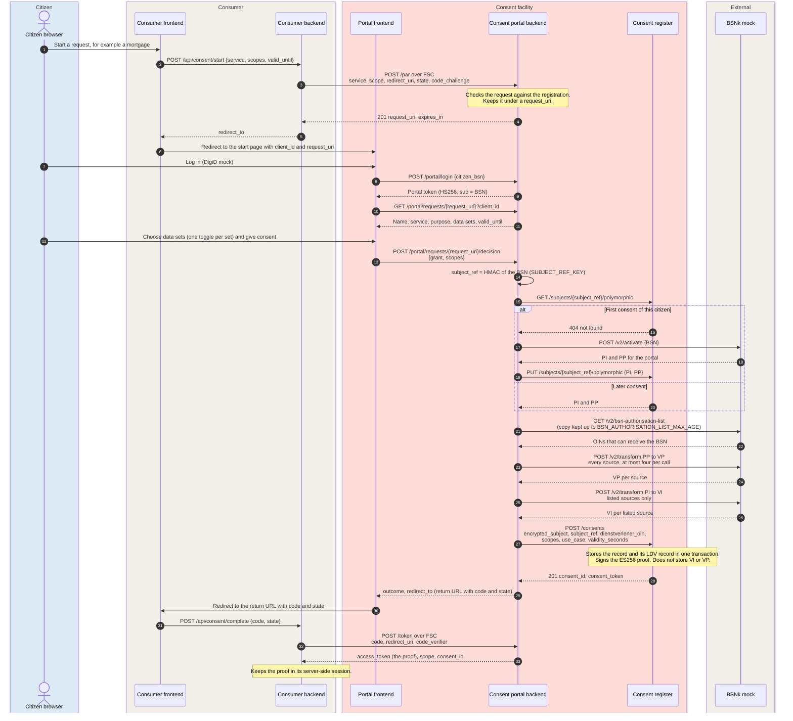

# DvTP: the citizen gives consent

In DvTP, the consumer is a private service provider (dienstverlener). A
citizen at the consumer goes to the consent portal (toestemmingsportaal),
logs in, and gives consent for one or more data sets. The consumer pushes
its request over FSC first, and gets the proof back over FSC for a code.
The result is a consent record in the consent register (toestemmingsregister) and a signed
consent proof. The proof goes back to the consumer. The consumer uses the
proof in [DvTP query](dvtp-query.md).

For the concepts, see [Consent](../concepts/consent.md) and
[Pseudonymization](../concepts/pseudonymization.md). For the components,
see [Level 2: consent chain](../building-blocks/components.md#level-2-consent-chain).
The main decisions are [ADR-0032](../decisions/0032-consent-proof.md) (the
consent proof),
[ADR-0040](../decisions/0040-route-d-citizen-recognition.md) (route D,
proposed), and [ADR-0045](../decisions/0045-pushed-consent-request.md)
(the pushed request and the code exchange).

## Sequence

## Data per hop

The tags in the last column are the data classes of
[What travels where](../concepts/consent.md#what-travels-where). Each hop
carries the following data:

| # | From → to | Endpoint | In | Out | Data and notes |
|---|---|---|---|---|---|
| 1 | Citizen → consumer frontend | (UI) | — | — | The consumer starts the request. No identity data travels at this hop |
| 2 | Consumer frontend → consumer backend | `POST /api/consent/start` | `service`, `scopes`, `valid_until` | — | Low. The consumer backend makes `state` and a PKCE verifier and keeps them in a server-side session ([`consentrequest.go`](https://github.com/ICTU/GBO-demo/blob/afcef2065578f902b0f5531d9b18e2bae11fce37/services/dienstverlener-backend/consentrequest/consentrequest.go)) |
| 3 | Consumer backend → portal backend | `POST /par`, over FSC | `response_type=code`, `client_id`, `service`, `scope`, `redirect_uri`, `state`, `code_challenge` (S256), optionally `valid_until` | — | Low: OIN and scope. The FSC peer identity proves the consumer. The backend checks the request against the registration before anything else ([REQ-111](../requirements/consent.md#req-111), [`par.go`](https://github.com/ICTU/GBO-demo/blob/afcef2065578f902b0f5531d9b18e2bae11fce37/services/consent-portal-backend/consent/par.go)) |
| 4 | Portal backend → consumer backend | — | — | `request_uri`, `expires_in` | The reference holds for `PAR_REQUEST_LIFETIME` (default 10 minutes) and must outlive the login ([REQ-126](../requirements/consent.md#req-126)) |
| 5 | Consumer backend → consumer frontend | — | — | `redirect_to` | The address of the start page with `client_id` and `request_uri` |
| 6 | Consumer frontend → portal frontend | Redirect to `/toestemming/start` | `client_id`, `request_uri` | — | Low. Nothing else in the URL is read ([`startFlow.ts`](https://github.com/ICTU/GBO-demo/blob/afcef2065578f902b0f5531d9b18e2bae11fce37/toestemmingsportaal-frontend/src/consentStart/startFlow.ts)). The mock login keeps the start address for 5 minutes in a cookie |
| 7 | Citizen → portal frontend | (UI) | Login with the DigiD mock | — | The citizen types the BSN as the password. This shortcut exists only in the demo |
| 8 | Portal frontend → portal backend | `POST /portal/login` | `citizen_bsn` | — | The **BSN** is in the browser and on the wire. In production, the identity comes from the MijnOverheid login ([REQ-24](../requirements/consent.md#req-24), [Q-50](../traceability/open-questions.md#q-50)) |
| 9 | Portal backend → portal frontend | — | — | Portal token, HS256, `sub` = BSN | The **BSN** is inside the token ([`auth.go#L17-L36`](https://github.com/ICTU/GBO-demo/blob/v0.9.0/services/consent-portal-backend/portalhttp/auth.go#L17-L36)). Later calls send this token instead of a raw BSN |
| 10 | Portal frontend → portal backend | `GET /portal/requests/{request_uri}?client_id=…` | Portal token, `request_uri`, `client_id` | — | The first citizen who resolves the reference is bound to it ([REQ-126](../requirements/consent.md#req-126), [`authorize.go`](https://github.com/ICTU/GBO-demo/blob/afcef2065578f902b0f5531d9b18e2bae11fce37/services/consent-portal-backend/consent/authorize.go)) |
| 11 | Portal backend → portal frontend | — | — | Name, service, purpose, data sets, `valid_until` | Name and purpose come from the registration. The return address and `state` stay at the backend |
| 12 | Citizen → portal frontend | (UI) | Data-set choice | — | One toggle per data set. The citizen cannot choose single fields ([REQ-10](../requirements/consent.md#req-10)). The portal shows only the requested sets |
| 13 | Portal frontend → portal backend | `POST /portal/requests/{request_uri}/decision` | Portal token, `decision`, `scopes` | — | The body holds no BSN. The backend takes the BSN from the verified token. One decision spends the reference. `use_case` is the purpose from the registration. The consumer sets the validity ([Q-13](../traceability/open-questions.md#q-13)) |
| 14 | Portal backend (internal) | — | BSN | `subject_ref` | The portal computes an HMAC of the BSN with its own secret, versioned key ([`subjectref.go#L40-L52`](https://github.com/ICTU/GBO-demo/blob/v0.9.0/services/consent-portal-backend/consent/subjectref.go#L40-L52), [route D](../requirements/pseudonymization.md#route-d)). The portal does not call BSNk |
| 15 | Portal backend → register | `GET /subjects/{subject_ref}/polymorphic` | `subject_ref` | — | Medium: `subject_ref`. Only the portal asks for these values |
| 16 | Register → portal backend | — | — | 404 | The register has no values, because this is the first consent of this citizen |
| 17 | Portal backend → BSNk | `POST /v2/activate` | BSN, requester OIN and key set version of the portal | — | The portal sends the **BSN** to BSNk, once per citizen. The mock follows the BSNk interface, but uses JSON instead of SOAP ([BSNK-11](../requirements/pseudonymization.md#bsnk-11)) |
| 18 | BSNk → portal backend | — | — | PI and PP | Medium. Only the portal, as requester, can use them ([BSNK-03](../requirements/pseudonymization.md#bsnk-03)) |
| 19 | Portal backend → register | `PUT /subjects/{subject_ref}/polymorphic` | `subject_ref`, PI, PP | — | The register keeps PI and PP under the reference ([REQ-69](../requirements/pseudonymization.md#req-69)). The register gets no BSN and no per-party value |
| 20 | Register → portal backend | — | — | PI and PP | Later consent: the portal finds the values again and does not activate ([`portal.go#L298-L321`](https://github.com/ICTU/GBO-demo/blob/v0.9.0/services/consent-portal-backend/consent/portal.go#L298-L321)) |
| 21 | Portal backend → BSNk | `GET /v2/bsn-authorisation-list` | — | — | The portal reads the list only when its copy is older than `BSN_AUTHORISATION_LIST_MAX_AGE` (default 1 hour, an assumption) |
| 22 | BSNk → portal backend | — | — | OINs that can receive the BSN | The BSN authorization list ([BSNK-06](../requirements/pseudonymization.md#bsnk-06)). If the copy is too old and BSNk does not answer, the portal gives no consent |
| 23 | Portal backend → BSNk | `POST /v2/transform` | PP, per source `EntityID` (OIN), `KeySetVersion`, `IdentifierType=Pseudonym` | — | The portal makes this call for every source in `CONSENT_SOURCES`. One call holds at most four parties. More sources give more calls ([BSNK-05](../requirements/pseudonymization.md#bsnk-05)) |
| 24 | BSNk → portal backend | — | — | VP per source | Only its own source can read a VP ([BSNK-08](../requirements/pseudonymization.md#bsnk-08)). In the demo, anyone can read the values, because the mock does not encrypt |
| 25 | Portal backend → BSNk | `POST /v2/transform` | PI, per listed source `EntityID`, `KeySetVersion`, `IdentifierType=Identity` | — | The portal makes this call only for sources on the list. If no source is on the list, this call does not occur. A party can occur only once per call, so each form takes its own call |
| 26 | BSNk → portal backend | — | — | VI per listed source | High at the recipient, and unreadable for others. This call and calls 23 and 24 work only while the citizen is logged in ([BSNK-04](../requirements/pseudonymization.md#bsnk-04)) |
| 27 | Portal backend → register | `POST /consents` | `encrypted_subject` (per OIN a `pseudonym` and, if listed, an `identity`, each with `key_set_version`), `subject_ref`, `dienstverlener_oin`, `scopes`, `use_case`, `validity_seconds` | — | The register never gets a BSN ([REQ-23](../requirements/consent.md#req-23)). Before this call, the portal writes its LDV record `dataverwerking.bsn-pseudonimisering` under `subject_ref` ([`portal.go#L153-L174`](https://github.com/ICTU/GBO-demo/blob/v0.9.0/services/consent-portal-backend/consent/portal.go#L153-L174), [REQ-72](../requirements/logging-audit.md#req-72)) |
| 28 | Register → portal backend | — | — | `consent_id`, `consent_token` | The register signs the proof and stores the record with `dataverwerking.toestemming-verlenen` in one transaction ([`main.go#L449-L484`](https://github.com/ICTU/GBO-demo/blob/v0.9.0/services/consent-register/main.go#L449-L484)). It does not store the per-party values ([REQ-80](../requirements/pseudonymization.md#req-80)). For the proof claims, see [The consent proof](../concepts/consent.md#the-consent-proof) |
| 29 | Portal backend → portal frontend | — | — | `outcome`, `redirect_to` | The return URL with a one-time `code` and `state`. The answer holds no proof ([REQ-127](../requirements/consent.md#req-127)) |
| 30 | Portal frontend → consumer frontend | Redirect to the return URL | `code`, `state` | — | Low. The consumer frontend removes the code from the address bar and sends no referrer ([AV-16](../requirements/admission.md#av-16)) |
| 31 | Consumer frontend → consumer backend | `POST /api/consent/complete` | `code`, `state` | — | The consumer backend checks `state` against its session |
| 32 | Consumer backend → portal backend | `POST /token`, over FSC | `grant_type=authorization_code`, `code`, `redirect_uri`, `code_verifier` | — | The code works once, for 60 seconds, only for the consumer that pushed the request ([REQ-127](../requirements/consent.md#req-127), [`token.go`](https://github.com/ICTU/GBO-demo/blob/afcef2065578f902b0f5531d9b18e2bae11fce37/services/consent-portal-backend/consent/token.go)) |
| 33 | Portal backend → consumer backend | — | — | `access_token` (the consent proof), `scope`, `consent_id` | Medium-high: the proof. It stays in the server-side session of the consumer. The consumer cannot read the citizen from the proof ([F-76](../traceability/findings.md#f-76)) |

## Error paths

The consent flow has no policy decision. Each failure stops the flow
before the register stores a consent. A refused pushed request never
reaches the citizen. A refused reference shows the citizen an error page,
without a return. A failure after the decision returns the citizen with
`error=server_error`. The consent flow has the following error paths:

| Trigger | What the consumer sees | Administrator reason | Pinned by (v0.9.0) |
|---|---|---|---|
| The pushed request is incomplete or does not match the registration. Or it comes from an inactive consumer, names an unknown data set, or has an unregistered return address | The consumer backend gets an OAuth error with the reason. The citizen is not sent to the portal | `INITIATION_INCOMPLETE`, `PARTY_NOT_ACTIVE`, `INITIATION_MISMATCH`, `UNKNOWN_SCOPE`, or `RETURN_URL_NOT_REGISTERED` | [`fschttp_test.go`](https://github.com/ICTU/GBO-demo/blob/afcef2065578f902b0f5531d9b18e2bae11fce37/services/consent-portal-backend/fschttp/fschttp_test.go), [`initiation_test.go`](https://github.com/ICTU/GBO-demo/blob/afcef2065578f902b0f5531d9b18e2bae11fce37/services/consent-portal-backend/consent/initiation_test.go) |
| The admission register cannot be read | The consumer backend gets `503 temporarily_unavailable` | `ADMISSION_REGISTER_UNAVAILABLE` | [`initiation_test.go`](https://github.com/ICTU/GBO-demo/blob/afcef2065578f902b0f5531d9b18e2bae11fce37/services/consent-portal-backend/consent/initiation_test.go) |
| The reference is unknown, expired, spent, used with another `client_id`, or bound to another citizen | The citizen sees an error page, without a return | `REQUEST_URI_UNKNOWN`, `REQUEST_URI_EXPIRED`, `REQUEST_URI_SPENT`, `CLIENT_ID_MISMATCH`, or `REQUEST_URI_OTHER_CITIZEN` | [`authorize_test.go`](https://github.com/ICTU/GBO-demo/blob/afcef2065578f902b0f5531d9b18e2bae11fce37/services/consent-portal-backend/consent/authorize_test.go) |
| The citizen refuses consent | A return with `error=access_denied` and `state`. The portal does not record the refusal ([Q-43](../traceability/open-questions.md#q-43)) | — | [`authorize_test.go`](https://github.com/ICTU/GBO-demo/blob/afcef2065578f902b0f5531d9b18e2bae11fce37/services/consent-portal-backend/consent/authorize_test.go) |
| The code is used twice, has expired, comes from another consumer, or the verifier does not match | The consumer backend gets `invalid_grant` and no proof | — | [`token_test.go`](https://github.com/ICTU/GBO-demo/blob/afcef2065578f902b0f5531d9b18e2bae11fce37/services/consent-portal-backend/fschttp/token_test.go) |
| The portal token is missing, expired, or not signed by the portal | No consent. The portal answers HTTP 401 | `invalid token: …` | Code only: [`portalhttp.go#L138-L147`](https://github.com/ICTU/GBO-demo/blob/v0.9.0/services/consent-portal-backend/portalhttp/portalhttp.go#L138-L147) |
| No source configured in `CONSENT_SOURCES` | No consent. The citizen returns with `error=server_error` | `no sources configured: a consent no source can read is not given` | [`TestGiveConsentNeedsASource`](https://github.com/ICTU/GBO-demo/blob/v0.9.0/services/consent-portal-backend/consent/portal_test.go#L552) |
| BSNk fails, or answers for another party, in another form, or without a value | No consent. The citizen returns with `error=server_error` | `activate: …` or `encrypt the subject for the sources: …` | [`TestGiveConsentFailsWhenBSNkFails`](https://github.com/ICTU/GBO-demo/blob/v0.9.0/services/consent-portal-backend/consent/portal_test.go#L639), [`TestAnAnswerThatDoesNotMatchIsRefused`](https://github.com/ICTU/GBO-demo/blob/v0.9.0/services/consent-portal-backend/bsnk/bsnk_test.go#L98) |
| The copy of the BSN authorization list is too old and BSNk does not answer | No consent. The citizen returns with `error=server_error` | `read the BSN authorisation list: …` | [`TestTheAuthorisationListIsNotUsedOutOfDate`](https://github.com/ICTU/GBO-demo/blob/v0.9.0/services/consent-portal-backend/consent/portal_test.go#L512) |
| The portal cannot write its LDV record for the pseudonymization | No consent. The citizen returns with `error=server_error` | `log pseudonymisation: …` | [`TestGiveConsentThatCannotBeLoggedCreatesNoConsent`](https://github.com/ICTU/GBO-demo/blob/v0.9.0/services/consent-portal-backend/consent/logbook_test.go#L116) |
| The register gets no `encrypted_subject`, or a party without a pseudonym | No consent. The register answers 400, and the portal answers 502 | `encrypted_subject is required (no plain BSN accepted)` | [`TestCreateRefusesAConsentWithoutAnEncryptedSubject`](https://github.com/ICTU/GBO-demo/blob/v0.9.0/services/consent-register/main_test.go#L197) |
| The register cannot sign, store, or log the consent | No consent. The register answers 500 | `could not issue consent token`, `could not store consent`, or the refused LDV record | Code only: [`main.go#L449-L484`](https://github.com/ICTU/GBO-demo/blob/v0.9.0/services/consent-register/main.go#L449-L484) |

## Main observations

The consent flow in gbo-demo v0.10.0 has these properties and gaps:

- **The BSN boundary.** The BSN occurs only in these places:
    - the browser and the portal token (hops 7 to 9),
    - the portal backend (hop 14),
    - BSNk, at the first consent (hop 17).

    The register and the consumer never see the BSN
    ([REQ-20](../requirements/pseudonymization.md#req-20),
    [REQ-23](../requirements/consent.md#req-23)). The BSN in the
    browser is a demo shortcut.

- **One activation per citizen.** At every later consent, the portal finds
  PI and PP under its own reference. Then the portal only transforms
  ([`TestASecondConsentOnlyTransforms`](https://github.com/ICTU/GBO-demo/blob/v0.9.0/services/consent-portal-backend/main_test.go#L396)).
  A new `SUBJECT_REF_KEY` gives every citizen a new reference. Migration to
  a new key is not built in demo v0.10.0
  ([Q-56](../traceability/open-questions.md#q-56)).
- **No consumer identifier in the proof.** The proof carries values that
  only the sources can read. The consumer does not recognize the citizen
  across consents ([F-76](../traceability/findings.md#f-76)). A VP for the
  consumer itself is not built in demo v0.10.0
  ([#478](https://github.com/ICTU/GBO-demo/issues/478)).
- **The proof freezes at consent.** BSNk makes the values only while the
  citizen is present. As a result, the parties, the key versions, and the
  proof form are fixed for the whole validity
  ([F-78](../traceability/findings.md#f-78),
  [The proof freezes at consent](../concepts/consent.md#the-proof-freezes-at-consent)).
  The portal configuration (`CONSENT_SOURCES`) names the sources. No
  catalogue supplies them
  ([REQ-82](../requirements/pseudonymization.md#req-82)).
- **BSNk recognition is open.** Only a recognized party can activate and
  transform ([BSNK-01](../requirements/pseudonymization.md#bsnk-01)).
  It is open whether the consent facility (toestemmingsvoorziening) can be a recognized party. It is
  also open whether the register and the portal backend are one BSNk
  participant
  ([F-75](../traceability/findings.md#f-75),
  [Q-26](../traceability/open-questions.md#q-26),
  [Q-49](../traceability/open-questions.md#q-49)).
- **The initiation is provable, and the proof stays off the browser.** The
  consumer pushes its request over FSC. The name, the purpose and the
  return address come from the registration
  ([REQ-111](../requirements/consent.md#req-111),
  [ADR-0045](../decisions/0045-pushed-consent-request.md)). The consumer
  gets the proof over FSC for a one-time code. The consent is recorded at
  the decision, before the consumer holds the proof. The record holds
  the purpose as `use_case`. The proof does not hold the purpose
  ([REQ-12](../requirements/consent.md#req-12),
  [Q-69](../traceability/open-questions.md#q-69)).
- **Some portal duties are not built.** Demo v0.10.0 does not have these
  portal duties:
    - a step in which the citizen states that they saw the information
      ([REQ-107](../requirements/consent.md#req-107)),
    - a plain-language summary to the norm of
      [REQ-117](../requirements/consent.md#req-117).

    The portal shows a short confirmation before the return
    ([REQ-122](../requirements/consent.md#req-122)).

    It is open whether the portal must prove what the citizen saw
    ([Q-51](../traceability/open-questions.md#q-51)).

## Traceability

- Requirements: [REQ-10](../requirements/consent.md#req-10), [REQ-12](../requirements/consent.md#req-12), [REQ-20](../requirements/pseudonymization.md#req-20), [REQ-23](../requirements/consent.md#req-23), [REQ-24](../requirements/consent.md#req-24), [REQ-37](../requirements/consent.md#req-37), [REQ-69](../requirements/pseudonymization.md#req-69), [REQ-72](../requirements/logging-audit.md#req-72), [REQ-80](../requirements/pseudonymization.md#req-80), [REQ-82](../requirements/pseudonymization.md#req-82), [REQ-107](../requirements/consent.md#req-107), [REQ-111](../requirements/consent.md#req-111), [REQ-117](../requirements/consent.md#req-117), [REQ-119](../requirements/consent.md#req-119), [REQ-122](../requirements/consent.md#req-122), [REQ-126](../requirements/consent.md#req-126), [REQ-127](../requirements/consent.md#req-127), [AV-16](../requirements/admission.md#av-16), [BSNK-01](../requirements/pseudonymization.md#bsnk-01), [BSNK-03](../requirements/pseudonymization.md#bsnk-03), [BSNK-04](../requirements/pseudonymization.md#bsnk-04), [BSNK-05](../requirements/pseudonymization.md#bsnk-05), [BSNK-06](../requirements/pseudonymization.md#bsnk-06), [BSNK-08](../requirements/pseudonymization.md#bsnk-08), [BSNK-11](../requirements/pseudonymization.md#bsnk-11)
- Findings: [F-75](../traceability/findings.md#f-75) (open), [F-76](../traceability/findings.md#f-76) (open), [F-78](../traceability/findings.md#f-78) (open)
- Open questions: [Q-13](../traceability/open-questions.md#q-13) (open), [Q-26](../traceability/open-questions.md#q-26) (open), [Q-43](../traceability/open-questions.md#q-43) (partly answered), [Q-44](../traceability/answered-questions.md#q-44) (answered), [Q-49](../traceability/open-questions.md#q-49) (open), [Q-50](../traceability/open-questions.md#q-50) (open), [Q-51](../traceability/open-questions.md#q-51) (open), [Q-56](../traceability/open-questions.md#q-56) (open), [Q-60](../traceability/answered-questions.md#q-60) (answered), [Q-69](../traceability/open-questions.md#q-69) (open)
- Demo increments: [SL-06a](../traceability/increments.md#sl-06a) (done), [SL-11](../traceability/increments.md#sl-11) (done), [SL-47](../traceability/increments.md#sl-47) (done), [SL-51](../traceability/increments.md#sl-51) (done)
