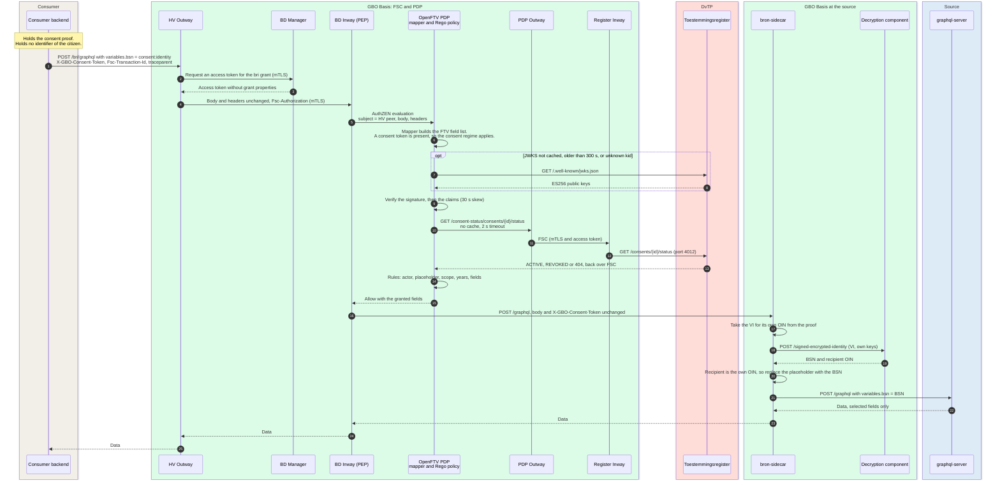
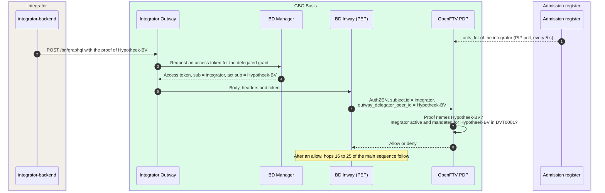
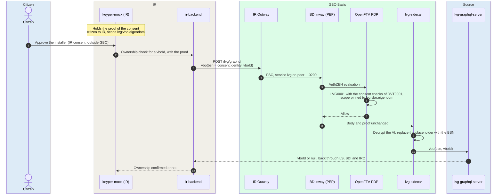

# DvTP: the consumer queries a source under consent

A consumer (dienstverlener) asks a source for data about a citizen who gave
consent. The consumer sends a GraphQL query and the consent proof through
FSC. The PDP of the source decides before any data reaches the source.
After an allow, the source fills in the citizen. Besides the direct call,
the flow has two variants: a call by an integrator, and a call by the
Installatie Register to LVG.

For the concepts, see [Authorization](../concepts/authorization.md),
[Consent](../concepts/consent.md#verification-and-status), and
[Pseudonymization](../concepts/pseudonymization.md#where-the-boundary-is-enforced).
For the components, see
[Level 2: authorization chain](../building-blocks/components.md#level-2-authorization-chain)
and [Level 2: bronhouder](../building-blocks/components.md#level-2-bronhouder). The main
decisions are [ADR-0031](../decisions/0031-regime-from-evidence.md),
[ADR-0032](../decisions/0032-consent-proof.md), and
[ADR-0033](../decisions/0033-gateway-decrypts-after-allow.md).

The precondition is that the consumer has an FSC contract with the source.
The Manager of the source signed the contract after a positive admission
decision of the same PDP
([REQ-61](../requirements/admission.md#req-61),
[REQ-62](../requirements/admission.md#req-62)). For that scenario, see
[Admission and activation](admission.md).

## Sequence

## Data per hop

The tags (for example Medium and Low) are the data classes of
[What travels where](../concepts/consent.md#what-travels-where). The hop
numbers refer to the steps of the sequence:

| # | From → to | Endpoint | In | Out | Data and notes |
|---|---|---|---|---|---|
| 1 | Consumer backend → HV Outway | `POST /bri/graphql` | Body `{query, variables}` with `variables.bsn = "consent:identity"`. Headers `X-GBO-Consent-Token`, `Fsc-Transaction-Id`, and `traceparent` | — | Plain GraphQL, no envelope. The placeholder names the citizen ([REQ-79](../requirements/pseudonymization.md#req-79)). The consumer reads only `consent_id` and `scopes` from the proof ([`token.go#L32-L52`](https://github.com/ICTU/GBO-demo/blob/v0.9.0/services/dienstverlener-backend/consumer/token.go#L32-L52)). It sends the proof unchanged ([AV-05](../requirements/admission.md#av-05), [`outway.go#L34-L51`](https://github.com/ICTU/GBO-demo/blob/v0.9.0/services/dienstverlener-backend/outway/outway.go#L34-L51)). The year filter travels inside the query ([`kind.go#L75-L95`](https://github.com/ICTU/GBO-demo/blob/v0.9.0/services/dienstverlener-backend/consumer/kind.go#L75-L95)) |
| 2 | HV Outway → BD Manager | Token request | Grant hash of the `bri` contract | — | The Manager of the providing peer issues the access token |
| 3 | BD Manager → HV Outway | — | — | Access token (certificate-bound JWT) | Medium. The token carries `sub`, `service_name`, `grant_hash`, and `service_peer_id`. It has no grant properties, so `flow` and `subject_id_type` are not in it ([REQ-74](../requirements/authorization.md#req-74)) |
| 4 | HV Outway → BD Inway | FSC transport | Body 1:1, `Fsc-Authorization`, `X-GBO-Consent-Token`, and `Fsc-Transaction-Id` | — | FSC native transport over mTLS ([ADR-0003](../decisions/0003-fsc-connectivity.md)) |
| 5 | BD Inway → PDP | `POST /authzen/v1/evaluation` | `subject` (HV peer, token attributes), `action.properties.body`, `resource`, and `context.headers` | — | The AuthZEN plugin of the Inway is the PEP. It passes the request unchanged ([REQ-42](../requirements/authorization.md#req-42)). The Inway sends no `traceparent`. It correlates with `X-Request-ID` = `Fsc-Transaction-Id` ([`ftv-graphql-profile.md#L105-L106`](https://github.com/ICTU/GBO-demo/blob/v0.9.0/docs/ftv-graphql-profile.md#L105-L106)) |
| 6 | PDP (internal) | Mapper, then policy | AuthZEN request | FTV field list | The mapper only maps ([Query mapping](../concepts/authorization.md#query-mapping-ftv-graphql-profile)). The policy reads the token from the headers and selects the regime ([`engine.rego#L173-L181`](https://github.com/ICTU/GBO-demo/blob/v0.9.0/policies/gbo/engine.rego#L173-L181), [Regime selection](../concepts/authorization.md#regime-selection)) |
| 7 | PDP → register | `GET /.well-known/jwks.json` | — | — | Direct, without FSC. Only if the cache is empty or older than 300 seconds, or if the `kid` is unknown |
| 8 | Register → PDP | — | — | ES256 public keys | Low. No stale-key fallback |
| 9 | PDP (internal) | Proof verification | `X-GBO-Consent-Token` | `consent_id`, `scopes`, `dienstverlener_oin`, and `valid_until` | The policy verifies the proof. The mapper does not ([REQ-68](../requirements/consent.md#req-68), [REQ-18](../requirements/authorization.md#req-18), [`consent.rego#L174-L186`](https://github.com/ICTU/GBO-demo/blob/v0.9.0/policies/gbo/consent.rego#L174-L186)). The policy does not read `encrypted_subject`. It only requires a pseudonym per party |
| 10 | PDP → PDP Outway | `GET /consent-status/consents/{id}/status` | `consent_id`, `traceparent`, and `Fsc-Transaction-Id` | — | Medium: `consent_id`. Per evaluation, no cache, 2-second timeout, and `raise_error: false` ([`consent.rego#L194-L200`](https://github.com/ICTU/GBO-demo/blob/v0.9.0/policies/gbo/consent.rego#L194-L200)) |
| 11 | PDP Outway → Register Inway | FSC service `consent-status` | Same as hop 10 | — | From the PDP peer `…0800` to the register peer `…0700` ([FSC peers](../deployment.md#fsc-peers), [REQ-76](../requirements/consent.md#req-76)) |
| 12 | Register Inway → register | Status listener, port 4012 | `consent_id` | — | The listener serves only the status. If the request has no FSC peer, the listener answers 401. The register logs the lookup with the calling peer as processor |
| 13 | Register → PDP | — | — | `{status}` or 404 | Only the status is online. The content of the consent comes from the proof ([F-61](../traceability/findings-closed.md#f-61)) |
| 14 | PDP (internal) | Rules | Resolved consent, field list, and `subject` | Decision per field | DVT0001 binds the fields of service `bri`. It checks actor binding, placeholder, scope, years, and fields ([REQ-48](../requirements/authorization.md#req-48), [REQ-97](../requirements/authorization.md#req-97), [`dvt0001.rego#L72-L80`](https://github.com/ICTU/GBO-demo/blob/v0.9.0/policies/gbo/rules/dvtp/dvt0001.rego#L72-L80)). The PDP input holds no BSN and no pseudonym |
| 15 | PDP → BD Inway | AuthZEN decision | — | `decision: true`, granted fields | The engine adds the resolved consent to its response for the console log ([`engine.rego#L25-L29`](https://github.com/ICTU/GBO-demo/blob/v0.9.0/policies/gbo/engine.rego#L25-L29)). The ADL records the request and the decision ([ADR-0036](../decisions/0036-adl-decision-record.md)) |
| 16 | BD Inway → bron-sidecar | `POST /graphql` | Body 1:1, `X-GBO-Consent-Token`, and `Fsc-Authorization` | — | The Inway forwards only after the allow. Only the source Inways reach the source gateway ([REQ-81](../requirements/pseudonymization.md#req-81), [Network isolation](../concepts/pseudonymization.md#network-isolation-is-the-control)) |
| 17 | Source gateway (internal) | Substitution | Proof, body | VI for `OWN_PEER_OIN` | If the request carries a consent token, the source gateway takes the subject from that token. The source gateway does not verify the token again ([`substitution.go#L105-L107`](https://github.com/ICTU/GBO-demo/blob/v0.9.0/services/bron-sidecar/substitution/substitution.go#L105-L107)) |
| 18 | Source gateway → decryption component | `POST /signed-encrypted-identity` | VI, own decryption keys, and scheme keys | — | For `consent:pseudonym`, the source gateway sends the VP to `/signed-encrypted-pseudonym`. No BSNk call in the query path ([REQ-21](../requirements/pseudonymization.md#req-21), [BSNK-09](../requirements/pseudonymization.md#bsnk-09)) |
| 19 | Decryption component → source gateway | — | — | BSN, recipient OIN | **BSN**, inside the source boundary. In the demo, the three sources share one decryption component and one OIN |
| 20 | Source gateway (internal) | Recipient check and substitution | BSN, recipient | Body with the BSN | The value must name the own OIN as recipient ([REQ-80](../requirements/pseudonymization.md#req-80), [`substitution.go#L213-L232`](https://github.com/ICTU/GBO-demo/blob/v0.9.0/services/bron-sidecar/substitution/substitution.go#L213-L232)). The source gateway logs the decryption in the LDV logbook of the source |
| 21 | Source gateway → source | `POST /graphql` | `variables.bsn` = BSN | — | **BSN** only at the source. The query and `operationName` stay the same |
| 22 | Source → source gateway | — | — | `{data}` | Only the selected fields ([REQ-08](../requirements/authorization.md#req-08)). The source gateway logs the forward |
| 23 to 25 | Source gateway → BD Inway → HV Outway → consumer | — | — | `{data}` | No BSN in the response. The consumer logs its processing under the `consent_id` ([F-76](../traceability/findings.md#f-76), [Q-27](../traceability/open-questions.md#q-27)) |

## Variant: an integrator calls for the consumer

An integrator is a software party that calls the source for a consumer
under FSC delegation ([ADR-0034](../decisions/0034-integrator-delegation.md),
[`integrator.md`](https://github.com/ICTU/GBO-demo/blob/v0.9.0/docs/integrator.md)).
The demo runs this variant opt-in with `make demo-integrator`. The consent
stays a consent to the consumer (Hypotheek-BV, peer `…0300`).

The integrator variant differs from the direct call in these hops:

| # | What differs from the direct call |
|---|---|
| 1 | The admission register (`dvtp-onboarding-register`) supplies `integrations` as `acts_for` on the entry of the integrator. A mandate names the represented party and the rules ([REQ-106](../requirements/consent.md#req-106), [AV-06](../requirements/admission.md#av-06)) |
| 2 | `integrator-backend` is the consumer backend behind the own Outway of the integrator (peer `…1100`). The proof is the proof that the portal gave to Hypotheek-BV |
| 3 to 4 | The contract is a `DelegatedServiceConnectionGrant` between the integrator, Hypotheek-BV, and the source. The OpenFSC Manager puts the delegator in `act.sub`. This is the reverse of RFC 8693 ([`integrator.md#L61-L67`](https://github.com/ICTU/GBO-demo/blob/v0.9.0/docs/integrator.md#L61-L67)) |
| 6 | The Inway maps the delegator to `subject.attributes.outway_delegator_peer_id`. The policy reads that field and does not read the claim |
| 7 | The consent binds the represented party. This is the delegator, or else `subject.id` ([`lib.rego#L62-L72`](https://github.com/ICTU/GBO-demo/blob/v0.9.0/policies/gbo/lib.rego#L62-L72)). Every delegated call also needs a mandate for that party and the granting rule ([`engine.rego#L253-L266`](https://github.com/ICTU/GBO-demo/blob/v0.9.0/policies/gbo/engine.rego#L253-L266)) |

At the source, the source gateway and the source log the integrator as
`foreignOperation.processor`. The LDV record has no field for "on behalf
of". The FSC transaction log of the source records both peers
([`integrator.md#L132-L152`](https://github.com/ICTU/GBO-demo/blob/v0.9.0/docs/integrator.md#L132-L152)).
It is open whether the proof must name the integrator
([Q-46](../traceability/open-questions.md#q-46)).

## Variant: the Installatie Register asks LVG about ownership

The LVG pilot uses the same consent pattern with a different consumer and
a different source
([`lvg-ir.md`](https://github.com/ICTU/GBO-demo/blob/v0.9.0/docs/lvg-ir.md)).
The Installatie Register (IR) asks the Landelijke Voorziening Gebouwen
(LVG) whether a building unit belongs to the citizen. The citizen gives two
consents:

- One consent to IR in the toestemmingsportaal (scope `lvg:vbo:eigendom`).
  This consent is in GBO.
- One consent to the installer inside IR. This consent is not in GBO.

The LVG variant differs from the direct call in these hops:

| # | What differs from the direct call |
|---|---|
| 2 to 3 | `ir-backend` is the consumer backend with `QUERY_KIND=lvg` ([`kind.go#L47-L53`](https://github.com/ICTU/GBO-demo/blob/v0.9.0/services/dienstverlener-backend/consumer/kind.go#L47-L53)). The query is `vbo(bsn: $bsn, vboId: $vboId) { vboId }` with the placeholder in `$bsn` |
| 4 | IR has its own peer `…1000`, so the actor binding tells IR apart from Hypotheek-BV. LVG is a logical source behind `bd-inway` on the shared provider peer |
| 5 to 6 | Hops 6 to 14 of the main sequence apply: proof verification and the online status lookup. If a consent does not have the LVG scope, LVG0001 denies with `SCOPE_NOT_ALLOWED` |
| 9 | `lvg-sidecar` logs `lvg-identiteit-ontsleuteling` and `lvg-bronquery-doorgifte` in the LVG logbook. `lvg-graphql-server` logs `lvg-vbo-eigendom`, also for `null` |
| 11 to 12 | Three outcomes are possible: the `vboId` (the citizen is the owner), `null` (not the owner), or a deny (no valid consent). Only if the citizen is the owner does IR record the access of the installer ([`lvg-ir.md#L64-L70`](https://github.com/ICTU/GBO-demo/blob/v0.9.0/docs/lvg-ir.md#L64-L70)) |

IR keeps the proof. At every access of an installer, IR asks again under
the same consent. After a revocation, the next question fails
([`lvg-ir.md#L60-L62`](https://github.com/ICTU/GBO-demo/blob/v0.9.0/docs/lvg-ir.md#L60-L62),
[Repeated use](../concepts/consent.md#repeated-use-not-single-use)). With
one consent, IR can ask about any `vboId`. The pilot must answer whether
the `vboId` belongs in the consent
([`lvg-ir.md#L113-L114`](https://github.com/ICTU/GBO-demo/blob/v0.9.0/docs/lvg-ir.md#L113-L114)).

## Error paths

A deny carries two layers of reason
([Reason codes](../concepts/authorization.md#reason-codes-two-layers),
[REQ-06](../requirements/authorization.md#req-06)):

- Consumer code: the PDP puts this code in `reason_user`, and the ADL
  stores it. It never names the field or the failed check.
- Administrator codes: these codes are per field. They reach only the OPA
  console decision log. For a server fault, the request code is
  `PIP_UNAVAILABLE`, and the trace keeps the cause.

In demo v0.9.0, the FSC Inway removes the consumer code. The Inway reads
`reasonUser`, but the PDP sends `reason_user`
([`ftv-graphql-profile.md#L93-L96`](https://github.com/ICTU/GBO-demo/blob/v0.9.0/docs/ftv-graphql-profile.md#L93-L96)).
As a result, the consumer gets a deny without a code. The consumer backend
then shows `UNAVAILABLE` to the citizen
([`denial.go#L12-L56`](https://github.com/ICTU/GBO-demo/blob/v0.9.0/services/dienstverlener-backend/consumer/denial.go#L12-L56)).

On every PDP deny, no request reaches the source gateway or the source. If one
field has more than one reason, the administrator code is the first reason
in a fixed order
([`engine.rego#L321-L339`](https://github.com/ICTU/GBO-demo/blob/v0.9.0/policies/gbo/engine.rego#L321-L339)).
The error paths have these triggers and codes:

| Trigger | Consumer code | Administrator code | Pinned by (v0.9.0) |
|---|---|---|---|
| The citizen revoked the consent | `FIELD_NOT_PERMITTED` | `CONSENT_WITHDRAWN` | [`consent_test.rego#L197-L207`](https://github.com/ICTU/GBO-demo/blob/v0.9.0/policies/gbo/consent_test.rego#L197-L207), [`dvt0001_test.rego#L72`](https://github.com/ICTU/GBO-demo/blob/v0.9.0/policies/gbo/rules/dvtp/dvt0001_test.rego#L72) |
| `valid_until` passed, within the 30-second skew | `FIELD_NOT_PERMITTED` | `CONSENT_EXPIRED` | [`dvt0001_test.rego#L76`](https://github.com/ICTU/GBO-demo/blob/v0.9.0/policies/gbo/rules/dvtp/dvt0001_test.rego#L76) |
| `exp` passed by more than 30 seconds | `FIELD_NOT_PERMITTED` | `CONSENT_TOKEN_EXPIRED` | [`consent_test.rego#L347`](https://github.com/ICTU/GBO-demo/blob/v0.9.0/policies/gbo/consent_test.rego#L347) |
| Forged or tampered proof, unknown `kid`, an algorithm other than ES256, no signature, or no JWT | `FIELD_NOT_PERMITTED` | `CONSENT_SIGNATURE_INVALID` | [`consent_test.rego#L318-L345`](https://github.com/ICTU/GBO-demo/blob/v0.9.0/policies/gbo/consent_test.rego#L318-L345), scenario [`use-bogus-consent-deny`](https://github.com/ICTU/GBO-demo/blob/v0.9.0/services/dev-portal-backend/scenarios/use-bogus-consent-deny.json) |
| The request has two tokens. Or the token has a wrong type, issuer, or audience, or misses a claim. Or it has no `encrypted_subject`, a party without a pseudonym, or a `valid_until` other than `exp` | `FIELD_NOT_PERMITTED` | `CONSENT_CONTEXT_INVALID` | [`consent_test.rego#L380-L424`](https://github.com/ICTU/GBO-demo/blob/v0.9.0/policies/gbo/consent_test.rego#L380-L424), [`#L438`](https://github.com/ICTU/GBO-demo/blob/v0.9.0/policies/gbo/consent_test.rego#L438) |
| The PDP cannot fetch the JWKS | `ACCESS_DENIED` | `PIP_UNAVAILABLE`, trace `CONSENT_KEYS_UNAVAILABLE` | [`consent_test.rego#L297`](https://github.com/ICTU/GBO-demo/blob/v0.9.0/policies/gbo/consent_test.rego#L297) |
| The status lookup fails, times out, or gives an unexpected answer | `ACCESS_DENIED` | `PIP_UNAVAILABLE`, trace `CONSENT_STATUS_UNAVAILABLE` | [`consent_test.rego#L303-L314`](https://github.com/ICTU/GBO-demo/blob/v0.9.0/policies/gbo/consent_test.rego#L303-L314) |
| The register does not know the consent | `FIELD_NOT_PERMITTED` | `CONSENT_NOT_FOUND` | [`consent_test.rego#L291`](https://github.com/ICTU/GBO-demo/blob/v0.9.0/policies/gbo/consent_test.rego#L291) |
| The proof names a party other than the represented party of the call | `FIELD_NOT_PERMITTED` | `CONSENT_ACTOR_MISMATCH` | [`dvt0001_test.rego#L84`](https://github.com/ICTU/GBO-demo/blob/v0.9.0/policies/gbo/rules/dvtp/dvt0001_test.rego#L84), [`lvg0001_test.rego#L44`](https://github.com/ICTU/GBO-demo/blob/v0.9.0/policies/gbo/rules/dvtp/lvg0001_test.rego#L44) |
| The proof has no scope of this rule, for example an LVG consent on income fields | `FIELD_NOT_PERMITTED` | `SCOPE_NOT_ALLOWED` | [`dvt0001_test.rego#L92-L102`](https://github.com/ICTU/GBO-demo/blob/v0.9.0/policies/gbo/rules/dvtp/dvt0001_test.rego#L92-L102), [`lvg0001_test.rego#L38`](https://github.com/ICTU/GBO-demo/blob/v0.9.0/policies/gbo/rules/dvtp/lvg0001_test.rego#L38) |
| A year without `bd:ib:<year>` in the proof, or no year filter in the query | `FIELD_NOT_PERMITTED` | `YEAR_NOT_COVERED` | [`dvt0001_test.rego#L167-L176`](https://github.com/ICTU/GBO-demo/blob/v0.9.0/policies/gbo/rules/dvtp/dvt0001_test.rego#L167-L176), scenarios [`use-hypotheek-2023-deny`](https://github.com/ICTU/GBO-demo/blob/v0.9.0/services/dev-portal-backend/scenarios/use-hypotheek-2023-deny.json), [`use-jaar-niet-geconsenteerd-deny`](https://github.com/ICTU/GBO-demo/blob/v0.9.0/services/dev-portal-backend/scenarios/use-jaar-niet-geconsenteerd-deny.json) |
| The subject is a literal BSN, `consent:pseudonym`, a different string, or a schema default | `FIELD_NOT_PERMITTED` | `CONSTRAINT_MISMATCH` | [`dvt0001_test.rego#L131-L154`](https://github.com/ICTU/GBO-demo/blob/v0.9.0/policies/gbo/rules/dvtp/dvt0001_test.rego#L131-L154), [`lvg0001_test.rego#L48-L55`](https://github.com/ICTU/GBO-demo/blob/v0.9.0/policies/gbo/rules/dvtp/lvg0001_test.rego#L48-L55) |
| A field that no consent rule covers, for example `box2Inkomen` | `FIELD_NOT_PERMITTED` | `NO_APPLICABLE_RULE` | [`engine_test.rego#L210-L220`](https://github.com/ICTU/GBO-demo/blob/v0.9.0/policies/gbo/engine_test.rego#L210-L220), scenario [`use-veld-buiten-scope-deny`](https://github.com/ICTU/GBO-demo/blob/v0.9.0/services/dev-portal-backend/scenarios/use-veld-buiten-scope-deny.json) |
| The consumer omits the proof | `FIELD_NOT_PERMITTED` | PID regime: `PID_NOT_PRESENT` (placeholder) or `ACTOR_NOT_ALLOWED` (literal BSN) | [`engine_test.rego#L341-L355`](https://github.com/ICTU/GBO-demo/blob/v0.9.0/policies/gbo/engine_test.rego#L341-L355), disjoint actors [`#L371`](https://github.com/ICTU/GBO-demo/blob/v0.9.0/policies/gbo/engine_test.rego#L371) |
| The mapper cannot build a complete field list | `COVERAGE_UNVERIFIABLE <subcode>` (`INVALID_QUERY` gives `FIELD_NOT_PERMITTED`) | The same code and subcode | [`engine_test.rego#L117-L129`](https://github.com/ICTU/GBO-demo/blob/v0.9.0/policies/gbo/engine_test.rego#L117-L129), [`appendix_a_test.rego#L214-L219`](https://github.com/ICTU/GBO-demo/blob/v0.9.0/policies/gbo/appendix_a_test.rego#L214-L219) |
| A mutation or a subscription | `OPERATION_NOT_SUPPORTED` | `OPERATION_NOT_SUPPORTED` | [`appendix_a_test.rego#L221-L225`](https://github.com/ICTU/GBO-demo/blob/v0.9.0/policies/gbo/appendix_a_test.rego#L221-L225) |
| A delegated call without a mandate for this party and rule, or from a suspended integrator | `FIELD_NOT_PERMITTED` | `INTEGRATOR_NOT_REGISTERED` | [`engine_test.rego#L621-L629`](https://github.com/ICTU/GBO-demo/blob/v0.9.0/policies/gbo/engine_test.rego#L621-L629), [`#L692-L711`](https://github.com/ICTU/GBO-demo/blob/v0.9.0/policies/gbo/engine_test.rego#L692-L711) |
| A delegated call while the admission register is not available | `ACCESS_DENIED` | `PIP_UNAVAILABLE`, trace `INTEGRATOR_REGISTER_UNAVAILABLE` | [`engine_test.rego#L631-L642`](https://github.com/ICTU/GBO-demo/blob/v0.9.0/policies/gbo/engine_test.rego#L631-L642) |
| After the allow: the proof has no value of the asked form for this source (a source not on the BSN authorization list has no VI) | HTTP 400 `the subject of the consent could not be filled in` | Source gateway log `subject substitution failed` (`ErrNoValue`), LDV decryption record with an error status | [`substitution_test.go#L186`](https://github.com/ICTU/GBO-demo/blob/v0.9.0/services/bron-sidecar/substitution/substitution_test.go#L186) |
| After the allow: BSNk made the value for a different party | HTTP 400, with the message of the preceding row | `ErrRecipient` | [`substitution_test.go#L112`](https://github.com/ICTU/GBO-demo/blob/v0.9.0/services/bron-sidecar/substitution/substitution_test.go#L112), [`#L234`](https://github.com/ICTU/GBO-demo/blob/v0.9.0/services/bron-sidecar/substitution/substitution_test.go#L234) |
| A request with a literal subject under a proof reaches the source gateway (so it did not pass the PDP) | HTTP 400, with the same message | `ErrLiteralSubject` | [`substitution_test.go#L141`](https://github.com/ICTU/GBO-demo/blob/v0.9.0/services/bron-sidecar/substitution/substitution_test.go#L141) |
| The source gateway cannot log the decryption | HTTP 500 | `the decryption could not be logged; refusing the request` | Code only: [`main.go#L236-L244`](https://github.com/ICTU/GBO-demo/blob/v0.9.0/services/bron-sidecar/main.go#L236-L244) |
| A request outside the transport subset reaches the source gateway | HTTP 404, 405, 400, or 415, before any decryption | The transport reason | [`transport_test.go#L14`](https://github.com/ICTU/GBO-demo/blob/v0.9.0/services/bron-sidecar/transport_test.go#L14), [`#L83`](https://github.com/ICTU/GBO-demo/blob/v0.9.0/services/bron-sidecar/transport_test.go#L83) |

The code `CONSENT_SCOPE_MISMATCH` does not exist. A consent without a
matching scope gives `SCOPE_NOT_ALLOWED`. A year outside the consent gives
`YEAR_NOT_COVERED`.

## Observations

The DvTP run in demo v0.9.0 shows these facts:

- The evidence selects the regime. A consent token, verified or not, puts
  the request in the consent regime. If the request has no consent token,
  only PID-regime rules apply. No header, grant property, or default
  decides the regime ([REQ-74](../requirements/authorization.md#req-74),
  [ADR-0031](../decisions/0031-regime-from-evidence.md)). The PID regime
  starts when a proof is absent. As a result, its actor lists must stay
  disjoint from consent consumers ([F-70](../traceability/findings.md#f-70)).
- The legal basis travels as a proof, and the status stays online. The PDP
  verifies the proof locally. It asks only for the status, per request and
  fail-closed ([REQ-68](../requirements/consent.md#req-68),
  [F-61](../traceability/findings-closed.md#f-61)). As a result, every DvTP
  request depends on the register
  ([REQ-75](../requirements/consent.md#req-75),
  [Q-05](../traceability/answered-questions.md#q-05)). The status answer is not
  in the PDP input, so the ADL cannot replay the decision
  ([F-72](../traceability/findings.md#f-72)).
- The subject comes from the proof. The consumer names the citizen only
  with a placeholder ([REQ-79](../requirements/pseudonymization.md#req-79),
  [Subject binding](../concepts/pseudonymization.md#subject-binding)). The
  PDP does not check who the subject is. It checks only that the subject
  comes from the proof. One request is about one citizen
  ([F-77](../traceability/findings.md#f-77)).
- The rule "after the decision" depends on network isolation. The source gateway
  does not verify the token again. A consumer holds real proofs, so a
  second verification gives no protection. Only the source Inways reach
  the source gateway ([REQ-81](../requirements/pseudonymization.md#req-81),
  [F-79](../traceability/findings.md#f-79),
  [ADR-0033](../decisions/0033-gateway-decrypts-after-allow.md)). In
  Kubernetes, this isolation needs a NetworkPolicy
  ([Deployment units and network zones](../deployment.md#deployment-units-and-network-zones)).
- BSNk is not in the query path. The source reads its own value with its
  own keys ([REQ-21](../requirements/pseudonymization.md#req-21),
  [BSNK-04](../requirements/pseudonymization.md#bsnk-04)). A source keeps
  older keys while proofs for that key version are valid
  ([AV-09](../requirements/admission.md#av-09)). In demo
  v0.9.0, no demo rule accepts `consent:pseudonym`, because no demo source
  takes a pseudonym ([#474](https://github.com/ICTU/GBO-demo/issues/474)).
- The PDP gives a clean deny instead of an HTTP error. For an unknown
  consent or an unreachable register, the PDP makes a policy decision with
  a reason in the decision record. The consumer does not get an upstream
  error ([F-24](../traceability/findings-closed.md#f-24)).
- The records correlate. The consumer sends `traceparent` and
  `Fsc-Transaction-Id` ([REQ-55](../requirements/logging-audit.md#req-55),
  [AV-01](../requirements/admission.md#av-01),
  [ADR-0035](../decisions/0035-w3c-trace-context.md)). The Inway does not
  pass `traceparent` to the PDP. The policy puts both on the status lookup.
  For how the records join, see
  [Logging](../concepts/logging.md#correlation-trace-id-and-transaction-id).
- A suspended consumer keeps access. A consumer with an existing contract
  can still send queries, also with a valid consent
  ([REQ-110](../requirements/admission.md#req-110),
  [Q-53](../traceability/open-questions.md#q-53)).

## Traceability

- Requirements: [REQ-06](../requirements/authorization.md#req-06), [REQ-08](../requirements/authorization.md#req-08), [REQ-18](../requirements/authorization.md#req-18), [REQ-21](../requirements/pseudonymization.md#req-21), [REQ-42](../requirements/authorization.md#req-42), [REQ-48](../requirements/authorization.md#req-48), [REQ-55](../requirements/logging-audit.md#req-55), [REQ-61](../requirements/admission.md#req-61), [REQ-62](../requirements/admission.md#req-62), [REQ-68](../requirements/consent.md#req-68), [REQ-74](../requirements/authorization.md#req-74), [REQ-75](../requirements/consent.md#req-75), [REQ-76](../requirements/consent.md#req-76), [REQ-79](../requirements/pseudonymization.md#req-79), [REQ-80](../requirements/pseudonymization.md#req-80), [REQ-81](../requirements/pseudonymization.md#req-81), [REQ-97](../requirements/authorization.md#req-97), [REQ-106](../requirements/consent.md#req-106), [REQ-110](../requirements/admission.md#req-110), [AV-01](../requirements/admission.md#av-01), [AV-05](../requirements/admission.md#av-05), [AV-06](../requirements/admission.md#av-06), [AV-09](../requirements/admission.md#av-09), [BSNK-04](../requirements/pseudonymization.md#bsnk-04), [BSNK-09](../requirements/pseudonymization.md#bsnk-09)
- Findings: [F-24](../traceability/findings-closed.md#f-24) (resolved in demo), [F-61](../traceability/findings-closed.md#f-61) (closed), [F-70](../traceability/findings.md#f-70) (open), [F-72](../traceability/findings.md#f-72) (open), [F-76](../traceability/findings.md#f-76) (open), [F-77](../traceability/findings.md#f-77) (open), [F-79](../traceability/findings.md#f-79) (open)
- Open questions: [Q-05](../traceability/answered-questions.md#q-05) (answered), [Q-27](../traceability/open-questions.md#q-27) (open), [Q-46](../traceability/open-questions.md#q-46) (open), [Q-53](../traceability/open-questions.md#q-53) (open)
- Demo increments: [SL-22](../traceability/increments.md#sl-22) (done), [SL-31](../traceability/increments.md#sl-31) (done), [SL-40](../traceability/increments.md#sl-40) (done), [SL-47](../traceability/increments.md#sl-47) (done), [SL-48](../traceability/increments.md#sl-48) (done), [SL-51](../traceability/increments.md#sl-51) (done)
