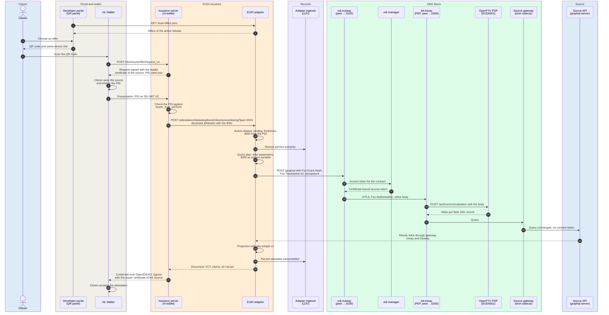
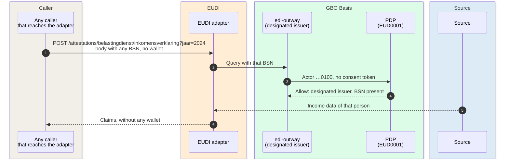

# EUDI issuance: the PuB-EAA route

A citizen scans a QR code, shares the PID from the NL Wallet, and gets an
attestation with data from an authentic source. The bronhouder is the
PuB-EAA provider. GBO operates the technical issuance facility
([ADR-0028](../decisions/0028-pubeaa-productization.md),
[PSA S11](https://ictu.github.io/GBO-PSA/main/capabilities/#s11-attesteringsuitgifte)).
The decision for this route is
[ADR-0018](../decisions/0018-eudi-disclosure-issuance.md).

One issuance in gbo-demo
[v0.9.0](https://github.com/ICTU/GBO-demo/tree/v0.9.0) has hops, data on
each hop, and error paths. The following sections give these details and do
not explain the concepts again. For the concepts, see these pages:

- The components: [Level 2: EUDI chain](../building-blocks/components.md#level-2-eudi-chain).
- The regime: [Regime selection](../concepts/authorization.md#regime-selection).
- The source description and its release:
  [Source onboarding](../concepts/source-onboarding.md).
- The certificates: [EUDI trust roles](../concepts/identity-trust.md#eudi-trust-roles).
- The BSN in this route:
  [Exception: the BSN in the EUDI and ASI routes](../concepts/pseudonymization.md#exception-the-bsn-in-the-eudi-and-asi-routes).

## Before the first QR code

The route runs only from an active source release. For each source, the
release holds these items:

- The offers.
- The GraphQL query and its parameters.
- The claims.
- The display texts.
- A reference to the certificate set.

GBO generates the issuance configuration and the Type Metadata from the
release ([REQ-64](../requirements/sources-identity.md#req-64),
[ADR-0016](../decisions/0016-source-owned-metadata.md),
[ADR-0017](../decisions/0017-gbo-simple-v1.md)). A valid FSC contract does
not activate a source ([REQ-65](../requirements/sources-identity.md#req-65)).
For that run, see [Admission and activation](admission.md). If no release
is active, no offer exists and the portal shows no QR code.

The demo has two attestation types:

| Type | Source (`source_id`) | FSC service | Rule | Offers | Subject of the data |
|---|---|---|---|---|---|
| Inkomensverklaring | `belastingdienst` | `bri` | EUD0001 | `jaar` 2024 and 2025 | The PID holder |
| Akte van overlijden | `rvig` | `brp` | EUD0002 | One, without parameters | The deceased partner of the PID holder ([related-person attestation](#related-person-attestation-akte-van-overlijden)) |

The offers come from the source documents
([BD](https://github.com/ICTU/GBO-demo/blob/v0.9.0/services/graphql-server/config/gbo-source-metadata.json),
[BRP](https://github.com/ICTU/GBO-demo/blob/v0.9.0/services/brp-graphql-server/config/gbo-source-metadata.json)).
In the default demo, both sources are on the Belastingdienst peer `…0200`
([FSC peers](../deployment.md#fsc-peers)).

## Sequence

The sequence shows the income declaration for 2024, cross-device.

## Data per hop

The table marks personal data in **bold**. The hop numbers refer to the
steps of the sequence:

| # | From → To | Endpoint | Data | Notes |
|---|---|---|---|---|
| 1 to 2 | Portal → adapter | `GET /eudi-offers.json` (through the portal proxy) | Per offer: key, label, `source_id`, `type_id`, and parameters | No personal data. The adapter serves the offers of the active release ([`source_release_runtime.go#L95-L104`](https://github.com/ICTU/GBO-demo/blob/v0.9.0/services/eudi-adapter/source_release_runtime.go#L95-L104), [`nginx.conf#L43-L49`](https://github.com/ICTU/GBO-demo/blob/v0.9.0/developer-portal/nginx.conf#L43-L49)). |
| 3 to 4 | Citizen ↔ portal | — | In: the chosen offer. Out: a universal link with `request_uri` | The portal builds the link in the browser ([`eudi.ts#L42-L51`](https://github.com/ICTU/GBO-demo/blob/v0.9.0/developer-portal/src/eudi.ts#L42-L51)). The QR code is public, so any person can scan it. This is the only initiation route in the demo. |
| 5 to 7 | Wallet ↔ issuance server | `POST /disclosure/<offer>/request_uri` | The disclosure request | The request asks for one PID claim, `bsn` ([`issuance_config.go#L162`](https://github.com/ICTU/GBO-demo/blob/v0.9.0/services/eudi-adapter/issuance_config.go#L162)). The reader certificate of the source names the issuer and the purpose ([REQ-58](../requirements/eudi-issuance.md#req-58)). |
| 8 to 10 | Wallet → issuance server | OpenID4VP | **PID** with the **BSN** | The issuance server checks the presentation against `issuer_trust_anchors` ([`issuance_server.toml.example#L3-L9`](https://github.com/ICTU/GBO-demo/blob/v0.9.0/services/eudi-adapter/config/issuance_server.toml.example#L3-L9)). That list also holds non-PID anchors ([REQ-45](../requirements/eudi-issuance.md#req-45)). The approval in the wallet is no legal basis ([F-83](../traceability/findings.md#f-83)). |
| 11 | Issuance server → adapter | `POST /attestations/{sourceID}/{typeID}?<offer parameters>` | **Disclosed attributes**, `urn:eudi:pid:nl:1` with the **BSN** | Public HTTPS (an ISRG-rooted certificate, through a tunnel). The route has no caller authentication ([`source_release_runtime.go#L69-L81`](https://github.com/ICTU/GBO-demo/blob/v0.9.0/services/eudi-adapter/source_release_runtime.go#L69-L81), [#133](https://github.com/ICTU/GBO-demo/issues/133)). For more information, see [The callback gap](#the-callback-gap). |
| 12 | Adapter (internal) | Active release | In: path and body. Out: the **BSN** | The binding of `sourceID` and `typeID` must exist in the active release. The adapter takes the BSN from the PID and does not check a signature ([`main.go#L143-L162`](https://github.com/ICTU/GBO-demo/blob/v0.9.0/services/eudi-adapter/main.go#L143-L162), [`#L23-L26`](https://github.com/ICTU/GBO-demo/blob/v0.9.0/services/eudi-adapter/main.go#L23-L26)). |
| 13 | Adapter → logbook | LDV write | Record `dataverwerking.pid-bsn-extractie` | The record names the data subject by a pseudonym that is local to the logbook. It does not hold the BSN. If the logbook does not acknowledge the record, the adapter does not call the source ([`main.go#L256-L262`](https://github.com/ICTU/GBO-demo/blob/v0.9.0/services/eudi-adapter/main.go#L256-L262), [`ldv_issuance.go#L101-L147`](https://github.com/ICTU/GBO-demo/blob/v0.9.0/services/eudi-adapter/ldv_issuance.go#L101-L147), [REQ-72](../requirements/logging-audit.md#req-72)). |
| 14 | Adapter (internal) | Query plan | In: the offer parameters and the query of the release. Out: `{query, variables: {bsn, jaar}}` | The parameters must match a published offer exactly ([`source_metadata.go#L272-L298`](https://github.com/ICTU/GBO-demo/blob/v0.9.0/services/eudi-adapter/source_metadata.go#L272-L298)). The adapter has no query or mapping of its own ([REQ-44](../requirements/authorization.md#req-44)). |
| 15 | Adapter → edi-outway | `POST {outway}/graphql` | `{query, variables}` with the **BSN**, and the headers `Fsc-Grant-Hash`, `Fsc-Transaction-Id`, and `traceparent` | The adapter checks that the source document names the contracted service ([`main.go#L466-L503`](https://github.com/ICTU/GBO-demo/blob/v0.9.0/services/eudi-adapter/main.go#L466-L503)). No `X-GBO-Scope` and no `flow`. The txlog and the trace carry the transaction ID. The ADL record behind the Inway gets its own trace and no transaction ID ([#369](https://github.com/ICTU/GBO-demo/issues/369), [REQ-55](../requirements/logging-audit.md#req-55), [ADR-0035](../decisions/0035-w3c-trace-context.md)). |
| 16 to 17 | edi-outway ↔ edi-manager | FSC access token | In: the grant hash. Out: a certificate-bound token | The Outway caches the token. The grant carries no properties. |
| 18 | edi-outway → bd-inway | FSC, mTLS | Body 1:1 with the **BSN** | Every channel goes through FSC with a valid certificate ([REQ-46](../requirements/sources-identity.md#req-46)). |
| 19 | bd-inway → PDP | `POST /authzen/v1/evaluation` | AuthZEN envelope: Outway peer `…0100`, service `bri`, and the body with the **BSN** | The Inway is the PEP. The mapper parses the GraphQL and does not call BSNk ([Regime selection](../concepts/authorization.md#regime-selection)). |
| 20 | PDP → bd-inway | AuthZEN response | Allow or deny, per field | The request has no consent token, so the PID regime applies. EUD0001 checks the designated issuer, the BSN in the root argument, and `allowed_years` ([`eud0001.rego#L45-L75`](https://github.com/ICTU/GBO-demo/blob/v0.9.0/policies/gbo/rules/eudi/eud0001.rego#L45-L75), [REQ-74](../requirements/authorization.md#req-74), [REQ-97](../requirements/authorization.md#req-97)). The PDP writes the BSN to the ADL and the console decision log ([REQ-60](../requirements/logging-audit.md#req-60)). |
| 21 to 22 | bd-inway → gateway → source | `POST /graphql` | The judged query with the **BSN** | The request has no consent token, so the gateway passes it through unchanged ([Level 2: bronhouder](../building-blocks/components.md#level-2-bronhouder)). The source logs its own processing. |
| 23 | Source → adapter | GraphQL response | **Income data** for the year | Back through the same FSC chain, 1:1. |
| 24 | Adapter (internal) | gbo-simple-v1 | In: the response at `result_pointer`. Out: flat **claims** | Exactly one result gives claims. Zero results is `no_data`. Any error gives no attestation ([REQ-116](../requirements/eudi-issuance.md#req-116)). Only scalar claims ([REQ-78](../requirements/eudi-issuance.md#req-78)). |
| 25 | Adapter → logbook | LDV write | Record `dataverwerking.attestatie-samenstellen` | The record names the number of claims without their values. It points at the logbook of the source. The adapter writes it for every outcome after the call to the source. If the logbook does not acknowledge the record, the adapter withholds the answer ([`main.go#L283-L292`](https://github.com/ICTU/GBO-demo/blob/v0.9.0/services/eudi-adapter/main.go#L283-L292)). |
| 26 | Adapter → issuance server | Response to hop 11 | `[{attestation_type: <VCT>, attributes, format: "dc+sd-jwt", id}]` with the **claims** | The VCT is the URL of the generated Type Metadata ([`main.go#L319-L334`](https://github.com/ICTU/GBO-demo/blob/v0.9.0/services/eudi-adapter/main.go#L319-L334)). |
| 27 to 28 | Issuance server → wallet | OpenID4VCI | **Attestation** (SD-JWT VC) | Signed with the issuer certificate of the source. Valid 365 days, with one status list per type ([`issuance_config.go#L166-L180`](https://github.com/ICTU/GBO-demo/blob/v0.9.0/services/eudi-adapter/issuance_config.go#L166-L180), [REQ-77](../requirements/eudi-issuance.md#req-77)). The wallet shows the issuer from the certificate. |

## Public endpoints of the adapter

The adapter serves three routes on one listener
([`source_release_runtime.go#L59-L106`](https://github.com/ICTU/GBO-demo/blob/v0.9.0/services/eudi-adapter/source_release_runtime.go#L59-L106)):

| Route | Caller | Content | When the release is not available |
|---|---|---|---|
| `GET /eudi-offers.json` | Developer portal, consumer frontends | The offer catalog | 503 for all sources, also when only one source is past its grace period |
| `GET /types/{sourceID}/{typeID}/v{version}` | Wallet, relying parties | The SD-JWT VC Type Metadata that GBO generates from the claims. Its URL is the VCT. | 503 |
| `POST /attestations/{sourceID}/{typeID}` | Issuance server | The attestation callback | 503 |

The issuance server installs the same Type Metadata bytes and computes
`vct#integrity` over them. A change to the claims or the display needs a
different `type_version`
([`type_metadata.go#L17-L40`](https://github.com/ICTU/GBO-demo/blob/v0.9.0/services/eudi-adapter/type_metadata.go#L17-L40),
[The `eudi` capability](../concepts/source-onboarding.md#the-eudi-capability-claims-once-type-metadata-generated)).

## The callback gap

The issuance server checks the PID. The adapter does not know that the
request comes from the issuance server. No mechanism binds the BSN in hop
11 to a checked disclosure ([REQ-45](../requirements/eudi-issuance.md#req-45),
[Q-18](../traceability/open-questions.md#q-18),
[#133](https://github.com/ICTU/GBO-demo/issues/133)). The demo uses this
gap itself. The developer portal has a playground that posts a typed BSN
to the adapter
([`EudiQrPanel.tsx#L36-L51`](https://github.com/ICTU/GBO-demo/blob/v0.9.0/developer-portal/src/components/EudiQrPanel.tsx#L36-L51),
[`nginx.conf#L36-L42`](https://github.com/ICTU/GBO-demo/blob/v0.9.0/developer-portal/nginx.conf#L36-L42)).

The data on each hop of this gap is as follows:

| # | Data | Notes |
|---|---|---|
| 1 | **Any BSN** | No caller authentication, and no proof of a checked disclosure. |
| 2 to 4 | **BSN** | The request has no consent token, so it enters the PID regime. The only gate of this regime is the list of designated issuers ([F-70](../traceability/findings.md#f-70), [`eudi_helper.rego#L13-L30`](https://github.com/ICTU/GBO-demo/blob/v0.9.0/policies/gbo/rules/eudi/eudi_helper.rego#L13-L30)). |
| 5 to 6 | **Income data** | The caller gets the projected claims. |

[SL-25](../traceability/increments.md#sl-25) removed the PID check from the
adapter, because the issuance server checks the PID. The issuance server
checks the signature, so the gap is in the callback. REQ-45 names two
fixes:

- The adapter checks the SD-JWT itself.
- The issuance server authenticates the callback and delivers signed
  evidence.

Both fixes need the binding of the disclosure to the request. The reference
QTSP callback on the same issuance server uses a secret path over CA-pinned
HTTPS
([`qtsp_issuance.go#L134-L152`](https://github.com/ICTU/GBO-demo/blob/v0.9.0/services/eudi-adapter/qtsp_issuance.go#L134-L152),
[ASI verification](asi-verification.md#test-statement-to-the-wallet)).

## Error paths

The consumer of the adapter is the issuance server. The issuance server
gets only the HTTP status. The details are in the adapter log (`stage`).
For a PDP deny, the details are also in the ADL.

The FSC Inway removes the reason of a deny
([`ftv-graphql-profile.md#L93-L95`](https://github.com/ICTU/GBO-demo/blob/v0.9.0/docs/ftv-graphql-profile.md#L93-L95)).
In every error path, no attestation reaches the wallet. The error paths
have these triggers and outcomes:

| Trigger | Outcome | Pinned by (v0.9.0) |
|---|---|---|
| The release is past its grace period for one source | `GET /eudi-offers.json` gives 503 for every source. The portal shows no QR code. | [`source_release_runtime.go#L95-L100`](https://github.com/ICTU/GBO-demo/blob/v0.9.0/services/eudi-adapter/source_release_runtime.go#L95-L100) |
| The adapter cannot load a release | 503 `source activations unavailable` | [`source_release_runtime.go#L70-L74`](https://github.com/ICTU/GBO-demo/blob/v0.9.0/services/eudi-adapter/source_release_runtime.go#L70-L74) |
| `sourceID` or `typeID` not in the active release | 404 | [`source_release_runtime.go#L75-L79`](https://github.com/ICTU/GBO-demo/blob/v0.9.0/services/eudi-adapter/source_release_runtime.go#L75-L79) |
| Source metadata missing, expired, or past the stale grace (15 min fresh, 1 h grace) | 503 `source metadata unavailable`, for this source only ([REQ-66](../requirements/sources-identity.md#req-66)) | [`main.go#L221-L225`](https://github.com/ICTU/GBO-demo/blob/v0.9.0/services/eudi-adapter/main.go#L221-L225), [`source_metadata_cache.go#L10-L14`](https://github.com/ICTU/GBO-demo/blob/v0.9.0/services/eudi-adapter/source_metadata_cache.go#L10-L14) |
| Body unreadable, or no disclosed attestation in it | 400 | [`main.go#L234-L246`](https://github.com/ICTU/GBO-demo/blob/v0.9.0/services/eudi-adapter/main.go#L234-L246) |
| PID without a BSN | 400 `no BSN in disclosed PID`. The adapter logs nothing and does not call the source. | [`main.go#L249-L253`](https://github.com/ICTU/GBO-demo/blob/v0.9.0/services/eudi-adapter/main.go#L249-L253), [`ldv_test.go#L402`](https://github.com/ICTU/GBO-demo/blob/v0.9.0/services/eudi-adapter/ldv_test.go#L402) |
| The logbook does not acknowledge the LDV record of hop 13 | 500. The adapter does not call the source. | [`main.go#L256-L262`](https://github.com/ICTU/GBO-demo/blob/v0.9.0/services/eudi-adapter/main.go#L256-L262), [`ldv_test.go#L354`](https://github.com/ICTU/GBO-demo/blob/v0.9.0/services/eudi-adapter/ldv_test.go#L354) |
| Offer parameters outside the published offer (for example `jaar=2023`) | 400 `invalid attestation parameters` | [`main.go#L263-L268`](https://github.com/ICTU/GBO-demo/blob/v0.9.0/services/eudi-adapter/main.go#L263-L268), [`main_test.go#L434`](https://github.com/ICTU/GBO-demo/blob/v0.9.0/services/eudi-adapter/main_test.go#L434) |
| PDP deny: the caller is not a designated issuer | `ACTOR_NOT_ALLOWED` in the ADL. The adapter answers 502. | [`eud0001_test.rego#L65`](https://github.com/ICTU/GBO-demo/blob/v0.9.0/policies/gbo/rules/eudi/eud0001_test.rego#L65), [`eud0002_test.rego#L36`](https://github.com/ICTU/GBO-demo/blob/v0.9.0/policies/gbo/rules/eudi/eud0002_test.rego#L36) |
| PDP deny: no BSN, or a placeholder, in the root argument | `PID_NOT_PRESENT`. The adapter answers 502. | [`eud0001_test.rego#L71-L80`](https://github.com/ICTU/GBO-demo/blob/v0.9.0/policies/gbo/rules/eudi/eud0001_test.rego#L71-L80), [`eud0002_test.rego#L42`](https://github.com/ICTU/GBO-demo/blob/v0.9.0/policies/gbo/rules/eudi/eud0002_test.rego#L42) |
| PDP deny: the request carries a consent token | `PID_NOT_PRESENT`. The adapter answers 502. | [`eud0001_test.rego#L83`](https://github.com/ICTU/GBO-demo/blob/v0.9.0/policies/gbo/rules/eudi/eud0001_test.rego#L83) |
| PDP deny: a year outside `allowed_years`, or no year filter | `YEAR_NOT_ALLOWED`. The adapter answers 502. | [`eud0001_test.rego#L39-L58`](https://github.com/ICTU/GBO-demo/blob/v0.9.0/policies/gbo/rules/eudi/eud0001_test.rego#L39-L58) |
| PDP deny: a field outside the rule (closed world) | `FIELD_NOT_PERMITTED` or `NO_APPLICABLE_RULE`. The adapter answers 502. | [`engine.rego#L282`](https://github.com/ICTU/GBO-demo/blob/v0.9.0/policies/gbo/engine.rego#L282), [Rule model](../concepts/authorization.md#rule-model) |
| Chain unreachable, non-200 answer, or GraphQL errors | 502 `source request failed`. The adapter does not pass on the upstream body. The assembly record has status ERROR. | [`main.go#L294-L300`](https://github.com/ICTU/GBO-demo/blob/v0.9.0/services/eudi-adapter/main.go#L294-L300), [`main_test.go#L444`](https://github.com/ICTU/GBO-demo/blob/v0.9.0/services/eudi-adapter/main_test.go#L444), [`ldv_test.go#L267`](https://github.com/ICTU/GBO-demo/blob/v0.9.0/services/eudi-adapter/ldv_test.go#L267) |
| Result does not fit the claims: `GBO_SIMPLE_PATH_MISSING`, `GBO_SIMPLE_TYPE_MISMATCH`, `GBO_SIMPLE_RESULT_TYPE` | 502 `source response could not be projected`. No partial attestation. The code is only in the adapter log. | [`main.go#L302-L308`](https://github.com/ICTU/GBO-demo/blob/v0.9.0/services/eudi-adapter/main.go#L302-L308), [`profile.go#L33-L37`](https://github.com/ICTU/GBO-demo/blob/v0.9.0/services/eudi-adapter/internal/gbosimplev1/profile.go#L33-L37), [`cases.json#L96-L125`](https://github.com/ICTU/GBO-demo/blob/v0.9.0/services/eudi-adapter/internal/gbosimplev1/testdata/cases.json#L96-L125) |
| More than one result | 502 with `GBO_SIMPLE_RESULT_AMBIGUOUS` | [`cases.json#L89-L93`](https://github.com/ICTU/GBO-demo/blob/v0.9.0/services/eudi-adapter/internal/gbosimplev1/testdata/cases.json#L89-L93) |
| No result (`no_data`) | 404 `source has no data for this subject and parameters`. The adapter still writes the assembly record, with zero claims. | [`main.go#L310-L315`](https://github.com/ICTU/GBO-demo/blob/v0.9.0/services/eudi-adapter/main.go#L310-L315), [`cases.json#L82-L86`](https://github.com/ICTU/GBO-demo/blob/v0.9.0/services/eudi-adapter/internal/gbosimplev1/testdata/cases.json#L82-L86), [`ldv_test.go#L505`](https://github.com/ICTU/GBO-demo/blob/v0.9.0/services/eudi-adapter/ldv_test.go#L505) |
| The logbook does not acknowledge the LDV record of hop 25 | 500. The adapter withholds the attestation. | [`main.go#L284-L292`](https://github.com/ICTU/GBO-demo/blob/v0.9.0/services/eudi-adapter/main.go#L284-L292) |
| Missing or incomplete certificate set of a source | The issuance facility blocks the source (`CERTIFICATE_SET_NOT_FOUND`, `CERTIFICATE_SET_INVALID`). Other sources continue to work. | [REQ-58](../requirements/eudi-issuance.md#req-58), [A certificate set per source](../concepts/source-onboarding.md#a-certificate-set-per-source) |
| A caller posts a body with any BSN directly to the adapter | Allowed in demo v0.9.0. The source answers, and the caller gets the claims. | Not built: [#133](https://github.com/ICTU/GBO-demo/issues/133), [REQ-45](../requirements/eudi-issuance.md#req-45) |

## Related-person attestation: akte van overlijden

The akte van overlijden holds data about the deceased partner of the
citizen who shares the PID. The subject of the claims differs from the
person who discloses the PID ([F-47](../traceability/findings.md#f-47),
[REQ-57](../requirements/eudi-issuance.md#req-57),
[SL-43](../traceability/increments.md#sl-43)). The run is the same as the
run in the preceding sections, with these differences per hop:

| # | Difference |
|---|---|
| 11 | `POST /attestations/rvig/akte-van-overlijden`, without parameters. |
| 14 to 15 | The query is `akteVanOverlijden(bsn: $bsn)` with the BSN of the PID holder, on service `brp`. |
| 19 to 20 | EUD0002 decides. It grants a closed list of output fields and checks the BSN in the root argument. It has no year check ([`eud0002.rego#L20-L66`](https://github.com/ICTU/GBO-demo/blob/v0.9.0/policies/gbo/rules/eudi/eud0002.rego#L20-L66)). |
| 21 to 22 | The gateway is `brp-sidecar`, and the source is `brp-graphql-server`. |
| 22 to 23 | The source resolves the relation itself. It selects the marriage that ended by the death of the partner. If the partner died on a different date than the dissolution, the source returns nothing. Then the adapter answers 404 ([`main_test.go#L183`](https://github.com/ICTU/GBO-demo/blob/v0.9.0/services/brp-graphql-server/main_test.go#L183)). |
| 25 | The deceased is not a data subject under the GDPR. The source logs the requester and the living parents ([AV-10](../requirements/admission.md#av-10)). |

The PDP sees only the flat output of the source view. It does not see the
relation. The relation depends on the source and on the subject from the
PID. Because of the callback gap, a caller can ask for the akte for any
BSN.

The preferred design puts the relation in filter arguments of the
published schema. The policy then requires these arguments with fixed
values ([#425](https://github.com/ICTU/GBO-demo/issues/425),
[Q-14](../traceability/open-questions.md#q-14)). In demo v0.9.0, the source
description does not mark the relation.

## Observations

The run of an issuance in demo v0.9.0 shows these facts:

- The regime follows from the evidence. A request without a consent token
  goes into the PID regime. That regime has no positive evidence of its
  own. Its only gate is the list of designated issuers. This list must stay
  disjoint from the consent consumers
  ([REQ-74](../requirements/authorization.md#req-74),
  [F-70](../traceability/findings.md#f-70),
  [ADR-0031](../decisions/0031-regime-from-evidence.md)). A test pins the
  disjointness only for the seeded consumers
  ([`engine_test.rego#L366-L376`](https://github.com/ICTU/GBO-demo/blob/v0.9.0/policies/gbo/engine_test.rego#L366-L376)).
- The PID check and the source query have no link. The issuance server
  checks the PID. The adapter callback has no authentication
  ([REQ-45](../requirements/eudi-issuance.md#req-45),
  [Q-18](../traceability/open-questions.md#q-18)). The PID trust list also
  trusts the GBO development CA and the issuer CA of every source.
- The BSN is in the decision logs. The adapter puts the plain BSN in the
  query variables. As a result, the BSN is in the PDP input, the ADL, and
  the console decision log
  ([REQ-60](../requirements/logging-audit.md#req-60),
  [F-54](../traceability/findings.md#f-54),
  [ADR-0043](../decisions/0043-identifiers-out-of-pdp-input.md),
  [#368](https://github.com/ICTU/GBO-demo/issues/368)). The LDV records
  of the adapter hold no BSN.
- The offer and the policy are independent limits. The source offers 2024
  and 2025. EUD0001 allows 2024 and 2025. A request for 2023 fails at the
  adapter (no offer). The PDP also denies it (`YEAR_NOT_ALLOWED`).
  Publication by a source does not authorize the published data
  ([F-74](../traceability/findings.md#f-74)).
- The adapter holds no knowledge of a source. The query, the parameters,
  the claims, the display, and the Type Metadata come from the release
  ([REQ-64](../requirements/sources-identity.md#req-64),
  [F-57](../traceability/findings.md#f-57)). The source decides through its
  own PDP ([REQ-44](../requirements/authorization.md#req-44)).
- No partial attestation exists. Any projection error gives 502 and no
  attestation ([REQ-116](../requirements/eudi-issuance.md#req-116)). The
  issuance server sees no reason code.
- The validity is fixed. Every source attestation is valid 365 days. GBO
  has no change feed from the source. As a result, GBO cannot revoke an
  attestation when the source data changes
  ([REQ-77](../requirements/eudi-issuance.md#req-77),
  [F-82](../traceability/findings.md#f-82)).
- Correlation works, with one gap. The adapter sends one
  `Fsc-Transaction-Id` and a `traceparent`. The txlog, the LDV records of
  the adapter and the source, and the trace share them. The ADL record
  behind the Inway has its own trace and no transaction ID
  ([#369](https://github.com/ICTU/GBO-demo/issues/369))
  ([REQ-55](../requirements/logging-audit.md#req-55),
  [Reading a chain](../concepts/logging.md#reading-a-chain)).

## Not built in demo v0.9.0

Demo v0.9.0 does not have these items:

- An authenticated callback, and the binding of the disclosure to the
  source query
  ([#133](https://github.com/ICTU/GBO-demo/issues/133),
  [REQ-45](../requirements/eudi-issuance.md#req-45)).
- A PID trust list with PID-provider anchors only.
- The BSN out of the PDP input
  ([#368](https://github.com/ICTU/GBO-demo/issues/368),
  [ADR-0043](../decisions/0043-identifiers-out-of-pdp-input.md), proposed).
- Validity and revocation per type, set by the bronhouder, with revocation
  on instruction or on a change in the source
  ([REQ-77](../requirements/eudi-issuance.md#req-77),
  [AV-12](../requirements/admission.md#av-12),
  [AV-13](../requirements/admission.md#av-13)).
- Nested claims ([REQ-78](../requirements/eudi-issuance.md#req-78)), and
  traceability of the mapping version per attestation
  ([REQ-124](../requirements/eudi-issuance.md#req-124)).
- The relation as filter arguments, and its marking in the source
  description ([#425](https://github.com/ICTU/GBO-demo/issues/425),
  [REQ-57](../requirements/eudi-issuance.md#req-57)).
- The regulatory frame for PuB-EAA issuance
  ([F-81](../traceability/findings.md#f-81),
  [Q-28](../traceability/open-questions.md#q-28)). This frame has these
  parts:
    - Designation.
    - A registration certificate.
    - A qualified seal in a QSCD.
    - Conformity with ETSI TS 119 471 and TS 119 472-3.

    The trust list for PuB-EAA providers is open
    ([Q-30](../traceability/open-questions.md#q-30)). Key custody is open
    ([Q-17](../traceability/open-questions.md#q-17)).

- A second initiation route next to the QR code in the developer portal.
- Cross-route items from the ASI work
  ([ASI verification](asi-verification.md)):
    - The BRP document also publishes the `asi` capability. An error in
      `asi` refuses the whole source, and this includes its EUDI issuance
      ([#592](https://github.com/ICTU/GBO-demo/issues/592),
      [`source-onboarding.md#L400-L401`](https://github.com/ICTU/GBO-demo/blob/v0.9.0/docs/source-onboarding.md#L400-L401)).
    - The issuance server also issues the test statement of the reference
      QTSP. That use case runs only in the local stack. A deployment in
      the simulation environment is
      [#594](https://github.com/ICTU/GBO-demo/issues/594).
    - [#595](https://github.com/ICTU/GBO-demo/issues/595) (BSN in the ASI
      token) and [#596](https://github.com/ICTU/GBO-demo/issues/596)
      (same-device wallet login on a phone) concern only the ASI route.

## Traceability

- Requirements: [REQ-44](../requirements/authorization.md#req-44),
  [REQ-45](../requirements/eudi-issuance.md#req-45),
  [REQ-46](../requirements/sources-identity.md#req-46),
  [REQ-55](../requirements/logging-audit.md#req-55),
  [REQ-57](../requirements/eudi-issuance.md#req-57),
  [REQ-58](../requirements/eudi-issuance.md#req-58),
  [REQ-60](../requirements/logging-audit.md#req-60),
  [REQ-64](../requirements/sources-identity.md#req-64),
  [REQ-65](../requirements/sources-identity.md#req-65),
  [REQ-66](../requirements/sources-identity.md#req-66),
  [REQ-72](../requirements/logging-audit.md#req-72),
  [REQ-74](../requirements/authorization.md#req-74),
  [REQ-77](../requirements/eudi-issuance.md#req-77),
  [REQ-78](../requirements/eudi-issuance.md#req-78),
  [REQ-97](../requirements/authorization.md#req-97),
  [REQ-116](../requirements/eudi-issuance.md#req-116),
  [REQ-124](../requirements/eudi-issuance.md#req-124),
  [AV-10](../requirements/admission.md#av-10),
  [AV-12](../requirements/admission.md#av-12),
  [AV-13](../requirements/admission.md#av-13)
- Findings: [F-47](../traceability/findings.md#f-47) (open),
  [F-54](../traceability/findings.md#f-54) (open),
  [F-57](../traceability/findings.md#f-57) (open),
  [F-70](../traceability/findings.md#f-70) (open),
  [F-74](../traceability/findings.md#f-74) (open),
  [F-81](../traceability/findings.md#f-81) (open),
  [F-82](../traceability/findings.md#f-82) (open),
  [F-83](../traceability/findings.md#f-83) (open)
- Open questions: [Q-14](../traceability/open-questions.md#q-14),
  [Q-17](../traceability/open-questions.md#q-17),
  [Q-18](../traceability/open-questions.md#q-18),
  [Q-28](../traceability/open-questions.md#q-28),
  [Q-30](../traceability/open-questions.md#q-30)
- Demo increments: [SL-19](../traceability/increments.md#sl-19),
  [SL-25](../traceability/increments.md#sl-25),
  [SL-26](../traceability/increments.md#sl-26),
  [SL-31](../traceability/increments.md#sl-31),
  [SL-33](../traceability/increments.md#sl-33),
  [SL-39](../traceability/increments.md#sl-39),
  [SL-40](../traceability/increments.md#sl-40),
  [SL-43](../traceability/increments.md#sl-43),
  [SL-46](../traceability/increments.md#sl-46),
  [SL-48](../traceability/increments.md#sl-48),
  [SL-49](../traceability/increments.md#sl-49)
