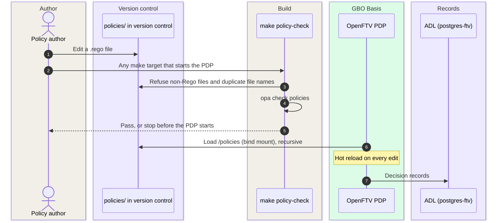
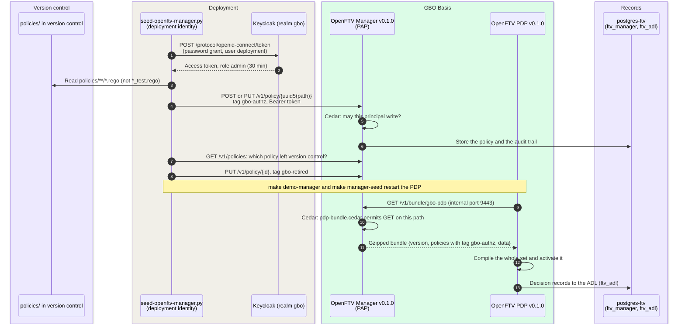

# Policy distribution

Policy distribution is a management-plane scenario. Policy travels in
this scenario, and no citizen data travels. The management plane decides
who changes the rules. The decision plane decides who gets which data. The
two planes are separate ([F-51](../traceability/findings.md#f-51)).

The scenario takes place at the source holder (bronhouder). The PDP is behind the FSC
Inway of the source holder, and the OpenFTV Manager serves exactly that
PDP. Policy management stays with each source holder
([Q-21](../traceability/answered-questions.md#q-21),
[ADR-0021](../decisions/0021-central-pap-signed-bundles.md)). In the demo,
everything runs in one compose stack. This setup is a demo artifact and
makes no statement about the architecture.

For the concept, see [Policy lifecycle](../concepts/policy-lifecycle.md).

Two components have the name Manager. The OpenFTV Manager manages policy
(PAP). The FSC Manager manages contracts and issues access tokens. This
page covers only the OpenFTV Manager.

## Two modes

The PDP gets its policy in one of two modes:

| Mode | Where the PDP gets its policy | Started by |
|---|---|---|
| Mount (default) | The PDP image carries `policies/` ([`Dockerfile#L62-L67`](https://github.com/ICTU/GBO-demo/blob/v0.9.0/services/openftv-pdp/Dockerfile#L62-L67)). Compose bind-mounts `./policies` over that copy ([`docker-compose.yml#L157`](https://github.com/ICTU/GBO-demo/blob/v0.9.0/docker-compose.yml#L157)). The PDP hot-reloads at each edit | every `make demo*` target |
| Bundle (opt-in) | The PDP pulls bundle `gbo-pdp` from the OpenFTV Manager at start, because `PDP_BUNDLE_MANAGER` is set ([`docker-compose.yml#L145-L149`](https://github.com/ICTU/GBO-demo/blob/v0.9.0/docker-compose.yml#L145-L149)) | `make demo-manager`, then `make manager-seed` after each change ([`Makefile#L151-L177`](https://github.com/ICTU/GBO-demo/blob/v0.9.0/Makefile#L151-L177)) |

The demo runs OpenFTV release v0.1.0. The PDP builds from the tag with
the FTV GraphQL mapper patched in. The Manager and its management
interface are the published v0.1.0 images
([`docker-compose.yml#L245`](https://github.com/ICTU/GBO-demo/blob/v0.9.0/docker-compose.yml#L245)).
If the three versions differ, or if the version is not a release tag, CI
fails
([`ci.yml#L355-L373`](https://github.com/ICTU/GBO-demo/blob/v0.9.0/.github/workflows/ci.yml#L355-L373)).

## Scenario 1: mount mode (default) {#mount-mode}

Each hop in mount mode carries the following data:

| # | From → to | Data | Notes |
|---|---|---|---|
| 1 | Author → version control | Rego source with tests next to the rules | Version control is the source of the content |
| 2 to 5 | `make` → `policies/` | File list, compile result | `policy-check` runs before every target that starts the PDP ([`Makefile#L92-L106`](https://github.com/ICTU/GBO-demo/blob/v0.9.0/Makefile#L92-L106)). `make policy-test` adds `opa fmt --diff` and `opa test` ([`#L115-L117`](https://github.com/ICTU/GBO-demo/blob/v0.9.0/Makefile#L115-L117)) |
| 6 to 7 | PDP → mount | Every file under `/policies` as a Rego module (`PDP_POLICIES_LANGUAGE=rego`, `PDP_POLICIES_STORE_RECURSE=true`) | The reload log line `policy added/replaced` does not prove that the new rules decide ([#151](https://github.com/ICTU/GBO-demo/issues/151)) |
| 8 | PDP → ADL | Decision records | The PDP does not start without the ADL database ([`docker-compose.yml#L117-L125`](https://github.com/ICTU/GBO-demo/blob/v0.9.0/docker-compose.yml#L117-L125)) |

## Scenario 2: bundle mode (OpenFTV Manager) {#bundle-mode}

### Data per hop

Each hop in bundle mode carries the following data:

| # | From → to | Interface | Data | Notes |
|---|---|---|---|---|
| 1 to 2 | Seed → Keycloak | `POST /realms/gbo/protocol/openid-connect/token` ([`seed-openftv-manager.py#L83-L113`](https://github.com/ICTU/GBO-demo/blob/v0.9.0/scripts/seed-openftv-manager.py#L83-L113)) | Client `openftv-manager-ui`, user `deployment`, password from `FTV_MANAGER_DEPLOY_PASSWORD` | Publishing token: non-personal deployment identity, role `admin`, token lifespan 1800 s, and no long-lived API key ([RL-03](../requirements/authorization.md#rl-03)) |
| 3 | Seed → version control | File system | `policies/**/*.rego` without tests, repo-relative path | Version control is canonical for the content. The Manager is the distribution mechanism ([RL-01](../requirements/authorization.md#rl-01)) |
| 4 to 6 | Seed → Manager → Postgres | `POST /v1/policy/{id}`, on conflict `PUT` ([`#L171-L211`](https://github.com/ICTU/GBO-demo/blob/v0.9.0/scripts/seed-openftv-manager.py#L171-L211)) | Rego source, title, tag `gbo-authz` | `id` is uuid5 of the repo-relative path, so a new run updates the policy instead of making a duplicate. The Manager has no file store: policy enters only through the API, the same path as the management interface |
| 7 to 8 | Seed → Manager | `GET /v1/policies`, then `PUT /v1/policy/{id}` ([`#L116-L168`](https://github.com/ICTU/GBO-demo/blob/v0.9.0/scripts/seed-openftv-manager.py#L116-L168)) | Policies with `gbo-authz` that are not in version control get tag `gbo-retired` and title prefix `RETIRED` | Reconciliation ([RL-04](../requirements/authorization.md#rl-04)). `DELETE` fails upstream on a foreign key to the audit trail, so the script retires policies and never deletes them |
| 9 to 11 | PDP → Manager | `GET /v1/bundle/gbo-pdp` on the internal port ([`gbo-pdp.yaml`](https://github.com/ICTU/GBO-demo/blob/v0.9.0/services/openftv-manager/bundles/gbo-pdp.yaml)) | Gzipped bundle: `version`, the policies with tag `gbo-authz`, design-time data | The PDP pulls the bundle. The Manager has no push targets (`targets: []`). The PDP presents no identity. [`pdp-bundle.cedar`](https://github.com/ICTU/GBO-demo/blob/v0.9.0/services/openftv-manager/authz/pdp-bundle.cedar#L13-L17) permits only `can_read` on this one path ([RL-02](../requirements/authorization.md#rl-02)) |
| 12 | PDP | — | The active policy set | The PDP compiles the set as a whole. If one package is duplicated, every request fails ([F-52](../traceability/findings.md#f-52), [RL-05](../requirements/authorization.md#rl-05)) |
| 13 | PDP → Postgres | ADL | Decision records for data requests and contract proposals | The ADL is the authoritative record ([ADR-0036](../decisions/0036-adl-decision-record.md)). The ADL records no policy version ([REQ-59](../requirements/logging-audit.md#req-59)). The ADL can hold OINs. In the EUDI and ASI routes, it can also hold the BSN ([REQ-60](../requirements/logging-audit.md#req-60)) |

### Components and ports

The Ports column gives each port as host:container. The host ports are
the compose defaults. Policy distribution uses the following components:

| Component | Ports | Role |
|---|---|---|
| `openftv-manager` | `9280:8443` management API · `9281:9443` internal (bundle) · `9282:8080` health | PAP. The Manager stores policy and builds bundles. Cedar policies from `/authz` authorize its own API ([`admin.cedar`](https://github.com/ICTU/GBO-demo/blob/v0.9.0/services/openftv-manager/authz/admin.cedar), [`auditor.cedar`](https://github.com/ICTU/GBO-demo/blob/v0.9.0/services/openftv-manager/authz/auditor.cedar), `pdp-bundle.cedar`). The Manager fails closed on an empty store ([`docker-compose.yml#L266-L269`](https://github.com/ICTU/GBO-demo/blob/v0.9.0/docker-compose.yml#L266-L269)) |
| `openftv-manager-ui` | `9283:8080` | Management interface: policies, deployments, and Logboek (ADL) |
| `keycloak` | `9284:8080` | Demo identity provider of the management plane. Realm `gbo` with roles `admin`, `author`, and `auditor`. The Manager reads the roles from the `roles` claim (`MANAGER_OIDC_ROLES_CLAIM`) |
| `postgres-ftv` | internal | Two databases: `ftv_manager` (policy and audit trail) and `ftv_adl` (decision log). They are separate because their migration bookkeeping conflicts. The component runs in every profile |
| `openftv-pdp` | `9181:8443` AuthZEN · `9180:8080` health | Decides. The PDP gets its policy set from the mount. If `PDP_BUNDLE_MANAGER` is set, the PDP gets the set as a bundle |

Only the Manager, its interface, and Keycloak are opt-in (profile
`manager`).

## Failures

Each fault in the following table has an effect and a guard in v0.9.0:

| Fault | Effect | Guard in v0.9.0 | Evidence |
|---|---|---|---|
| A non-Rego file under `policies/` | The loader reads every file as Rego. A file that does not parse drops every policy after it in walk order. The paths of those policies answer HTTP 500 | `make policy-check`, CI step | [`Makefile#L93-L98`](https://github.com/ICTU/GBO-demo/blob/v0.9.0/Makefile#L93-L98), [`ci.yml#L143-L154`](https://github.com/ICTU/GBO-demo/blob/v0.9.0/.github/workflows/ci.yml#L143-L154) |
| The same file name twice | The loader keys policies by file name, so the second file replaces the first. Every decision fails, while `opa test` passes | `make policy-check`, CI step | [`Makefile#L99-L104`](https://github.com/ICTU/GBO-demo/blob/v0.9.0/Makefile#L99-L104), [`ci.yml#L155-L162`](https://github.com/ICTU/GBO-demo/blob/v0.9.0/.github/workflows/ci.yml#L155-L162) |
| A module that does not compile, at hot reload | The PDP reports the module as loaded. The previous rules keep deciding | `opa check` before start. No runtime signal: a visible fallback is not built in demo v0.9.0 ([RL-05](../requirements/authorization.md#rl-05)) | [#151](https://github.com/ICTU/GBO-demo/issues/151), [`docker-compose.yml#L234-L238`](https://github.com/ICTU/GBO-demo/blob/v0.9.0/docker-compose.yml#L234-L238) |
| A policy renamed or removed in version control (bundle mode) | The store is cumulative: the old policy stays in the bundle. A duplicate package breaks the whole set, and every request gets HTTP 500 instead of a deny | `retire_stale` at every seed. A failed retirement fails the seed | [`seed-openftv-manager.py#L116-L168`](https://github.com/ICTU/GBO-demo/blob/v0.9.0/scripts/seed-openftv-manager.py#L116-L168), [`test_seed_openftv_manager.py#L63`](https://github.com/ICTU/GBO-demo/blob/v0.9.0/scripts/test_seed_openftv_manager.py#L63) |
| Delete a policy | The delete fails upstream on a foreign key to the audit trail | Retire (tag `gbo-retired`) | [`#L119-L123`](https://github.com/ICTU/GBO-demo/blob/v0.9.0/scripts/seed-openftv-manager.py#L119-L123) |
| Push a bundle from the Manager | The PDP authorizes its own management endpoints with the decision policy. That policy denies every request that is not a data request, with HTTP 403 ([F-51](../traceability/findings.md#f-51)) | No push targets. The PDP pulls at start. The make targets restart the PDP after a seed | [`gbo-pdp.yaml#L18-L32`](https://github.com/ICTU/GBO-demo/blob/v0.9.0/services/openftv-manager/bundles/gbo-pdp.yaml#L18-L32), [`Makefile#L164-L165`](https://github.com/ICTU/GBO-demo/blob/v0.9.0/Makefile#L164-L165) |
| Bundle pull without a Cedar permit | Since v0.1.0, the bundle endpoint uses the same authorizer as the API. Cedar denies by default. Every pull gets HTTP 403, and the PDP gets no bundle | `pdp-bundle.cedar` | [`pdp-bundle.cedar`](https://github.com/ICTU/GBO-demo/blob/v0.9.0/services/openftv-manager/authz/pdp-bundle.cedar), [CHANGELOG](https://github.com/ICTU/GBO-demo/blob/v0.9.0/CHANGELOG.md#L737-L742) |
| A changed Cedar file on an existing volume | The Manager seeds `/authz` only into an empty store, then treats the store as the truth. The change does not arrive | Add the policy through the API, or recreate the volume | [CHANGELOG](https://github.com/ICTU/GBO-demo/blob/v0.9.0/CHANGELOG.md#L743-L747) |
| `MANAGER_POLICIES_LANGUAGE=rego` | Then the GBO `package authz` governs the Manager API. From the next restart, the API answers HTTP 403 | Not set. The compose file explains why | [`docker-compose.yml#L254-L263`](https://github.com/ICTU/GBO-demo/blob/v0.9.0/docker-compose.yml#L254-L263) |
| `PDP_POLICIES_LANGUAGE=OPA` (the documented value) | OpenFTV skips every policy file without a signal | Set to `rego` | [`docker-compose.yml#L106-L114`](https://github.com/ICTU/GBO-demo/blob/v0.9.0/docker-compose.yml#L106-L114) |
| No deployment password, or the token request fails | The seed stops. The Manager does not change | Required variable | [`seed-openftv-manager.py#L236-L250`](https://github.com/ICTU/GBO-demo/blob/v0.9.0/scripts/seed-openftv-manager.py#L236-L250), [`test_seed_openftv_manager.py#L44`](https://github.com/ICTU/GBO-demo/blob/v0.9.0/scripts/test_seed_openftv_manager.py#L44) |
| PDP, Manager, and interface on different OpenFTV versions | The bundle format and the API differ | CI check | [`ci.yml#L355-L373`](https://github.com/ICTU/GBO-demo/blob/v0.9.0/.github/workflows/ci.yml#L355-L373) |
| The contract policy package is renamed | The FSC Manager finds no policy. Every contract stays pending, without a signal | None (comment only) | [`autosign.rego#L8-L10`](https://github.com/ICTU/GBO-demo/blob/v0.9.0/policies/fsc/autosign.rego#L8-L10) |
| The ADL database is missing | The PDP exits at start | `postgres-ftv` in every profile | [`docker-compose.yml#L117-L125`](https://github.com/ICTU/GBO-demo/blob/v0.9.0/docker-compose.yml#L117-L125) |

## Main observations

Policy distribution in gbo-demo v0.9.0 has these properties and gaps:

- **Two planes, two policy sets.** Cedar policies authorize the Manager
  API. These policies are separate from the Rego decision policy. On the
  PDP side, this separation is missing. The PDP guards its own management
  endpoints with the decision policy. As a result, push works only if that
  policy opens up. The demo pulls instead
  ([F-51](../traceability/findings.md#f-51),
  [RL-02](../requirements/authorization.md#rl-02)).
- **Write and publish are not separate.** The realm defines `author`, but
  no Cedar policy in v0.9.0 grants it an action. Only `admin` writes and
  publishes. The deployment identity is that non-personal `admin`
  ([RL-03](../requirements/authorization.md#rl-03)).
- **Version control is canonical.** The PAP distributes the policy.
  Manual API changes are possible. As a result, reconciliation at every
  publication is the only guard against drift
  ([RL-04](../requirements/authorization.md#rl-04)).
- **The policy set fails as a whole.** The policy set is one availability
  object. If one rule is faulty, the whole set fails, and every request
  gets HTTP 500 instead of a deny. Since
  [SL-45](../traceability/increments.md#sl-45), the same set also holds
  the contract policy (`policies/fsc/`). As a result, one broken module
  stops the data exchange and also the admission of new participants
  ([F-52](../traceability/findings.md#f-52),
  [REQ-62](../requirements/admission.md#req-62)).
- **No signing, by decision.** The bundle has an ID and a version, but no
  signature. A bundle gets a signature only when it crosses an
  organization boundary. Inside one organization, signing is not planned
  ([#426](https://github.com/ICTU/GBO-demo/issues/426), closed as not
  planned, [F-09](../traceability/findings-closed.md#f-09),
  [ADR-0021](../decisions/0021-central-pap-signed-bundles.md)).
- **Source metadata has a fuller lifecycle.** Source releases get
  validation before activation, atomic promotion of immutable releases,
  and rollback ([REQ-66](../requirements/sources-identity.md#req-66),
  [Source activation](admission.md#source-activation)). The policy bundle
  has none of these steps. For this reason, RL-05 is a backlog item and
  more than a wish ([F-59](../traceability/findings-closed.md#f-59)).
- **Read access to the ADL is open.** Read access to the decision log is
  an authorization question. The `auditor` role reads the Logboek through
  the management interface. The ADL can hold OINs, and in the EUDI and ASI
  routes also the BSN. It is open who can read the ADL
  ([Q-08](../traceability/open-questions.md#q-08),
  [F-53](../traceability/findings-closed.md#f-53)).

## Traceability

- Requirements: [RL-01](../requirements/authorization.md#rl-01), [RL-02](../requirements/authorization.md#rl-02), [RL-03](../requirements/authorization.md#rl-03), [RL-04](../requirements/authorization.md#rl-04), [RL-05](../requirements/authorization.md#rl-05), [REQ-59](../requirements/logging-audit.md#req-59), [REQ-60](../requirements/logging-audit.md#req-60), [REQ-62](../requirements/admission.md#req-62), [REQ-66](../requirements/sources-identity.md#req-66)
- Findings: [F-09](../traceability/findings-closed.md#f-09) (open), [F-51](../traceability/findings.md#f-51) (open), [F-52](../traceability/findings.md#f-52) (open), [F-53](../traceability/findings-closed.md#f-53) (resolved in demo), [F-59](../traceability/findings-closed.md#f-59) (closed)
- Open questions: [Q-21](../traceability/answered-questions.md#q-21) (answered), [Q-02](../traceability/answered-questions.md#q-02) (answered), [Q-08](../traceability/open-questions.md#q-08) (open)
- Demo increments: [SL-44](../traceability/increments.md#sl-44) (done), [SL-45](../traceability/increments.md#sl-45) (done)
